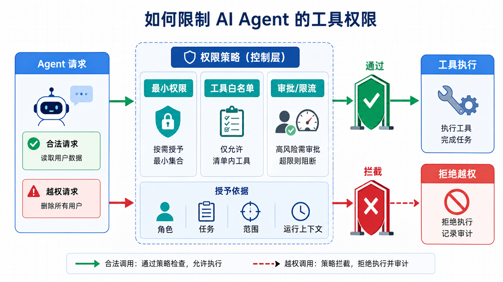

## 知识点讲解



### 1. 核心概念

工具是 Agent 能力的延伸，也是攻击面的延伸。工具权限控制要回答一个问题：**这个 Agent 在这次任务里，到底需要哪些工具，能做什么，不能做什么？**

权限控制的维度有三个：

- **工具可见性**：Agent 能不能看到这个工具（看不到就调不了）
- **调用权限**：能看到这个工具，但允不允许调用
- **参数范围**：能调用这个工具，但参数范围有没有限制

很多系统只做了第一层（工具可见性），后两层缺失，导致 Agent 被注入后能通过可见工具做出超出预期的操作。

### 2. 技术细节

#### 2.1 工具权限的粒度设计

| 粒度 | 示例 | 适用场景 |
| --- | --- | --- |
| 工具级 | 允许调用 `search`，不允许调用 `delete` | 大多数场景 |
| 操作级 | 允许 `file_ops(read)`，不允许 `file_ops(write)` | 同一工具需要细粒度控制 |
| 参数级 | 允许 `query_db(table="logs")`，不允许 `query_db(table="users")` | 高安全要求场景 |
| 时间级 | 工作时间内允许，休息时间禁止 | 时间敏感操作 |

#### 2.2 工具调用的风险分级

不同工具的危险程度差别很大，要分级控制：

| 风险级别 | 工具类型 | 控制策略 |
| --- | --- | --- |
| 低 | 只读查询（搜索、数据库读） | 直接允许，记日志 |
| 中 | 创建/修改操作（写入、发通知） | 参数校验后执行，记审计日志 |
| 高 | 删除操作、外部系统写入 | 二次确认，人工审批 |
| 极高 | 批量操作、金融交易、生产配置修改 | 强制人工审批，多重签名 |

#### 2.3 工具权限注册机制

```python
from typing import Set, List, Callable, Dict, Any, Optional
from dataclasses import dataclass
from enum import Enum
import functools

class RiskLevel(Enum):
    LOW = 1
    MEDIUM = 2
    HIGH = 3
    CRITICAL = 4

@dataclass
class ToolSpec:
    name: str
    func: Callable
    description: str
    risk_level: RiskLevel
    requires_approval: bool = False
    allowed_params: Optional[Dict[str, Any]] = None  # None 表示不限制

class ToolRegistry:
    """工具注册表：统一管理工具的权限配置"""
    
    def __init__(self):
        self._tools: Dict[str, ToolSpec] = {}
        self._agent_allowlist: Dict[str, Set[str]] = {}  # agent_id -> 允许的工具集
    
    def register(self, spec: ToolSpec):
        self._tools[spec.name] = spec
    
    def grant_tool(self, agent_id: str, tool_name: str):
        """给特定 Agent 授权某个工具"""
        if tool_name not in self._tools:
            raise ValueError(f"Tool {tool_name} not registered")
        if agent_id not in self._agent_allowlist:
            self._agent_allowlist[agent_id] = set()
        self._agent_allowlist[agent_id].add(tool_name)
    
    def get_visible_tools(self, agent_id: str) -> List[ToolSpec]:
        """Agent 只能看到被授权的工具，看不到的连描述都不暴露"""
        allowed = self._agent_allowlist.get(agent_id, set())
        return [spec for name, spec in self._tools.items() if name in allowed]
    
    def execute_tool(self, agent_id: str, tool_name: str, 
                     params: Dict[str, Any], approval_token: str = None) -> Any:
        """执行工具，带完整的权限校验"""
        # 1. 工具可见性校验
        allowed = self._agent_allowlist.get(agent_id, set())
        if tool_name not in allowed:
            raise PermissionError(f"Agent {agent_id} has no access to tool {tool_name}")
        
        spec = self._tools[tool_name]
        
        # 2. 高风险工具需要审批
        if spec.requires_approval and not approval_token:
            raise PermissionError(f"Tool {tool_name} requires human approval")
        
        # 3. 参数范围校验
        if spec.allowed_params:
            for key, allowed_values in spec.allowed_params.items():
                if key in params and params[key] not in allowed_values:
                    raise ValueError(
                        f"Parameter {key}={params[key]} not in allowed values"
                    )
        
        # 4. 执行并记录审计日志
        result = spec.func(**params)
        self._audit_log(agent_id, tool_name, params, result)
        return result
    
    def _audit_log(self, agent_id: str, tool_name: str, 
                   params: Dict, result: Any):
        import time
        log = {
            "timestamp": time.time(),
            "agent_id": agent_id,
            "tool": tool_name,
            "params": params,  # 注意：params 里可能有敏感信息，需要脱敏后再存
            "success": True
        }
        # 写入审计日志系统

# 使用示例
registry = ToolRegistry()

# 注册工具，声明风险等级
registry.register(ToolSpec(
    name="search_web",
    func=lambda query: f"Search results for: {query}",
    description="搜索网络信息",
    risk_level=RiskLevel.LOW
))

registry.register(ToolSpec(
    name="delete_record",
    func=lambda record_id: f"Deleted {record_id}",
    description="删除数据记录",
    risk_level=RiskLevel.CRITICAL,
    requires_approval=True
))

# 给 Agent 授权——只授权必要的工具
registry.grant_tool("agent-reader-001", "search_web")
# agent-reader-001 看不到 delete_record，也调不了它
```

## 面试怎么答

工具权限控制有三个层次：工具可见性（Agent 连这个工具的存在都不知道，自然调不了）；调用权限（能看到但需要显式授权才能调）；参数范围（能调但只允许特定的参数值，比如只能查某几个表）。很多系统只做了可见性这一层，后两层缺失，是安全漏洞的来源。

工具要按风险分级：只读查询低风险，直接允许执行；写入修改中等风险，参数校验后执行；删除、外部系统写入高风险，要二次确认；批量操作和金融交易极高风险，强制人工审批。这个分级不只是文档里写写，要在工具执行层面硬性实现。

## 高频追问 & 加分点

- **Q1：工具太多怎么管理权限？**  
    分组+模板。把功能相近的工具分成工具组，按任务类型定义权限模板（"数据分析任务"、"客服任务"、"运维任务"），每个模板对应一套工具集。新的 Agent 任务选一个最接近的模板，再按需微调，避免每次都从零配置。
- **Q2：Agent 运行中发现需要一个没有的工具怎么办？**  
    标准做法是：Agent 声明"我需要工具 X 才能继续"，暂停执行，触发权限申请流程，经审批后临时授权，然后继续。不允许 Agent 自行扩展自己的工具权限。这个流程要在 Agent 框架层面设计好，不能只靠 prompt 让 Agent 说"我需要"。
- **Q3：工具的参数级限制怎么实现？**  
    在工具注册时声明参数约束（比如 `allowed_tables=["logs", "metrics"]`），工具执行层在调用前做参数校验，超出范围直接拒绝。这比靠 prompt 约束 LLM 的参数选择可靠得多——LLM 可以被注入，但参数校验的代码逻辑绕不过去。
- **Q4：如何审计工具调用行为？**  
    每次工具调用都记录：时间、Agent ID、工具名、关键参数（脱敏后）、执行结果、耗时。建立调用频率基线，异常（频率突增、非工作时间大量调用、非常规参数组合）触发告警。定期审查审计日志，特别是高风险工具的调用记录。
- **Q5：开源框架（LangChain 等）的工具权限是否够用？**  
    大多数开源框架的工具权限比较简单——通常只做了工具可见性控制（给 Agent 哪些工具），参数级限制和运行时审计需要自己在上面加一层。生产系统不建议只依赖框架的默认机制，要根据业务安全要求自己实现细粒度控制。
