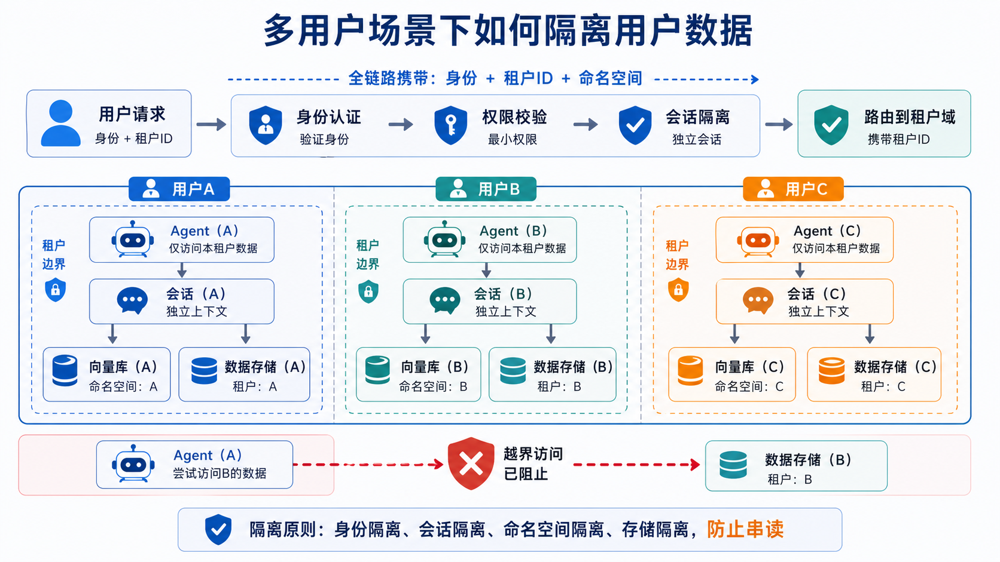

## 知识点讲解



### 1. 核心概念

多用户（多租户）场景下的数据隔离，是 Agent 系统里非常容易踩的坑。因为 Agent 有"主动拿数据"的能力——检索向量库、查数据库、读缓存——任何一个地方没做好隔离，就可能出现 A 用户看到 B 用户数据的情况。

这个问题在 B2B 产品里格外严重——一旦出现跨租户数据泄露，不只是隐私问题，还是商业机密泄露，后果很严重。

隔离的三种方式，按隔离强度从低到高：

| 隔离方式 | 做法 | 强度 | 成本 |
| --- | --- | --- | --- |
| 行级隔离 | 共享数据库，每行加 tenant_id，查询时过滤 | 弱（依赖代码正确性） | 低 |
| Schema 隔离 | 每个租户独立 schema，共享数据库实例 | 中 | 中 |
| 数据库隔离 | 每个租户独立数据库实例 | 强 | 高 |

选哪种取决于安全要求和成本预算。安全要求高的 B2B 场景，Schema 或数据库级隔离是标准。

### 2. 技术细节

#### 2.1 上下文隔离：最容易被忽视

很多团队只想到数据库隔离，忘了 **LLM 上下文** 也需要隔离。Agent 处理用户 A 的请求时，上下文里不应该出现用户 B 的任何信息——包括 B 之前执行任务的中间结果、B 的对话历史、从 B 的记忆里检索到的内容。

做法：每个用户请求有独立的上下文会话，会话之间完全隔离，不共享 LLM 的 context window。

#### 2.2 向量数据库的隔离

这是 Agent 系统特有的隔离挑战。向量数据库通常是多用户共享的，如果不做隔离，语义检索可能跨用户返回数据。

```python
from typing import List, Dict, Any

class IsolatedVectorStore:
    """强制租户隔离的向量数据库封装"""
    
    def __init__(self, vector_db_client):
        self.db = vector_db_client
    
    def upsert(self, tenant_id: str, doc_id: str, 
               vector: List[float], metadata: Dict) -> None:
        # 强制把 tenant_id 写入 metadata，且不允许外部覆盖
        safe_metadata = {k: v for k, v in metadata.items() 
                         if k != "tenant_id"}  # 防止外部伪造
        safe_metadata["tenant_id"] = tenant_id  # 强制赋值
        
        # key 里也加 tenant_id，防止 ID 碰撞
        namespaced_id = f"{tenant_id}:{doc_id}"
        self.db.upsert(id=namespaced_id, vector=vector, metadata=safe_metadata)
    
    def query(self, tenant_id: str, query_vector: List[float], 
              top_k: int = 5) -> List[Dict]:
        # 强制过滤：只返回该租户的数据
        filter_condition = {"tenant_id": {"$eq": tenant_id}}
        results = self.db.query(
            vector=query_vector, 
            filter=filter_condition,  # 这个过滤条件不可绕过
            top_k=top_k
        )
        # 返回前再做一次校验，防止底层 filter 出 bug
        return [r for r in results if r["metadata"].get("tenant_id") == tenant_id]
    
    def delete_tenant_data(self, tenant_id: str) -> int:
        """满足 GDPR 的数据删除权：删除某租户的所有数据"""
        # 查询该租户所有数据的 ID
        all_ids = self.db.list_ids(filter={"tenant_id": {"$eq": tenant_id}})
        self.db.delete(ids=all_ids)
        return len(all_ids)


class AgentSessionManager:
    """Agent 会话管理：确保上下文隔离"""
    
    def __init__(self):
        self._sessions: Dict[str, Dict] = {}
    
    def create_session(self, user_id: str, task_id: str) -> str:
        session_id = f"{user_id}:{task_id}"
        self._sessions[session_id] = {
            "user_id": user_id,
            "task_id": task_id,
            "context": [],        # 独立的 context，不与其他用户共享
            "working_memory": {}  # 独立的工作记忆
        }
        return session_id
    
    def get_context(self, session_id: str, requesting_user_id: str) -> List:
        session = self._sessions.get(session_id)
        if not session:
            raise ValueError("Session not found")
        # 校验请求者和会话所属者一致，防止会话 ID 枚举攻击
        if session["user_id"] != requesting_user_id:
            raise PermissionError("Access denied: session belongs to another user")
        return session["context"]
    
    def cleanup_session(self, session_id: str):
        """任务结束后清理会话，释放内存，防止数据残留"""
        if session_id in self._sessions:
            del self._sessions[session_id]
```

#### 2.3 缓存层隔离

Redis 等缓存不加隔离的话，key 碰撞或者 key 扫描都可能导致跨用户访问。

```python
class TenantAwareCache:
    def _make_key(self, tenant_id: str, key: str) -> str:
        # 缓存 key 强制包含 tenant_id
        return f"tenant:{tenant_id}:{key}"
    
    def get(self, tenant_id: str, key: str):
        return self.redis.get(self._make_key(tenant_id, key))
    
    def set(self, tenant_id: str, key: str, value, ttl: int = 3600):
        self.redis.setex(self._make_key(tenant_id, key), ttl, value)
```

## 面试怎么答

多用户数据隔离需要在每一层都做，不只是数据库。数据库层：按隔离强度选行级/Schema/数据库实例隔离，高安全要求 B2B 场景建议 Schema 或实例级；向量库层：查询时强制加 tenant_id 过滤条件，返回前再做一次校验；缓存层：缓存 key 强制包含用户 ID；上下文层（容易被忽视）：每个用户的 Agent 会话有独立的 context，会话之间不共享 LLM 的 context window。

最重要的原则是：隔离要在代码层面硬性实现，不能只靠业务逻辑"应该不会混"。向量库的过滤条件必须在查询时强制加，不依赖调用方传不传；会话取数时必须校验请求者和会话归属者一致。防御要假设代码可能有 bug，加双重校验。

## 高频追问 & 加分点

- **Q1：行级隔离和 Schema 隔离哪个更好？**  
    行级隔离成本低，但依赖每次查询都正确加 WHERE tenant_id = X，任何一处忘了就是漏洞。Schema 隔离从数据库层面隔离，即使查询代码有 bug，跨 schema 访问也会被数据库拒绝。高安全要求场景强烈建议 Schema 或数据库实例级隔离。
- **Q2：向量数据库的过滤条件能绕过吗？**  
    过滤条件在数据库层执行，通常不能被应用层绕过。但要小心：确认你用的向量数据库的 filter 实现是服务端执行而不是客户端后处理（后者可以被绕过）；返回结果后在应用层再加一次校验，防止底层 bug。
- **Q3：GDPR 的"数据删除权"对 Agent 系统有什么挑战？**  
    主要难点在向量数据库——要能精确找到并删除某个用户的所有向量数据（包括从各种文档 embedding 来的）。设计时必须为每条向量记录存储 user_id 元数据，建立索引，支持按 user_id 批量删除。对话历史、工作记忆也要能按用户删除。
- **Q4：Agent 的会话 ID 被猜测到会怎样？**  
    会话 ID 枚举攻击：攻击者猜测其他用户的 session_id，直接访问别人的会话数据。防御：session_id 使用足够长的随机值（UUID v4 或更长），不能是顺序数字；取会话数据时校验请求者的用户 ID 和会话归属者一致。
- **Q5：多 Agent 协作时数据隔离如何维持？**  
    Orchestrator 调 Worker Agent 时，Worker Agent 应该在自己的权限上下文里执行（包括数据访问范围），不继承 Orchestrator 的权限和数据访问范围。各 Agent 只能访问当前任务权限范围内的数据，中间结果传递时只传必要的字段，不传整条数据。
