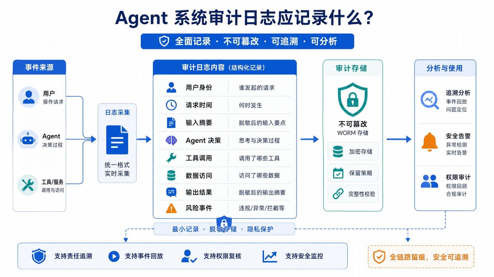

## 知识点讲解



### 1. 核心概念

审计日志是 Agent 系统安全的最后一道"保险"——前面的防御措施可能被绕过，但审计日志能让你在事后还原整个攻击链，找出根因，修复漏洞。

Agent 的审计日志比普通系统复杂很多，因为 Agent 的"行为"是多步骤的、非确定性的，每步的 Thought、Action、Observation 都可能和事件调查相关。

审计日志需要回答的核心问题：**"发生了什么，谁触发的，什么时候，结果是什么"**。

### 2. 技术细节

#### 2.1 必须记录的五类事件

**① LLM 推理记录**

- 输入 prompt 的摘要（不是全文——全文太大，而且可能含敏感信息）
- 输出的 Thought 和 Action 决策
- 使用的模型版本、temperature 设置

**② 工具调用记录**

- 工具名称、调用时间、执行耗时
- 调用参数（脱敏后）
- 工具返回结果（摘要，不是全量）
- 成功/失败状态，失败原因

**③ 权限事件**

- 权限校验通过/拒绝的记录
- 权限申请和审批记录
- 权限变更记录

**④ 安全事件**

- 注入检测告警
- 越狱尝试检测
- 异常行为模式（频率异常、非常规参数）

**⑤ 任务生命周期**

- 任务创建、开始、结束、中断
- 执行步骤数、总 token 消耗、总成本
- 最终结果和完成状态

#### 2.2 日志的设计要点

**必须脱敏**：日志里不能有原始的 PII 数据、API 密钥、密码。写入前先过脱敏处理器。

**不可篡改**：审计日志本身要防篡改，通常单独的日志系统（Splunk、Elasticsearch）加写入后的哈希校验，或者写入区块链（极高安全要求场景）。

**可关联**：同一个任务的所有日志条目用统一的 trace_id 串起来，方便完整还原执行链路。

**有时效**：按合规要求设定保留时间，到期自动清理，不要无限期保存（本身也是数据安全风险）。

```python
import time
import hashlib
import json
from typing import Optional, Dict, Any
from dataclasses import dataclass, asdict
from enum import Enum

class EventType(Enum):
    TASK_START = "task.start"
    TASK_END = "task.end"
    LLM_CALL = "llm.call"
    TOOL_CALL = "tool.call"
    TOOL_CALL_FAILED = "tool.call.failed"
    PERMISSION_DENIED = "permission.denied"
    SECURITY_ALERT = "security.alert"

@dataclass
class AuditEvent:
    event_type: str
    timestamp: float
    trace_id: str          # 串联同一任务所有事件
    user_id: str
    agent_id: str
    payload: Dict[str, Any]
    event_hash: str = ""   # 防篡改校验

class AuditLogger:
    def __init__(self, sanitizer, storage_backend):
        self.sanitizer = sanitizer
        self.storage = storage_backend
    
    def log(self, event_type: EventType, trace_id: str, 
            user_id: str, agent_id: str, payload: Dict) -> AuditEvent:
        # 1. 脱敏
        safe_payload = self.sanitizer.sanitize_dict(payload)
        
        event = AuditEvent(
            event_type=event_type.value,
            timestamp=time.time(),
            trace_id=trace_id,
            user_id=user_id,
            agent_id=agent_id,
            payload=safe_payload
        )
        
        # 2. 计算防篡改哈希
        event_str = json.dumps(asdict(event), sort_keys=True)
        event.event_hash = hashlib.sha256(event_str.encode()).hexdigest()
        
        # 3. 写入不可变存储
        self.storage.write(event)
        return event
    
    def log_tool_call(self, trace_id: str, user_id: str, agent_id: str,
                      tool_name: str, params: Dict, result: Any, 
                      duration_ms: int, success: bool):
        self.log(
            EventType.TOOL_CALL if success else EventType.TOOL_CALL_FAILED,
            trace_id=trace_id,
            user_id=user_id,
            agent_id=agent_id,
            payload={
                "tool": tool_name,
                "params": params,          # 会被脱敏
                "result_summary": str(result)[:200] if result else None,
                "duration_ms": duration_ms,
                "success": success
            }
        )
    
    def log_security_alert(self, trace_id: str, user_id: str, 
                           agent_id: str, alert_type: str, details: str):
        self.log(
            EventType.SECURITY_ALERT,
            trace_id=trace_id,
            user_id=user_id,
            agent_id=agent_id,
            payload={
                "alert_type": alert_type,
                "details": details,
                "severity": "high"
            }
        )
        # 安全告警同时触发实时通知
        self._send_alert_notification(alert_type, user_id, details)
    
    def _send_alert_notification(self, alert_type: str, user_id: str, details: str):
        # 发送到安全团队的告警系统（PagerDuty、Slack 等）
        ...
```

## 面试怎么答

审计日志是 Agent 安全的最后兜底——前面的防御可能被绕过，但日志能让你事后还原攻击链。Agent 的审计日志比普通系统复杂，需要记录五类事件：LLM 推理记录（Thought、Action 决策）；工具调用记录（工具名、参数、结果、耗时）；权限事件（通过/拒绝记录）；安全告警（注入/越狱检测）；任务生命周期（开始、结束、消耗）。

设计上几个关键点：写入前必须脱敏（日志里不能有 PII 和密钥）；用 trace_id 串联同一任务的所有事件，方便完整还原；日志本身要防篡改（哈希校验或写入不可变存储）；安全告警要实时推送，不能只是写进文件等人来查。

## 高频追问 & 加分点

- **Q1：审计日志要保留多久？**  
    一般安全审计日志最少 90 天，合规要求高的（金融、医疗）通常要 1-7 年。但也不要无限期保存——日志本身也是数据安全风险（日志里可能有脱敏不彻底的残留信息）。按合规要求设 retention policy，到期自动归档或删除。
- **Q2：LLM 的推理过程（Thought）需要存吗？**  
    建议存，但注意安全：Thought 里可能包含 Agent 对业务数据的中间分析，需要脱敏后存储。存 Thought 的价值在于事后分析 Agent 的决策逻辑，对调试和安全审计都很有帮助。如果 token 成本太高，可以存 Thought 的摘要而不是全文。
- **Q3：如何快速查询审计日志排查问题？**  
    两个关键设计：索引（trace_id、user_id、event_type、timestamp 都要建索引）；结构化格式（JSON 而不是纯文本，方便字段级查询）。建议用 Elasticsearch 或专业的日志分析平台（Splunk、Datadog），不要把审计日志写到普通文件里。
- **Q4：审计日志本身被篡改了怎么发现？**  
    每条日志记录写入时计算哈希，验证时重新计算对比。也可以用 append-only 存储（S3 加 Object Lock、Kafka 等），物理上防止修改。定期自动化校验所有历史日志的哈希，一旦发现不匹配立即告警。
- **Q5：日志量太大怎么处理？**  
    分级存储：热日志（最近 7 天）放高速存储，快速查询；温日志（7-90 天）放标准存储；冷日志（90 天以上）压缩归档到低成本存储。安全告警类日志单独存，保证高可用；普通任务日志可以采样（比如只存 10% 的正常任务日志，100% 的异常和安全日志）。
