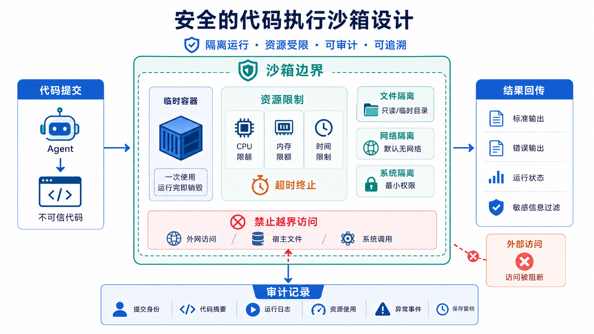

## 知识点讲解



### 1. 核心概念

代码执行是 Agent 里风险最高的能力之一。Agent 被允许执行代码意味着：理论上它能做任何操作系统允许做的事。攻击者只要让 Agent 执行一段精心构造的代码，就能绕过所有上层的权限控制。

所以代码执行能力必须放在沙箱里——**隔离的执行环境，限制能访问的资源，执行完就销毁**。

沙箱设计的核心目标：

1. **隔离**：代码执行不影响宿主系统
2. **资源限制**：CPU、内存、磁盘、网络都有上限
3. **快速失效**：超时自动终止，不让恶意代码长期运行
4. **无状态/短生命周期**：执行完立即销毁，不留残留

### 2. 技术细节

#### 2.1 沙箱实现方式的选择

| 方案 | 隔离强度 | 启动速度 | 资源开销 | 适用场景 |
| --- | --- | --- | --- | --- |
| 进程级（subprocess + seccomp） | 弱 | 快 | 低 | 低风险代码，内部系统 |
| 容器级（Docker + 限制） | 中 | 中 | 中 | 多数生产场景 |
| VM 级（Firecracker/gVisor） | 强 | 较慢 | 高 | 高安全要求，用户提交代码 |
| 专用服务（E2B、Modal） | 强 | 中 | 托管 | 快速接入，省运维 |

当前业界主流是容器级（Docker），配合 seccomp、AppArmor、网络策略做加固。高安全要求场景用 Firecracker（AWS Lambda 的底层）或 gVisor（Google 的内核沙箱）。

#### 2.2 关键限制维度

```python
import subprocess
import resource
import os
import tempfile
from typing import Tuple

class CodeSandbox:
    """轻量级代码沙箱（进程级，适合低风险场景演示）"""
    
    def __init__(self):
        self.TIMEOUT_SECONDS = 10
        self.MAX_MEMORY_MB = 128
        self.MAX_OUTPUT_CHARS = 10_000
        
        # 禁止调用的危险系统调用（生产中用 seccomp 在内核层限制）
        self.FORBIDDEN_IMPORTS = [
            'os', 'sys', 'subprocess', 'socket', 'shutil',
            'ctypes', 'multiprocessing', '__import__', 'eval', 'exec',
            'open',  # 文件访问
        ]
    
    def _pre_check(self, code: str) -> Tuple[bool, str]:
        """执行前静态检查，快速拒绝明显危险的代码"""
        code_lower = code.lower()
        for forbidden in self.FORBIDDEN_IMPORTS:
            if f'import {forbidden}' in code_lower or f'from {forbidden}' in code_lower:
                return False, f"Forbidden import: {forbidden}"
        
        # 检测常见的沙箱逃逸尝试
        escape_patterns = [
            '__builtins__', '__class__', '__subclasses__',
            'breakpoint', 'compile', 'globals', 'locals',
        ]
        for pattern in escape_patterns:
            if pattern in code:
                return False, f"Forbidden pattern: {pattern}"
        
        return True, ""
    
    def execute(self, code: str, language: str = "python") -> dict:
        # 1. 静态预检
        is_safe, reason = self._pre_check(code)
        if not is_safe:
            return {"success": False, "error": f"Pre-check failed: {reason}"}
        
        # 2. 写入临时文件（执行完自动清理）
        with tempfile.NamedTemporaryFile(
            suffix=".py", mode='w', delete=False
        ) as f:
            f.write(code)
            temp_file = f.name
        
        try:
            # 3. 在子进程里执行，设置资源限制
            def set_limits():
                # 内存限制
                resource.setrlimit(
                    resource.RLIMIT_AS,
                    (self.MAX_MEMORY_MB * 1024 * 1024,) * 2
                )
                # CPU 时间限制
                resource.setrlimit(resource.RLIMIT_CPU, (self.TIMEOUT_SECONDS,) * 2)
                # 禁止 fork 新进程
                resource.setrlimit(resource.RLIMIT_NPROC, (0, 0))
            
            result = subprocess.run(
                ['python3', '-I', '-S', temp_file],  # -I 隔离模式，-S 禁 site
                capture_output=True,
                text=True,
                timeout=self.TIMEOUT_SECONDS,
                preexec_fn=set_limits,
                env={},  # 清空环境变量，不泄露系统信息
            )
            
            output = result.stdout[:self.MAX_OUTPUT_CHARS]
            error = result.stderr[:1000] if result.returncode != 0 else ""
            
            return {
                "success": result.returncode == 0,
                "output": output,
                "error": error,
                "return_code": result.returncode
            }
            
        except subprocess.TimeoutExpired:
            return {"success": False, "error": "Execution timeout exceeded"}
        except Exception as e:
            return {"success": False, "error": f"Sandbox error: {str(e)}"}
        finally:
            os.unlink(temp_file)  # 清理临时文件


# 生产级方案：使用容器沙箱
class DockerSandbox:
    """基于 Docker 的容器级沙箱（生产推荐）"""
    
    DOCKER_RUN_ARGS = [
        "--rm",                           # 执行完自动删除容器
        "--network=none",                 # 无网络访问
        "--memory=128m",                  # 内存限制
        "--cpus=0.5",                     # CPU 限制
        "--read-only",                    # 只读文件系统
        "--cap-drop=ALL",                 # 撤销所有 Linux capabilities
        "--security-opt=no-new-privileges", # 禁止提权
        "--tmpfs=/tmp:size=10m",          # 只有 /tmp 可写，且有大小限制
    ]
    
    def execute(self, code: str, timeout: int = 10) -> dict:
        # 实际实现：把代码写入 Docker 容器并执行
        # docker run [ARGS] python:3.11-slim python -c {code}
        ...
```

## 面试怎么答

代码执行沙箱的核心是四点：隔离（代码执行在独立环境里，不影响宿主系统）、资源限制（CPU、内存、磁盘、网络都有上限）、超时终止（执行超时自动 kill）、无状态（执行完立即销毁，不留残留）。

实现方案按隔离强度排：进程级（subprocess + seccomp）最轻量但隔离弱；容器级（Docker + 限制参数）是目前最常用的生产方案，隔离好、启动快；VM 级（Firecracker、gVisor）隔离最强，适合用户提交的不可信代码。生产里推荐 Docker 加上 `--network=none`（断网）、`--read-only`（只读文件系统）、`--cap-drop=ALL`（撤销所有权限）这几个关键参数。

光有运行时隔离还不够，代码执行前要做静态预检——禁止危险 import（os、subprocess、socket 等），检测沙箱逃逸模式，拒绝明显有问题的代码。预检是低成本的第一道防线。

## 高频追问 & 加分点

- **Q1：Docker 沙箱能被逃逸吗？**  
    理论上有风险（历史上有过 Docker 逃逸漏洞），但通过加固参数（`--cap-drop=ALL`、`--security-opt=no-new-privileges`、seccomp profile）可以大幅降低风险。对于特别高安全要求的场景（用户提交的不可信代码），用 gVisor（runc=runsc）或 Firecracker 更安全，它们在内核层做额外隔离。
- **Q2：网络禁用（--network=none）会不会影响正常代码功能？**  
    会影响需要网络的代码，比如调用外部 API、下载依赖。两种处理方式：如果代码确实不需要网络，直接禁掉（最安全）；如果需要，白名单特定的域名（配置 DNS 只允许解析白名单域名，配置出口防火墙只允许访问白名单 IP）。禁止全部出站是最简单的选择，除非有明确需求。
- **Q3：沙箱里的代码能读取宿主机文件吗？**  
    容器默认只能看到容器自己的文件系统。加上 `--read-only` 后连容器里的文件也大多不能写（只有 tmpfs 挂载的 /tmp 可写）。不要把宿主机的敏感目录 mount 进容器。
- **Q4：如何处理代码执行超时的情况？**  
    超时触发后：立即 kill 子进程/容器（不是等它自己结束）；返回超时错误给 Agent；记录超时日志（频繁超时可能是攻击尝试或代码质量问题）；根据任务的重要性决定是否重试（超时重试要谨慎，可能是死循环）。
- **Q5：现成的代码执行服务（E2B、Modal 等）值得用吗？**  
    对于中小团队完全值得——省去自己维护沙箱基础设施的成本，安全性和可用性都有专业团队保障。大厂或对数据有严格控制要求的场景可能需要自建，但自建的维护成本不低。评估标准：数据能不能出到第三方服务、SLA 能不能满足、成本合不合适。
