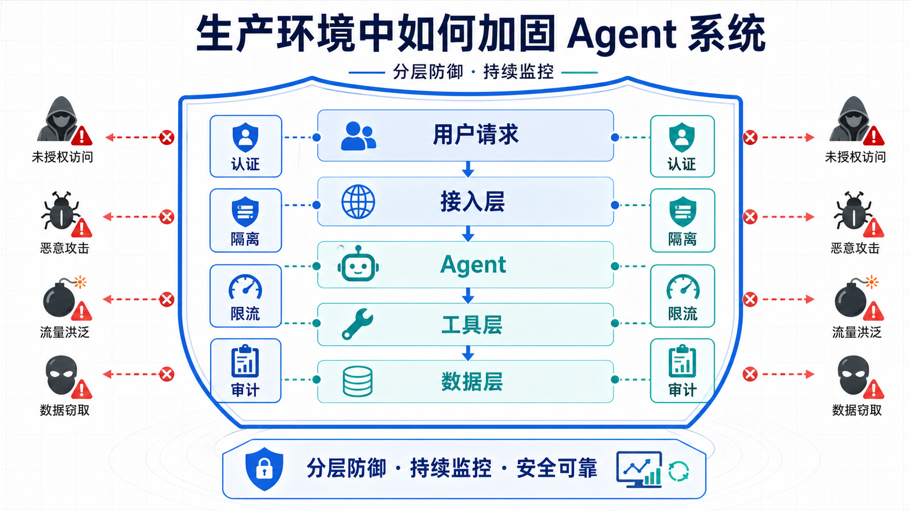

## 知识点讲解



### 1. 核心概念

生产加固（Hardening）是在 Agent 系统上线前和运行中系统性地减少攻击面的过程。和单点防御（比如只做 Prompt 注入防御）不同，加固是全局视角——从网络层到应用层到运维层，每一层都要收紧。

Agent 系统的生产加固比普通 Web 应用难，原因是 Agent 的行为是动态的：工具调用组合、LLM 推理结果、外部数据输入都可能触发意外情况。所以加固不只是配置，还要有持续的监控和响应机制。

加固的核心维度：**减少攻击面 + 限制爆炸半径 + 提升可观测性**。

### 2. 技术细节

#### 2.1 网络层加固

```python
# 配置示例（Python/FastAPI Agent 服务）

# 1. 速率限制（防 DoS 和高频探测）
from slowapi import Limiter, _rate_limit_exceeded_handler
from slowapi.util import get_remote_address

limiter = Limiter(key_func=get_remote_address)
app.state.limiter = limiter

@app.post("/agent/run")
@limiter.limit("10/minute")  # 每个 IP 每分钟最多 10 次
async def run_agent(request: Request, task: AgentTask):
    ...

# 2. 请求签名验证（内部服务间通信）
import hmac, hashlib, time

def verify_request_signature(payload: bytes, signature: str, secret: str) -> bool:
    timestamp = signature.split(".")[0]
    # 防止重放攻击：签名时间不超过 5 分钟
    if abs(time.time() - int(timestamp)) > 300:
        return False
    expected = hmac.new(
        secret.encode(), 
        f"{timestamp}.{payload.decode()}".encode(),
        hashlib.sha256
    ).hexdigest()
    return hmac.compare_digest(expected, signature.split(".")[1])
```

#### 2.2 应用层加固清单

| 加固项 | 做什么 | 优先级 |
| --- | --- | --- |
| 最小权限 | Agent 只有完成任务必要的工具和权限 | 高 |
| 密钥管理 | API 密钥走 KMS，禁止硬编码 | 高 |
| 输入验证 | 长度限制 + 注入检测 + 速率限制 | 高 |
| 输出过滤 | 内容安全检测 + 敏感信息检测 | 高 |
| 日志脱敏 | 写日志前脱敏 PII | 高 |
| 沙箱隔离 | 代码执行在容器沙箱里 | 高 |
| 超时控制 | 每次工具调用和整体任务都有超时 | 中 |
| 预算控制 | 每次任务的 token 和 API 调用有上限 | 中 |
| 依赖更新 | 定期更新依赖，修复已知漏洞 | 中 |
| 健康检查 | 定期自动化安全扫描 | 中 |

#### 2.3 预算控制：防止 DoS 和资费失控

Agent 任务不加预算控制，可能因为规划失误或攻击触发大量工具调用，导致 API 账单爆炸或服务降速。

```python
class BudgetController:
    def __init__(self, max_tokens: int, max_tool_calls: int, 
                 max_cost_usd: float, max_duration_seconds: int):
        self.limits = {
            "tokens": max_tokens,
            "tool_calls": max_tool_calls,
            "cost_usd": max_cost_usd,
            "duration_s": max_duration_seconds
        }
        self.consumed = {k: 0 for k in self.limits}
        self.start_time = __import__('time').time()
    
    def check_and_consume(self, tokens: int = 0, tool_calls: int = 0, 
                          cost_usd: float = 0) -> bool:
        """返回 False 表示超预算，应该停止执行"""
        import time
        self.consumed["tokens"] += tokens
        self.consumed["tool_calls"] += tool_calls
        self.consumed["cost_usd"] += cost_usd
        self.consumed["duration_s"] = time.time() - self.start_time
        
        for key, limit in self.limits.items():
            if self.consumed[key] >= limit:
                return False  # 超预算
        return True
    
    def get_summary(self) -> dict:
        return {
            "consumed": self.consumed,
            "limits": self.limits,
            "utilization": {
                k: self.consumed[k] / v 
                for k, v in self.limits.items() if v > 0
            }
        }
```

#### 2.4 持续监控和告警

生产加固不是一次性的，要持续运行：

- **实时告警**：安全事件（注入检测、权限拒绝、异常工具调用）实时推送到告警系统
- **每日统计报告**：被拒绝请求数、安全告警数、高风险操作统计
- **定期扫描**：每周对依赖库做 CVE 扫描，发现高危漏洞立即修复
- **定期红队测试**：每季度组织一次安全测试，模拟攻击者视角

## 面试怎么答

生产环境加固是全局的，不只是某一个安全措施，而是每一层都要收紧。核心维度三个：减少攻击面（权限最小化、密钥走 KMS、关闭不必要的功能）；限制爆炸半径（任务有预算上限，工具调用有超时，沙箱隔离代码执行）；提升可观测性（完整审计日志、实时告警、异常检测）。

生产加固最容易被忽视的是预算控制——没有 token 和成本上限的 Agent，可能因为规划失误或被攻击而产生大量 API 调用，账单直接爆炸。每次任务要设 max_tokens、max_tool_calls、max_cost、max_duration 四重上限，任何一个触发就停止执行。

加固不是一次性的事，要有持续的监控、定期的扫描和红队测试，因为 Agent 的行为是动态的，新的攻击手法也在不断出现。

## 高频追问 & 加分点

- **Q1：上线前的安全检查清单有哪些？**  
    基本的：权限配置复查（是否给了不必要的权限）；密钥扫描（代码库里有没有硬编码的密钥）；依赖 CVE 扫描（用 `pip-audit`、`safety` 等工具）；输入输出的安全测试（构造攻击 payload 测试防御效果）；日志配置确认（是否正确脱敏）。
- **Q2：Agent 系统的 SLA 和安全怎么平衡？**  
    有时候安全措施会增加延迟（多一层过滤、多一次校验）。平衡方式：轻量的安全检查（关键词匹配、签名验证）放在请求路径上，接受轻微延迟；重量的检查（LLM 内容审核）可以异步做，结果缓存复用；把安全措施的性能数据纳入监控，发现问题及时优化。
- **Q3：如何做 Agent 的灾难恢复？**  
    预先定义以下场景的恢复步骤：Agent 中间被停止（任务只完成一半）、向量库数据被篡改、API 密钥泄露（需要紧急轮换所有密钥）。重点是写成 runbook，不要等出事了再临时想怎么处理。定期演练，确保流程真的能走通。
- **Q4：开源 Agent 框架的安全性如何评估？**  
    关注几点：框架的安全公告历史（有没有已知漏洞）；代码是否做了输入验证；依赖库的质量（不要间接引入不安全的依赖）；社区活跃度（安全问题发现后多快修复）。不盲目相信框架的安全性，自己加上必要的安全层。
- **Q5：多云/混合部署的 Agent 系统有什么额外安全考虑？**  
    主要两块：跨云的网络通信要加密（不能假设内网就安全）；密钥管理更复杂（每个云平台有自己的 KMS，需要统一的密钥管理策略）；日志集中（不同云的日志要汇聚到统一的 SIEM 系统，否则攻击链路可能横跨多个云看不出来）。
