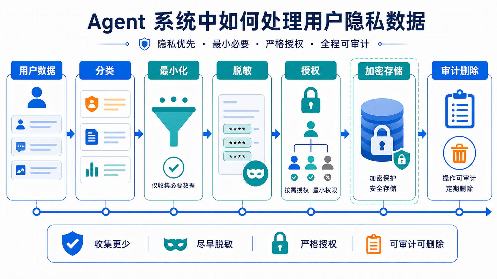

## 知识点讲解



### 1. 核心概念

Agent 系统处理隐私数据面临的挑战比普通应用更复杂——Agent 会把用户数据传给 LLM API（可能是第三方），传给各种工具，写进向量库，存进日志。数据流转路径多，每条路径都可能是隐私泄漏点。

隐私保护的基本原则：

- **最小化收集**：只收集完成任务必要的数据，不多收
- **目的限制**：数据只用于声明的目的，不拿去做别的
- **知情同意**：用户知道数据被怎么用
- **安全保护**：在整个生命周期内保护数据安全
- **用户控制**：用户可以查看、修改、删除自己的数据

### 2. 技术细节

#### 2.1 数据分类和处理策略

| 数据类型 | 示例 | 能否发给第三方 LLM | 存储策略 |
| --- | --- | --- | --- |
| 公开信息 | 产品名称、公开文档 | 是 | 普通存储 |
| 普通用户数据 | 用户偏好、行为历史 | 需要评估 | 加密存储 |
| PII | 姓名、手机号、身份证 | 脱敏后才可以 | 加密存储，严格访问控制 |
| 敏感 PII | 医疗数据、财务数据 | 不可以（考虑本地部署） | 最严格保护，合规要求 |

#### 2.2 发给 LLM 之前的数据处理

这是最常被忽视的环节——把含有隐私数据的 prompt 发给第三方 LLM（OpenAI、Anthropic 等）时，数据实际上已经离开了你的系统边界。

处理策略：

```python
import re
from typing import Dict

class PrivacyGuard:
    """发给 LLM 之前，对 prompt 做隐私脱敏"""
    
    # PII 正则模式
    PATTERNS = {
        'phone': r'1[3-9]\d{9}',
        'id_card': r'\d{6}(19|20)\d{2}(0[1-9]|1[0-2])(0[1-9]|[12]\d|3[01])\d{3}[\dXx]',
        'email': r'[\w.+-]+@[\w-]+\.[\w.-]+',
        'bank_card': r'(?<!\d)\d{16,19}(?!\d)',
        'name_cn': r'(?:姓名|用户名|客户名)[:：]\s*([^\s,，。]+)',
    }
    
    def __init__(self):
        self._token_map: Dict[str, str] = {}  # 脱敏 token → 原值，用于还原
        self._counter = 0
    
    def anonymize(self, text: str) -> str:
        """将 PII 替换为占位符，可选地保留还原映射"""
        result = text
        for data_type, pattern in self.PATTERNS.items():
            def replace(m):
                self._counter += 1
                token = f"<{data_type.upper()}_{self._counter}>"
                self._token_map[token] = m.group()
                return token
            result = re.sub(pattern, replace, result)
        return result
    
    def restore(self, text: str) -> str:
        """把 LLM 的输出里的占位符还原成原始值（如果业务需要的话）"""
        result = text
        for token, original in self._token_map.items():
            result = result.replace(token, original)
        return result
    
    def should_use_local_model(self, text: str) -> bool:
        """检测数据敏感级别，判断是否需要用本地部署的模型"""
        # 检测高度敏感的数据（医疗、财务）
        highly_sensitive_patterns = [
            r'(诊断|病历|处方|用药)',
            r'(银行账户|账户余额|转账记录)',
            r'(工资|薪酬|税前)',
        ]
        for pattern in highly_sensitive_patterns:
            if re.search(pattern, text):
                return True
        return False


class ConsentManager:
    """数据使用的知情同意管理"""
    
    def __init__(self, storage):
        self.storage = storage
    
    def record_consent(self, user_id: str, data_type: str, 
                       purpose: str, version: str):
        """记录用户的同意声明（用于审计）"""
        self.storage.upsert(f"consent:{user_id}:{data_type}", {
            "user_id": user_id,
            "data_type": data_type,
            "purpose": purpose,
            "consent_version": version,
            "timestamp": __import__('time').time()
        })
    
    def has_consent(self, user_id: str, data_type: str, purpose: str) -> bool:
        """检查用户是否给了对应用途的同意"""
        record = self.storage.get(f"consent:{user_id}:{data_type}")
        if not record:
            return False
        return record.get("purpose") == purpose
    
    def delete_all_user_data(self, user_id: str) -> Dict:
        """GDPR 删除权：删除某用户的所有数据"""
        deleted = {
            "vector_db": self._delete_vector_data(user_id),
            "conversation_history": self._delete_conversations(user_id),
            "consent_records": self._delete_consents(user_id),
            "audit_logs": "retained_for_compliance"  # 部分日志可能要合规保留
        }
        return deleted
    
    def _delete_vector_data(self, user_id: str) -> int:
        # 从向量库删除用户所有数据
        ...
    
    def _delete_conversations(self, user_id: str) -> int:
        # 从对话历史存储删除用户数据
        ...
    
    def _delete_consents(self, user_id: str) -> int:
        # 删除同意记录
        ...
```

#### 2.3 第三方 LLM 使用时的隐私评估

不是所有数据都能发给第三方 LLM。评估时要问：

1. 这个 LLM 提供商的数据政策是什么？用户数据会不会用于训练？
2. 数据传输和存储是否符合所在地区的法规（GDPR、PIPL）？
3. 如果数据必须出境，是否符合跨境数据传输要求？

对于高敏感数据，可行的选项：**本地部署开源模型**（Llama、Qwen 等）+ 数据完全不出境。

## 面试怎么答

Agent 处理隐私数据，最容易出问题的是"发给第三方 LLM 之前没有脱敏"。用户的姓名、手机号、身份证号这些 PII 混在 prompt 里，连带着发给了 OpenAI 或其他第三方——数据实际上已经出境了，合规风险很大。

处理策略分几层：发给 LLM 之前先脱敏（PII 替换为占位符，如果输出里需要还原再还原）；高度敏感数据（医疗、财务）考虑用本地部署的模型，不让数据出境；存储层做加密和访问控制；日志写入前脱敏；用户可以行使数据删除权（GDPR）——向量库、对话历史、审计日志都要能按用户删除。

最容易被忽视的还有知情同意——用户要知道他们的数据被如何使用，用于什么目的，是否会传给第三方。这不只是法律要求，也是建立用户信任的基础。

## 高频追问 & 加分点

- **Q1：GDPR 的"被遗忘权"对 Agent 系统有什么技术挑战？**  
    最难的是向量数据库——要精确找到并删除某个用户贡献的所有向量数据，需要在向量库里用 user_id 做索引。对话历史相对容易（有明确的会话 ID）。嵌入进共享文档的用户数据（比如用户上传的文档被嵌入到共享知识库）最难处理，需要在设计时就考虑隔离。
- **Q2：用户数据能不能用来改进模型？**  
    要看用户协议和所在地区法规。大多数情况下，用户数据用于个性化（只给这个用户用）和用于模型训练（给所有用户用）需要分别获得同意。如果没有明确的训练同意，不能把用户数据用于微调。要在产品设计时就把这个区分清楚，不要到时候再解释。
- **Q3：Agent 的向量记忆存的是"关于用户的信息"还是"用户生成的内容"，有区别吗？**  
    有重大区别。"关于用户的信息"（用户的偏好、行为模式）是个人数据，受隐私法保护。"用户生成的内容"（用户写的文章）版权属于用户，但不一定是个人数据。两者的法律定性不同，处理方式也不同。设计时要明确存的是哪类，对应的权利（删除权、可携带权等）都要支持。
- **Q4：国内 PIPL（个人信息保护法）和 GDPR 的主要区别？**  
    几个关键差异：PIPL 对跨境数据传输要求更严（发给海外第三方需要安全评估或标准合同）；PIPL 对"敏感个人信息"的范围更广（包括生物特征、宗教信仰、特定身份、医疗健康、金融账户、行踪轨迹）；PIPL 的处罚金额和力度和 GDPR 类似。在中国运营要对照 PIPL 做合规评估，不能简单套用 GDPR 的框架。
- **Q5：如何向用户透明地说明数据使用情况？**  
    隐私声明要说清楚：收集了什么数据；发给哪些第三方（LLM 提供商名称、数据政策链接）；保留多长时间；用户的权利（查看、修改、删除）。在产品里提供清晰的数据管理入口，让用户能真实行使权利，而不只是写在隐私政策里。
