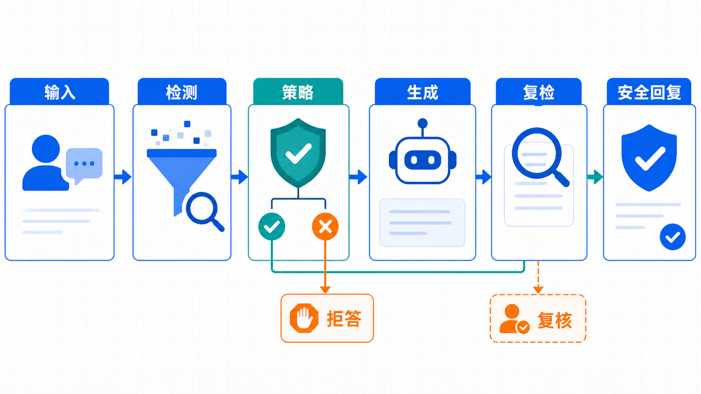

## 知识点讲解



### 1. 核心概念

内容安全过滤（Content Safety Filtering）是在 Agent 的输入侧和输出侧做的内容合规检测，目的是防止两件事：**有害内容进来**（用户提交的违规请求）和**有害内容出去**（Agent 生成的违规输出）。

两侧都要过滤，而且过滤策略不完全一样：

- **输入过滤**：检测意图（这个请求是否在尝试触发有害内容）
- **输出过滤**：检测内容（生成的内容是否确实有害）

输出过滤更可靠——不管输入是什么，只要输出有问题就拦截。但它有延迟（LLM 跑完了才过滤）和成本（多一次过滤调用）。两者配合使用。

### 2. 技术细节

#### 2.1 内容安全的分类维度

通常需要覆盖的类别：

| 类别 | 细分 |
| --- | --- |
| 暴力/仇恨 | 鼓吹暴力、仇恨言论、歧视性内容 |
| 色情/成人 | 露骨内容（按年龄分级） |
| 违法信息 | 武器制造、毒品合成、诈骗方法 |
| 隐私侵犯 | 未经同意的个人信息扩散 |
| 误导信息 | 虚假医疗信息、政治操纵 |
| 自伤内容 | 自杀方法、自残引导 |
| 版权侵犯 | 大段复制版权内容 |

不同产品需要的严格程度不同。B2B 企业工具可能只需要防违法内容；面向未成年人的产品需要极严格的过滤。

#### 2.2 实现方案选择

| 方案 | 准确率 | 速度 | 成本 | 适用 |
| --- | --- | --- | --- | --- |
| 关键词黑名单 | 低（易绕过） | 极快 | 极低 | 第一层粗过滤 |
| 规则引擎 | 中 | 快 | 低 | 结构化规则 |
| 专用安全模型 | 高 | 中 | 中 | 主过滤层 |
| LLM 自评估 | 很高 | 慢 | 高 | 关键内容二次确认 |
| 人工审核 | 最高 | 极慢 | 高 | 灰色地带 |

生产里通常用分层方案：关键词过滤（快速拒绝明显违规）→ 专用安全模型（主过滤）→ 可疑内容人工审核。

```python
from enum import Enum
from typing import Tuple, List
from dataclasses import dataclass

class SafetyCategory(Enum):
    VIOLENCE = "violence"
    HATE_SPEECH = "hate_speech"
    SEXUAL = "sexual"
    ILLEGAL = "illegal"
    SELF_HARM = "self_harm"
    MISINFORMATION = "misinformation"

@dataclass
class SafetyResult:
    is_safe: bool
    flagged_categories: List[SafetyCategory]
    confidence: float
    action: str  # "allow", "block", "review"

class ContentSafetyFilter:
    def __init__(self, moderation_client, threshold_config: dict):
        self.client = moderation_client
        self.thresholds = threshold_config
        
        # 快速关键词拒绝列表（明显违规，不用调模型）
        self.blocklist = self._load_blocklist()
    
    def _load_blocklist(self) -> set:
        # 加载关键词黑名单
        return {"制作炸弹", "合成毒品", "..."}  # 实际要更完整
    
    def check_input(self, text: str) -> SafetyResult:
        """输入侧检测"""
        # 第一层：关键词快速拒绝
        for keyword in self.blocklist:
            if keyword in text:
                return SafetyResult(
                    is_safe=False,
                    flagged_categories=[SafetyCategory.ILLEGAL],
                    confidence=1.0,
                    action="block"
                )
        
        # 第二层：安全模型检测
        return self._model_check(text, mode="input")
    
    def check_output(self, text: str) -> SafetyResult:
        """输出侧检测"""
        return self._model_check(text, mode="output")
    
    def _model_check(self, text: str, mode: str) -> SafetyResult:
        """调用专用安全模型"""
        # 使用 OpenAI Moderation API 或自建模型
        result = self.client.moderate(text)
        
        flagged = []
        max_score = 0.0
        for category, score in result.category_scores.items():
            threshold = self.thresholds.get(category, 0.7)
            if score >= threshold:
                flagged.append(SafetyCategory(category))
                max_score = max(max_score, score)
        
        is_safe = len(flagged) == 0
        
        # 确定处置动作
        if not is_safe:
            if max_score >= 0.9:
                action = "block"     # 高置信度 → 直接拒绝
            else:
                action = "review"    # 低置信度 → 人工复核
        else:
            action = "allow"
        
        return SafetyResult(
            is_safe=is_safe,
            flagged_categories=flagged,
            confidence=max_score,
            action=action
        )
    
    def get_safe_response(self, flagged_categories: List[SafetyCategory]) -> str:
        """返回对用户的友好拒绝消息，不暴露系统细节"""
        category_messages = {
            SafetyCategory.VIOLENCE: "您的请求包含暴力相关内容，无法处理。",
            SafetyCategory.ILLEGAL: "您的请求可能涉及违法信息，无法处理。",
            SafetyCategory.SEXUAL: "您的请求包含不适当内容，无法处理。",
        }
        for category in flagged_categories:
            if category in category_messages:
                return category_messages[category]
        return "您的请求包含不符合使用规范的内容，无法处理。"
```

#### 2.3 误报（False Positive）的处理

严格的过滤会产生误报——正常内容被错误拦截。这是用户体验的大坑。处理策略：

- 设置合理的置信度阈值（不要太低）
- 允许用户对误报申诉（提交人工复核）
- 监控拦截率，持续调优阈值
- 对于特殊用途场景（医疗教育、安全研究），提供白名单

## 面试怎么答

内容安全过滤要在输入侧和输出侧都做，两者策略不同：输入侧检测意图（这个请求是否在尝试引出有害内容），输出侧检测内容（生成的结果是否确实有问题）。输出侧更可靠，因为管的是最终结果，不管绕过了什么都拦得住。

实现上用分层方案：关键词黑名单快速拒绝明显违规（低成本）→ 专用安全模型主过滤（OpenAI Moderation API 或自建）→ 置信度低的可疑内容推送人工审核。不要只靠一层，因为每层都有绕过风险。

有一个常被忽视的点：不同产品场景的过滤严格程度不一样，同一个内容类别在企业内部工具和面向未成年人产品里的阈值可以差很多。过滤策略要能按场景配置，不是一刀切。

## 高频追问 & 加分点

- **Q1：如何降低内容过滤的误报率？**  
    三个方向：调高置信度阈值（代价是漏报率上升）；做上下文感知过滤（同一内容在不同上下文可能是合法的，比如医学教育）；持续用真实误报 case 微调过滤模型，提高精度。误报率和漏报率是 trade-off，要根据业务风险取向决定哪个更不能接受。
- **Q2：如何处理用户绕过内容过滤的尝试（比如用谐音、拼音、缩写）？**  
    文本规范化（把谐音字、变体写法统一转换后再检测）；模型层过滤（专用安全模型比关键词匹配对变体更鲁棒）；上下文感知（单个词不触发，但结合上下文语义是有害的，要考虑整体语义）。完全防住是不可能的，目标是提高绕过成本。
- **Q3：用 LLM 做内容安全检测准确吗？**  
    很准，但贵且慢。GPT-4 级别的模型做内容安全评估，准确率非常高，能理解上下文和意图。但每次检测都要调一次 LLM，成本和延迟不低。一般用法：专用安全模型做主过滤，LLM 只用于专用模型置信度低的边界 case 的二次确认。
- **Q4：内容安全过滤和业务逻辑过滤是一回事吗？**  
    不是。内容安全过滤管的是"这内容本身是否有害"（暴力、违法等）；业务逻辑过滤管的是"这内容是否符合业务要求"（比如只回答产品相关问题，不回答竞品问题）。两者要独立实现，不要混在一起。
- **Q5：内容安全过滤的法律责任是什么？**  
    平台对用户生成内容（UGC）有"知道或应当知道"的责任——如果你部署了 Agent 允许生成和传播内容，没有合理的安全过滤，对于有害内容是有法律责任的（具体看各国法规）。在中国，网络安全法和内容管理规定对此有要求；在欧盟，DSA（数字服务法）对内容管理有明确规定。
