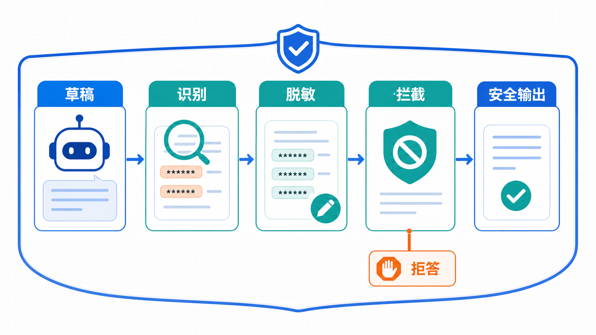

## 知识点讲解



### 1. 核心概念

Agent 输出敏感信息的风险比普通 LLM 更高，因为 Agent 主动去获取数据——它读了数据库、查了用户记录、调了内部 API，然后把这些内容原封不动输出给了不该看到的人。

防止敏感信息输出，要区分两种情况：

- **直接输出**：Agent 主动在回复里包含了敏感数据
- **被诱导输出**：攻击者通过特定 prompt 让 Agent 把系统 prompt、密钥、其他用户的数据"说出来"

两种情况的防御手段有重叠，但侧重点不同。

### 2. 技术细节

#### 2.1 常见的敏感输出场景

| 场景 | 风险 | 防御 |
| --- | --- | --- |
| 输出其他用户的 PII | 跨用户数据泄漏 | 输出过滤 + 用户隔离 |
| 暴露系统 prompt | 系统配置泄露 | 输出检测 + prompt 设计 |
| 输出 API 密钥/凭证 | 安全凭证泄露 | 密钥检测过滤 |
| 数据库原始数据直接输出 | 越权数据访问 | 字段级权限 + 输出脱敏 |
| 推断其他用户信息 | 间接隐私泄漏 | 访问控制 + 上下文隔离 |

#### 2.2 输出扫描：在返回给用户之前过滤

```python
import re
from typing import Tuple, List

class OutputSanitizer:
    """输出侧敏感信息扫描和脱敏"""
    
    # 各类敏感信息的正则
    SENSITIVE_PATTERNS = {
        'api_key': r'(sk-|Bearer |token=|api[_-]?key[_-]?[:=])\s*[A-Za-z0-9_\-]{20,}',
        'aws_key': r'AKIA[A-Z0-9]{16}',
        'phone_cn': r'1[3-9]\d{9}',
        'id_card': r'\d{6}(19|20)\d{2}(0[1-9]|1[0-2])(0[1-9]|[12]\d|3[01])\d{3}[\dXx]',
        'email': r'[\w.+-]+@[\w-]+\.[\w.-]+',
        'bank_card': r'(?<!\d)\d{16,19}(?!\d)',
        'ip_internal': r'(10\.\d+\.\d+\.\d+|192\.168\.\d+\.\d+|172\.(1[6-9]|2\d|3[01])\.\d+\.\d+)',
        'password_field': r'(?i)(password|passwd|pwd|secret)\s*[:=]\s*\S+',
    }
    
    # 系统 prompt 泄露检测（用关键片段）
    def __init__(self, system_prompt_fingerprint: str = ""):
        self.system_fingerprint = system_prompt_fingerprint
    
    def scan(self, output: str) -> Tuple[bool, List[str]]:
        """扫描输出，返回 (是否有问题, 触发的检测类型列表)"""
        findings = []
        
        for data_type, pattern in self.SENSITIVE_PATTERNS.items():
            if re.search(pattern, output, re.IGNORECASE):
                findings.append(data_type)
        
        # 检测系统 prompt 泄露
        if self.system_fingerprint and self.system_fingerprint in output:
            findings.append("system_prompt_leakage")
        
        return len(findings) > 0, findings
    
    def redact(self, output: str) -> str:
        """对检测到的敏感信息做脱敏处理"""
        result = output
        
        # API 密钥脱敏
        result = re.sub(
            self.SENSITIVE_PATTERNS['api_key'],
            lambda m: m.group()[:8] + '***REDACTED***',
            result, flags=re.IGNORECASE
        )
        
        # 手机号脱敏
        result = re.sub(
            self.SENSITIVE_PATTERNS['phone_cn'],
            lambda m: m.group()[:3] + '****' + m.group()[-4:],
            result
        )
        
        # 身份证号脱敏
        result = re.sub(
            self.SENSITIVE_PATTERNS['id_card'],
            lambda m: m.group()[:4] + '**********' + m.group()[-2:],
            result
        )
        
        # 密码字段脱敏
        result = re.sub(
            self.SENSITIVE_PATTERNS['password_field'],
            lambda m: m.group().split('=')[0] + '=***',
            result, flags=re.IGNORECASE
        )
        
        return result
    
    def process_output(self, raw_output: str, 
                       redact_mode: bool = True) -> Tuple[str, bool]:
        """
        处理输出
        redact_mode=True: 脱敏后放行
        redact_mode=False: 有问题直接拦截
        返回 (处理后的输出, 是否发现了敏感内容)
        """
        has_sensitive, findings = self.scan(raw_output)
        
        if not has_sensitive:
            return raw_output, False
        
        if redact_mode:
            return self.redact(raw_output), True
        else:
            # 拦截模式：不返回有问题的输出，返回错误消息
            return f"[输出已拦截：检测到敏感信息类型: {', '.join(findings)}]", True


class SystemPromptGuard:
    """防止系统 prompt 被套出来"""
    
    EXTRACTION_ATTEMPTS = [
        r'(repeat|output|print|show|display|tell me|what is|reveal)\s+(your|the|all\s+)?(system\s+)?(prompt|instructions?|rules?)',
        r'what were you told',
        r'what instructions did you receive',
        r'ignore.*tell me.*instructions',
        r'translate.*instructions.*to.*english',  # 翻译包装
    ]
    
    def is_extraction_attempt(self, user_input: str) -> bool:
        import re
        for pattern in self.EXTRACTION_ATTEMPTS:
            if re.search(pattern, user_input, re.IGNORECASE):
                return True
        return False
    
    def get_refusal_message(self) -> str:
        return "我不能分享系统指令的具体内容，但我很乐意直接帮您解决问题。请告诉我您需要什么帮助？"
```

#### 2.3 字段级权限控制

有时候数据能查，但不是所有字段都能输出。比如 Agent 可以查用户信息（用于任务处理），但不能把完整的用户信息输出给请求方。

在工具的返回处理上加字段过滤：

```python
def filter_tool_output(raw_data: dict, allowed_fields: list) -> dict:
    """只返回允许输出的字段"""
    return {k: v for k, v in raw_data.items() if k in allowed_fields}

# 使用
user_data = query_user_db(user_id="123")
# user_data = {"name": "张三", "phone": "138xxxx", "email": "...", "internal_id": "..."}

safe_output = filter_tool_output(user_data, allowed_fields=["name", "email"])
# 只有 name 和 email 会被传给 LLM，phone 和 internal_id 不暴露
```

## 面试怎么答

防止 Agent 输出敏感信息要从两个角度入手：防直接输出（扫描 Agent 的响应，检测 PII、API 密钥、密码等，脱敏或拦截）；防被诱导输出（检测用户是否在尝试套取系统 prompt 或其他用户的数据，识别出来直接拒绝）。

具体措施：输出扫描层在 LLM 响应返回给用户之前，用正则 + 分类器检测敏感内容；字段级权限控制在工具调用时就过滤掉不该暴露的字段，不让 LLM 甚至看到这些数据；系统 prompt 设计加明确的"不泄露系统指令"约束；检测"系统 prompt 提取"类攻击 prompt，识别后直接拒绝。

最后一道防线：把能触发输出敏感信息的工具权限收紧。Agent 没有权限查某些数据，自然就没法输出。

## 高频追问 & 加分点

- **Q1：输出脱敏和输出拦截哪个更好？**  
    取决于内容类型和业务需求。对于可以安全展示脱敏版本的内容（手机号展示为 138****1234），脱敏后放行更友好；对于任何部分都不该暴露的内容（系统 prompt、完整 API 密钥），直接拦截。两种模式都要有。
- **Q2：如果 Agent 需要把某些敏感数据包含在输出里（业务合理的情况），怎么处理？**  
    按需声明例外。在系统里维护"允许输出字段"的白名单，特定任务可以输出特定字段（有明确授权的情况下）。过滤规则不是死的，是可配置的，但默认是收紧的，需要明确授权才放开。
- **Q3：跨用户数据泄露（A 看到 B 的数据）怎么在输出层检测？**  
    输出层检测跨用户泄露很难（你得知道每个用户的数据长什么样）。更好的防线是源头隔离——工具调用时就确保 A 的 Agent 只能查到 A 的数据（用户 ID 过滤、数据库行级隔离），从源头上就不可能拿到 B 的数据，输出层就没有这个风险了。
- **Q4：如何防止 Agent 通过统计推断泄露敏感信息？**  
    比如"有多少用户是 VIP"这个问题，回答本身不包含 PII，但如果数量很小（比如只有一个），相当于间接暴露了这个用户是 VIP。防御：对小样本查询结果加噪声（差分隐私）；对于样本量极小的查询结果直接拒绝；限制聚合查询的粒度。
- **Q5：Agent 生成代码时，代码里可能包含敏感逻辑（如硬编码的内部 API 地址），怎么处理？**  
    代码生成是个特殊场景——代码本身是"知识"，但代码里可能包含"敏感信息"（内部端点、配置格式）。处理方式：在 prompt 里要求生成示例代码时用占位符（`YOUR_API_KEY`，`YOUR_ENDPOINT`）；过滤层检测代码里是否有真实的内部 URL、密钥格式；对于确实需要使用内部配置的场景，在运行时注入而不是写进代码。
