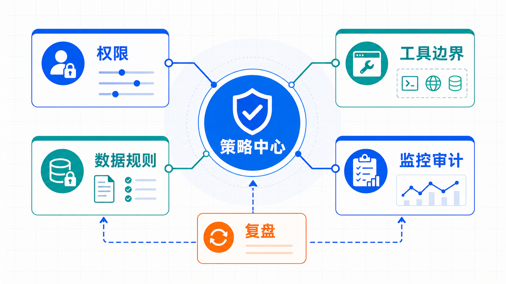

## 知识点讲解



### 1. 核心概念

安全策略是 Agent 系统安全的顶层设计——把各种具体的安全措施（输入过滤、权限控制、输出检测等）整合成一个连贯的、可落地的体系。

好的安全策略有三个特征：

1. **系统性**：覆盖所有攻击面，没有大的盲区
2. **可操作**：具体到每个组件要做什么，不是空话
3. **动态维护**：不是写一次就完，要随威胁演变持续更新

设计 Agent 安全策略，通用的框架是 **STRIDE 威胁建模**（微软提出）：

| 威胁类型 | 含义 | Agent 场景示例 |
| --- | --- | --- |
| **S**poofing（欺骗） | 伪造身份 | 伪造用户 ID 访问他人数据 |
| **T**ampering（篡改） | 修改数据/逻辑 | 篡改 Agent 的长期记忆投毒 |
| **R**epudiation（抵赖） | 否认行为 | Agent 操作无审计，无法追责 |
| **I**nformation Disclosure（信息泄露） | 敏感数据暴露 | PII 被输出或日志泄露 |
| **D**enial of Service（拒绝服务） | 使系统不可用 | 长 prompt 撑爆 context，token 耗尽 |
| **E**levation of Privilege（权限提升） | 获得不该有的权限 | 注入后调用高权限工具 |

### 2. 技术细节

#### 2.1 安全策略的四层架构

**第一层：预防（Prevention）**

在问题发生之前阻止：

- 最小权限原则（工具权限、数据访问权限）
- 输入验证和注入检测
- 密钥管理（KMS，禁止硬编码）
- 代码执行沙箱隔离

**第二层：检测（Detection）**

问题发生时及时发现：

- 实时内容安全过滤（输入 + 输出）
- 异常行为监控（工具调用频率、权限使用模式）
- 安全告警系统（高风险事件实时推送）

**第三层：响应（Response）**

发现问题后快速处置：

- 应急停止机制（能立即停止失控的 Agent）
- 事件分级和处置 runbook
- 受影响用户/数据的隔离和通知

**第四层：恢复（Recovery）**

问题处置后恢复正常：

- 数据备份和恢复
- 漏洞修复和规则更新
- 事后复盘和策略更新

#### 2.2 安全策略的落地文档

```python
# 安全策略的代码化表达（配置驱动，而不是散落在各处代码里）

from dataclasses import dataclass, field
from typing import Set, Dict, List
from enum import Enum

class RiskLevel(Enum):
    LOW = "low"
    MEDIUM = "medium"  
    HIGH = "high"
    CRITICAL = "critical"

@dataclass
class ToolPolicy:
    """工具级别的安全策略"""
    tool_name: str
    risk_level: RiskLevel
    requires_human_approval: bool
    max_calls_per_task: int
    allowed_parameter_ranges: Dict = field(default_factory=dict)
    audit_level: str = "standard"  # "standard" | "detailed" | "full"

@dataclass
class AgentSecurityPolicy:
    """Agent 整体安全策略（配置化，可审计可版本管理）"""
    
    # 身份和权限
    allowed_tools: Set[str] = field(default_factory=set)
    tool_policies: Dict[str, ToolPolicy] = field(default_factory=dict)
    
    # 资源预算
    max_tokens_per_task: int = 50_000
    max_tool_calls_per_task: int = 30
    max_cost_usd_per_task: float = 2.0
    max_duration_seconds: int = 300
    
    # 输入控制
    max_input_length: int = 5_000
    enable_injection_detection: bool = True
    enable_rate_limiting: bool = True
    rate_limit_per_minute: int = 20
    
    # 输出控制
    enable_output_scanning: bool = True
    output_redact_pii: bool = True
    output_redact_credentials: bool = True
    block_system_prompt_leakage: bool = True
    
    # 数据隔离
    enable_tenant_isolation: bool = True
    vector_db_namespace_per_user: bool = True
    
    # 审计
    audit_log_enabled: bool = True
    audit_log_retention_days: int = 90
    alert_on_security_events: bool = True
    
    # 代码执行
    code_execution_enabled: bool = False  # 默认关闭，按需开启
    code_execution_sandbox: str = "docker"  # "process" | "docker" | "vm"
    code_execution_timeout_s: int = 10
    code_execution_network: bool = False  # 默认断网

# 不同场景的策略预设
INTERNAL_TOOL_POLICY = AgentSecurityPolicy(
    max_tokens_per_task=100_000,
    rate_limit_per_minute=60,
    code_execution_enabled=True,
    audit_log_retention_days=30
)

CUSTOMER_FACING_POLICY = AgentSecurityPolicy(
    max_tokens_per_task=20_000,
    rate_limit_per_minute=10,
    code_execution_enabled=False,
    output_redact_pii=True,
    audit_log_retention_days=365
)

HIGH_SECURITY_POLICY = AgentSecurityPolicy(
    max_tokens_per_task=10_000,
    rate_limit_per_minute=5,
    code_execution_enabled=False,
    enable_injection_detection=True,
    vector_db_namespace_per_user=True,
    audit_log_retention_days=2555  # 7年，金融合规要求
)
```

#### 2.3 持续维护机制

安全策略不是写完就放着的：

- **定期威胁建模**（每季度）：重新跑 STRIDE，看有没有新的攻击面
- **红队测试**（每季度）：模拟攻击者视角，验证现有防御是否有效
- **安全事件复盘**（每次重大事件后）：找出根因，更新策略
- **依赖库 CVE 扫描**（每周自动化）：及时修复已知漏洞
- **策略版本管理**：所有策略变更记录在案，可回溯

## 面试怎么答

设计 Agent 安全策略，我习惯用 STRIDE 威胁建模来系统梳理攻击面——欺骗、篡改、抵赖、信息泄露、拒绝服务、权限提升，每个维度对应的防御措施。这比零散地想"我需要防什么"更全面。

策略分四层：预防（阻止问题发生）、检测（问题发生时发现）、响应（快速处置）、恢复（事后修复和学习）。实际落地里，预防层做得再好也不能保证100%，所以检测和响应同样重要。

很重要的一点：安全策略要代码化、配置化，不能散落在各处代码注释里。用配置对象表达安全策略，不同场景用不同的策略预设，策略变更有版本记录——这样才能做到可审计、可维护、可持续演进。

## 高频追问 & 加分点

- **Q1：安全策略最容易被忽视的地方是哪里？**  
    两个：一是恢复层（大家都在想怎么防，很少想万一防不住了怎么快速恢复）；二是供应链安全（第三方工具库、LLM 供应商——这些你没有直接控制，但漏洞可以影响你的系统）。
- **Q2：如何量化 Agent 系统的安全水平？**  
    几个可以量化的指标：安全事件数量（每月被检测到的攻击尝试次数）；平均检测时间（从攻击发生到被发现的平均时长）；修复时间（从发现漏洞到修复的时间）；策略覆盖率（STRIDE 里有多少威胁点有对应的防御措施）。
- **Q3：初创团队资源有限，安全策略的优先级怎么排？**  
    优先做影响最大的：API 密钥不硬编码（最低成本的安全措施）；最小权限（Agent 只能做任务必要的操作）；输入验证和速率限制（防止被轻易利用）；基本审计日志（发生问题时能还原）。这四条可以以很低的成本实现，覆盖了大多数常见攻击。其他高级功能（红队测试、差分隐私等）等资源充足了再加。
- **Q4：如何在敏捷开发的节奏里保持安全策略的有效性？**  
    安全策略要集成到 CI/CD 里：依赖扫描自动化（每次构建跑 CVE 扫描）；安全单元测试（测试输入过滤、权限控制是否正常工作）；发布前的安全 checklist 自动化检查。把安全变成流程的一部分，而不是额外的手动步骤。
- **Q5：怎么向非技术的业务/法务团队解释 Agent 安全策略？**  
    用业务语言而不是技术语言：不说"最小权限原则"，说"Agent 只能做它工作需要的事，不多做"；不说"输入过滤"，说"用户发来的请求会先检查是否合规，才会被处理"；不说"审计日志"，说"每次 Agent 做了什么都有记录，出了问题可以追查"。让他们理解风险和保护措施，才能获得必要的资源投入。
