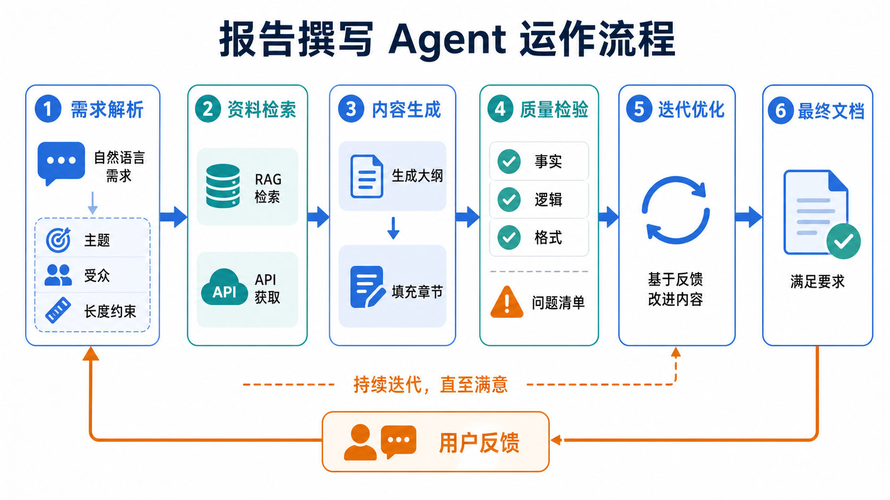

## 知识点讲解



### 1. 核心概念

报告撰写 Agent 本质上是把"写报告"这件事拆成可以自动化的流水线：需求分析 → 资料检索 → 大纲生成 → 章节撰写 → 事实校验 → 格式输出。

为什么不能直接让 LLM 一次生成？因为一次性生成有两个硬伤：① 幻觉问题严重，数据、时间、引用都可能是编的；② 无法确保结构稳定，生成三次可能三种格式。分步骤执行，每步的输出作为下一步的输入，质量可控。

### 2. 技术细节

#### 2.1 核心模块

**需求解析模块**：把自然语言需求转成结构化的"报告规格"——主题、受众、篇幅、数据源要求、格式要求。这一步用 Structured Output 是最稳的，别让模型自由发挥。

**资料检索引擎**：集成 RAG，支持向量库（历史报告、案例）、关系数据库（结构化数据）、实时 API（市场数据、财务数据）多源查询。检索结果要去重，不能把三份说法相同的文档都塞进 context。

**分层内容生成**：先生成大纲，审查大纲逻辑，再逐章节生成，每章生成后做一致性检查。不要一口气生成整份报告——5000 字的报告放进一个 prompt，模型后半段容易跑偏。

**事实校验**：对关键数据和结论跑一个独立的校验 Agent。校验 Agent 只拿着数据和声明，不看上下文，判断数据是否有来源、是否合理。

**格式输出**：把结构化内容转换为 Word/PDF/Markdown。内容和格式分离，内容生成完再做渲染，别把格式问题混进生成环节。

#### 2.2 关键流程

```
需求分析 → 大纲规划 → 资料检索 → 章节生成 → 事实校验 → 格式输出
   ↑                                                        ↓
   └────────────────── 用户反馈循环 ──────────────────────┘
```

#### 2.3 工具集设计

- `search_documents(query, doc_type)` — 从知识库检索相关文档
- `fetch_real_time_data(metric, time_range)` — 获取实时数据
- `validate_facts(claims)` — 验证关键声明的真实性
- `generate_outline(topic, audience, length)` — 生成报告大纲
- `export_document(content, format)` — 导出最终文档

## 代码示例

```python
import anthropic
import json

client = anthropic.Anthropic()
MODEL = "claude-3-5-sonnet-20241022"


def define_tools():
    return [
        {
            "name": "search_documents",
            "description": "从知识库检索相关文档和数据",
            "input_schema": {
                "type": "object",
                "properties": {
                    "query":    {"type": "string",  "description": "检索关键词"},
                    "doc_type": {"type": "string",  "enum": ["report", "data", "case_study"]},
                    "limit":    {"type": "integer", "description": "返回文档数量，默认 5"},
                },
                "required": ["query"],
            },
        },
        {
            "name": "fetch_real_time_data",
            "description": "获取实时数据（财务、市场等）",
            "input_schema": {
                "type": "object",
                "properties": {
                    "metric":     {"type": "string", "description": "指标名称，如 revenue、DAU"},
                    "time_range": {"type": "string", "description": "时间范围，如 2024Q4"},
                },
                "required": ["metric"],
            },
        },
        {
            "name": "validate_facts",
            "description": "验证报告中的事实和数据是否有来源支撑",
            "input_schema": {
                "type": "object",
                "properties": {
                    "claims": {
                        "type":  "array",
                        "items": {"type": "string"},
                        "description": "需要验证的声明列表",
                    }
                },
                "required": ["claims"],
            },
        },
        {
            "name": "export_document",
            "description": "导出最终文档",
            "input_schema": {
                "type": "object",
                "properties": {
                    "content": {"type": "string"},
                    "format":  {"type": "string", "enum": ["docx", "pdf", "markdown"]},
                },
                "required": ["content", "format"],
            },
        },
    ]


def execute_tool(name: str, inputs: dict) -> dict:
    """模拟工具执行（实际应接真实数据源）"""
    if name == "search_documents":
        return {
            "status": "success",
            "documents": [
                {"title": f"相关文档 - {inputs['query']}", "content": "文档内容摘要..."},
            ],
        }
    if name == "fetch_real_time_data":
        return {"status": "success", "data": [{"date": "2024-12", "value": 1000}]}
    if name == "validate_facts":
        return {
            "status": "success",
            "results": [{"claim": c, "verified": True} for c in inputs.get("claims", [])],
        }
    if name == "export_document":
        return {"status": "success", "file_path": f"/output/report.{inputs['format']}"}
    return {"status": "unknown_tool"}


def write_report(requirement: str) -> str:
    """报告撰写 Agent 主流程"""
    system = """你是一个专业的报告撰写 Agent。

工作流程：
1. 分析需求，明确报告类型、受众和数据需求
2. 检索相关资料和历史数据
3. 逐章节生成内容，每节完成后做一致性检查
4. 对关键数据进行事实验证
5. 生成最终报告

规则：
- 所有数据声明必须有来源（通过 fetch_real_time_data 或 search_documents）
- 不确定的数据用"据估计"或"参考数据"标注，不要编造精确数字
- 完成后调用 validate_facts 对关键数字做校验"""

    messages = [
        {"role": "user", "content": f"请帮我撰写一份报告，需求如下：\n{requirement}"},
    ]
    tools = define_tools()

    # Agent 循环
    while True:
        response = client.messages.create(
            model=MODEL,
            max_tokens=4096,
            system=system,
            tools=tools,
            messages=messages,
        )

        if response.stop_reason == "end_turn":
            for block in response.content:
                if hasattr(block, "text"):
                    return block.text
            return ""

        if response.stop_reason == "tool_use":
            tool_results = []
            for block in response.content:
                if block.type == "tool_use":
                    result = execute_tool(block.name, block.input)
                    tool_results.append({
                        "type":        "tool_result",
                        "tool_use_id": block.id,
                        "content":     json.dumps(result, ensure_ascii=False),
                    })
            messages.append({"role": "assistant", "content": response.content})
            messages.append({"role": "user",      "content": tool_results})
        else:
            break

    return ""


# 使用示例
report = write_report("""
主题：2024年度产品运营分析报告
受众：产品委员会
篇幅：3000-5000字
数据需求：月活、留存率、收入数据
格式：Markdown
""")
print(report[:500])
```

## 面试怎么答

报告撰写 Agent 的关键是流程拆分和质量控制，而不是让模型一口气生成所有内容。

流程上分五步：需求解析（结构化需求）→ 资料检索（RAG 多源）→ 分层生成（先大纲再章节）→ 事实校验（独立验证数据声明）→ 格式输出。每步有明确的输入输出规范，失败可以重试单步，不用全部重跑。

质量控制有两个重点：第一，数据声明必须有来源，模型不许凭空编数字；第二，有一个独立的事实校验 Agent，专门拿数据声明去查，不参与内容生成，避免"自己生成自己验证"的循环偏见。

## 高频追问 & 加分点

- **Q1：如何确保报告数据不是模型编的？**  
    两层机制：① prompt 里明确规则"所有精确数据必须来自工具调用，不能凭空生成"；② 独立的 validate_facts 工具，用事实校验 Agent 对报告里的数字声明逐条核查，不通过的标记为"待确认"。有了工具调用日志，每个数字都能追溯来源。
- **Q2：报告很长，context window 装不下怎么办？**  
    分层生成是解决方案：先生成大纲（1 次调用），再逐章节生成（每章 1 次调用），最后汇总时只传各章的摘要版本，不传全文。章节之间的一致性靠"摘要 + 关键结论"来维持，而不是把前面所有内容都传给当前章节。
- **Q3：用户想修改某一章节怎么处理？**  
    保存每步的状态——大纲、章节内容、工具调用结果都持久化。用户标注要修改的章节，Agent 只重跑该章节，其他章节不动。修改完后局部做事实校验，不用全部重来。这就是状态管理的价值。
- **Q4：如何评估报告质量？**  
    几个维度：① 格式合规（结构是否符合模板）；② 数据有源率（多少数据声明有工具调用支撑）；③ 逻辑完整度（结论和论据是否对应）；④ 用户满意度（修改次数）。前三个可以自动化评分，用于监控系统长期质量。
