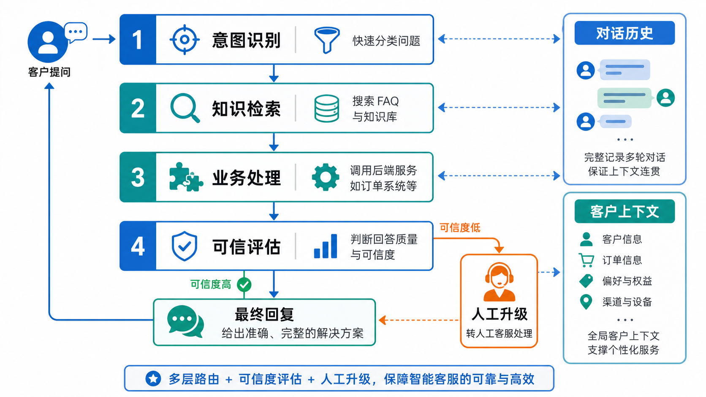

## 知识点讲解



### 1. 核心概念

智能客服 Agent 要解决三个核心问题：**快速找到答案**（检索）、**执行业务操作**（工具调用）、**知道何时放弃**（升级人工）。

第三点最容易被忽视。客服 Agent 最大的风险不是答不对——是答错了还不知道，让用户以为问题解决了。设计上必须有置信度评估机制，低于阈值就主动升级，不要强撑。

### 2. 技术细节

#### 2.1 四层架构

**意图识别层**：把用户输入分类——订单查询、退换货、产品咨询、投诉、其他。分类越精准，后续检索和工具路由越准。

**知识检索层**：分三类存储：

- FAQ 库：高频问题标准答案，用向量检索
- 政策库：退货规则、保修条款等，结构化存储
- 历史工单：相似问题的已解决方案

**业务工具层**：`query_order(order_id)` / `create_return(order_id, reason)` / `track_shipment(order_id)` 等。工具调用要做权限控制——查询类可以直接执行，退款类需要确认。

**升级决策层**：触发人工升级的条件：置信度 &lt; 60%、涉及金额纠纷、情绪激动（检测到愤怒/威胁关键词）、同一问题第三次未解决。

#### 2.2 多轮对话管理

客服对话必须维护会话状态，至少记录：

- 已确认的订单号/用户 ID
- 当前问题类型
- 已尝试过的解决方案
- 用户情绪信号

不记录状态，用户每轮都要重复信息，体验很差。

#### 2.3 置信度机制

```
置信度 = 检索覆盖度 * 0.4 + 数据新鲜度 * 0.3 + 问题复杂度倒数 * 0.3
```

简单问题、有对应 FAQ、数据是最新的 → 高置信度，直接回答。  
复杂问题、没有对应案例、数据可能过期 → 低置信度，升级人工。

## 代码示例

```python
import anthropic
import json

client = anthropic.Anthropic()
MODEL = "claude-3-5-sonnet-20241022"

SYSTEM_PROMPT = """你是一个专业的电商客服助手。

职责范围：
- 订单查询和状态追踪
- 退换货申请处理
- 商品咨询
- 物流查询

规则（严格遵守）：
1. 所有订单操作必须先查询订单确认身份，不能基于用户口述直接操作
2. 退款超过 200 元的，告知用户需要人工审核，不要承诺自动退款
3. 如果遇到不在职责范围内的问题，说明并提供人工客服联系方式
4. 用户出现明显不满情绪时，主动告知可以转人工

回复风格：简洁、礼貌、具体，不用空泛的"感谢您的耐心"开头。"""


def define_tools():
    return [
        {
            "name": "search_faq",
            "description": "从 FAQ 库检索常见问题答案",
            "input_schema": {
                "type": "object",
                "properties": {
                    "query":    {"type": "string", "description": "用户问题"},
                    "category": {"type": "string", "enum": ["order", "return", "product", "shipping"]},
                },
                "required": ["query"],
            },
        },
        {
            "name": "query_order",
            "description": "查询订单状态和详情",
            "input_schema": {
                "type": "object",
                "properties": {
                    "order_id": {"type": "string", "description": "订单号"},
                },
                "required": ["order_id"],
            },
        },
        {
            "name": "create_return_request",
            "description": "创建退换货申请",
            "input_schema": {
                "type": "object",
                "properties": {
                    "order_id": {"type": "string"},
                    "reason":   {"type": "string"},
                    "type":     {"type": "string", "enum": ["return", "exchange"]},
                },
                "required": ["order_id", "reason", "type"],
            },
        },
        {
            "name": "escalate_to_human",
            "description": "转接人工客服",
            "input_schema": {
                "type": "object",
                "properties": {
                    "reason":   {"type": "string", "description": "转接原因"},
                    "priority": {"type": "string", "enum": ["normal", "urgent"]},
                    "context":  {"type": "string", "description": "已了解的问题摘要"},
                },
                "required": ["reason"],
            },
        },
    ]


def execute_tool(name: str, inputs: dict) -> dict:
    """模拟工具执行"""
    if name == "search_faq":
        return {
            "found": True,
            "answer": f"关于「{inputs['query']}」的回答：...",
            "confidence": 0.85,
        }
    if name == "query_order":
        return {
            "order_id": inputs["order_id"],
            "status":   "已发货",
            "items":    [{"name": "商品 A", "qty": 1, "price": 299}],
            "total":    299,
            "ship_date": "2024-12-01",
        }
    if name == "create_return_request":
        return {"request_id": "RET-2024-001", "status": "已创建", "estimated_days": 3}
    if name == "escalate_to_human":
        return {"status": "已转接", "wait_time": "约 2 分钟", "agent_id": "CS-007"}
    return {"status": "unknown_tool"}


class CustomerServiceAgent:
    def __init__(self):
        self.history = [{"role": "system", "content": SYSTEM_PROMPT}]  # 用 system 传，但在 messages 里维护
        self.messages = []
        self.tools = define_tools()

    def handle_message(self, user_input: str) -> str:
        self.messages.append({"role": "user", "content": user_input})

        # Agent 循环（最多 5 轮工具调用，防无限循环）
        for _ in range(5):
            response = client.messages.create(
                model=MODEL,
                max_tokens=1024,
                system=SYSTEM_PROMPT,
                tools=self.tools,
                messages=self.messages,
            )

            if response.stop_reason == "end_turn":
                reply = ""
                for block in response.content:
                    if hasattr(block, "text"):
                        reply = block.text
                self.messages.append({"role": "assistant", "content": reply})
                return reply

            if response.stop_reason == "tool_use":
                tool_results = []
                for block in response.content:
                    if block.type == "tool_use":
                        result = execute_tool(block.name, block.input)
                        tool_results.append({
                            "type":        "tool_result",
                            "tool_use_id": block.id,
                            "content":     json.dumps(result, ensure_ascii=False),
                        })
                self.messages.append({"role": "assistant", "content": response.content})
                self.messages.append({"role": "user", "content": tool_results})

        return "抱歉，当前问题比较复杂，为您转接人工客服处理。"


# 测试
agent = CustomerServiceAgent()
print(agent.handle_message("我的订单 12345 还没到，现在什么状态？"))
print("---")
print(agent.handle_message("已经 7 天了还没到，我要退款！"))
```

## 面试怎么答

智能客服 Agent 的设计重点是三件事：快速检索、安全操作、知道何时升级。

检索层分层次——FAQ 向量库处理高频问题，政策库处理规则查询，历史工单处理复杂案例。操作层要做权限分级：查询类直接执行，退款类要二次确认，超额退款转人工。

最容易被忽视的是升级机制。客服 Agent 最大的风险是"信心很足但答错了"，所以必须有置信度评估——置信度低的时候主动说"这个问题我不确定，给您转人工"，比强撑一个错答案要好得多。

## 高频追问 & 加分点

- **Q1：如何处理用户情绪激动的情况？**  
    用关键词检测识别负面情绪信号（"投诉"、"律师"、"骗子"等）。检测到之后，Agent 先道歉确认情绪，然后主动提出转人工，不要继续机械地解答问题。情绪处理是客服体验的核心，技术上就是在回复逻辑里加一个情绪分支。
- **Q2：同一个用户多轮对话，历史信息如何管理？**  
    会话内的历史放在 messages 列表里，Agent 自然可以看到。跨会话的历史（比如用户昨天问过的）要存到数据库，下次对话时从 DB 拉取关键摘要注入 context——比如"该用户上次反馈过物流慢问题，已处理"。不能把全部历史都塞进去，要做摘要。
- **Q3：客服 Agent 给出了错误信息，怎么处理？**  
    两方面：事前预防（敏感操作二次确认、低置信度升级）和事后处理（收集用户反馈、标注错误案例、更新 FAQ 或 Prompt）。错误案例要进测试集，下次 Prompt 改动后必须跑这些案例，防止回归。
- **Q4：业务规则频繁变化，怎么让 Agent 跟上？**  
    把业务规则放在可更新的知识库里（政策库），而不是硬编码进 System Prompt。规则变了更新知识库即可，不需要改 Prompt 重新部署。退货政策、促销规则这类时效性强的内容一定要外置。
