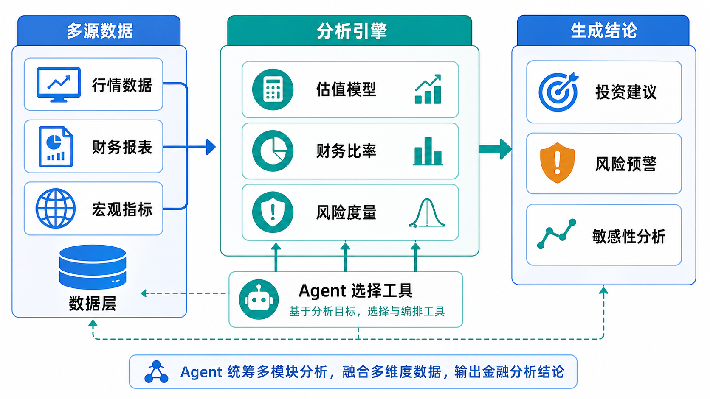

## 知识点讲解



### 1. 核心概念

金融分析 Agent 和普通分析 Agent 的最大区别：**结论要可追溯，分析要可解释，风险要明示**。

金融场景的错误代价很高——分析结论错了可能直接影响投资决策。所以设计上有两个核心约束：① 所有数据必须有来源，不允许 LLM 生成数字；② 分析结论必须同时给出"如果关键假设变了，结论会怎么变"的敏感性分析。

### 2. 技术细节

#### 2.1 数据层

数据是金融 Agent 的基础。数据层要做到：

- **多源交叉验证**：同一个财务指标从两个数据源取，不一致时报警，不能静默选一个
- **时效性标记**：每条数据都带 timestamp，分析时自动检测是否用了过期数据
- **单位统一**：不同来源可能用万元/亿元/百万美元，必须在数据层统一，不能扔给模型判断

数据类型：

- 财务报表（资产负债表、利润表、现金流）
- 市场数据（股价、成交量、技术指标）
- 宏观数据（利率、汇率、GDP）
- 研究报告（分析师观点、行业报告）

#### 2.2 分析引擎

分析方法用工具实现，不用模型推理：

- 估值计算（PE、PB、DCF）→ 数值计算，结果确定性高，用代码算
- 财务比率 → 同上，杜邦分解、流动性比率用代码算
- 相对表现比较 → 行业平均对标，查数据库

模型负责的是：解读计算结果、识别异常趋势、生成结论叙述。模型不应该负责输出精确数字。

#### 2.3 合规与风险披露

金融报告必须包含：

- 分析截止日期（数据时间点）
- 关键假设列表
- 风险因素（至少 3 条）
- 敏感性分析（关键假设变化 ±10% 时结论怎么变）
- 免责声明（不构成投资建议）

这些不是可选项，是必须在 System Prompt 里硬编码的规则。

## 代码示例

```python
import anthropic
import json

client = anthropic.Anthropic()
MODEL = "claude-3-5-sonnet-20241022"

SYSTEM_PROMPT = """你是一个专业的金融分析助手。

分析原则：
1. 所有财务数据必须通过工具获取，不允许凭空生成数字
2. 每个结论都需要对应的数据支撑
3. 分析报告必须包含：数据来源、关键假设、主要风险、敏感性分析
4. 免责声明：所有分析仅供参考，不构成投资建议

报告格式：
- 公司概况（基本面数据）
- 财务分析（核心指标趋势）
- 估值分析（至少两种方法）
- 主要风险（≥3条）
- 综合评估"""


def define_tools():
    return [
        {
            "name": "get_financial_statements",
            "description": "获取公司财务报表（资产负债表、利润表、现金流）",
            "input_schema": {
                "type": "object",
                "properties": {
                    "symbol":       {"type": "string", "description": "股票代码，如 AAPL"},
                    "period":       {"type": "string", "description": "期间，如 2024Q3 或 FY2023"},
                    "statement_type": {
                        "type": "string",
                        "enum": ["balance_sheet", "income_statement", "cash_flow", "all"],
                    },
                },
                "required": ["symbol", "period"],
            },
        },
        {
            "name": "get_market_data",
            "description": "获取市场数据（股价、成交量、技术指标）",
            "input_schema": {
                "type": "object",
                "properties": {
                    "symbol":    {"type": "string"},
                    "days":      {"type": "integer", "description": "历史数据天数"},
                    "include_pe": {"type": "boolean", "description": "是否包含市盈率"},
                },
                "required": ["symbol"],
            },
        },
        {
            "name": "calculate_valuation",
            "description": "计算估值指标（PE、PB、DCF、EV/EBITDA）",
            "input_schema": {
                "type": "object",
                "properties": {
                    "symbol": {"type": "string"},
                    "method": {
                        "type": "string",
                        "enum": ["pe_relative", "pb_relative", "dcf", "ev_ebitda"],
                    },
                    "assumptions": {
                        "type": "object",
                        "description": "DCF 的关键假设，如增长率、折现率",
                    },
                },
                "required": ["symbol", "method"],
            },
        },
        {
            "name": "get_industry_comparison",
            "description": "获取行业对标数据（行业平均 PE、同类公司财务比率）",
            "input_schema": {
                "type": "object",
                "properties": {
                    "symbol":  {"type": "string"},
                    "metrics": {
                        "type":  "array",
                        "items": {"type": "string"},
                        "description": "需要对标的指标，如 ['pe', 'roe', 'gross_margin']",
                    },
                },
                "required": ["symbol", "metrics"],
            },
        },
    ]


def execute_tool(name: str, inputs: dict) -> dict:
    """模拟工具执行（实际应接真实数据 API）"""
    if name == "get_financial_statements":
        return {
            "symbol": inputs["symbol"],
            "period": inputs.get("period", "FY2023"),
            "revenue": 383285,     # 百万美元
            "net_income": 96995,
            "total_assets": 352583,
            "roe": 0.172,
            "data_source": "SEC EDGAR",
            "as_of": "2024-01-01",
        }
    if name == "get_market_data":
        return {
            "symbol":         inputs["symbol"],
            "current_price":  189.5,
            "pe_ttm":         29.8,
            "market_cap":     2900000,  # 百万美元
            "52w_high":       199.6,
            "52w_low":        164.1,
        }
    if name == "calculate_valuation":
        return {
            "method":          inputs["method"],
            "fair_value":      195.0,
            "upside_downside": "2.9%",
            "key_assumptions": {"growth_rate": "5%", "discount_rate": "9%"},
        }
    if name == "get_industry_comparison":
        return {
            "industry_avg_pe":  25.4,
            "company_pe":       29.8,
            "premium_discount": "+17%",
            "peers":            [{"name": "MSFT", "pe": 32.1}, {"name": "GOOGL", "pe": 23.5}],
        }
    return {"status": "unknown_tool"}


def analyze_stock(symbol: str) -> str:
    """金融分析 Agent 主流程"""
    tools = define_tools()
    messages = [{
        "role": "user",
        "content": f"""请对 {symbol} 进行综合分析，包括：
1. 基本面数据（最新财务报表）
2. 市场表现和估值（PE、PB 方法）
3. 行业对标（与同行比较）
4. 主要风险（≥3条）
5. 综合评估（附关键假设和敏感性说明）

完成后请输出结构化的分析报告。""",
    }]

    for _ in range(10):  # 最多 10 轮工具调用
        response = client.messages.create(
            model=MODEL,
            max_tokens=4096,
            system=SYSTEM_PROMPT,
            tools=tools,
            messages=messages,
        )

        if response.stop_reason == "end_turn":
            for block in response.content:
                if hasattr(block, "text"):
                    return block.text
            return ""

        if response.stop_reason == "tool_use":
            tool_results = []
            for block in response.content:
                if block.type == "tool_use":
                    result = execute_tool(block.name, block.input)
                    tool_results.append({
                        "type":        "tool_result",
                        "tool_use_id": block.id,
                        "content":     json.dumps(result, ensure_ascii=False),
                    })
            messages.append({"role": "assistant", "content": response.content})
            messages.append({"role": "user", "content": tool_results})

    return "分析超时，请重试"


# 使用示例
report = analyze_stock("AAPL")
print(report[:800])
```

## 面试怎么答

金融分析 Agent 和普通分析 Agent 的最大区别是对数据准确性和结论可追溯性的要求。

设计上有两条硬规则：第一，所有数字必须来自工具调用，模型只负责解读和叙述，不能生成精确数字；第二，分析报告必须有明确的关键假设和敏感性分析——如果某个假设（比如增长率）变化 10%，结论会怎么变，这对投资决策非常重要。

还有一个经常被忽视的点：数据来源交叉验证。同一个财务指标从两个数据源拿，不一致时报警而不是静默选一个。数据质量直接决定分析质量，这层防护必须有。

## 高频追问 & 加分点

- **Q1：金融数据实时性很重要，如何确保数据不过期？**  
    每条数据都带 `as_of` 时间戳。分析时自动检测：如果财务数据超过 90 天没更新，提示"数据可能过期"；如果市场数据超过 15 分钟，标注"非实时价格"。这个检查逻辑在工具层做，不依赖模型判断。
- **Q2：不同分析方法给出的估值差异很大怎么处理？**  
    这是正常情况，DCF 和 PE 相对估值本来就可能差 20-30%。处理方式：① 对所有方法给出结果，不要只用一个；② 解释差异的原因（不同假设导致）；③ 给出综合区间而不是单一数字（如"合理估值区间 180-210 美元"）。差异本身就是信息。
- **Q3：分析师报告里有主观判断，LLM 能做到吗？**  
    定量部分（财务比率、估值计算）用代码和数据，不让 LLM 做。定性部分（行业趋势、竞争格局分析）才是 LLM 的场景，但要求：① 基于检索到的真实报告，不靠训练数据；② 结论要有来源引用；③ 不确定的判断要标注置信度。
- **Q4：如何防止 Agent 生成错误的金融建议？**  
    三层防护：System Prompt 里硬写免责声明和禁止用语（不能说"建议买入"只能说"基于数据的分析"）；输出层做关键词过滤，检测到"推荐"、"一定"、"保证"等词就拦截；日志记录所有输出，定期人工抽查。
