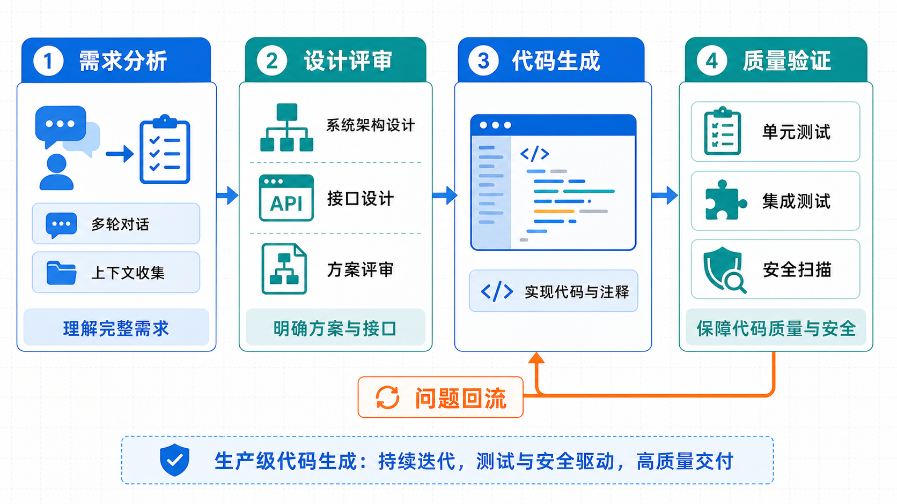

## 知识点讲解



### 1. 核心概念

代码生成 Agent 和"让 LLM 写代码"的区别：前者是一个有质量保证环节的工程系统，后者是一次性的文本生成。

关键差别在于**验证闭环**：生成代码 → 运行测试 → 修复失败 → 再测试，直到通过。没有这个闭环，生成的代码能跑多少靠运气。

### 2. 技术细节

#### 2.1 三个核心阶段

**需求精细化**：模糊需求是代码出错的最主要原因。在开始写代码前，用结构化问题把需求挖清楚：

- 功能边界：什么情况处理，什么情况不处理
- 性能要求：QPS、延迟、数据量级
- 接口规范：函数签名、输入输出类型
- 错误处理：失败时返回什么

**代码生成**：先生成接口定义（函数签名、类型注解、docstring），review 接口后再生成实现。接口先确认能减少大量返工。

**质量验证**：三层检查——

1. 语法/静态检查（flake8、mypy）
2. 单元测试执行（用模型自己生成的测试用例）
3. 安全扫描（依赖漏洞、SQL 注入等）

#### 2.2 上下文感知

生成的代码要能"融进去"，就需要感知现有代码库：

- 已有的工具函数不重复造轮子
- 变量命名、注释风格与现有代码一致
- 依赖库版本兼容
- 接口规范与现有模式一致

这不是靠 prompt 描述能解决的，要实际读取代码库相关文件注入上下文。

#### 2.3 迭代修复

测试失败后，不是直接重新生成，而是把失败信息传回模型让它针对性修复：

```
原代码 + 失败的测试 + 错误信息 → 模型修复 → 重新测试
```

这比重新生成效率高，也更能保持代码其他部分不变。

## 代码示例

```python
import anthropic
import json

client = anthropic.Anthropic()
MODEL = "claude-3-5-sonnet-20241022"

SYSTEM_PROMPT = """你是一个专业的 Python 代码生成助手。

代码规范：
- 所有函数必须有类型注解和 docstring
- 代码风格遵循 PEP 8
- 函数单一职责，单个函数不超过 50 行
- 错误处理要显式，不能用裸 except

生成流程：
1. 先输出函数签名和类型注解（不含实现），等确认
2. 实现时考虑边界情况和错误处理
3. 同时生成对应的单元测试

如果需求不明确，先提问而不是猜测。"""


def define_tools():
    return [
        {
            "name": "get_codebase_context",
            "description": "获取现有代码库上下文（相关函数、类、工具）",
            "input_schema": {
                "type": "object",
                "properties": {
                    "module":    {"type": "string", "description": "模块名或文件路径"},
                    "pattern":   {"type": "string", "description": "搜索模式，如函数名关键词"},
                },
                "required": ["module"],
            },
        },
        {
            "name": "run_code_tests",
            "description": "执行测试代码，返回通过/失败情况",
            "input_schema": {
                "type": "object",
                "properties": {
                    "test_code": {"type": "string", "description": "测试代码内容"},
                    "code":      {"type": "string", "description": "被测代码"},
                },
                "required": ["test_code", "code"],
            },
        },
        {
            "name": "run_security_scan",
            "description": "对代码进行安全扫描（SQL 注入、路径遍历、硬编码密码等）",
            "input_schema": {
                "type": "object",
                "properties": {
                    "code": {"type": "string"},
                },
                "required": ["code"],
            },
        },
        {
            "name": "check_code_style",
            "description": "检查代码风格（PEP 8、类型注解覆盖率）",
            "input_schema": {
                "type": "object",
                "properties": {
                    "code": {"type": "string"},
                },
                "required": ["code"],
            },
        },
    ]


def execute_tool(name: str, inputs: dict) -> dict:
    """模拟工具执行"""
    if name == "get_codebase_context":
        return {
            "module":     inputs["module"],
            "found_items": [
                {"name": "BaseProcessor", "type": "class",    "file": "processors/base.py"},
                {"name": "validate_input", "type": "function", "file": "utils/validation.py"},
            ],
            "conventions": {
                "naming":    "snake_case",
                "docstring": "Google style",
                "error":     "raise ValueError for validation errors",
            },
        }
    if name == "run_code_tests":
        # 模拟测试结果
        return {
            "passed": 4,
            "failed": 1,
            "failures": [
                {
                    "test":   "test_empty_input",
                    "error":  "AssertionError: expected ValueError, got None",
                    "line":   12,
                }
            ],
        }
    if name == "run_security_scan":
        return {
            "issues": [],
            "scanned": ["sql_injection", "path_traversal", "hardcoded_secrets"],
            "clean":   True,
        }
    if name == "check_code_style":
        return {
            "pep8_issues":       [],
            "type_coverage":     "100%",
            "docstring_coverage": "100%",
            "passed":            True,
        }
    return {"status": "unknown_tool"}


def generate_code(requirement: str, context_module: str = "main") -> dict:
    """代码生成 Agent 主流程，带验证和修复循环"""
    tools = define_tools()
    messages = [{
        "role": "user",
        "content": f"""请生成以下代码，并运行测试验证：

需求：{requirement}
代码库上下文：{context_module} 模块

请按流程：
1. 先获取代码库上下文了解现有规范
2. 生成代码（含类型注解和 docstring）
3. 生成单元测试并运行
4. 修复测试失败（如有）
5. 运行安全扫描和风格检查
6. 输出最终代码""",
    }]

    max_iterations = 8
    for iteration in range(max_iterations):
        response = client.messages.create(
            model=MODEL,
            max_tokens=4096,
            system=SYSTEM_PROMPT,
            tools=tools,
            messages=messages,
        )

        if response.stop_reason == "end_turn":
            final_text = ""
            for block in response.content:
                if hasattr(block, "text"):
                    final_text = block.text
            return {"status": "success", "code": final_text, "iterations": iteration + 1}

        if response.stop_reason == "tool_use":
            tool_results = []
            for block in response.content:
                if block.type == "tool_use":
                    result = execute_tool(block.name, block.input)
                    tool_results.append({
                        "type":        "tool_result",
                        "tool_use_id": block.id,
                        "content":     json.dumps(result, ensure_ascii=False),
                    })
            messages.append({"role": "assistant", "content": response.content})
            messages.append({"role": "user",      "content": tool_results})

    return {"status": "timeout", "code": "", "iterations": max_iterations}


# 使用示例
result = generate_code(
    requirement="实现一个文本清洗函数，去除 HTML 标签、多余空白，返回纯文本",
    context_module="utils",
)
print(f"状态: {result['status']}, 迭代次数: {result['iterations']}")
print(result["code"][:500])
```

## 面试怎么答

代码生成 Agent 和直接用 LLM 写代码的区别在于验证闭环：生成 → 测试 → 修复 → 再测试，有了这个环才能保证质量。

流程上分三步：需求精细化（先确认接口再写实现，减少返工）、代码生成（先输出函数签名确认，再生成实现和测试用例）、质量验证（测试执行 + 安全扫描 + 风格检查）。测试失败时，把失败信息连同原代码一起传给模型让它针对性修复，比重新生成效率高，也能保持代码其他部分不变。

上下文感知也很重要——生成的代码要能融进现有代码库，命名规范、工具复用、依赖版本都要匹配，这需要在生成前读取相关代码注入上下文。

## 高频追问 & 加分点

- **Q1：生成的代码能直接上生产吗？**  
    经过完整测试和安全扫描的代码可以作为候选，但建议加一层人工 review，特别是核心业务逻辑。Agent 可以生成 80-90% 的"可信赖代码"，剩下的边界情况和业务逻辑仍需人工确认。另外，预发环境集成测试是必须的，不能跳过。
- **Q2：需求描述很模糊，Agent 怎么处理？**  
    让 Agent 先提问，而不是猜测。Prompt 里写清楚"如果需求不明确，先用结构化问题澄清，澄清完才开始写代码"。比如遇到"写一个用户管理模块"，Agent 应该先问：有哪些角色、接口是 REST 还是 GraphQL、需要哪些字段、认证方式是什么。
- **Q3：Agent 修了多次还是测试不过怎么办？**  
    设置最大迭代次数（比如 5 次），超出后返回"修复失败"状态，附上所有失败信息，上报给人工处理。别让 Agent 无限循环。同时，迭代修复的历史要记录在案，帮人工快速定位问题根源。
- **Q4：安全扫描能防住所有风险吗？**  
    不能，但能过滤大部分常见漏洞（SQL 注入、路径遍历、硬编码密码、敏感信息泄露）。扫描工具要定期更新规则库。对于业务逻辑漏洞（比如权限检查是否正确），静态扫描发现不了，还是需要人工 review + 集成测试覆盖。
