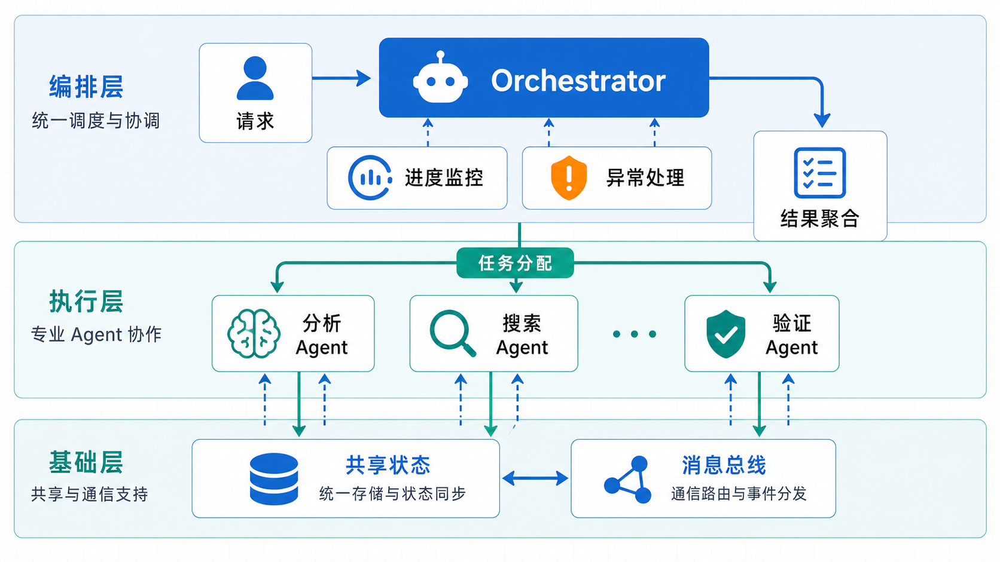

## 知识点讲解



### 1. 核心概念

多 Agent 系统的核心问题不是"怎么让多个模型一起跑"，而是**怎么把复杂任务分给合适的 Agent，怎么协调它们的执行，怎么把结果整合起来**。

什么时候值得用多 Agent？当单个 Agent 的 context 装不下所有需要的工具和上下文、或者任务的不同阶段需要不同的专业能力时。一个 Agent 做所有事，prompt 会越来越臃肿，效果反而变差。

### 2. 技术细节

#### 2.1 Orchestrator 模式

核心架构：一个 Orchestrator Agent 负责拆任务、分配、收集结果；多个 Worker Agent 各司其职。

Orchestrator 的职责：

- 把用户请求拆成子任务
- 决定哪个 Agent 做哪个任务
- 管理任务的执行顺序（顺序/并行/条件）
- 聚合各 Agent 的结果
- 处理 Agent 失败和重试

Worker Agent 的设计原则：**职责单一，接口清晰**。每个 Worker 有固定的输入格式和输出格式，不依赖其他 Worker 的内部状态。

#### 2.2 任务调度策略

| 策略 | 适用场景 | 特点 |
| --- | --- | --- |
| 顺序执行 | 有依赖关系的任务 | B 依赖 A 的结果 |
| 并行执行 | 独立任务 | 减少总时间 |
| 条件执行 | 分支场景 | 基于 A 的结果决定是否执行 B |
| 扇出-聚合 | 需要多视角的任务 | 多个 Agent 独立分析，最后合并 |

#### 2.3 共享状态管理

所有 Agent 共享一个状态库，存储：

- 任务元数据（ID、状态、依赖关系）
- Agent 执行结果（按任务 ID 索引）
- 全局上下文（对所有 Agent 都需要的信息）

写操作需要加锁，防止并发写冲突。只允许 Orchestrator 修改任务状态，Worker 只读任务、写结果。

## 代码示例

```python
import anthropic
import json
from dataclasses import dataclass, field
from typing import Optional

client = anthropic.Anthropic()
MODEL = "claude-3-5-sonnet-20241022"


@dataclass
class Task:
    id:          str
    description: str
    agent:       str
    depends_on:  list[str] = field(default_factory=list)
    status:      str = "pending"   # pending / running / done / failed
    result:      Optional[str] = None


@dataclass
class WorkerAgent:
    name:       str
    role:       str
    system:     str

    def run(self, task_description: str, context: str = "") -> str:
        prompt = task_description
        if context:
            prompt = f"背景信息：\n{context}\n\n任务：{task_description}"

        response = client.messages.create(
            model=MODEL,
            max_tokens=2048,
            system=self.system,
            messages=[{"role": "user", "content": prompt}],
        )
        for block in response.content:
            if hasattr(block, "text"):
                return block.text
        return ""


class MultiAgentOrchestrator:
    """Orchestrator 负责任务拆分、分配和结果聚合"""

    def __init__(self):
        # 注册专业 Worker
        self.workers: dict[str, WorkerAgent] = {
            "researcher": WorkerAgent(
                name="researcher",
                role="信息检索与整理",
                system="你是一个信息检索专家。专注于收集、整理和核实信息，给出清晰的信息摘要。",
            ),
            "analyst": WorkerAgent(
                name="analyst",
                role="数据分析与推理",
                system="你是一个分析专家。基于给定信息进行深度分析，识别趋势和关键洞察。",
            ),
            "writer": WorkerAgent(
                name="writer",
                role="内容创作与组织",
                system="你是一个内容创作专家。把分析结果组织成清晰、结构化的输出。",
            ),
        }
        self.shared_state: dict[str, Task] = {}

    def decompose_task(self, user_request: str) -> list[Task]:
        """用 Orchestrator LLM 把用户需求拆成子任务"""
        system = """你是一个任务协调专家。把用户请求拆分为子任务，并分配给合适的 Agent。

可用 Agent：
- researcher：信息检索和整理
- analyst：数据分析和推理  
- writer：内容创作和组织

输出格式（JSON 数组）：
[
  {"id": "t1", "description": "...", "agent": "researcher", "depends_on": []},
  {"id": "t2", "description": "...", "agent": "analyst",    "depends_on": ["t1"]},
  {"id": "t3", "description": "...", "agent": "writer",     "depends_on": ["t2"]}
]"""

        response = client.messages.create(
            model=MODEL,
            max_tokens=1024,
            system=system,
            messages=[{"role": "user", "content": f"拆分以下任务：{user_request}"}],
        )

        raw = ""
        for block in response.content:
            if hasattr(block, "text"):
                raw = block.text

        try:
            import re
            json_match = re.search(r'\[.*\]', raw, re.DOTALL)
            if json_match:
                task_defs = json.loads(json_match.group())
                tasks = [
                    Task(
                        id=t["id"],
                        description=t["description"],
                        agent=t["agent"],
                        depends_on=t.get("depends_on", []),
                    )
                    for t in task_defs
                ]
                return tasks
        except (json.JSONDecodeError, KeyError):
            pass

        # 降级：固定 3 步流程
        return [
            Task("t1", f"研究背景信息：{user_request}", "researcher", []),
            Task("t2", "基于研究结果进行深度分析",      "analyst",    ["t1"]),
            Task("t3", "把分析结果整理成最终输出",       "writer",     ["t2"]),
        ]

    def execute(self, user_request: str) -> str:
        """执行多 Agent 协作流程"""
        print(f"[Orchestrator] 分解任务：{user_request[:50]}...")
        tasks = self.decompose_task(user_request)

        # 初始化共享状态
        for task in tasks:
            self.shared_state[task.id] = task

        # 按依赖顺序执行（简化版拓扑排序）
        executed = set()
        max_rounds = len(tasks) * 2  # 防止死循环

        for _ in range(max_rounds):
            progress = False
            for task in tasks:
                if task.id in executed:
                    continue

                # 检查依赖是否都完成
                deps_done = all(
                    self.shared_state[dep].status == "done"
                    for dep in task.depends_on
                )
                if not deps_done:
                    continue

                # 收集前置任务的结果作为上下文
                context_parts = []
                for dep_id in task.depends_on:
                    dep_result = self.shared_state[dep_id].result or ""
                    context_parts.append(f"[{dep_id} 的结果]\n{dep_result}")
                context = "\n\n".join(context_parts)

                # 执行 Worker
                worker = self.workers.get(task.agent)
                if not worker:
                    task.status = "failed"
                    task.result = f"未知 Agent：{task.agent}"
                else:
                    print(f"  [{task.agent}] 执行：{task.description[:40]}...")
                    task.status = "running"
                    task.result = worker.run(task.description, context)
                    task.status = "done"
                    print(f"  [{task.agent}] 完成")

                executed.add(task.id)
                progress = True

            if len(executed) == len(tasks):
                break
            if not progress:
                break  # 有循环依赖，跳出

        # 返回最后一个任务的结果作为最终输出
        if tasks:
            return self.shared_state[tasks[-1].id].result or "执行失败"
        return "没有生成任务"


# 使用示例
orchestrator = MultiAgentOrchestrator()
result = orchestrator.execute("分析 AI Agent 在企业中的应用现状和未来趋势")
print("\n=== 最终结果 ===")
print(result[:600])
```

## 面试怎么答

多 Agent 系统的核心是 Orchestrator 模式：一个 Orchestrator 负责拆任务、分配、调度和聚合；多个专业 Worker 各负责一个领域。

关键设计点有三个：① Worker 职责单一、接口清晰，输入输出格式固定，不依赖其他 Worker 的内部状态；② 任务调度策略要根据依赖关系决定顺序/并行——有依赖关系的顺序执行，独立的并行执行；③ 共享状态管理，所有任务结果集中存储，Worker 之间通过共享状态传递信息，不直接互相通信。

什么时候用多 Agent？当单个 Agent 的工具集太多导致 prompt 膨胀、或者任务的不同阶段需要完全不同的"心智模式"时。不要为了多 Agent 而多 Agent，增加协调复杂度是有成本的。

## 高频追问 & 加分点

- **Q1：多个 Agent 给出冲突结论时怎么处理？**  
    几个策略：① Orchestrator 汇总所有 Agent 的结论，明确展示分歧，让用户或上级决策；② 多数投票（适合分类判断）；③ 按优先级取权威 Agent 的结论（比如某任务以分析 Agent 的结论为准）。对于高风险决策，分歧应该直接上报，不要自动解决。
- **Q2：某个 Worker Agent 挂了怎么处理？**  
    两层处理：Worker 层做超时检测和重试（最多 2 次）；Orchestrator 层对失败的 Worker 有降级策略，比如跳过可选步骤、用简化版本替代、或者返回"部分完成"的结果附上说明。不要让单个 Worker 的失败导致整个流程阻塞。
- **Q3：多 Agent 系统的调试比单 Agent 困难很多，怎么办？**  
    可观测性是关键：每个 Agent 的输入、输出、执行时间都要记录；任务调度日志（谁在什么时间执行了什么）要完整；失败时要记录是哪个 Agent 失败的以及完整的错误信息。有了这些，排查时可以把特定 Agent 的输入/输出单独拿出来复现，不需要重跑整个流程。
- **Q4：多 Agent 比单 Agent 成本更高怎么控制？**  
    对于简单任务，Orchestrator 在拆分阶段就判断"这个任务不需要多 Agent"，直接走单 Agent 路径。Worker 之间传递的上下文要做摘要，不传全文。并行的 Worker 可以用更便宜的小模型，Orchestrator 和最终综合步骤才用大模型。
