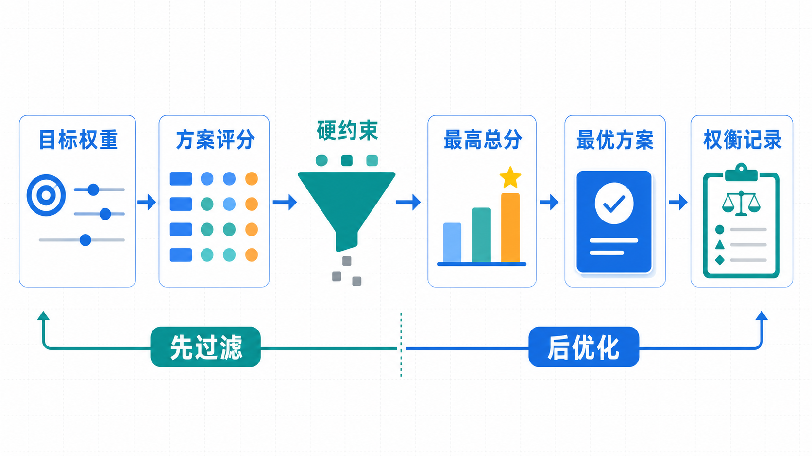

## 知识点讲解



### 1. 核心概念

多目标冲突是 Agent 决策中最常见的难题：速度快了准确率就可能下降；成本低了质量可能变差；用户体验好了系统资源消耗更多。

没有银弹，但有方法论：**先分清硬约束和软约束，硬约束不能违反，软约束做加权权衡**。

硬约束（Constraint）：必须满足，违反了方案直接淘汰——比如"合规要求"、"安全底线"、"响应时间不能超过 30 秒"。

软约束（Objective）：尽量优化，有权重，可以做取舍——比如"尽量降低成本"、"尽量提高用户满意度"。

### 2. 技术细节

#### 2.1 决策框架

**第一步：确认硬约束**  
先过滤不满足硬约束的方案，剩下的才是候选方案。这步是二元的（满足/不满足），不需要打分。

**第二步：加权评分**  
对候选方案在每个软约束上打分，按权重加权求和：

```
综合得分 = Σ(目标分数 × 目标权重)
```

**第三步：敏感性分析**  
权重设置是主观的，所以要检验：如果某个权重变化 ±20%，最优方案会不会变？不会变说明决策稳健；会变说明决策对这个权重很敏感，需要更小心。

**第四步：上报规则**  
当最优方案分数和次优方案分数差距很小（比如 &lt; 5%），或者存在帕累托改进（找到一个方案在所有目标上都不比当前最优差），说明自动决策不可靠，应该上报人工确认。

#### 2.2 常见冲突类型

| 冲突类型 | 例子 | 处理方式 |
| --- | --- | --- |
| 成本 vs 质量 | 便宜模型 vs 精准模型 | 加权评分，按场景调整权重 |
| 速度 vs 准确 | 流式返回 vs 完整验证 | 分场景：实时场景优速度，高风险场景优准确 |
| 用户 vs 平台 | 给用户推荐最优 vs 推荐平台利润高的 | 硬约束：不能欺骗用户；软约束：平台利益权重 |

## 代码示例

```python
from dataclasses import dataclass, field
from typing import Optional
import anthropic
import json

client = anthropic.Anthropic()
MODEL = "claude-3-5-sonnet-20241022"


@dataclass
class Objective:
    name:        str
    weight:      float        # 权重，所有软目标权重之和应为 1.0
    direction:   str          # "maximize" 或 "minimize"
    is_hard:     bool = False # True = 硬约束，False = 软约束
    threshold:   Optional[float] = None  # 硬约束的阈值


@dataclass
class Solution:
    name:   str
    scores: dict[str, float]  # 各目标的原始分（0-1）


class MultiObjectiveDecisionAgent:
    """多目标决策引擎"""

    def __init__(self, objectives: list[Objective]):
        self.objectives = {o.name: o for o in objectives}
        self.decision_log: list[dict] = []

    def evaluate(self, solutions: list[Solution]) -> dict:
        """评估所有候选方案，返回最优方案和评估详情"""
        # 第一步：过滤不满足硬约束的方案
        valid_solutions = []
        rejected = []

        for sol in solutions:
            is_valid = True
            for obj_name, obj in self.objectives.items():
                if not obj.is_hard:
                    continue
                score = sol.scores.get(obj_name, 0)
                if obj.threshold is not None:
                    if obj.direction == "minimize" and score > obj.threshold:
                        rejected.append({"solution": sol.name, "reason": f"{obj_name} 超过阈值 {obj.threshold}"})
                        is_valid = False
                        break
                    if obj.direction == "maximize" and score < obj.threshold:
                        rejected.append({"solution": sol.name, "reason": f"{obj_name} 低于阈值 {obj.threshold}"})
                        is_valid = False
                        break
            if is_valid:
                valid_solutions.append(sol)

        if not valid_solutions:
            return {"status": "no_valid_solution", "rejected": rejected}

        # 第二步：加权评分（软目标）
        soft_objectives = {n: o for n, o in self.objectives.items() if not o.is_hard}
        scored = []

        for sol in valid_solutions:
            weighted = 0.0
            detail = {}
            for obj_name, obj in soft_objectives.items():
                raw = sol.scores.get(obj_name, 0)
                # minimize 目标取反（分数越低越好 → 转换为分数越高越好）
                normalized = raw if obj.direction == "maximize" else (1 - raw)
                contribution = normalized * obj.weight
                weighted += contribution
                detail[obj_name] = {"raw": raw, "normalized": normalized, "contribution": contribution}
            scored.append({"solution": sol.name, "total_score": round(weighted, 4), "detail": detail})

        scored.sort(key=lambda x: x["total_score"], reverse=True)
        best = scored[0]
        second = scored[1] if len(scored) > 1 else None

        # 第三步：判断是否需要人工介入
        needs_human = False
        reason = ""
        if second and (best["total_score"] - second["total_score"]) < 0.05:
            needs_human = True
            reason = f"最优方案（{best['solution']}）和次优方案（{second['solution']}）分差小于 5%，建议人工确认"

        result = {
            "status":        "needs_human" if needs_human else "decided",
            "best":          best["solution"],
            "total_score":   best["total_score"],
            "ranking":       scored,
            "rejected":      rejected,
            "needs_human":   needs_human,
            "human_reason":  reason,
        }
        self.decision_log.append(result)
        return result

    def explain_decision(self, result: dict) -> str:
        """用 LLM 生成可读的决策解释"""
        if result["status"] == "no_valid_solution":
            return f"所有方案都被硬约束过滤：{result['rejected']}"

        system = "你是一个决策分析助手，用简洁清晰的中文解释多目标决策结果。"
        prompt = f"""请解释以下决策结果：

最优方案：{result['best']}（综合得分 {result['total_score']:.2%}）
排名：{json.dumps(result['ranking'], ensure_ascii=False, indent=2)}
被过滤的方案：{result['rejected']}

请说明：1. 为什么选择这个方案 2. 主要的权衡取舍 3. 如果有不确定性，请指出"""

        response = client.messages.create(
            model=MODEL,
            max_tokens=512,
            system=system,
            messages=[{"role": "user", "content": prompt}],
        )
        for block in response.content:
            if hasattr(block, "text"):
                return block.text
        return ""


# ===== 使用示例：选择 LLM 模型 =====
objectives = [
    Objective("latency_p99",  weight=0.0,  direction="minimize", is_hard=True, threshold=0.1),  # 硬约束：P99 延迟 < 0.1（归一化后）
    Objective("accuracy",      weight=0.45, direction="maximize"),
    Objective("cost_per_call", weight=0.35, direction="minimize"),
    Objective("latency",       weight=0.20, direction="minimize"),
]

agent = MultiObjectiveDecisionAgent(objectives)

solutions = [
    Solution("GPT-4",          {"latency_p99": 0.08, "accuracy": 0.95, "cost_per_call": 0.9,  "latency": 0.7}),
    Solution("GPT-3.5",        {"latency_p99": 0.05, "accuracy": 0.78, "cost_per_call": 0.2,  "latency": 0.3}),
    Solution("Claude-Sonnet",  {"latency_p99": 0.06, "accuracy": 0.92, "cost_per_call": 0.5,  "latency": 0.4}),
    Solution("Slow-BigModel",  {"latency_p99": 0.95, "accuracy": 0.98, "cost_per_call": 0.95, "latency": 0.95}),  # 延迟硬约束不满足
]

result = agent.evaluate(solutions)
print(f"决策状态：{result['status']}")
print(f"最优方案：{result['best']}（得分 {result['total_score']:.2%}）")
print(f"被过滤：{[r['solution'] for r in result['rejected']]}")

if result.get("needs_human"):
    print(f"⚠️  建议人工确认：{result['human_reason']}")

explanation = agent.explain_decision(result)
print(f"\n决策解释：{explanation[:300]}")
```

## 面试怎么答

多目标冲突决策的关键是先分清硬约束和软约束。硬约束是底线，不满足就直接淘汰；软约束是优化目标，用加权评分做取舍。

具体流程：① 列出所有目标，标清楚哪些是硬约束（不可违反）哪些是软约束（有权重）；② 过滤硬约束不达标的方案；③ 对剩余方案做加权评分；④ 检查最优和次优的分差，差距太小说明决策不稳定，上报人工。

权重怎么定是个难题。通常的方式：对齐业务优先级（成本敏感期提高成本权重）、基于历史案例验证（过去的决策合不合理）、定期复审（季度 / 年度根据业务变化调整）。

## 高频追问 & 加分点

- **Q1：权重怎么设才合理？**  
    权重设置是主观判断，但可以做得更严谨：① 让业务方排序（哪个目标更重要）；② 用历史案例验证——用当前权重回测，看过去的好决策是否能被选出来；③ 做敏感性分析，如果单个权重变化 20% 就改变了决策结论，说明这个权重很关键，需要更多讨论才能确定。
- **Q2：目标无法量化（比如"用户满意度"）怎么处理？**  
    用代理指标（Proxy Metric）：用户满意度 → 用"解决率"+"平均对话轮数"+"NPS 得分"组合代替。代理指标不完美，但比"感觉"可靠。另一个方向是设计"评分员"——让 LLM 或人工评委对方案打 1-5 分，转换成 0-1 的量化分数。
- **Q3：帕累托最优有什么实际意义？**  
    帕累托最优集是"没有方案在所有目标上都更好"的集合。它的实际意义是：集合内的所有方案都值得讨论，不应该自动选一个。如果有一个方案对所有目标都不差（帕累托支配了其他方案），那就应该选它；如果有多个帕累托最优方案，就是真正的权衡，需要人工或更高层的目标来决定。
- **Q4：决策结果要怎么向用户或管理层解释？**  
    关键是可解释性：不只说"选了 A"，要说"选 A 因为它在准确率（权重 45%）上明显优于 B，虽然成本高一些（B 在成本上得分更高），综合权衡下 A 胜出"。把权衡说清楚，让决策接受方知道他们"买"了什么，"放弃"了什么。
