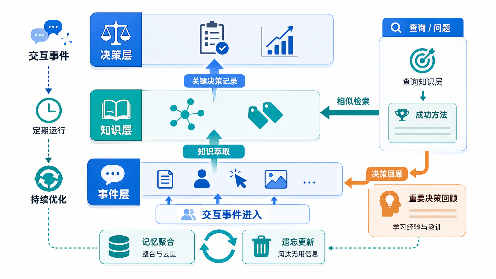

## 知识点讲解



### 1. 核心概念

LLM 没有天然的长期记忆——每次对话都是一张白纸，session 结束记忆就消失了。但 Agent 往往需要在多个会话之间积累经验：记住用户偏好、避免重复错误、复用成功方案。

长期记忆要解决的核心问题是**存什么、怎么找、什么时候忘**。

### 2. 技术细节

#### 2.1 三层记忆架构

**事件层（Raw Events）**：原始交互日志，记录每次任务的输入、输出、执行步骤、是否成功。是最细粒度的记录，用于复现和分析。

**知识层（Knowledge Base）**：从事件中提炼的可重用知识——"处理 X 类任务，用 Y 方法效果好"。比事件层抽象，支持向量检索（找相似问题的解法）。

**决策层（Decision History）**：关键决策及其结果，支持反思——"上次选择了 A，结果 B，下次类似情况参考"。

三层的关系：事件层是原材料，知识层是提炼的经验，决策层是教训。事件层数据量最大，知识层最常被检索，决策层最有战略价值。

#### 2.2 存储方案选型

| 层级 | 推荐存储 | 理由 |
| --- | --- | --- |
| 事件层 | 关系数据库（PostgreSQL） | 结构化，支持按时间/类型/结果查询 |
| 知识层 | 向量数据库（Chroma/Weaviate） | 支持语义相似性搜索 |
| 决策层 | 关系数据库 + 向量索引 | 结构化存储 + 相似决策检索 |

#### 2.3 记忆检索

每次任务开始前，Agent 先检索记忆：

1. 用当前任务做向量检索，找 top-3 相似的历史案例
2. 把历史案例的"关键经验"注入 context（不是全文，是摘要）
3. 执行完成后，把本次经验更新回知识库

#### 2.4 遗忘机制

记忆不能无限增长，要设计遗忘：

- **时间衰减**：久远的记忆权重下降
- **使用频率**：长期没有被检索到的记忆降权
- **准确性验证**：定期检验知识库里的知识是否还准确
- **压缩聚合**：10 条相似的成功案例 → 压缩成 1 条"处理 X 类问题的通用方法"

## 代码示例

```python
import json
from datetime import datetime, timedelta
from dataclasses import dataclass, field
from typing import Optional
import anthropic

client = anthropic.Anthropic()
MODEL = "claude-3-5-sonnet-20241022"


@dataclass
class MemoryItem:
    id:          str
    content:     str
    task_type:   str
    success:     bool
    created_at:  str
    usage_count: int = 0
    weight:      float = 1.0   # 随时间和使用频率衰减


class LongTermMemorySystem:
    """三层长期记忆系统（简化实现，实际应使用向量数据库）"""

    def __init__(self, decay_days: int = 30):
        self.events:    list[dict] = []       # 事件层
        self.knowledge: list[MemoryItem] = [] # 知识层
        self.decisions: list[dict] = []       # 决策层
        self.decay_days = decay_days

    # ===== 记录层 =====

    def record_event(self, task: str, result: str, success: bool, task_type: str = "general"):
        """记录一次任务事件"""
        event = {
            "id":         f"evt_{len(self.events)}",
            "task":       task,
            "result":     result,
            "success":    success,
            "task_type":  task_type,
            "timestamp":  datetime.now().isoformat(),
        }
        self.events.append(event)

        # 成功的事件自动提炼为知识
        if success:
            self._extract_knowledge(event)

    def _extract_knowledge(self, event: dict):
        """从成功事件提炼可重用知识"""
        # 实际应该用 LLM 提炼，这里用简单规则
        knowledge_content = f"任务类型 [{event['task_type']}]：{event['task'][:100]}\n成功方法：{event['result'][:200]}"
        item = MemoryItem(
            id=f"know_{len(self.knowledge)}",
            content=knowledge_content,
            task_type=event["task_type"],
            success=True,
            created_at=event["timestamp"],
        )
        self.knowledge.append(item)

    def record_decision(self, context: str, decision: str, rationale: str, outcome: Optional[str] = None):
        """记录一次关键决策"""
        self.decisions.append({
            "id":        f"dec_{len(self.decisions)}",
            "context":   context,
            "decision":  decision,
            "rationale": rationale,
            "outcome":   outcome,
            "timestamp": datetime.now().isoformat(),
        })

    # ===== 检索层 =====

    def retrieve_similar(self, current_task: str, top_k: int = 3) -> list[MemoryItem]:
        """检索相似的历史知识（简化版：关键词匹配，实际用向量检索）"""
        task_words = set(current_task.lower().split())

        scored = []
        for item in self.knowledge:
            item_words = set(item.content.lower().split())
            overlap = len(task_words & item_words) / (len(task_words) + 1)
            score = overlap * item.weight
            scored.append((score, item))

        scored.sort(key=lambda x: x[0], reverse=True)
        top = [item for _, item in scored[:top_k] if _ > 0]

        # 更新使用计数
        for item in top:
            item.usage_count += 1

        return top

    def build_memory_context(self, current_task: str) -> str:
        """构建注入 Agent context 的记忆摘要"""
        similar = self.retrieve_similar(current_task, top_k=3)
        if not similar:
            return ""

        lines = ["[历史经验]"]
        for i, item in enumerate(similar, 1):
            lines.append(f"{i}. {item.content[:150]}")
        return "\n".join(lines)

    # ===== 遗忘层 =====

    def apply_decay(self):
        """对久远、低频使用的记忆做时间衰减"""
        now = datetime.now()
        for item in self.knowledge:
            try:
                created = datetime.fromisoformat(item.created_at)
                days_old = (now - created).days
                # 超过 decay_days 开始衰减，最低权重 0.1
                if days_old > self.decay_days:
                    decay_factor = max(0.1, 1.0 - (days_old - self.decay_days) / 90)
                    item.weight = decay_factor
            except (ValueError, TypeError):
                pass

    def prune_low_value(self, min_weight: float = 0.1):
        """移除低价值记忆"""
        before = len(self.knowledge)
        self.knowledge = [k for k in self.knowledge if k.weight > min_weight or k.usage_count > 2]
        print(f"  剪枝：移除 {before - len(self.knowledge)} 条低价值记忆")

    def get_stats(self) -> dict:
        """获取记忆系统统计"""
        success_events = sum(1 for e in self.events if e["success"])
        return {
            "total_events":     len(self.events),
            "success_rate":     success_events / len(self.events) if self.events else 0,
            "knowledge_items":  len(self.knowledge),
            "decisions":        len(self.decisions),
        }


# ===== 带长期记忆的 Agent =====
class MemoryAwareAgent:
    def __init__(self):
        self.memory = LongTermMemorySystem(decay_days=30)

    def execute(self, task: str, task_type: str = "general") -> str:
        # 检索历史经验
        memory_ctx = self.memory.build_memory_context(task)

        system = "你是一个具有长期记忆的 Agent，能从历史经验中学习。"
        user_content = task
        if memory_ctx:
            user_content = f"{memory_ctx}\n\n当前任务：{task}\n\n请参考历史经验完成任务。"

        response = client.messages.create(
            model=MODEL,
            max_tokens=1024,
            system=system,
            messages=[{"role": "user", "content": user_content}],
        )

        result = ""
        for block in response.content:
            if hasattr(block, "text"):
                result = block.text

        # 记录本次任务
        success = len(result) > 50  # 简化：有实质性输出算成功
        self.memory.record_event(task, result, success, task_type)

        return result


# 模拟使用
agent = MemoryAwareAgent()

# 执行几次任务，积累经验
tasks = [
    ("分析用户留存率下降的原因", "data_analysis"),
    ("对比 A/B 测试的统计显著性",  "data_analysis"),
    ("总结上季度产品迭代效果",    "report"),
]

for task, task_type in tasks:
    result = agent.execute(task, task_type)
    print(f"✓ [{task_type}] {task[:30]}... 完成")

# 新任务会自动检索相关历史经验
print("\n[新任务，参考历史经验]")
new_result = agent.execute("分析本月新用户转化率", "data_analysis")
print(new_result[:300])

# 查看记忆统计
stats = agent.memory.get_stats()
print(f"\n记忆统计：{stats}")
```

## 面试怎么答

为 Agent 实现长期记忆，核心是三层架构：事件层存原始日志，知识层存从成功事件提炼的经验，决策层存关键决策及结果。

检索上，用向量相似性搜索——每次任务开始前，把当前任务向量化，找 top-K 相似的历史案例，把经验摘要注入 context。不是把全部历史塞进去，是精准地注入相关的几条。

遗忘机制也很重要，不然记忆会无限增长，检索质量下降。两个机制：时间衰减（久远的记忆权重降低）和使用频率（长期不被检索到的记忆降权）。定期跑压缩：把 10 条相似的成功案例聚合成 1 条通用知识，减少存储量，提高检索效率。

## 高频追问 & 加分点

- **Q1：向量数据库存知识，相似度阈值怎么设？**  
    从高阈值（比如 0.8）开始，看召回率。阈值太高：找不到相似案例，记忆没用上；阈值太低：拉进来很多不相关的，干扰决策。通常 0.6-0.75 是比较好的范围，具体要结合领域和测试集调。另外加 Top-K 限制（比如最多拉 3 条），防止 context 被历史经验占满。
- **Q2：记忆里存了过时或错误的信息怎么处理？**  
    三个机制：① 时间衰减，久远的记忆自动降权；② 反馈更新，用户标注"这个方法不好用"时，主动降低对应知识的权重；③ 定期审查，对高权重的知识做抽样验证，发现不准确的直接删除或标注为"待验证"。
- **Q3：多个 Agent 能共享长期记忆吗？**  
    能，但要注意写入权限控制。读取可以共享，写入要限制——不能让任意 Agent 随意修改共享知识库，避免一个 Agent 的坏经验污染所有 Agent。通常的方案是：写入走"提交 + 审核"流程，达到一定置信度阈值才合并进共享库。
- **Q4：长期记忆里存用户数据，隐私怎么处理？**  
    原则是最小化存储：只存任务类型和方法论，不存用户个人信息。如果任务涉及敏感数据，在提炼知识时要脱敏。用户有权要求删除自己的交互记录（GDPR 合规）。存储时对敏感字段加密，访问权限要严格控制。
