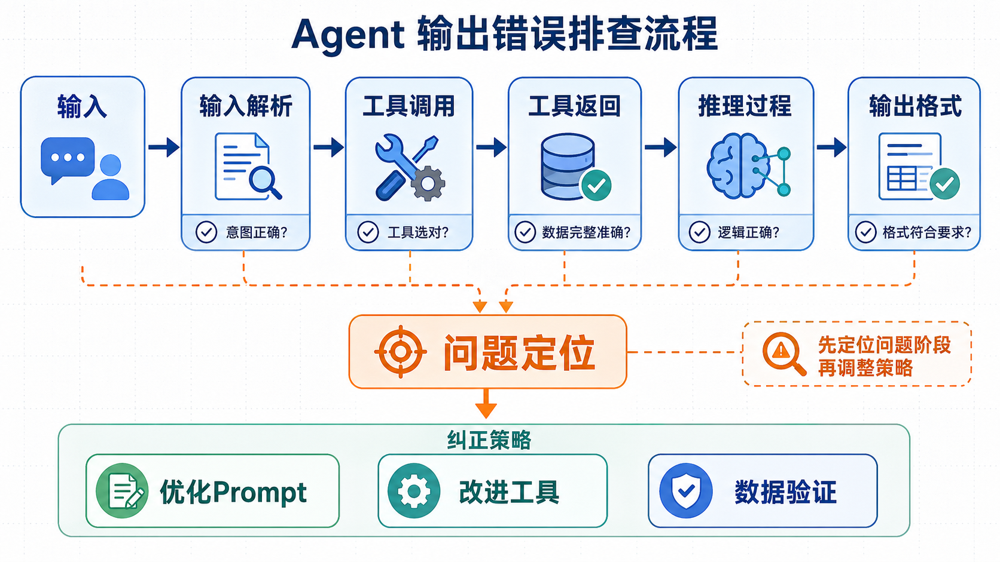

## 知识点讲解



### 1. 核心概念

Agent 输出错误，排查的第一步不是改 prompt，而是**定位错误发生在哪一层**。

常见错误层级：

1. **输入理解层**：Agent 误解了用户意图
2. **工具选择层**：选错了工具或工具顺序错误
3. **工具执行层**：工具本身返回了错误数据
4. **推理层**：工具数据是对的，但推理逻辑出错
5. **输出格式层**：结论对，但格式不符合要求

不同层级的修复方式完全不同，混为一谈会走很多弯路。

### 2. 技术细节

#### 2.1 可观测性设计

没有日志就没有办法调试。Agent 系统必须记录：

| 记录点 | 内容 | 用途 |
| --- | --- | --- |
| 输入日志 | 原始用户输入、解析后意图 | 定位输入理解错误 |
| 推理日志 | 每步推理过程（CoT） | 定位逻辑错误 |
| 工具调用日志 | 工具名、入参、返回值、耗时 | 定位工具问题 |
| 输出日志 | 最终输出、格式校验结果 | 定位格式问题 |

#### 2.2 错误分类与对应修复

| 症状 | 可能根因 | 修复方向 |
| --- | --- | --- |
| 答案完全无关 | 输入理解错误 | 在 prompt 里加意图分类，或加 Few-shot 示例 |
| 调用了错误工具 | 工具描述不清 | 改进工具 description，加示例说明何时用 |
| 工具参数错误 | Schema 定义不严 | 加 enum 约束、required 字段、参数示例 |
| 答案格式不符 | 输出约束不明 | 在 prompt 里加更明确的格式说明和示例 |
| 答案部分正确 | 推理不完整 | 加 CoT prompt，让模型显示推理步骤 |

#### 2.3 调试策略

**二分法定位**：找到错误后，把 prompt 和输入拆成两半，看哪半出问题。逐步缩小范围，比逐行检查效率高。

**复现优先**：在改之前先稳定复现。如果随机出现，可能是 temperature 太高（稳定性问题）；如果必然出现，才是 prompt 逻辑问题。

**修改后测试**：改了 prompt 之后，不能只测刚才的问题案例，要跑完整的测试集，确认没有引入新问题。

## 代码示例

```python
import json
import logging
from datetime import datetime
from dataclasses import dataclass, field
import anthropic

client = anthropic.Anthropic()
MODEL = "claude-3-5-sonnet-20241022"

logging.basicConfig(level=logging.INFO, format="%(asctime)s [%(levelname)s] %(message)s")
logger = logging.getLogger(__name__)


@dataclass
class ExecutionTrace:
    """完整的执行链路记录"""
    trace_id:     str
    input:        str
    timestamp:    str = field(default_factory=lambda: datetime.now().isoformat())
    tool_calls:   list[dict] = field(default_factory=list)
    reasoning:    list[str] = field(default_factory=list)
    output:       str = ""
    errors:       list[str] = field(default_factory=list)
    is_valid:     bool = False


class DiagnosticAgent:
    """带完整可观测性的 Agent，用于排查错误"""

    def __init__(self, system_prompt: str):
        self.system = system_prompt
        self.traces: list[ExecutionTrace] = []

    def execute(self, user_input: str) -> dict:
        import uuid
        trace = ExecutionTrace(
            trace_id=str(uuid.uuid4())[:8],
            input=user_input,
        )
        logger.info(f"[{trace.trace_id}] 开始执行，输入：{user_input[:60]}...")

        tools = [
            {
                "name": "search_knowledge",
                "description": "在知识库中搜索相关信息",
                "input_schema": {
                    "type": "object",
                    "properties": {
                        "query":    {"type": "string"},
                        "category": {"type": "string", "enum": ["fact", "procedure", "example"]},
                    },
                    "required": ["query"],
                },
            }
        ]

        messages = [{"role": "user", "content": user_input}]
        max_steps = 5

        for step in range(max_steps):
            response = client.messages.create(
                model=MODEL,
                max_tokens=1024,
                system=self.system,
                tools=tools,
                messages=messages,
            )

            logger.info(f"[{trace.trace_id}] 步骤 {step+1}，stop_reason={response.stop_reason}")

            if response.stop_reason == "end_turn":
                for block in response.content:
                    if hasattr(block, "text"):
                        trace.output = block.text
                break

            if response.stop_reason == "tool_use":
                tool_results = []
                for block in response.content:
                    if block.type == "tool_use":
                        # 记录工具调用
                        call_record = {
                            "step":      step + 1,
                            "tool":      block.name,
                            "input":     block.input,
                            "timestamp": datetime.now().isoformat(),
                        }

                        # 模拟工具执行
                        tool_output = self._execute_tool(block.name, block.input)
                        call_record["output"] = tool_output
                        call_record["success"] = "error" not in str(tool_output).lower()
                        trace.tool_calls.append(call_record)

                        logger.info(f"[{trace.trace_id}] 工具调用：{block.name}({block.input}) → {str(tool_output)[:80]}")

                        tool_results.append({
                            "type":        "tool_result",
                            "tool_use_id": block.id,
                            "content":     json.dumps(tool_output, ensure_ascii=False),
                        })

                messages.append({"role": "assistant", "content": response.content})
                messages.append({"role": "user",      "content": tool_results})

        # 输出验证
        trace.is_valid, issues = self._validate_output(trace.output, user_input)
        trace.errors.extend(issues)

        if not trace.is_valid:
            logger.warning(f"[{trace.trace_id}] 输出验证失败：{issues}")
        else:
            logger.info(f"[{trace.trace_id}] 执行完成，输出验证通过")

        self.traces.append(trace)
        return {
            "output":     trace.output,
            "is_valid":   trace.is_valid,
            "trace_id":   trace.trace_id,
            "tool_calls": len(trace.tool_calls),
            "errors":     trace.errors,
        }

    def _execute_tool(self, name: str, inputs: dict) -> dict:
        if name == "search_knowledge":
            return {"found": True, "content": f"关于「{inputs['query']}」的知识：示例内容..."}
        return {"error": f"未知工具：{name}"}

    def _validate_output(self, output: str, original_input: str) -> tuple[bool, list[str]]:
        """输出质量验证"""
        issues = []
        if not output or len(output) < 20:
            issues.append("输出过短或为空")
        if "error" in output.lower() and "错误" not in original_input:
            issues.append("输出包含异常错误信息")
        if len(output) > 5000:
            issues.append("输出异常过长，可能有重复生成")
        return len(issues) == 0, issues

    def analyze_failures(self) -> dict:
        """分析所有失败执行，输出诊断报告"""
        failed = [t for t in self.traces if not t.is_valid]
        if not failed:
            return {"status": "all_passed", "total": len(self.traces)}

        # 按错误类型分类
        error_types: dict[str, int] = {}
        for trace in failed:
            for err in trace.errors:
                error_types[err] = error_types.get(err, 0) + 1

        # 工具调用统计
        tool_usage: dict[str, dict] = {}
        for trace in self.traces:
            for call in trace.tool_calls:
                tool = call["tool"]
                if tool not in tool_usage:
                    tool_usage[tool] = {"count": 0, "failures": 0}
                tool_usage[tool]["count"] += 1
                if not call.get("success", True):
                    tool_usage[tool]["failures"] += 1

        return {
            "total":          len(self.traces),
            "failed":         len(failed),
            "failure_rate":   f"{len(failed)/len(self.traces):.1%}",
            "error_types":    error_types,
            "tool_stats":     tool_usage,
            "recommendation": self._generate_recommendation(error_types, tool_usage),
        }

    def _generate_recommendation(self, errors: dict, tools: dict) -> list[str]:
        recs = []
        if "输出过短或为空" in errors:
            recs.append("检查 max_tokens 设置，并在 prompt 里要求模型给出完整回答")
        if any(t["failures"] > 0 for t in tools.values()):
            bad_tools = [t for t, s in tools.items() if s["failures"] > 0]
            recs.append(f"工具 {bad_tools} 有失败，检查工具定义和参数 Schema")
        return recs or ["暂无明确建议，建议人工检查失败 trace"]


# 使用示例
agent = DiagnosticAgent(
    system_prompt="你是一个知识问答助手，通过搜索知识库来回答用户问题。"
)

# 执行几次任务
inputs = [
    "什么是 RAG？",
    "Agent 和 LLM 有什么区别？",
    "如何优化 prompt？",
]

for q in inputs:
    result = agent.execute(q)
    print(f"Q: {q}")
    print(f"  valid={result['is_valid']}, tools={result['tool_calls']}, trace_id={result['trace_id']}")

# 分析失败情况
report = agent.analyze_failures()
print(f"\n诊断报告：{json.dumps(report, ensure_ascii=False, indent=2)}")
```

## 面试怎么答

排查 Agent 错误，第一步是定位在哪一层出错：输入理解、工具选择、工具执行、推理逻辑、还是输出格式。不同层的修复方向完全不同，把层次搞清楚才不会走弯路。

排查的基础是可观测性——要记录完整的执行链路：输入、每步推理、每次工具调用（入参和返回值）、最终输出和验证结果。有了这些日志，出了问题可以"回放"整个执行过程，不用靠猜。

修复完之后，改动要跑完整的测试集，不能只测刚才的问题案例。改 prompt 很容易"按下葫芦浮起瓢"，新问题修了旧问题又出来。

## 高频追问 & 加分点

- **Q1：出了问题，怎么快速复现？**  
    关键是记录完整的输入（不只是用户文字，还有 conversation history 的 snapshot）。有了完整输入，同样的 trace 可以用相同参数重放。如果 temperature > 0，同样的输入可能每次结果不同——复现时可以临时把 temperature 调到 0，排除随机性干扰，定位是不是确定性 bug。
- **Q2：工具调用参数错了，怎么让 Agent 下次不再犯？**  
    两个方向：① 改工具的 Schema 定义，加更严格的约束（enum 限制可选值、description 加参数示例）；② 在 prompt 里加 Few-shot 示例，展示正确的工具调用方式。如果错误很具体（比如总是把日期格式搞错），在工具 description 里直接写"日期格式必须是 YYYY-MM-DD"。
- **Q3：错误只在特定输入下出现，怎么找规律？**  
    看失败案例的共性：都是长输入？都是某类问题类型？都是特定时段（可能 API 问题）？工具调用次数多的时候失败率高（可能 context 太长）？找到规律比找到根因更容易定向优化。可以用简单的分类统计，不需要复杂分析。
- **Q4：A/B 测试 prompt 改动，怎么判断改动是有效的？**  
    固定测试集（100-200 条，覆盖正常和边界情况），两版 prompt 分别跑，对比：① 格式合规率；② 任务完成率；③ 错误类型分布。同时要做统计显著性检验，样本量太小的改善可能是随机波动。不能靠主观感觉说"感觉好了"。
