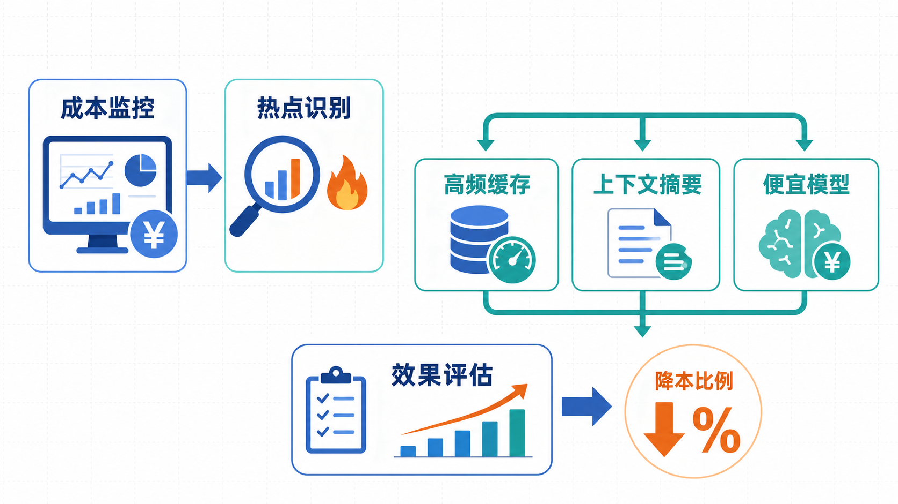

## 知识点讲解



### 1. 核心概念

Agent 成本优化的核心思路：**找到成本热点，有针对性地降，而不是全面压缩质量**。

Agent 的成本构成通常是：LLM API 调用（70-80%）、工具调用（10-15%）、存储和计算（5-10%）。优化要从 LLM 调用着手。

降低 LLM 成本有三个方向：

1. **减少调用次数**（缓存 + 合并请求）
2. **降低单次 Token 消耗**（压缩 prompt + 控制输出长度）
3. **换更便宜的模型**（小任务不用大模型）

### 2. 技术细节

#### 2.1 成本分析先行

不做分析就优化，容易把精力花在没价值的地方。先量化：

- 统计各类任务的 Token 消耗分布（P50、P95、P99）
- 找出调用频次最高的任务类型
- 识别"高 Token 消耗但质量差"的场景——这才是优先优化的靶点

#### 2.2 四种优化策略

**模型分级路由**：根据任务复杂度选模型。

```
简单任务（分类、抽取）→ 小模型（便宜 3-10x）
复杂任务（推理、创作）→ 大模型
```

实践中，60-70% 的任务可以用小模型处理，成本下降幅度很显著。

**语义缓存**：精确哈希匹配命中率低，用向量相似度做模糊匹配：相似度 > 0.95 的问题，直接返回缓存结果。高频重复查询的场景，缓存能减少 30-60% 的 API 调用。

**Prompt 压缩**：移除冗余描述、合并相似规则、Few-shot 示例从 5 个减到 2 个（效果差不多但 Token 少一半）。System Prompt 开启 Prompt Caching，固定部分只算一次。

**批处理**：把多个独立的小任务合并成一次调用，减少 API 往返次数。适合非实时场景（离线分析、批量处理）。

#### 2.3 质量底线

优化不能无限，要设质量底线：

- 任务成功率不低于基线的 5%
- P99 延迟不超过 SLA 上限
- 关键任务（高风险操作）不降级到小模型

## 代码示例

```python
import hashlib
import json
import time
from dataclasses import dataclass, field
from typing import Optional
import anthropic

client = anthropic.Anthropic()


@dataclass
class CostRecord:
    model:        str
    input_tokens:  int
    output_tokens: int
    cached:        bool
    task_type:    str
    timestamp:    float = field(default_factory=time.time)

    @property
    def cost_usd(self) -> float:
        """估算成本（简化计算）"""
        prices = {
            "claude-3-5-sonnet-20241022": {"input": 3.0,  "output": 15.0},  # 每 M token
            "claude-3-haiku-20240307":    {"input": 0.25, "output": 1.25},
        }
        p = prices.get(self.model, {"input": 3.0, "output": 15.0})
        return (self.input_tokens * p["input"] + self.output_tokens * p["output"]) / 1_000_000


class CostOptimizedAgent:
    """成本优化的 Agent：模型分级 + 语义缓存 + 消耗监控"""

    # 模型分级：不同复杂度的任务用不同模型
    MODEL_TIER = {
        "simple":  "claude-3-haiku-20240307",         # 简单任务：分类、抽取
        "medium":  "claude-3-5-sonnet-20241022",       # 中等任务：分析、摘要
        "complex": "claude-3-5-sonnet-20241022",       # 复杂任务：推理、创作
    }

    def __init__(self):
        self.cache: dict[str, dict] = {}   # 精确匹配缓存
        self.cost_log: list[CostRecord] = []

    def _cache_key(self, prompt: str, model: str) -> str:
        return hashlib.md5(f"{model}:{prompt}".encode()).hexdigest()

    def _classify_complexity(self, prompt: str) -> str:
        """简单规则判断任务复杂度（实际可用小模型分类）"""
        prompt_lower = prompt.lower()
        if any(w in prompt_lower for w in ["分类", "是否", "判断", "提取", "抽取"]):
            return "simple"
        if any(w in prompt_lower for w in ["分析", "总结", "对比", "列出"]):
            return "medium"
        return "complex"

    def query(
        self,
        prompt: str,
        task_type: str = "general",
        force_model: Optional[str] = None,
        system: str = "你是一个助手，简洁准确地回答问题。",
    ) -> dict:
        """带成本优化的查询"""
        # 1. 选模型
        complexity = self._classify_complexity(prompt)
        model = force_model or self.MODEL_TIER[complexity]

        # 2. 缓存检查
        cache_key = self._cache_key(prompt, model)
        if cache_key in self.cache:
            cached = self.cache[cache_key]
            self.cost_log.append(CostRecord(
                model=model, input_tokens=0, output_tokens=0,
                cached=True, task_type=task_type,
            ))
            return {"response": cached["response"], "cached": True, "model": model, "cost_usd": 0}

        # 3. API 调用
        response = client.messages.create(
            model=model,
            max_tokens=512,
            system=system,
            messages=[{"role": "user", "content": prompt}],
        )

        result_text = ""
        for block in response.content:
            if hasattr(block, "text"):
                result_text = block.text

        # 4. 记录成本
        record = CostRecord(
            model=model,
            input_tokens=response.usage.input_tokens,
            output_tokens=response.usage.output_tokens,
            cached=False,
            task_type=task_type,
        )
        self.cost_log.append(record)

        # 5. 写入缓存
        self.cache[cache_key] = {"response": result_text, "model": model}

        return {
            "response":   result_text,
            "cached":     False,
            "model":      model,
            "complexity": complexity,
            "tokens":     {"input": record.input_tokens, "output": record.output_tokens},
            "cost_usd":   record.cost_usd,
        }

    def batch_query(self, prompts: list[str], task_type: str = "batch") -> list[dict]:
        """批量查询（对简单任务合并处理）"""
        simple_prompts = [(i, p) for i, p in enumerate(prompts)
                          if self._classify_complexity(p) == "simple"]
        complex_prompts = [(i, p) for i, p in enumerate(prompts)
                           if self._classify_complexity(p) != "simple"]

        results = [None] * len(prompts)

        # 简单任务合并成一次调用
        if simple_prompts:
            combined = "\n".join([f"问题 {j+1}: {p}" for j, (_, p) in enumerate(simple_prompts)])
            batch_prompt = f"请依次回答以下问题，每个答案用「答案 N:」开头：\n{combined}"
            batch_result = self.query(batch_prompt, task_type=f"{task_type}_batch")
            # 解析批量结果（简化处理）
            for j, (i, _) in enumerate(simple_prompts):
                results[i] = {"response": f"批量答案 {j+1}", "cached": False, "batched": True}

        # 复杂任务单独处理
        for i, p in complex_prompts:
            results[i] = self.query(p, task_type=task_type)

        return results

    def get_cost_report(self) -> dict:
        """生成成本报告"""
        if not self.cost_log:
            return {"total_calls": 0}

        total_cost = sum(r.cost_usd for r in self.cost_log)
        cached_count = sum(1 for r in self.cost_log if r.cached)
        model_breakdown: dict[str, dict] = {}

        for r in self.cost_log:
            if r.model not in model_breakdown:
                model_breakdown[r.model] = {"calls": 0, "cost": 0.0, "tokens": 0}
            model_breakdown[r.model]["calls"] += 1
            model_breakdown[r.model]["cost"] += r.cost_usd
            model_breakdown[r.model]["tokens"] += r.input_tokens + r.output_tokens

        return {
            "total_calls":   len(self.cost_log),
            "cache_hits":    cached_count,
            "cache_rate":    f"{cached_count/len(self.cost_log):.1%}",
            "total_cost_usd": round(total_cost, 6),
            "model_breakdown": model_breakdown,
        }


# 使用示例
agent = CostOptimizedAgent()

# 测试模型分级
queries = [
    ("这句话是正面还是负面情感？「产品不错」", "sentiment"),    # simple
    ("总结以下文章的三个要点：...",              "summary"),    # medium
    ("分析 AI Agent 的技术演进趋势",             "analysis"),  # complex
]

for prompt, task_type in queries:
    r = agent.query(prompt, task_type=task_type)
    print(f"[{r.get('complexity', '?')}] 模型={r['model'].split('-')[2]}, 缓存={r['cached']}, 成本=${r['cost_usd']:.6f}")

# 测试缓存
print("\n--- 重复查询（应命中缓存）---")
r = agent.query(queries[0][0], task_type="sentiment_repeat")
print(f"缓存命中={r['cached']}, 成本=${r['cost_usd']}")

# 成本报告
report = agent.get_cost_report()
print(f"\n成本报告：")
print(f"  总调用次数：{report['total_calls']}")
print(f"  缓存命中率：{report['cache_rate']}")
print(f"  总成本：${report['total_cost_usd']}")
```

## 面试怎么答

Agent 成本优化要从分析开始，不是盲目压缩。先看成本分布：哪类任务 Token 消耗最多、哪类任务调用频率最高、哪类任务成本高但效果差——这才是优化的靶点。

三个最有效的手段：① 模型分级路由，简单任务（分类、抽取）用小模型，贵 3-10 倍的大模型只用在真正需要的地方；② 语义缓存，相似问题不重复调用，高频场景能减少 30-60% 调用；③ Prompt Caching（Anthropic/OpenAI 都支持），把稳定的 System Prompt 和 Few-shot 示例缓存在服务端，每次只发变化的部分，成本能降 60-80%。

优化要设质量底线，不能无限压。每次优化后跑测试集，确认成功率没有明显下降。

## 高频追问 & 加分点

- **Q1：缓存命中率太低怎么办？**  
    精确哈希匹配命中率通常不高，因为同样意思的问题表达方式千变万化。升级到语义缓存：把历史问题向量化存入向量库，新问题来了先做向量检索，相似度 > 0.95 的直接返回缓存。代价是多一次向量检索，但节省的 LLM 调用成本远大于检索成本。
- **Q2：换小模型后质量变差怎么处理？**  
    不是所有任务都适合降级。先做实验：用小模型跑测试集，计算成功率对比。成功率下降 > 5% 的任务类型，不降级。只对成功率损失可接受的任务做降级。另一个方向是"小模型 + 更精细的 prompt"——小模型需要更明确的指令，可以弥补一部分能力差距。
- **Q3：Prompt Caching 怎么用？**  
    Anthropic 的实现：在 System Prompt 或 Few-shot 示例后加 `cache_control: {"type": "ephemeral"}` 标记。第一次调用计算并缓存，后续命中缓存的部分只按缓存 Token 价格计费（约原价的 10%）。关键是缓存内容要稳定——System Prompt 要放在最前面，动态内容（用户输入）放后面，不能混在一起。
- **Q4：成本和延迟有没有矛盾？**  
    有。缓存降成本但缓存查询有延迟；批处理降成本但增加等待时间；小模型省成本但可能需要更多轮推理。要根据场景优先级：实时场景优先延迟，离线批处理场景优先成本。两者都想要就需要在系统架构层面分流——实时请求走快路径，低优先级请求进批处理队列。
