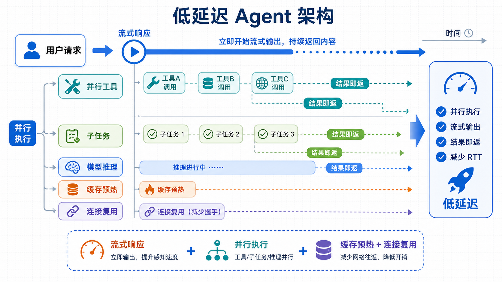

## 知识点讲解



### 1. 核心概念

Agent 延迟高，先找瓶颈，再对症下药。延迟分解：

- **LLM 推理**：通常 1-5 秒，占总延迟最大头（50-60%）
- **工具调用**：数据库查询、外部 API，可能 0.5-3 秒（20-30%）
- **串行等待**：前一步没完成就不能开始下一步
- **网络传输**：通常 &lt; 200ms，但高并发时会上升

不同瓶颈的解法完全不同，不分析就优化是在瞎折腾。

### 2. 技术细节

#### 2.1 五种优化策略

**策略 1：流式输出（Stream）**  
不等完整响应，收到第一个 token 就开始展示。用户感知延迟从"等待全部生成完"变成"等待第一个字出现"，体感延迟大幅降低。

**策略 2：并发工具调用**  
Agent 的工具调用默认串行——调完 A 才能调 B。如果 A 和 B 相互独立，改成并发调用，总时间从 T(A)+T(B) 变成 max(T(A), T(B))。减少 30-50% 的工具延迟。

**策略 3：更快的模型**  
对于不需要最强推理能力的任务，用延迟更低的模型（比如 claude-3-haiku 比 claude-3-sonnet 快 2-3x）。

**策略 4：语义缓存**  
重复或相似的请求直接返回缓存，延迟从 2-5 秒变成 &lt; 50ms。

**策略 5：预加载**  
可以预测的数据提前加载——比如用户打开页面时就开始拉取可能需要的上下文，不等用户开口再加载。

#### 2.2 延迟优化的优先级

```
流式输出 > 并发工具调用 > 缓存 > 模型选择 > 预加载
```

流式输出和并发工具调用投入产出比最高，先做这两个。

#### 2.3 首字节延迟 vs 完整延迟

对用户体验来说，首字节延迟（TTFB，Time to First Byte）比完整生成时间更重要。流式输出是降低 TTFB 的核心手段。

## 代码示例

```python
import asyncio
import time
from typing import Generator, AsyncGenerator
import anthropic

client = anthropic.Anthropic()
MODEL_FAST = "claude-3-haiku-20240307"     # 快速模型
MODEL_GOOD = "claude-3-5-sonnet-20241022"  # 高质量模型


# ===== 优化 1：流式输出 =====
def streaming_response(prompt: str) -> Generator[str, None, None]:
    """流式输出：第一个 token 出来就开始返回，降低 TTFB"""
    with client.messages.stream(
        model=MODEL_GOOD,
        max_tokens=1024,
        messages=[{"role": "user", "content": prompt}],
    ) as stream:
        for text in stream.text_stream:
            yield text


def demo_streaming():
    print("=== 流式输出演示 ===")
    start = time.time()
    first_token_time = None
    full_text = []

    for chunk in streaming_response("简单介绍一下 Agent 架构的核心组件"):
        if first_token_time is None:
            first_token_time = time.time()
            print(f"首字节延迟：{(first_token_time - start)*1000:.0f}ms")
        full_text.append(chunk)
        print(chunk, end="", flush=True)

    total_time = time.time() - start
    print(f"\n总生成时间：{total_time:.2f}s，输出长度：{len(''.join(full_text))} 字符")


# ===== 优化 2：并发工具调用 =====
async def fetch_user_profile(user_id: str) -> dict:
    """模拟：获取用户信息（耗时 0.8s）"""
    await asyncio.sleep(0.8)
    return {"user_id": user_id, "name": "张三", "level": "VIP"}


async def fetch_order_history(user_id: str) -> dict:
    """模拟：获取订单历史（耗时 1.0s）"""
    await asyncio.sleep(1.0)
    return {"orders": [{"id": "O001", "status": "已完成"}]}


async def fetch_recommendations(user_id: str) -> list:
    """模拟：获取推荐内容（耗时 0.6s）"""
    await asyncio.sleep(0.6)
    return [{"product": "推荐商品 A"}, {"product": "推荐商品 B"}]


async def demo_concurrent_tools():
    """串行 vs 并发工具调用对比"""
    print("\n=== 工具调用：串行 vs 并发 ===")
    user_id = "user_123"

    # 串行（默认方式）
    t0 = time.time()
    profile  = await fetch_user_profile(user_id)
    orders   = await fetch_order_history(user_id)
    recs     = await fetch_recommendations(user_id)
    serial_time = time.time() - t0
    print(f"串行时间：{serial_time:.2f}s（= 0.8 + 1.0 + 0.6 = 2.4s）")

    # 并发（改进方式）
    t1 = time.time()
    profile, orders, recs = await asyncio.gather(
        fetch_user_profile(user_id),
        fetch_order_history(user_id),
        fetch_recommendations(user_id),
    )
    concurrent_time = time.time() - t1
    print(f"并发时间：{concurrent_time:.2f}s（= max(0.8, 1.0, 0.6) ≈ 1.0s）")
    print(f"节省时间：{serial_time - concurrent_time:.2f}s（{(1 - concurrent_time/serial_time):.0%}）")


# ===== 优化 3：模型分级路由 =====
def classify_request_complexity(prompt: str) -> str:
    """粗粒度判断请求复杂度"""
    words = prompt.lower()
    if any(w in words for w in ["分析", "推理", "为什么", "比较", "评估", "设计"]):
        return "complex"
    if len(prompt) < 50 and any(w in words for w in ["是什么", "怎么", "哪个"]):
        return "simple"
    return "medium"


def latency_optimized_query(prompt: str, require_quality: bool = False) -> dict:
    """根据复杂度选模型，平衡延迟和质量"""
    complexity = classify_request_complexity(prompt)
    if require_quality or complexity == "complex":
        model = MODEL_GOOD
    else:
        model = MODEL_FAST

    start = time.time()
    response = client.messages.create(
        model=model,
        max_tokens=512,
        messages=[{"role": "user", "content": prompt}],
    )
    latency = time.time() - start

    result = ""
    for block in response.content:
        if hasattr(block, "text"):
            result = block.text

    return {
        "response":   result,
        "model":      model,
        "complexity": complexity,
        "latency_ms": int(latency * 1000),
        "tokens":     response.usage.input_tokens + response.usage.output_tokens,
    }


# ===== 延迟监控 =====
class LatencyMonitor:
    def __init__(self, sla_ms: int = 3000):
        self.sla_ms = sla_ms
        self.records: list[dict] = []

    def record(self, task_type: str, latency_ms: int, model: str):
        self.records.append({"task_type": task_type, "latency_ms": latency_ms, "model": model})

    def report(self) -> dict:
        if not self.records:
            return {}
        latencies = [r["latency_ms"] for r in self.records]
        latencies.sort()
        n = len(latencies)
        sla_violations = sum(1 for l in latencies if l > self.sla_ms)
        return {
            "p50_ms":       latencies[n // 2],
            "p95_ms":       latencies[int(n * 0.95)],
            "p99_ms":       latencies[int(n * 0.99)],
            "sla_violations": f"{sla_violations}/{n}",
            "sla_pass_rate":  f"{(1 - sla_violations/n):.1%}",
        }


# 主演示
if __name__ == "__main__":
    # 流式输出演示
    demo_streaming()

    # 并发工具调用演示
    asyncio.run(demo_concurrent_tools())

    # 模型分级路由
    print("\n=== 模型分级路由 ===")
    test_prompts = [
        "什么是 RAG？",
        "分析 AI Agent 在企业中的落地挑战和解决方案",
    ]
    monitor = LatencyMonitor(sla_ms=3000)
    for p in test_prompts:
        result = latency_optimized_query(p)
        monitor.record("query", result["latency_ms"], result["model"])
        print(f"[{result['complexity']}] 模型={result['model'].split('-')[2]}, 延迟={result['latency_ms']}ms")

    print(f"\n延迟报告：{monitor.report()}")
```

## 面试怎么答

Agent 延迟高，先做分析再优化。延迟主要来自三块：LLM 推理（50-60%）、工具调用（20-30%）、网络（10%）。找到瓶颈再对症。

投入产出比最高的两个手段：流式输出（把用户感知延迟从"等全部生成完"变成"等第一个字"，体感差距很大）；并发工具调用（把串行的工具调用改成并发，总时间从各工具耗时之和变成最慢那个，减少 30-50%）。

模型选择也很重要——不是所有任务都需要最强模型。简单查询用快速小模型，延迟可以低 2-3x。配合语义缓存，重复请求直接返回，延迟从秒级降到毫秒级。

## 高频追问 & 加分点

- **Q1：流式输出会不会影响答案质量？**  
    不会。流式只是改变了返回方式，推理过程完全相同。模型生成完整答案，只是逐 token 返回而不是等全部生成完再返回。对 token 采样和推理没有任何影响，答案质量完全一样。
- **Q2：并发工具调用怎么处理有依赖关系的工具？**  
    有依赖关系的必须串行：B 需要 A 的结果，那 A → B 不能并发。只对独立的工具做并发。设计时要分析工具依赖图（DAG），识别哪些工具可以并发，哪些必须顺序。复杂场景可以用任务调度框架（比如 asyncio.gather 配合依赖管理）自动处理。
- **Q3：缓存命中率低，语义缓存怎么做？**  
    把历史请求向量化存入向量库，新请求来了先做相似度检索。设阈值（比如 0.95），高于阈值直接返回缓存。缓存除了存结果，还要存请求的向量表示和 metadata（时间戳、模型版本、使用次数）。过期策略：超过 N 天或底层数据更新了就失效。
- **Q4：SLA 怎么设置，破线了怎么处理？**  
    SLA 根据业务场景定：实时对话 P95 &lt; 2s，分析报告 P95 &lt; 10s。监控分位数（P50/P95/P99），不只看平均值——平均值掩盖了尾部延迟。破线触发告警，工程师介入排查。如果是突发流量导致，自动扩容或启用流量削峰（队列化低优先级请求）。
