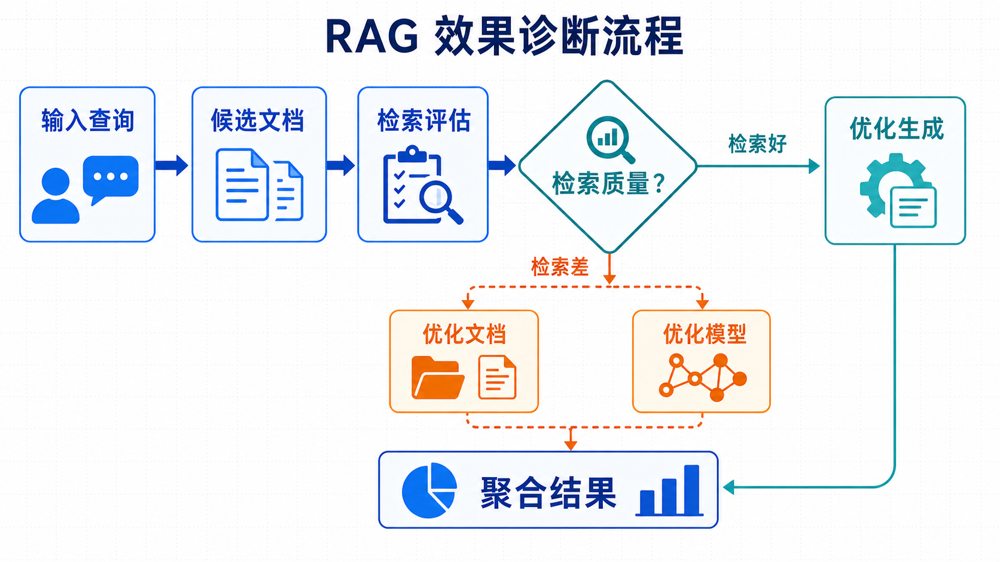

## 知识点讲解



### 1. 核心概念

RAG 效果差，不是一个问题，是一类问题。要先诊断是哪一段出了问题：

- **检索段**：找不到相关文档，或者找到了很多无关的
- **生成段**：文档找对了，但模型没有正确利用，或者答案格式不对

两段的修复方式完全不同，混在一起盲目优化效率极低。

### 2. 技术细节

#### 2.1 诊断流程

**第一步：评估检索质量**

固定一批测试问题（带标准答案），看检索结果：

- **召回率（Recall）**：相关文档是否在 top-K 里？目标 > 80%
- **精准率（Precision）**：top-K 里有多少是真正相关的？目标 > 60%
- **MRR**：最相关的文档排在第几位？目标 > 0.7

召回率低 → 文档没被检索到，是嵌入/分块/索引问题  
精准率低 → 检索到了很多无关的，是相似度阈值或查询优化问题

**第二步：评估生成质量**

用正确的文档（手工提供）问同样的问题，看模型能不能给出正确答案：

- 如果手工提供正确文档也答不对 → 生成问题（prompt 设计/模型能力）
- 如果手工提供正确文档答对了，但检索的文档做不到 → 检索问题

#### 2.2 检索段优化

**分块策略**：块太大检索精度低（相关信息被淹没），块太小缺乏上下文。通常 256-512 tokens 是比较好的范围。切割位置优先在段落边界、标题处，避免在句中切。

**嵌入模型选择**：通用嵌入模型在专业领域效果差。中文文本用中文嵌入模型，专业术语多的场景用该领域微调过的嵌入模型。

**查询改写**：用户问题和文档的表述方式可能不一样。用 LLM 把用户问题改写成更适合检索的形式，或者生成多个改写版本分别检索。

**重排序（Rerank）**：初步检索用相似度快速召回（top-20），再用小型 Cross-Encoder 模型对结果精排，取 top-3-5。精排比初步检索准确得多，而且只对少量候选做，计算量可接受。

#### 2.3 生成段优化

**Prompt 设计**：明确告诉模型"只基于提供的文档回答，文档里没有的说没有"。不写这句话，模型倾向于混入训练数据里的知识，产生幻觉。

**文档引用**：要求模型引用来源文档，可以减少"凭空生成"的概率，也方便用户核实。

**答案验证**：用另一个 LLM 调用验证答案是否有文档支撑，检测幻觉。

## 代码示例

```python
import json
import anthropic

client = anthropic.Anthropic()
MODEL = "claude-3-5-sonnet-20241022"


# ===== 诊断工具：评估检索质量 =====
def evaluate_retrieval(
    query: str,
    retrieved_docs: list[dict],
    ground_truth_doc_ids: list[str],
) -> dict:
    """计算检索指标"""
    retrieved_ids = [d["id"] for d in retrieved_docs]

    # 召回率：ground truth 有多少被检索到
    hits = [gid for gid in ground_truth_doc_ids if gid in retrieved_ids]
    recall = len(hits) / len(ground_truth_doc_ids) if ground_truth_doc_ids else 0

    # 精准率：检索结果中有多少是相关的
    relevant_in_result = sum(1 for rid in retrieved_ids if rid in ground_truth_doc_ids)
    precision = relevant_in_result / len(retrieved_ids) if retrieved_ids else 0

    # MRR：第一个相关文档在第几位
    mrr = 0.0
    for i, rid in enumerate(retrieved_ids):
        if rid in ground_truth_doc_ids:
            mrr = 1 / (i + 1)
            break

    return {
        "recall":    round(recall, 3),
        "precision": round(precision, 3),
        "mrr":       round(mrr, 3),
        "diagnosis": _diagnose_retrieval(recall, precision, mrr),
    }


def _diagnose_retrieval(recall: float, precision: float, mrr: float) -> str:
    if recall < 0.5:
        return "召回率过低：检索不到相关文档。检查嵌入模型、分块策略、索引配置"
    if precision < 0.4:
        return "精准率过低：检索了太多无关文档。调高相似度阈值，或使用查询改写"
    if mrr < 0.5:
        return "排名质量差：相关文档排名靠后。考虑加 Rerank 重排序"
    return "检索质量正常"


# ===== RAG 管道：带诊断的完整实现 =====
class DiagnosticRAGPipeline:
    def __init__(self, docs: list[dict]):
        """
        docs: [{"id": "doc1", "title": "...", "content": "..."}]
        """
        self.docs = {d["id"]: d for d in docs}
        self.query_log: list[dict] = []

    def _retrieve(self, query: str, top_k: int = 5) -> list[dict]:
        """简化检索（实际应使用向量数据库）"""
        query_words = set(query.lower().split())
        scored = []
        for doc_id, doc in self.docs.items():
            doc_words = set((doc["title"] + " " + doc["content"]).lower().split())
            overlap = len(query_words & doc_words)
            if overlap > 0:
                scored.append((overlap, doc))
        scored.sort(key=lambda x: x[0], reverse=True)
        return [d for _, d in scored[:top_k]]

    def _rewrite_query(self, original_query: str) -> list[str]:
        """查询改写：生成多个改写版本提高召回"""
        response = client.messages.create(
            model=MODEL,
            max_tokens=256,
            system="你是一个搜索优化专家。",
            messages=[{
                "role": "user",
                "content": f"""对以下问题生成 3 个不同表述，保持语义相同，输出 JSON 数组：
问题：{original_query}
格式：["改写1", "改写2", "改写3"]""",
            }],
        )
        raw = ""
        for block in response.content:
            if hasattr(block, "text"):
                raw = block.text
        try:
            import re
            arr_match = re.search(r'\[.*\]', raw, re.DOTALL)
            if arr_match:
                return json.loads(arr_match.group())
        except (json.JSONDecodeError, AttributeError):
            pass
        return [original_query]

    def _generate_answer(self, query: str, docs: list[dict]) -> str:
        """基于检索文档生成答案"""
        if not docs:
            return "根据现有文档，找不到相关信息来回答您的问题。"

        doc_text = "\n\n".join([
            f"[文档 {i+1}: {d['title']}]\n{d['content'][:400]}"
            for i, d in enumerate(docs)
        ])

        system = """你是一个严格基于文档回答问题的助手。

规则：
- 只使用 <documents> 标签内的内容作答
- 引用时注明来自哪个文档（"根据文档 X..."）
- 如果文档里没有答案，直接说"根据现有文档无法回答"
- 不要使用文档以外的知识"""

        response = client.messages.create(
            model=MODEL,
            max_tokens=1024,
            system=system,
            messages=[{
                "role": "user",
                "content": f"""<documents>
{doc_text}
</documents>

问题：{query}""",
            }],
        )
        for block in response.content:
            if hasattr(block, "text"):
                return block.text
        return ""

    def _validate_answer(self, answer: str, docs: list[dict]) -> dict:
        """验证答案是否有文档支撑"""
        doc_text = "\n".join([d["content"][:200] for d in docs])
        response = client.messages.create(
            model="claude-3-haiku-20240307",  # 验证用小模型
            max_tokens=128,
            messages=[{
                "role": "user",
                "content": f"""以下答案是否有文档支撑？输出 JSON：{{"grounded": true/false, "reason": "..."}}

答案：{answer[:300]}

文档：{doc_text[:500]}""",
            }],
        )
        raw = ""
        for block in response.content:
            if hasattr(block, "text"):
                raw = block.text
        try:
            import re
            json_match = re.search(r'\{.*\}', raw, re.DOTALL)
            if json_match:
                return json.loads(json_match.group())
        except (json.JSONDecodeError, AttributeError):
            pass
        return {"grounded": True, "reason": "验证失败"}

    def query(self, question: str, use_query_rewrite: bool = True) -> dict:
        """完整 RAG 查询，带诊断信息"""
        # Step 1: 查询改写（可选）
        queries = self._rewrite_query(question) if use_query_rewrite else [question]

        # Step 2: 检索（多查询合并去重）
        seen_ids = set()
        all_docs = []
        for q in queries:
            for doc in self._retrieve(q, top_k=3):
                if doc["id"] not in seen_ids:
                    all_docs.append(doc)
                    seen_ids.add(doc["id"])
        retrieved = all_docs[:5]  # 最终取 top-5

        # Step 3: 生成答案
        answer = self._generate_answer(question, retrieved)

        # Step 4: 答案验证
        validation = self._validate_answer(answer, retrieved)

        result = {
            "question":         question,
            "retrieved_count":  len(retrieved),
            "retrieved_titles": [d["title"] for d in retrieved],
            "answer":           answer,
            "grounded":         validation.get("grounded", True),
            "ground_reason":    validation.get("reason", ""),
            "query_rewrites":   queries if use_query_rewrite else [],
        }
        self.query_log.append(result)
        return result


# 使用示例
docs = [
    {"id": "d1", "title": "RAG 技术原理",  "content": "RAG（检索增强生成）通过在生成前检索相关文档，把外部知识注入到 LLM 的上下文中，减少幻觉。"},
    {"id": "d2", "title": "向量数据库选型", "content": "常见向量数据库包括 Chroma、Weaviate、Pinecone、Qdrant。Chroma 适合小规模本地部署，Pinecone 适合生产环境。"},
    {"id": "d3", "title": "嵌入模型比较",   "content": "中文场景推荐 text2vec-large-chinese 或 BGE 系列。通用场景可用 OpenAI text-embedding-3-small。"},
]

rag = DiagnosticRAGPipeline(docs)
result = rag.query("RAG 是什么，有什么优点？")
print(f"检索到 {result['retrieved_count']} 篇文档")
print(f"答案是否有文档支撑：{result['grounded']}")
print(f"\n答案：{result['answer'][:400]}")

# 检索质量评估
metrics = evaluate_retrieval(
    query="RAG 检索增强生成",
    retrieved_docs=[{"id": "d1"}, {"id": "d3"}],
    ground_truth_doc_ids=["d1"],
)
print(f"\n检索指标：recall={metrics['recall']}, precision={metrics['precision']}, mrr={metrics['mrr']}")
print(f"诊断：{metrics['diagnosis']}")
```

## 面试怎么答

RAG 效果不好，首先要分清是检索段的问题还是生成段的问题。最简单的诊断方法：手工提供正确的文档，看模型能不能给出正确答案——如果能，说明是检索出了问题；如果不能，说明是生成段（prompt 设计或模型能力）的问题。

检索段常见问题有三个：① 分块策略不合理（块太大检索精度低，块太小缺上下文）；② 嵌入模型不适配（通用模型在专业领域效果差）；③ 没有重排序（初步检索召回多但精度低，加 rerank 可以显著提升精准率）。

生成段的关键是 prompt 设计：明确要求"只基于文档回答，文档里没有就说没有"，要求引用来源，最后做一次幻觉检测验证答案是否有文档支撑。

## 高频追问 & 加分点

- **Q1：如何判断是检索问题还是生成问题？**  
    做隔离实验：固定 20 个测试问题，分别用"理想文档"（手工选的最相关文档）和"检索文档"作为 context，对比生成质量。如果两者差距大，是检索问题；如果差距小但质量都差，是生成问题。这个实验成本低，是 RAG 调优的标准诊断流程。
- **Q2：分块大小怎么定，有没有推荐值？**  
    通用推荐 256-512 tokens。但实际要看内容类型：技术文档段落密度高，可以取 512；FAQ 答案短，可以取 128。另一个因素是检索模型的最优输入长度——大多数嵌入模型在 512 tokens 以内效果最好。建议做 A/B 实验：分别用 256、512、1024 测试，看召回率和精准率。
- **Q3：用户问题和文档表述差距很大（专业术语 vs 口语），怎么处理？**  
    三个策略：① 查询改写——用 LLM 把用户口语问题扩展为专业表述，或生成多个改写版本；② 假设性文档嵌入（HyDE）——先让 LLM 生成一段"假设答案"，用这段答案做检索（因为和文档表述更接近）；③ 关键词混合检索——向量检索 + BM25 关键词检索的融合，互补覆盖。
- **Q4：RAG 和微调，该怎么选？**  
    两者解决的问题不同。RAG 解决的是"模型不知道的事"（外部知识、实时数据、私有文档），微调解决的是"模型输出风格/格式不对"（让模型学会特定的回答方式）。实践中经常组合用：先 RAG 注入知识，再微调让模型按特定格式输出。如果只是知识更新频繁，RAG 更适合，因为微调很贵，还可能遗忘旧知识。
