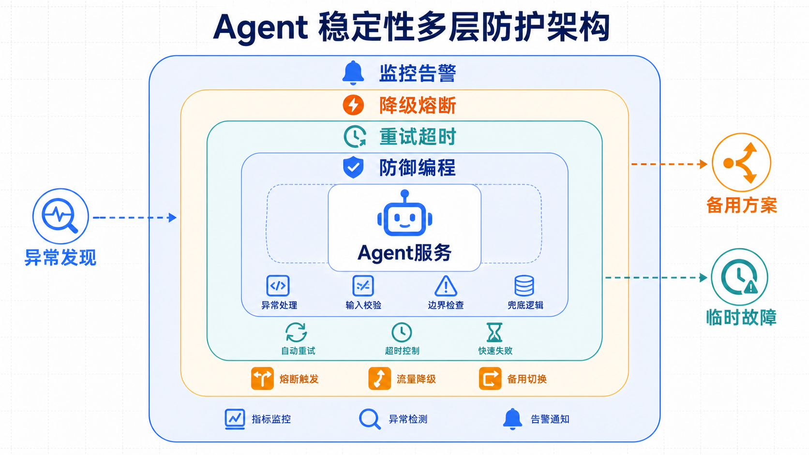

## 知识点讲解



### 1. 核心概念

Agent 稳定性，说白了就是：**出了问题能继续跑，跑不下去能优雅降级，不能让一个点的故障把整个系统拖垮**。

Agent 系统的故障风险来自四类：

- **模型风险**：LLM 推理错误、幻觉、超时
- **工具风险**：工具函数 bug、第三方服务不可用
- **外部风险**：网络抖动、API 限流、服务器故障
- **逻辑风险**：Agent 陷入死循环、无限重试、资源耗尽

每类风险的处理方式不同，不能用同一个"重试"解决所有问题。

### 2. 技术细节

#### 2.1 错误分类与差异化处理

| 错误类型 | 例子 | 处理策略 |
| --- | --- | --- |
| 临时错误 | 网络超时、API 限流 | 指数退避重试 |
| 持续错误 | API 密钥失效、服务下线 | 立即降级，不要重试 |
| 逻辑错误 | 参数类型错误、权限拒绝 | 直接失败，不重试，上报 |
| 资源错误 | OOM、磁盘满 | 拒绝新请求，等待恢复 |

临时错误才值得重试，逻辑错误重试 10 次也没用，还浪费资源。

#### 2.2 三个核心机制

**重试 + 指数退避**：首次失败等 1 秒，第二次 2 秒，第三次 4 秒。避免在服务端压力大时大量请求同时重试，把服务打垮。加抖动（jitter）防止雪崩。

**断路器（Circuit Breaker）**：连续失败 N 次，自动"断路"——停止向该服务发请求，直接走降级。等一段时间后进入"半开"状态，允许少量请求探测服务是否恢复。恢复了就重新开路。

**降级策略**：服务不可用时不要直接失败，有备用方案：返回缓存的上次结果、走简化版本（不调工具，只靠模型知识）、返回默认值并告知用户"功能暂时受限"。

#### 2.3 防止死循环

Agent 最容易犯的"稳定性错误"：在工具调用失败时不断重试，导致无限循环。

防护措施：

- 全局最大步数限制（比如 20 步）
- 相同工具调用重复次数限制（同一个工具 + 相同参数，重复 3 次就停）
- 总耗时超过阈值就中止（比如 30 秒）

## 代码示例

```python
import time
import logging
import random
from enum import Enum
from dataclasses import dataclass, field
import anthropic

client = anthropic.Anthropic()
MODEL = "claude-3-5-sonnet-20241022"
logger = logging.getLogger(__name__)


# ===== 断路器 =====
class CircuitState(Enum):
    CLOSED   = "closed"    # 正常
    OPEN     = "open"      # 断路（不发请求）
    HALF_OPEN = "half_open" # 探测中


@dataclass
class CircuitBreaker:
    name:             str
    failure_threshold: int   = 5     # 连续失败多少次触发断路
    recovery_timeout:  float = 30.0  # 断路后多少秒进入半开状态
    success_threshold: int   = 2     # 半开状态成功多少次恢复

    state:           CircuitState = field(default=CircuitState.CLOSED, init=False)
    failure_count:   int = field(default=0, init=False)
    success_count:   int = field(default=0, init=False)
    last_failure_at: float = field(default=0.0, init=False)

    def can_request(self) -> bool:
        if self.state == CircuitState.CLOSED:
            return True
        if self.state == CircuitState.OPEN:
            if time.time() - self.last_failure_at > self.recovery_timeout:
                self.state = CircuitState.HALF_OPEN
                logger.info(f"[{self.name}] 断路器进入半开状态")
                return True
            return False
        return True  # HALF_OPEN 允许少量请求

    def record_success(self):
        if self.state == CircuitState.HALF_OPEN:
            self.success_count += 1
            if self.success_count >= self.success_threshold:
                self.state = CircuitState.CLOSED
                self.failure_count = 0
                self.success_count = 0
                logger.info(f"[{self.name}] 断路器已恢复（CLOSED）")
        elif self.state == CircuitState.CLOSED:
            self.failure_count = 0

    def record_failure(self):
        self.failure_count += 1
        self.last_failure_at = time.time()
        if self.state == CircuitState.HALF_OPEN:
            self.state = CircuitState.OPEN
            logger.warning(f"[{self.name}] 半开探测失败，回到断路状态")
        elif self.failure_count >= self.failure_threshold:
            self.state = CircuitState.OPEN
            logger.error(f"[{self.name}] 断路器触发！连续失败 {self.failure_count} 次")


# ===== 重试 + 指数退避 =====
def retry_with_backoff(
    fn,
    max_retries:   int   = 3,
    base_delay:    float = 1.0,
    max_delay:     float = 16.0,
    retryable_exceptions: tuple = (Exception,),
):
    """指数退避重试，带抖动"""
    for attempt in range(max_retries):
        try:
            return fn()
        except retryable_exceptions as e:
            if attempt == max_retries - 1:
                raise  # 最后一次失败，抛出

            delay = min(base_delay * (2 ** attempt), max_delay)
            jitter = delay * 0.1 * random.random()  # 10% 抖动
            wait = delay + jitter
            logger.warning(f"第 {attempt+1} 次失败，{wait:.1f}s 后重试：{e}")
            time.sleep(wait)


# ===== 稳定 Agent 完整实现 =====
class StableAgent:
    def __init__(self):
        self.circuit_breaker = CircuitBreaker("llm_api")
        self.max_steps = 10        # 防止无限循环
        self.step_timeout = 30.0   # 单次执行最长时间（秒）

    def _call_llm(self, messages: list, system: str) -> str:
        """带断路器和重试的 LLM 调用"""
        if not self.circuit_breaker.can_request():
            raise RuntimeError("LLM API 服务断路，暂时不可用")

        def _do_call():
            response = client.messages.create(
                model=MODEL,
                max_tokens=512,
                system=system,
                messages=messages,
            )
            for block in response.content:
                if hasattr(block, "text"):
                    return block.text
            return ""

        try:
            result = retry_with_backoff(_do_call, max_retries=3)
            self.circuit_breaker.record_success()
            return result
        except Exception as e:
            self.circuit_breaker.record_failure()
            raise

    def _fallback_response(self, task: str) -> str:
        """降级响应：LLM 不可用时的备用方案"""
        return f"当前 AI 服务暂时受限，您的请求「{task[:50]}...」已记录，稍后会处理。请稍等片刻或联系支持。"

    def execute(self, task: str) -> dict:
        """带完整稳定性保障的任务执行"""
        start_time = time.time()
        system = "你是一个稳定可靠的助手，简洁准确地完成任务。"
        messages = [{"role": "user", "content": task}]

        try:
            result = self._call_llm(messages, system)
            elapsed = time.time() - start_time
            logger.info(f"任务完成，耗时 {elapsed:.2f}s")
            return {"status": "success", "result": result, "elapsed_s": round(elapsed, 2)}
        except RuntimeError as e:
            # 断路器触发 → 降级
            logger.warning(f"断路器降级：{e}")
            return {"status": "degraded", "result": self._fallback_response(task), "reason": str(e)}
        except Exception as e:
            elapsed = time.time() - start_time
            logger.error(f"任务失败，耗时 {elapsed:.2f}s：{e}")
            return {"status": "error", "result": None, "reason": str(e)}

    def execute_with_tools(self, task: str, tools: list) -> dict:
        """带工具调用的稳定执行，防止无限循环"""
        start_time  = time.time()
        step_count  = 0
        tool_call_counts: dict[str, int] = {}  # 记录每个工具调用次数
        messages = [{"role": "user", "content": task}]
        system = "你是一个助手，使用工具完成任务。"

        while step_count < self.max_steps:
            # 总耗时检查
            if time.time() - start_time > self.step_timeout:
                return {"status": "timeout", "result": None, "steps": step_count}

            step_count += 1

            try:
                response = client.messages.create(
                    model=MODEL,
                    max_tokens=1024,
                    system=system,
                    tools=tools,
                    messages=messages,
                )
            except Exception as e:
                return {"status": "error", "result": None, "reason": str(e), "steps": step_count}

            if response.stop_reason == "end_turn":
                result = ""
                for block in response.content:
                    if hasattr(block, "text"):
                        result = block.text
                return {"status": "success", "result": result, "steps": step_count}

            if response.stop_reason == "tool_use":
                import json
                tool_results = []
                for block in response.content:
                    if block.type == "tool_use":
                        # 重复调用检测（同工具 + 相同参数）
                        call_signature = f"{block.name}:{json.dumps(block.input, sort_keys=True)}"
                        tool_call_counts[call_signature] = tool_call_counts.get(call_signature, 0) + 1
                        if tool_call_counts[call_signature] > 3:
                            return {"status": "loop_detected", "result": None,
                                    "reason": f"工具 {block.name} 被重复调用超过 3 次，可能进入死循环", "steps": step_count}

                        # 模拟工具执行
                        tool_results.append({
                            "type":        "tool_result",
                            "tool_use_id": block.id,
                            "content":     json.dumps({"status": "success", "data": "工具执行结果"}),
                        })
                messages.append({"role": "assistant", "content": response.content})
                messages.append({"role": "user",      "content": tool_results})

        return {"status": "max_steps_exceeded", "result": None, "steps": step_count}


# 使用示例
agent = StableAgent()

result = agent.execute("简单介绍一下 AI Agent 的定义")
print(f"状态：{result['status']}")
if result["result"]:
    print(f"结果：{result['result'][:200]}")
```

## 面试怎么答

Agent 稳定性的关键是分层防护，不同类型的错误用不同的手段处理。

临时错误（网络抖动、限流）用指数退避重试，等的时间越来越长，加点随机抖动防止"集体重试"打垮服务。持续错误不重试，直接降级——LLM API 不可用，就走规则兜底或返回友好提示，不要让用户等着。

断路器是生产系统必须有的机制：连续失败 N 次就断路，停止向故障服务发请求，等一段时间后小流量探测是否恢复。这能防止故障服务在压力下雪崩。

防死循环也很重要：设全局最大步数、相同工具重复调用次数限制、总耗时上限，任何一个触发就中止。这些都是硬约束，不能靠模型自己判断什么时候停。

## 高频追问 & 加分点

- **Q1：重试次数设多少合适？**  
    通常 2-3 次，不要超过 5 次。重试次数多了，在服务端问题期间会产生大量积压请求，加重问题。更重要的是重试间隔：第一次 1s，第二次 2s，第三次 4s，加 10% 随机抖动。如果是 API 限流（429），第一次重试可以直接等 Rate Limit 响应头里给出的等待时间。
- **Q2：降级到什么程度才算合适？**  
    降级目标是"可用"而不是"好用"。层级上：全功能 > 简化功能（不调工具，只靠模型）> 缓存结果 > 友好提示。能返回有价值的内容就返回，实在不行就返回"服务暂时不可用，请稍后重试"。绝对不能返回空白或崩溃报错——那对用户体验伤害最大。
- **Q3：如何测试 Agent 的稳定性？**  
    故障注入测试（Chaos Engineering）：在测试环境里模拟 API 超时、随机错误、工具失败，看系统怎么响应。验证点：① 重试是否按预期退避；② 断路器是否正确触发；③ 降级响应是否友好；④ 没有无限循环；⑤ 日志是否完整记录了故障链路。定期跑这些测试，不要等上了生产才发现问题。
- **Q4：多个 Agent 组成的系统，某一个挂了怎么处理？**  
    依赖关系是关键。如果挂的 Agent 是可选的（锦上添花），跳过它继续执行；如果是关键路径上的，触发整体降级。Orchestrator 要维护每个 Worker 的状态，Worker 失败后能决定是重试、替换其他 Agent、还是整体回退。不能让一个 Worker 的失败悄悄消失，必须上报到 Orchestrator 层处理。
