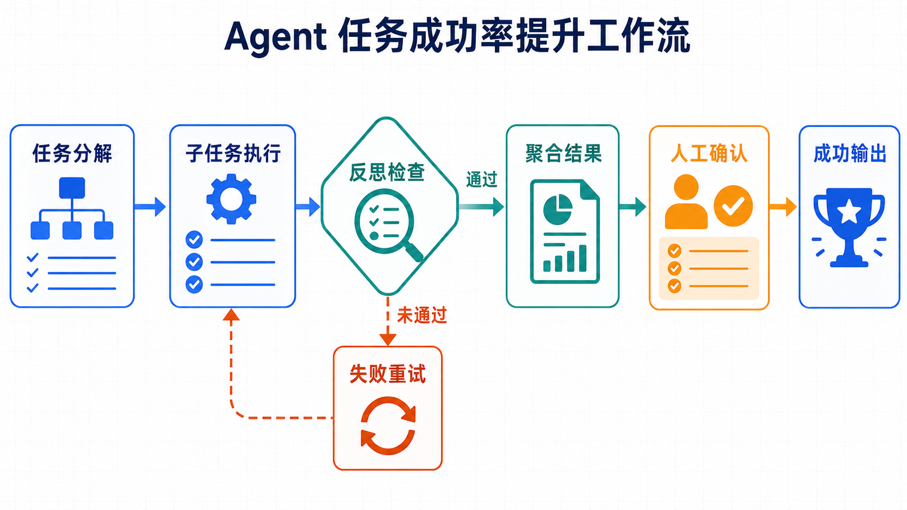

## 知识点讲解



### 1. 核心概念

任务成功率低，根本原因通常是以下几个之一：任务太复杂（一次推理搞不定）、输入太模糊（需求没搞清楚就开始做）、中间出错没有纠正（错误被放大）、没有人工兜底（模型做不了的事强行做）。

提升成功率的核心思路：**降低单次推理难度（拆任务）+ 在执行中纠错（反思）+ 关键节点人工确认（人机协作）**。

### 2. 技术细节

#### 2.1 任务分解降难度

最有效的成功率提升手段。把"写一份完整的竞品分析报告"拆成：

1. 确认分析的竞品范围
2. 收集各竞品的公开信息
3. 按维度（功能、定价、用户口碑）对比
4. 总结差异和机会点
5. 组织成报告格式

每步的难度远低于整体任务，模型成功率自然提升。关键是拆的粒度：每步应该是"一个清晰目标 + 确定性输入 + 格式明确的输出"，不要把两步的事混在一步里。

#### 2.2 反思机制

每步执行完，加一个"自我检查"环节：

```
生成结果 → 检查是否满足要求 → 满足则继续，不满足则修正
```

检查标准要在 prompt 里写清楚（不是"检查一下"这种模糊的），要量化：

- 格式是否符合规范
- 关键字段是否都有
- 结论和数据是否对应

#### 2.3 人工在环（Human-in-the-Loop）

三个典型的人工确认节点：

- **启动前**：任务模糊时先让用户澄清，避免做了一半方向错了
- **关键决策**：高风险操作（删除数据、发送邮件）执行前让用户确认
- **异常处理**：Agent 置信度低（&lt; 50%）或多次重试失败时，转人工

人工确认要做得轻——一个清晰的问题和几个选项，不要让用户填表。

#### 2.4 成功率指标

成功率 = 首次成功率 + (重试成功率 × 重试触发率)

提升首次成功率（更好的 prompt、更清晰的需求）比提升重试成功率更高效，因为重试本身消耗时间和成本。

## 代码示例

```python
import json
from typing import Optional, Callable
import anthropic

client = anthropic.Anthropic()
MODEL = "claude-3-5-sonnet-20241022"


class HighSuccessRateAgent:
    """带任务分解、反思和人工在环的高成功率 Agent"""

    def __init__(
        self,
        system_prompt:       str,
        confidence_threshold: float = 0.6,
        max_retries:         int   = 2,
        human_input_fn:      Optional[Callable] = None,
    ):
        self.system   = system_prompt
        self.conf_threshold = confidence_threshold
        self.max_retries    = max_retries
        # 人工确认函数：接收问题字符串，返回用户输入
        self.human_input = human_input_fn or (lambda q: input(f"[人工确认] {q}: "))

    def _clarify_if_needed(self, task: str) -> str:
        """任务前置澄清：模糊需求先问清楚"""
        response = client.messages.create(
            model=MODEL,
            max_tokens=256,
            system="你是一个任务分析助手。",
            messages=[{
                "role": "user",
                "content": f"""分析以下任务，如果有关键信息缺失需要用户澄清，列出最重要的 1-2 个问题；如果信息足够，返回"CLEAR"。

任务：{task}

只返回问题列表（JSON 数组）或字符串 "CLEAR"。""",
            }],
        )
        raw = ""
        for block in response.content:
            if hasattr(block, "text"):
                raw = block.text.strip()

        if "CLEAR" in raw:
            return task

        # 有需要澄清的问题，询问用户
        try:
            import re
            arr_match = re.search(r'\[.*\]', raw, re.DOTALL)
            if arr_match:
                questions = json.loads(arr_match.group())
                answers = []
                for q in questions:
                    ans = self.human_input(q)
                    answers.append(f"Q: {q}\nA: {ans}")
                clarification = "\n".join(answers)
                return f"{task}\n\n[补充说明]\n{clarification}"
        except (json.JSONDecodeError, AttributeError):
            pass

        return task

    def _decompose_task(self, task: str) -> list[dict]:
        """把复杂任务拆成子任务"""
        response = client.messages.create(
            model=MODEL,
            max_tokens=512,
            system="你是一个任务分解专家。",
            messages=[{
                "role": "user",
                "content": f"""把以下任务分解为 3-5 个清晰的子任务。每个子任务有：明确目标、输入来源、输出格式。

任务：{task}

返回 JSON 数组：[{{"step": 1, "goal": "...", "input": "...", "output_format": "..."}}]""",
            }],
        )
        raw = ""
        for block in response.content:
            if hasattr(block, "text"):
                raw = block.text

        try:
            import re
            arr_match = re.search(r'\[.*\]', raw, re.DOTALL)
            if arr_match:
                return json.loads(arr_match.group())
        except (json.JSONDecodeError, AttributeError):
            pass

        # 降级：单步执行
        return [{"step": 1, "goal": task, "input": "用户输入", "output_format": "自由格式"}]

    def _execute_step(self, step: dict, context: str = "") -> dict:
        """执行单个子任务，带反思验证"""
        prompt = step["goal"]
        if context:
            prompt = f"[前置结果]\n{context[:500]}\n\n[当前任务]\n{step['goal']}\n\n输出格式：{step.get('output_format', '自由格式')}"

        for attempt in range(self.max_retries + 1):
            response = client.messages.create(
                model=MODEL,
                max_tokens=1024,
                system=self.system,
                messages=[{"role": "user", "content": prompt}],
            )

            result = ""
            for block in response.content:
                if hasattr(block, "text"):
                    result = block.text

            # 自我验证
            validation = self._self_validate(step["goal"], result)
            if validation["pass"]:
                return {"result": result, "success": True, "attempts": attempt + 1}

            # 验证失败，修正后重试
            if attempt < self.max_retries:
                prompt = f"{prompt}\n\n[上次输出问题] {validation['issues']}\n请修正以上问题重新输出。"

        # 多次重试后仍失败
        return {"result": result, "success": False, "attempts": self.max_retries + 1,
                "issues": validation.get("issues", "未知问题")}

    def _self_validate(self, goal: str, result: str) -> dict:
        """让模型验证自己的输出"""
        response = client.messages.create(
            model="claude-3-haiku-20240307",  # 验证用小模型，节省成本
            max_tokens=128,
            messages=[{
                "role": "user",
                "content": f"""验证以下输出是否满足任务目标。输出 JSON：{{"pass": true/false, "confidence": 0.0-1.0, "issues": "问题描述或空字符串"}}

任务目标：{goal[:200]}
输出：{result[:400]}""",
            }],
        )
        raw = ""
        for block in response.content:
            if hasattr(block, "text"):
                raw = block.text

        try:
            import re
            json_match = re.search(r'\{.*\}', raw, re.DOTALL)
            if json_match:
                return json.loads(json_match.group())
        except (json.JSONDecodeError, AttributeError):
            pass

        return {"pass": len(result) > 30, "confidence": 0.5, "issues": ""}

    def execute(self, task: str) -> dict:
        """完整执行流程：澄清 → 分解 → 逐步执行 + 反思"""
        print(f"[Agent] 处理任务：{task[:60]}...")

        # Step 1：前置澄清
        clarified_task = self._clarify_if_needed(task)

        # Step 2：任务分解
        steps = self._decompose_task(clarified_task)
        print(f"[Agent] 分解为 {len(steps)} 个子任务")

        # Step 3：逐步执行
        results: list[dict] = []
        context = ""
        all_success = True

        for step in steps:
            print(f"  步骤 {step['step']}：{step['goal'][:40]}...")
            step_result = self._execute_step(step, context)
            results.append(step_result)

            if step_result["success"]:
                context = step_result["result"]  # 作为下一步上下文
                print(f"  ✓ 步骤 {step['step']} 完成（尝试 {step_result['attempts']} 次）")
            else:
                all_success = False
                print(f"  ✗ 步骤 {step['step']} 失败：{step_result.get('issues', '未知')}")
                # 关键步骤失败 → 人工介入
                decision = self.human_input(f"步骤 {step['step']} 失败，是否跳过继续？(yes/no)")
                if decision.lower() != "yes":
                    break

        # 汇总最终结果
        final_result = results[-1]["result"] if results else ""
        return {
            "status":       "success" if all_success else "partial",
            "final_result": final_result,
            "steps_count":  len(steps),
            "steps_done":   sum(1 for r in results if r["success"]),
        }


# 使用示例（使用自动确认，避免交互式等待）
def auto_confirm(question: str) -> str:
    print(f"  [自动确认] {question}")
    return "yes"

agent = HighSuccessRateAgent(
    system_prompt="你是一个专业的分析助手，给出清晰、有据可查的分析结果。",
    human_input_fn=auto_confirm,
)

result = agent.execute("分析 GPT-4 和 Claude-3 的主要差异和各自的适用场景")
print(f"\n完成状态：{result['status']}")
print(f"步骤完成：{result['steps_done']}/{result['steps_count']}")
print(f"最终结果（前 300 字）：\n{result['final_result'][:300]}")
```

## 面试怎么答

提升 Agent 任务成功率，我从三个角度来做：任务分解降难度、反思机制纠错、人工在环兜底。

任务分解是最有效的手段——把复杂任务拆成每步都清晰的子任务，每步有明确的输入、目标和输出格式。单步推理难度低，模型成功率就高。反思是让模型执行完再自我检查一遍，检查标准要在 prompt 里量化，不能只说"检查一下"。

人工在环不是万能兜底，而是要设计在关键节点：任务模糊时先澄清、高风险操作前确认、置信度低时上报。这三个节点设计好了，能大幅降低"做了一半发现方向错了"的损耗。

## 高频追问 & 加分点

- **Q1：任务分解的粒度怎么把握？**  
    太粗不够细，太细协调成本高。原则是：每步的输入是明确的（来自用户或上一步结果），输出格式是具体的，单步推理不需要"脑子转好几个弯"。如果你觉得这步"需要先做 A 再做 B"，就该拆两步。通常 3-6 步是比较合理的范围，超过 10 步考虑是否拆成多 Agent 协作。
- **Q2：反思机制会不会大幅增加成本？**  
    会增加，但不一定多。验证可以用小模型（比 generator 便宜 5-10x），验证 prompt 也很短（只需要判断是否通过，不需要生成内容）。整体成本增加约 15-30%，换来明显的成功率提升，通常是值得的。高成功率也意味着减少重试，间接降低了成本。
- **Q3：置信度怎么量化？**  
    几个方向：① 让模型输出置信度（"你有多确定这个答案？0-1 打分"）——不够准确，模型倾向于高估；② 让验证模型评分（比生成模型的自评更客观）；③ 基于任务类型的规则（没有找到相关文档就认为置信度低，找到了多个互相矛盾的文档也认为置信度低）。三种方式结合比单独用任何一种都准。
- **Q4：成功率和延迟之间怎么权衡？**  
    任务分解和反思都增加延迟（多了几次 API 调用）。可以分场景处理：对于用户等待的实时场景，任务不要拆太细（2-3 步），反思只对关键步骤做；对于后台异步处理的场景，可以拆更细、做更多验证，追求更高成功率。关键是识别"这个任务用户在等吗"，据此调整策略。
