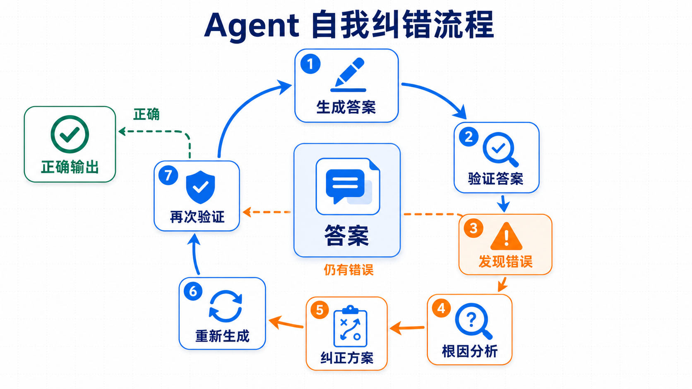

## 知识点讲解



### 1. 核心概念

自我纠错能力，核心是让 Agent 在执行过程中检测到"自己答错了"，并能针对性地修正，而不是盲目重试。

没有纠错 vs 有纠错的区别：没有纠错，模型输出什么就是什么，错了也输出给用户；有纠错，输出先经过验证，发现问题后拿着具体的错误信息让模型修正，修正后再验证。

### 2. 技术细节

#### 2.1 三个核心环节

**错误检测**：发现"这个输出有问题"。三种检测方式：

- **规则检测**：格式不对、字段缺失、数值超出合理范围——用代码直接检查，快且准
- **语义检测**：结论和数据是否对应、逻辑是否自洽——用 LLM（最好是单独的验证模型）检查
- **事实验证**：声明的数据是否有来源支撑——结合 RAG 验证

**根因分析**：知道"哪里出了问题"。不只是"输出不对"，要给出具体的错误类型和位置——这样修正的时候才能针对性改，而不是从头重新生成。

**自我修正**：用具体的错误描述 + 原始输出 → 让模型针对性修正。关键：不是让模型"重新生成一遍"，而是给它看到自己的错误后让它修正，后者效率高很多。

#### 2.2 检测层级

| 检测类型 | 工具 | 速度 | 准确度 |
| --- | --- | --- | --- |
| 格式/结构检测 | 代码验证（JSON parse、正则） | 极快 | 高（规则确定） |
| 语义一致性 | 验证 LLM | 慢 | 中（依赖模型） |
| 事实核查 | RAG 检索 + 验证 | 中 | 中高 |

优先用代码检测（快且准），语义检测作为第二层，事实核查成本最高只在关键场景用。

#### 2.3 避免死循环

纠错机制的最大风险：纠错 → 仍然有错 → 继续纠错 → 无限循环。

必须设置：

- 最大纠错次数（通常 2-3 次）
- 纠错后如果问题没有减少（反而变多），停止纠错
- 超出限制后上报人工，不要强行输出错误结果

## 代码示例

```python
import json
import re
from dataclasses import dataclass, field
from typing import Optional, Callable
import anthropic

client = anthropic.Anthropic()
MODEL       = "claude-3-5-sonnet-20241022"
MODEL_CHECK = "claude-3-haiku-20240307"  # 验证用小模型


@dataclass
class ValidationResult:
    passed:     bool
    issues:     list[str]
    severity:   str     = "low"    # low / medium / high
    suggestions: list[str] = field(default_factory=list)


# ===== 验证器：不同类型的检测 =====

def validate_json_format(output: str, required_fields: list[str]) -> ValidationResult:
    """规则检测：验证 JSON 格式和必填字段"""
    issues = []
    try:
        data = json.loads(output.strip())
    except json.JSONDecodeError as e:
        return ValidationResult(passed=False, issues=[f"无效 JSON：{e}"], severity="high")

    missing = [f for f in required_fields if f not in data]
    if missing:
        issues.append(f"缺少必填字段：{missing}")

    # 简单类型检查
    for field_name, expected_type in [("score", (int, float)), ("items", list)]:
        if field_name in data and not isinstance(data[field_name], expected_type):
            issues.append(f"字段 {field_name} 类型错误，期望 {expected_type.__name__}")

    return ValidationResult(
        passed=len(issues) == 0,
        issues=issues,
        severity="high" if issues else "low",
    )


def validate_semantic_consistency(task_goal: str, output: str) -> ValidationResult:
    """语义检测：验证输出是否符合任务目标，逻辑是否自洽"""
    response = client.messages.create(
        model=MODEL_CHECK,
        max_tokens=256,
        messages=[{
            "role": "user",
            "content": f"""检查以下输出是否满足任务目标、逻辑是否自洽。
输出 JSON：{{"passed": true/false, "issues": ["问题1"], "suggestions": ["建议1"]}}

任务目标：{task_goal[:200]}
输出内容：{output[:400]}""",
        }],
    )
    raw = ""
    for block in response.content:
        if hasattr(block, "text"):
            raw = block.text

    try:
        json_match = re.search(r'\{.*\}', raw, re.DOTALL)
        if json_match:
            data = json.loads(json_match.group())
            return ValidationResult(
                passed=data.get("passed", True),
                issues=data.get("issues", []),
                suggestions=data.get("suggestions", []),
                severity="medium" if not data.get("passed") else "low",
            )
    except (json.JSONDecodeError, AttributeError):
        pass

    return ValidationResult(passed=True, issues=[], severity="low")


# ===== 自我纠错 Agent =====
class SelfCorrectingAgent:
    """具备多层错误检测和针对性修正能力的 Agent"""

    def __init__(
        self,
        system_prompt:  str,
        validators:     list[Callable] = None,
        max_iterations: int = 3,
    ):
        self.system    = system_prompt
        self.validators = validators or []
        self.max_iter  = max_iterations
        self.correction_log: list[dict] = []

    def _generate(self, prompt: str) -> str:
        """生成响应"""
        response = client.messages.create(
            model=MODEL,
            max_tokens=1024,
            system=self.system,
            messages=[{"role": "user", "content": prompt}],
        )
        for block in response.content:
            if hasattr(block, "text"):
                return block.text
        return ""

    def _run_validators(self, output: str, task: str) -> list[ValidationResult]:
        """运行所有验证器"""
        results = []
        for validator in self.validators:
            try:
                result = validator(output)
                results.append(result)
            except Exception as e:
                results.append(ValidationResult(passed=False, issues=[f"验证器出错：{e}"], severity="medium"))
        return results

    def _build_correction_prompt(
        self,
        original_task: str,
        current_output: str,
        issues: list[str],
        suggestions: list[str],
    ) -> str:
        """构建针对性的修正 prompt"""
        issue_text = "\n".join(f"- {issue}" for issue in issues)
        suggestion_text = "\n".join(f"- {s}" for s in suggestions) if suggestions else "无特定建议"

        return f"""请修正以下输出中的问题。

原始任务：{original_task}

当前输出（有问题需要修正）：
{current_output}

发现的问题：
{issue_text}

修正建议：
{suggestion_text}

请针对以上问题修正输出，保持其他正确部分不变。"""

    def execute(self, task: str) -> dict:
        """执行任务，带自动检测和纠错循环"""
        current_output = self._generate(task)
        iteration = 0
        correction_history = []

        while iteration < self.max_iter:
            # 运行验证器
            validation_results = self._run_validators(current_output, task)
            all_issues      = [issue for r in validation_results for issue in r.issues]
            all_suggestions = [s for r in validation_results for s in r.suggestions]
            has_high_severity = any(r.severity == "high" for r in validation_results)
            all_passed = all(r.passed for r in validation_results)

            if all_passed:
                # 所有验证通过
                self.correction_log.append({
                    "task":       task,
                    "iterations": iteration,
                    "success":    True,
                })
                return {
                    "status":     "success",
                    "result":     current_output,
                    "iterations": iteration,
                    "corrections": correction_history,
                }

            # 记录这次迭代的问题
            correction_history.append({
                "iteration": iteration,
                "issues":    all_issues,
            })

            # 高严重性问题（格式完全错误），重新生成比修正更合适
            if has_high_severity and iteration == 0:
                corrected_prompt = f"""{task}

重要：输出必须满足以下要求：
{chr(10).join(f'- {issue}' for issue in all_issues)}"""
                current_output = self._generate(corrected_prompt)
            else:
                # 针对性修正
                correction_prompt = self._build_correction_prompt(
                    task, current_output, all_issues, all_suggestions
                )
                current_output = self._generate(correction_prompt)

            iteration += 1

        # 达到最大迭代次数
        final_validations = self._run_validators(current_output, task)
        remaining_issues = [issue for r in final_validations for issue in r.issues]

        self.correction_log.append({
            "task":       task,
            "iterations": self.max_iter,
            "success":    len(remaining_issues) == 0,
        })

        return {
            "status":          "partial" if remaining_issues else "success",
            "result":          current_output,
            "iterations":      self.max_iter,
            "remaining_issues": remaining_issues,
            "corrections":     correction_history,
            "needs_human":     len(remaining_issues) > 0,
        }

    def get_stats(self) -> dict:
        """统计纠错效果"""
        total = len(self.correction_log)
        if not total:
            return {}
        success = sum(1 for r in self.correction_log if r["success"])
        avg_iterations = sum(r["iterations"] for r in self.correction_log) / total
        return {
            "total_tasks":    total,
            "success_rate":   f"{success/total:.1%}",
            "avg_iterations": round(avg_iterations, 1),
        }


# 使用示例
SYSTEM = """你是一个情感分析助手。

输出格式（只输出 JSON，不加其他文字）：
{"sentiment": "正面|负面|中性", "score": 1-5, "key_points": ["要点1", "要点2"]}"""

# 定义验证器
def check_sentiment_format(output: str) -> ValidationResult:
    return validate_json_format(output, required_fields=["sentiment", "score", "key_points"])

def check_sentiment_values(output: str) -> ValidationResult:
    try:
        data = json.loads(output.strip())
        issues = []
        if data.get("sentiment") not in ["正面", "负面", "中性"]:
            issues.append(f"sentiment 值无效：{data.get('sentiment')}，必须是 正面/负面/中性")
        if not isinstance(data.get("score"), (int, float)) or not (1 <= data.get("score", 0) <= 5):
            issues.append(f"score 值无效：{data.get('score')}，必须是 1-5 的数字")
        if not isinstance(data.get("key_points"), list) or len(data.get("key_points", [])) < 1:
            issues.append("key_points 必须是非空数组")
        return ValidationResult(passed=len(issues) == 0, issues=issues, severity="high" if issues else "low")
    except json.JSONDecodeError:
        return ValidationResult(passed=False, issues=["输出不是有效 JSON"], severity="high")

agent = SelfCorrectingAgent(
    system_prompt=SYSTEM,
    validators=[check_sentiment_format, check_sentiment_values],
    max_iterations=3,
)

test_comments = [
    "这款产品质量很好，用了一年没问题，强烈推荐！",
    "退货流程太复杂了，等了半个月还没处理",
]

for comment in test_comments:
    result = agent.execute(f"分析以下评论的情感：{comment}")
    print(f"\n评论：{comment[:30]}...")
    print(f"状态：{result['status']}, 迭代次数：{result['iterations']}")
    if result["result"]:
        print(f"结果：{result['result'][:150]}")

print(f"\n统计：{agent.get_stats()}")
```

## 面试怎么答

Agent 自我纠错的核心是三个环节：检测错误、分析根因、针对性修正。

检测分层次：格式检测用代码（解析 JSON、验证字段），最快最准；语义检测用验证模型，检查逻辑是否自洽；事实核查用 RAG 验证数据来源。三层按成本从低到高叠加，不是每次都跑最贵的那层。

修正时不是让模型"重新生成一遍"，而是把具体的错误信息 + 原始输出一起给模型，让它针对性修改。这样效率高，也能保留输出中正确的部分。

必须设最大迭代次数，超出后上报人工，不能无限循环。还要检测"越纠越错"的情况——如果修正后问题变多了，就停下来。

## 高频追问 & 加分点

- **Q1：用另一个模型做验证，会不会两个模型互相质疑，没有定论？**  
    这是个真实风险，特别是对于主观判断类的输出。解决方法：① 验证层只做客观检查（格式、数值范围、字段完整性），不做主观判断；② 如果要判断逻辑是否正确，设计的验证问题要是有确定答案的（比如"这个数字是否在给定范围内"），不要问"这个解释是否合理"这类开放问题；③ 验证不过才修正，过了就接受，不要无限追求"更好"。
- **Q2：如何防止纠错反而把对的内容改错了？**  
    修正 prompt 里要明确："只修改以下具体问题，保持其他内容不变"，然后列出具体问题。不要用"请改进整个输出"这种模糊指令——模型会倾向于全部重写，很可能把对的也动了。修正后做 diff，如果改动范围超出了问题部分，发出告警。
- **Q3：对于不可验证的输出（比如创意写作），如何做纠错？**  
    换维度检测：不验证内容好不好，验证格式是否符合要求（字数、段落结构、是否包含要求的元素）、是否违反约束（不包含敏感词、符合主题范围）。内容好坏交给人工评估或用户反馈，不要让机器判断主观创作质量。
- **Q4：自我纠错和让用户反馈改进有什么区别？**  
    自我纠错是实时的（生成即检测），用户看到的已经是修正后的结果；用户反馈改进是离线的（收集错误案例 → 更新 prompt/数据），影响的是下一个版本的模型行为。两者互补：自我纠错解决当前问题，用户反馈改进系统长期能力。都要做，缺一不可。
