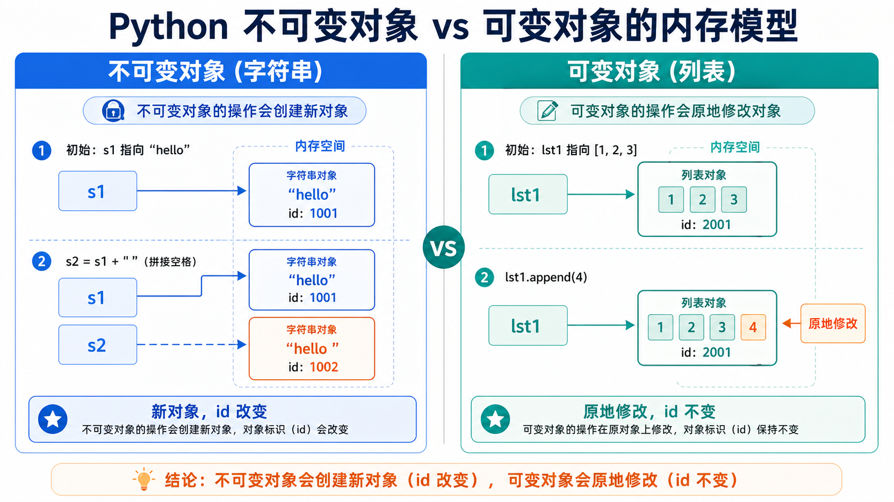

## 知识点讲解



### 1. 核心概念

Python 里所有对象要么可变、要么不可变，这是语言设计的基础分类。

**不可变对象**（int、float、str、tuple、frozenset、bytes）：创建后内容锁死，"修改"操作实际上是创建了一个新对象，原对象不变。

**可变对象**（list、dict、set、bytearray，以及自定义 class）：创建后内容可以原地修改，`id()` 不变。

```python
# 不可变：str "修改" 其实是创建新对象
s = "hello"
print(id(s))       # 比如 4521234560
s += " world"
print(id(s))       # 不一样了——新对象

# 可变：list 原地修改，id 不变
lst = [1, 2, 3]
print(id(lst))     # 比如 4521234688
lst.append(4)
print(id(lst))     # 一样——同一个对象
```

### 2. 技术细节

不可变性带来三个工程价值：

**① 可哈希**：Python 的哈希机制要求对象的哈希值在生命周期内不变，这只有不可变对象能保证。可哈希 → 能当 dict 的 key 或 set 的元素。

**② 线程安全**：不可变对象天然线程安全，不需要加锁——因为根本改不了。多个 Agent 并发读取同一个 tuple 配置没有竞争条件。

**③ 缓存优化**：Python 对小整数（-5 到 256）和字符串做了驻留（interning），`is` 比较可以快于 `==`。不可变对象也是 `functools.lru_cache` 的必要前提。

| 类型 | 可变 | 可哈希 | 当 dict key |
| --- | --- | --- | --- |
| str | ✗ | ✓ | ✓ |
| tuple | ✗ | ✓ (内层也不可变时) | ✓ |
| list | ✓ | ✗ | ✗ |
| dict | ✓ | ✗ | ✗ |
| frozenset | ✗ | ✓ | ✓ |

### 3. 对比与拓展

有个容易混淆的点：tuple 的不可变性只作用于"引用"本身，不作用于引用指向的对象。

```python
t = (1, [2, 3])
t[1].append(4)    # 合法！list 本身可变
print(t)          # (1, [2, 3, 4])
hash(t)           # 报错：含可变对象的 tuple 不可哈希
```

这意味着 `t` 不可哈希，不能当字典 key——所以用 tuple 当 key 时，要保证 tuple 里只有不可变对象。

## 代码示例

**LLM 调用缓存：用 tuple 做 key**

```python
from functools import lru_cache

# lru_cache 要求参数可哈希，所以 messages 不能是 list[dict]
# 这里把关键参数打包成 tuple
@lru_cache(maxsize=256)
def _cached_llm_call(model: str, temperature: float, prompt_hash: int) -> str:
    # ... 实际调用 LLM
    # ...

class CachedAgent:
    def call(self, model: str, temperature: float, prompt: str) -> str:
        # 把 prompt 转成哈希，避免超长字符串当 key
        prompt_hash = hash(prompt)
        return _cached_llm_call(model, temperature, prompt_hash)
```

**工具路由：用 frozenset 做权限集合**

```python
class ToolPermission:
    # frozenset 可哈希，可放进 set，方便权限比较
    READ_ONLY = frozenset({"search", "summarize", "read_file"})
    READ_WRITE = frozenset({"search", "summarize", "read_file", "write_file", "execute"})

    @staticmethod
    def can_use(agent_level: str, tool_name: str) -> bool:
        if agent_level == "read_only":
            return tool_name in ToolPermission.READ_ONLY
        return tool_name in ToolPermission.READ_WRITE
```

**字符串高效拼接**

```python
# 不可变 str 频繁 += 是性能陷阱，每次创建新对象
# 用 list 收集，最后 join 一次
def build_prompt(parts: list[str]) -> str:
    buffer: list[str] = []
    for part in parts:
        buffer.append(part)
    return "\n".join(buffer)  # 一次性创建最终字符串
```

## 面试怎么答

Python 对象分两类：可变的改了 id 不变（list/dict/set），不可变的"改"了其实是新建对象（int/str/tuple）。

不可变对象有三个工程价值：一是可哈希，能当字典 key 或放进集合；二是线程安全，多个 Agent 并发读不需要加锁；三是支持缓存，`lru_cache` 要求参数可哈希。

Agent 里常见用法：用 tuple 做工具注册表的键（确保分类名不被改），用 frozenset 做权限集合（快速 `in` 判断且不可被外部追加），用 str 当 prompt 的缓存键（不可变，哈希值稳定）。

容易踩的坑：tuple 嵌了 list 就不可哈希了，`hash((1, [2, 3]))` 直接报 TypeError。用 tuple 当字典 key 时，必须保证里面只有不可变对象。

## 高频追问 & 加分点

- **Q1：为什么字符串不可变但效率高？**  
    Python 对字符串做了驻留优化——相同内容的短字符串通常只保存一份，多个变量共享。不可变保证了这个共享是安全的。如果字符串可变，共享一份就会互相影响，所以不可变是驻留优化的前提。
- **Q2：可变对象作为函数默认参数有什么坑？**  
    经典陷阱：`def f(lst=[])` 里的 `[]` 只在函数定义时创建一次，多次调用共享同一个 list。Agent 工厂方法如果用可变默认参数，每个 Agent 拿到的是同一个对象。正确做法是 `def f(lst=None): lst = lst or []`，或用 `field(default_factory=list)`（dataclass）。
- **Q3：frozenset 在 Agent 里有什么实用场景？**  
    权限集合、工具白名单——这两种"只读、需要快速 in 判断"的场景很适合。frozenset 支持集合运算（交集、差集），判断"当前 Agent 有没有某组权限"可以直接用 `required_perms <= agent_perms` 这种子集写法，比 list 遍历清晰得多。加分信号词：frozenset 可以当 dict key，可以放进另一个 set，这是 set 做不到的。
- **Q4：Python 3.12 以后有什么变化？**  
    Python 3.12 引入了 `type` 关键字语法糖，但对可变/不可变的核心机制没有变化。值得提的是 Python 3.13 的"no-GIL"实验版本——不可变对象在多线程场景下的安全优势会更突出，因为可变对象的并发写入问题会暴露得更明显。
