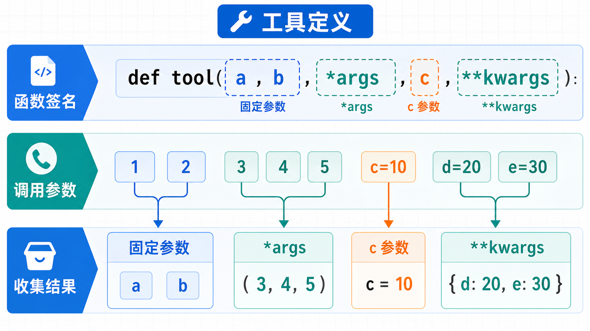

## 知识点讲解



### 1. 核心概念

`*args` 和 `**kwargs` 是 Python 的"万能接线板"，让函数可以接受不定数量的参数。

`*args`：收集多余的**位置参数**，打包成一个 tuple 传进来。  
`**kwargs`：收集多余的**关键字参数**，打包成一个 dict 传进来。

```python
def demo(*args, **kwargs):
    print(args)    # tuple，比如 (1, 2, 3)
    print(kwargs)  # dict，比如 {'name': 'Alice', 'age': 30}

demo(1, 2, 3, name='Alice', age=30)
```

函数签名的完整顺序：

```
def f(普通位置参数, *args, 关键字专用参数, **kwargs)
```

### 2. 技术细节

在 Agent 工具定义里，`**kwargs` 特别有用——LLM 返回的 function call 参数是 JSON，直接解包成 `**kwargs` 就能调用对应函数，不用手动一个个取字段。

```python
# LLM 返回的 tool_call.input 是个 dict
tool_input = {"query": "Python async", "limit": 5}

# 直接解包，等价于 search_web(query="Python async", limit=5)
result = search_web(**tool_input)
```

`*` **解包**也很常见，把 list 展开成位置参数：

```python
queries = ["Python", "Agent", "RAG"]
# 等价于 asyncio.gather(search("Python"), search("Agent"), search("RAG"))
results = await asyncio.gather(*[search(q) for q in queries])
```

### 3. 对比与拓展

固定参数 vs `**kwargs` 的选择标准：

- 参数已知且稳定 → 固定参数（类型检查、IDE 提示更好）
- 参数动态来自 LLM/配置 → `**kwargs`（灵活，直接解包 JSON）

LLM function calling 场景几乎都是后者——你不知道 LLM 会选哪个工具、传什么参数，`**kwargs` 是自然选择。

## 代码示例

**工具注册装饰器：用** `**kwargs` **透传参数**

```python
from functools import wraps
from typing import Callable

class ToolRegistry:
    def __init__(self):
        self._tools: dict[str, dict] = {}

    def register(self, name: str, description: str):
        def decorator(func: Callable) -> Callable:
            self._tools[name] = {
                "func": func,
                "description": description,
                "name": name,
            }

            @wraps(func)
            def wrapper(*args, **kwargs):
                # 可以在这里加日志、参数校验等
                return func(*args, **kwargs)

            return wrapper
        return decorator

    def call(self, name: str, **kwargs):
        if name not in self._tools:
            raise KeyError(f"tool '{name}' not registered")
        return self._tools[name]["func"](**kwargs)

registry = ToolRegistry()

@registry.register("search_web", "Search the internet for information")
def search_web(query: str, limit: int = 5, safe_mode: bool = True) -> list[str]:
    # ...
    return [f"result_{i}" for i in range(limit)]
```

**执行 LLM 返回的工具调用**

```python
async def execute_tool_call(registry: ToolRegistry, tool_call: dict) -> str:
    tool_name = tool_call["name"]
    # LLM 返回的参数 dict 直接解包
    tool_args = tool_call["input"]  # 已经是 dict

    try:
        result = registry.call(tool_name, **tool_args)
        return str(result)
    except KeyError:
        return f"error: tool '{tool_name}' not found"
    except TypeError as e:
        return f"error: invalid arguments — {e}"
```

## 面试怎么答

`*args` 把多余的位置参数收成 tuple，`**kwargs` 把多余的关键字参数收成 dict。参数名只是约定，`*` 和 `**` 前缀才是关键。

在 Agent 工具定义里，`**kwargs` 最直接的用途是接 LLM 的 function call 输出——LLM 生成的参数本来就是 JSON 对象（dict），直接 `tool_func(**tool_call.input)` 就能调用，省去了手动解字段的麻烦。

`*` 解包用得也多：把 coroutine 列表展开给 `asyncio.gather(*tasks)` 是并发调用多工具的标准写法。

需要注意：`**kwargs` 会丢掉类型信息，IDE 拿不到提示。关键工具建议还是显式定义参数签名，只在通用的 dispatch 层用 `**kwargs`。

## 高频追问 & 加分点

- **Q1：**`*args` **和** `**kwargs` **的顺序能不能乱？**  
    不能。Python 规定顺序：普通位置参数 → `*args` → 关键字专用参数（keyword-only）→ `**kwargs`。违反这个顺序会在函数定义时就报 `SyntaxError`。加分点：`*args` 之后的参数自动变成 keyword-only，调用时必须写参数名，不能按位置传。
- **Q2：如何在使用** `**kwargs` **的同时保留类型提示？**  
    Python 3.12 引入了 `TypedDict` + `Unpack` 组合可以给 `**kwargs` 加类型：`def f(**kwargs: Unpack[MyTypedDict])`。更早的版本只能在 docstring 里说明，或改用显式参数签名。
- **Q3：**`@wraps(func)` **在工具注册里为什么重要？**  
    没有 `@wraps`，装饰后的函数 `__name__` 和 `__doc__` 都会变成 wrapper 的，LLM 看到的工具描述或日志里的函数名就错了。`@wraps` 把原函数的元信息复制过来，调试和可观测性都好很多——这是工具注册装饰器的标配。
- **Q4：工具参数直接 eval 解析安全吗？**  
    极不安全。有些示例里用 `eval(params_str)` 解析 LLM 输出的参数，这等于给 LLM 执行任意 Python 代码的权限——prompt injection 攻击直接就能跑命令。正确做法是强制 JSON 格式，用 `json.loads()` 解析，再做参数校验（pydantic 或 jsonschema）。这是 Agent 安全的基础防线。
