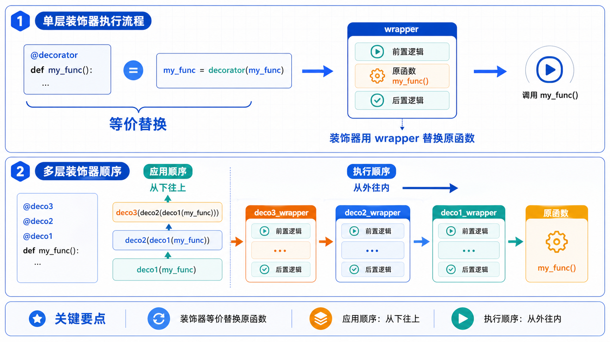

## 知识点讲解



### 1. 核心概念

装饰器本质就是一个高阶函数：接收一个函数作为输入，返回一个"增强版"函数。`@decorator` 是语法糖，等价于 `func = decorator(func)`。

```
@decorator
def my_func():
    pass

# 等价于：
def my_func():
    pass
my_func = decorator(my_func)
```

这个模式的核心价值是：**不修改原函数的代码，给它叠加额外行为**。

装饰器分三层结构：

1. **外层函数**：接收被装饰的函数，返回包装函数
2. **内层 wrapper**：包裹原函数，在调用前后插入逻辑
3. `@wraps(func)`：必须加，把原函数的 `__name__`、`__doc__` 保留下来

### 2. 技术细节

Agent 里装饰器最常见的三个用途：

**① 工具注册**：`@agent.tool("name")` 把函数自动写入工具注册表，不用手动调用 `register()`。

**② 日志 & 计时**：在工具执行前后记录调用时间和结果，不侵入业务代码。

**③ 参数校验**：在函数执行前校验入参类型和范围，LLM 传来的参数不一定合法。

装饰器还可以堆叠，执行顺序从距离函数最近的开始（从内往外）：

```python
@log_call          # 最外层，最后执行
@validate_args     # 中间
@retry(times=3)    # 最内层，最先执行
def search(query: str):
    # ...
```

### 3. 对比与拓展

装饰器 vs 继承：装饰器是"横向组合"，堆叠灵活；继承是"纵向扩展"，适合强相关的功能。工具注册、日志、限流这类"横切关注点"用装饰器比继承优雅得多。

## 代码示例

**工具注册装饰器（带自动 schema 生成）**

```python
import inspect
import time
from functools import wraps
from typing import Callable

class Agent:
    def __init__(self):
        self.tools: dict[str, dict] = {}

    def tool(self, name: str, description: str = ""):
        def decorator(func: Callable) -> Callable:
            # 自动从函数签名提取参数信息
            sig = inspect.signature(func)
            params = {
                k: {"type": str(v.annotation.__name__
                    if v.annotation != inspect.Parameter.empty else "any")}
                for k, v in sig.parameters.items()
            }

            self.tools[name] = {
                "func": func,
                "name": name,
                "description": description or func.__doc__ or "",
                "parameters": params,
            }

            @wraps(func)
            def wrapper(*args, **kwargs):
                return func(*args, **kwargs)

            return wrapper
        return decorator
```

**日志 + 计时装饰器**

```python
def log_tool_call(func: Callable) -> Callable:
    @wraps(func)
    def wrapper(*args, **kwargs):
        start = time.monotonic()
        try:
            result = func(*args, **kwargs)
            elapsed = time.monotonic() - start
            print(f"[TOOL] {func.__name__} ok ({elapsed:.3f}s)")
            return result
        except Exception as e:
            elapsed = time.monotonic() - start
            print(f"[TOOL] {func.__name__} error ({elapsed:.3f}s): {e}")
            raise
    return wrapper
```

**组合使用**

```python
agent = Agent()

@agent.tool("search_web", "Search the internet")
@log_tool_call
def search_web(query: str, limit: int = 5) -> list[str]:
    """搜索网络并返回结果列表"""
    # ...
    return [f"result_{i}" for i in range(limit)]

# 调用 LLM 返回的 tool call
tool_result = agent.tools["search_web"]["func"](query="Python", limit=3)
```

## 面试怎么答

装饰器是高阶函数，接收函数返回增强函数，`@syntax` 是语法糖。本质是"不改原函数代码，给它叠功能"。

Agent 工具注册是装饰器最经典的用法：`@agent.tool("search", "搜索网络")` 一行，函数就自动写进注册表、带上 description 和参数 schema，比手动 `register()` 干净得多。LangChain 的 `@tool` 装饰器就是这个思路。

除了注册，还常用来加日志计时（在工具执行前后插 hook）、参数校验（拦截不合法的 LLM 参数）、重试（工具失败自动重试）。这三个可以堆叠在同一个函数上，互不干扰。

必须记一点：`@wraps(func)` 是强制的。没有它，装饰后的函数 `__name__` 变成 wrapper，日志、可观测性、错误追踪都会乱。

## 高频追问 & 加分点

- **Q1：装饰器带参数和不带参数有什么区别？**  
    不带参数的装饰器是两层函数（外层接函数、内层是 wrapper）；带参数的需要三层（最外层接参数、中层接函数、内层是 wrapper）。`@agent.tool("name")` 就是带参数，所以有三层。写的时候容易少一层，调试会报很奇怪的 TypeError。
- **Q2：如何给装饰器本身加类型提示？**  
    Python 3.10+ 可以用 `ParamSpec` 和 `Concatenate` 精确描述 decorator 的类型签名。简单场景可以用 `TypeVar` + `Callable`：`F = TypeVar('F', bound=Callable) def dec(func: F) -> F: ...`。加分点：typing.overload 在 decorator 场景下可以保留原函数的参数类型。
- **Q3：装饰器会影响性能吗？**  
    每次函数调用多一层 wrapper 的开销，通常微不足道（纳秒级）。真正的性能问题是装饰器里做了重的操作（比如每次调用都 inspect 参数签名）——这些应该放在定义时一次性完成，而不是每次调用时重复执行。
- **Q4：类装饰器和函数装饰器有什么区别？**  
    函数装饰器返回函数，类装饰器返回类实例（类实现 `__call__` 方法充当 wrapper）。类装饰器更适合有状态的场景，比如带计数器的限流装饰器——限流次数存在实例属性里，比函数装饰器的闭包变量更清晰。加分信号词：`dataclass` 本身就是一个类装饰器。
