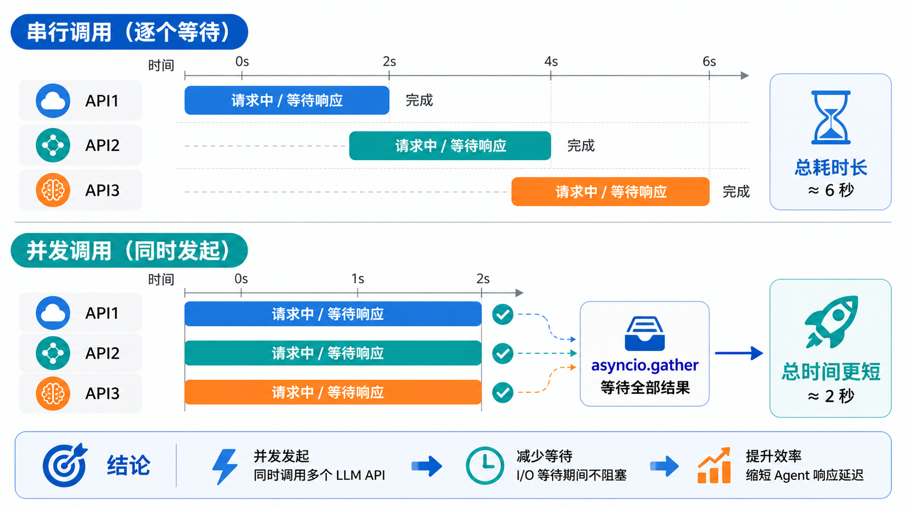

## 知识点讲解



### 1. 核心概念

`asyncio.gather()` 是 Agent 并发调用的核心——把多个协程打包，同时发出，全部完成后按输入顺序返回结果。

```python
results = await asyncio.gather(coro1(), coro2(), coro3())
# results[0] 对应 coro1，results[1] 对应 coro2，以此类推
```

Agent 调用 LLM 的延迟通常在 1-5 秒。如果有 5 个子任务各需要调一次 LLM，串行要 5-25 秒，并发只需最慢那个——通常 5 秒出头。这个差距在复杂任务里直接决定用户体验。

### 2. 技术细节

`asyncio.gather` 有两种常用模式：

**默认模式**：任何一个任务失败，立刻抛异常，其他任务虽然继续运行但结果被丢弃。

`return_exceptions=True`：所有任务都跑完，成功的返回结果，失败的返回异常对象。适合 Agent 场景——部分工具失败不应该让整步崩掉。

```python
results = await asyncio.gather(
    call_tool_a(),
    call_tool_b(),
    call_tool_c(),
    return_exceptions=True,
)

for i, r in enumerate(results):
    if isinstance(r, Exception):
        print(f"task {i} failed: {r}")
    else:
        print(f"task {i} ok: {r}")
```

**并发限流**：用 `asyncio.Semaphore` 控制最大并发数，避免触发 rate limit：

```python
sem = asyncio.Semaphore(10)  # 最多 10 个并发请求

async def limited_call(prompt: str) -> str:
    async with sem:
        return await call_llm(prompt)
```

### 3. 对比与拓展

`gather` vs `as_completed`：gather 等所有完成按顺序返回；`asyncio.as_completed()` 谁先完成先给谁，适合"第一个结果出来就处理"的场景，比如竞速策略（同时发多个模型，谁快用谁）。

## 代码示例

**多模型竞速：谁快用谁**

```python
import asyncio

async def call_model(client, model: str, prompt: str) -> tuple[str, str]:
    response = await client.messages.create(
        model=model,
        max_tokens=512,
        messages=[{"role": "user", "content": prompt}],
    )
    return model, response.content[0].text

async def race_models(client, prompt: str) -> str:
    """同时发给多个模型，用最快完成的那个"""
    tasks = [
        asyncio.create_task(call_model(client, m, prompt))
        for m in ["claude-haiku-4-5-20251001", "gpt-4o-mini"]
    ]
    # as_completed：谁先完成先处理
    for coro in asyncio.as_completed(tasks):
        model_name, result = await coro
        # 取消其他还在跑的任务
        for t in tasks:
            t.cancel()
        print(f"winner: {model_name}")
        return result
```

**批量 embedding：限流 + 并发**

```python
import asyncio

async def embed_batch(client, texts: list[str], max_concurrent: int = 20) -> list[list[float]]:
    sem = asyncio.Semaphore(max_concurrent)

    async def embed_one(text: str) -> list[float]:
        async with sem:
            resp = await client.embeddings.create(
                model="text-embedding-3-small",
                input=text,
            )
            return resp.data[0].embedding

    results = await asyncio.gather(
        *[embed_one(t) for t in texts],
        return_exceptions=True,
    )

    # 过滤失败的
    embeddings = []
    for i, r in enumerate(results):
        if isinstance(r, Exception):
            print(f"text[{i}] embedding failed: {r}")
            embeddings.append(None)
        else:
            embeddings.append(r)

    return embeddings
```

**ReWOO 风格并行执行**

```python
async def parallel_tool_step(tool_calls: list[dict], registry) -> dict[str, str]:
    """执行一批无依赖的工具调用"""
    async def run_one(call: dict) -> tuple[str, str]:
        tool_id = call["id"]
        tool_fn = registry.get(call["name"])
        result = await tool_fn(**call["args"])
        return tool_id, str(result)

    pairs = await asyncio.gather(
        *[run_one(c) for c in tool_calls],
        return_exceptions=True,
    )

    evidences = {}
    for item in pairs:
        if isinstance(item, Exception):
            continue
        tool_id, result = item
        evidences[tool_id] = result

    return evidences
```

## 面试怎么答

并发调用多个 LLM API 的标准做法就是 `asyncio.gather`——把多个 async 调用打包，同时发出，返回按输入顺序排列的结果列表。耗时由最慢的那个决定，而不是所有耗时之和。

生产环境里有两个必须加的东西：一是 `return_exceptions=True`，部分工具失败不应该把整步崩掉，要能区分哪个成功哪个失败；二是 `asyncio.Semaphore` 限流，同时打出太多请求容易触发 rate limit，一般我习惯按 API 的 RPM 上限反推最大并发数。

如果有"谁快用谁"的需求（比如同时发多个模型做竞速），用 `asyncio.as_completed` 更合适，第一个完成就处理并取消其他任务。

## 高频追问 & 加分点

- **Q1：gather 里的任务数量有上限吗？**  
    没有硬上限，但实践中要控制。几十个并发没问题；几千个同时打 API 会导致连接耗尽或触发对端限流。正确做法是 Semaphore 限制最大并发，或者分批 gather（把任务分成 batch_size 一组，每组 gather 完再下一组）。
- **Q2：如果要获取第一个完成的结果并取消其他，怎么做？**  
    用 `asyncio.wait(tasks, return_when=asyncio.FIRST_COMPLETED)`，或者像示例里用 `as_completed` 手动 cancel。取消后要 `await` 那些被取消的 task 确保它们确实停了，不然后台还在跑。加分点：`task.cancel()` 只是发送取消信号，协程里下一个 `await` 才会实际抛 `CancelledError`，没有 `await` 点的代码取消不掉。
- **Q3：OpenAI 和 Anthropic 的 SDK 支持 asyncio 吗？**  
    两者都有异步版本。OpenAI 用 `from openai import AsyncOpenAI`；Anthropic 用 `from anthropic import AsyncAnthropic`。方法签名和同步版本基本相同，加个 `await` 就行。第三方工具库要注意看文档——有些只有同步版本，需要用 `asyncio.to_thread()` 包装才能在 async 上下文里用。
- **Q4：并发 LLM 调用的成本控制怎么做？**  
    三层：①Semaphore 限并发数，防止瞬时流量打爆；②请求级别加 `max_tokens` 上限，防止单次超额；③会话级别记录累计消耗，超阈值拒绝新请求。生产里还会加缓存（相同 prompt 命中缓存直接返回），Anthropic 的 Prompt Caching 可以在 SDK 层直接启用，高频重复 system prompt 省 90% input token。
