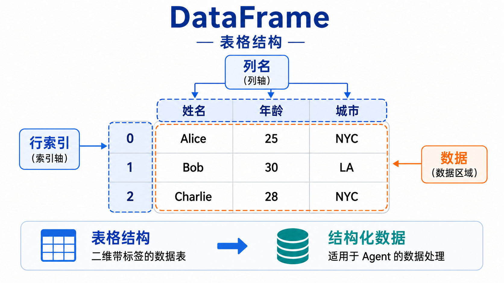

## 知识点讲解



### 1. 核心概念

Pandas 是 Python 里处理结构化数据（表格、时序、CSV）的主力库，核心是两种数据结构：

**DataFrame**：二维表格，有行索引和列名，每列可以是不同类型。Agent 处理数据库查询结果、日志文件、用户行为数据，第一步基本都是加载成 DataFrame。

**Series**：一维带标签的序列，可以理解为 DataFrame 的一列。

Pandas 在 Agent 里的典型位置：数据工具（Tool）返回 DataFrame，Agent 调用工具后对结果做过滤/聚合，再把摘要传给 LLM 生成自然语言回答。

### 2. 技术细节

高频操作速查：

| 操作 | 代码 | 说明 |
| --- | --- | --- |
| 加载数据 | `pd.read_csv()` / `read_json()` / `read_sql()` | 支持多种格式 |
| 过滤行 | `df[df["age"] > 25]` | 布尔索引 |
| 选列 | `df[["name", "age"]]` | 传列名列表 |
| 按位置选 | `df.iloc[0:5, 1:3]` | 行/列都用整数位置 |
| 按标签选 | `df.loc[df.id > 5, "name"]` | 行条件 + 列名 |
| 分组聚合 | `df.groupby("city")["salary"].mean()` | groupby + 聚合函数 |
| 处理缺失值 | `df.dropna()` / `df.fillna(0)` | 删除或填充 |
| 类型转换 | `df["date"].astype("datetime64[ns]")` | 转换列类型 |

**性能注意**：Pandas 的向量化操作比 Python `for` 循环快几十到几百倍。Agent 处理大量数据时，绝对不要用 `for row in df.iterrows()` 逐行处理——改用向量化操作或 `df.apply()`。

### 3. 对比与拓展

Pandas vs SQL：功能重叠很多，但 Pandas 在内存里操作更灵活，SQL 更适合大数据量和持久化存储。Agent 常见模式：先用 SQL/API 取原始数据 → 加载成 DataFrame → Pandas 做二次加工。

## 代码示例

**Agent 数据分析工具：加载 + 过滤 + 聚合**

```python
import pandas as pd

def analyze_sales(filepath: str, filters: dict, group_by: str) -> dict:
    """Agent 调用这个工具分析销售数据"""
    df = pd.read_csv(filepath, parse_dates=["date"])

    # 动态过滤
    for col, val in filters.items():
        if col in df.columns:
            df = df[df[col] == val]

    # 分组聚合
    summary = df.groupby(group_by).agg(
        total_sales=("amount", "sum"),
        avg_sales=("amount", "mean"),
        count=("amount", "count"),
    ).reset_index()

    # 转成 dict 方便序列化给 LLM
    return summary.to_dict(orient="records")
```

**数据清洗 Pipeline**

```python
def clean_dataframe(df: pd.DataFrame) -> pd.DataFrame:
    # 1. 删除全空行
    df = df.dropna(how="all")

    # 2. 填充数值列缺失值（用中位数）
    num_cols = df.select_dtypes(include="number").columns
    df[num_cols] = df[num_cols].fillna(df[num_cols].median())

    # 3. 去除字符串列的首尾空白
    str_cols = df.select_dtypes(include="object").columns
    df[str_cols] = df[str_cols].apply(lambda x: x.str.strip())

    # 4. 去重
    df = df.drop_duplicates()

    return df
```

**把 DataFrame 摘要传给 LLM**

```python
def df_to_llm_context(df: pd.DataFrame, max_rows: int = 10) -> str:
    """把 DataFrame 转成 LLM 能读的文本上下文"""
    lines = [
        f"数据行数: {len(df)}, 列数: {len(df.columns)}",
        f"列名: {list(df.columns)}",
        "",
        "统计摘要:",
        df.describe().to_string(),
        "",
        f"前 {min(max_rows, len(df))} 行样本:",
        df.head(max_rows).to_string(index=False),
    ]
    return "\n".join(lines)
```

## 面试怎么答

Pandas 是 Agent 处理结构化数据的标配。核心是 DataFrame（二维表格）和 Series（一维序列）。Agent 里最常见的模式：工具从数据库或 CSV 拿数据 → 加载成 DataFrame → 过滤/聚合 → 把摘要转成文本传给 LLM 分析。

高频操作就那几个：布尔索引过滤行（`df[df["col"] > val]`）、groupby 分组聚合、loc/iloc 选子集、dropna/fillna 处理缺失值。

性能上，Pandas 的向量化操作比 for 循环快几十倍。大数据集里千万不能 `iterrows` 逐行处理，应该用 `apply` 或直接向量化表达式。超过内存的数据用 `read_csv(chunksize=N)` 分块处理。

## 高频追问 & 加分点

- **Q1：Agent 如何动态执行 LLM 生成的 Pandas 操作？**  
    一种方案是让 LLM 生成 Pandas 代码字符串，在受限环境里 `exec()`——但安全风险很高（代码注入）。更安全的做法是定义一套结构化的"数据操作 DSL"（JSON 格式），Agent 把 LLM 返回的操作描述解析成具体的 Pandas 调用。加分点：让 LLM 只生成操作参数（过滤条件、聚合函数），而不是完整代码，把执行权控制在工具层。
- **Q2：DataFrame 太大了，怎么给 LLM 喂数据？**  
    不能把整个 DataFrame 塞进 prompt——太大。几个策略：①先 `describe()` 拿统计摘要；②`sample(20)` 随机采样几行；③按问题的维度 groupby 后传聚合结果；④先让 Agent 生成过滤条件，再传过滤后的小表。总之，LLM 拿到的是摘要，不是原始数据。
- **Q3：Pandas 读取大文件的最佳实践？**  
    `read_csv(chunksize=10000)` 返回迭代器，每次处理一块；`dtype` 参数指定列类型（尤其是字符串和数值），避免 Pandas 自动推断浪费内存；`usecols` 参数只加载需要的列；对于更大的数据，换 Polars（内存效率更高）或 DuckDB（支持 SQL 直接查 Parquet）。
- **Q4：Pandas 的** `apply` **和向量化操作哪个更快？**  
    向量化操作（直接在 Series/DataFrame 上做运算）>> `apply`（Python 层面逐元素） >> `iterrows`。能用向量化就不用 `apply`；必须用 `apply` 时，考虑 `swifter` 或 `pandarallel` 并行化。真正的性能瓶颈出现时，Polars 是 Pandas 的替代品，默认并行、内存效率更高。
