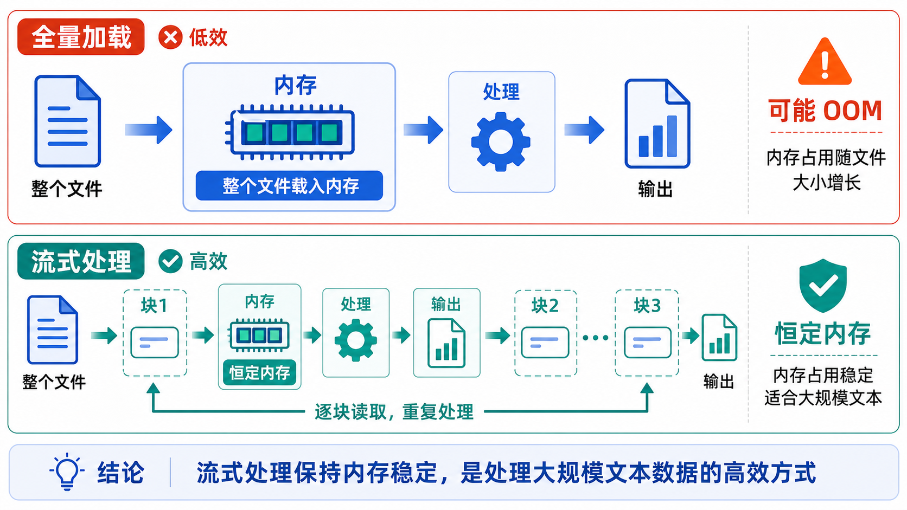

## 知识点讲解



### 1. 核心概念

大规模文本处理的核心矛盾是：**内存是有限的，数据是无限的**。

解决思路一共就两条：

**流式处理**：不一次性把文件读进内存，而是"用一行、读一行"，内存始终只存当前处理的那块数据。Python 的生成器（`yield`）天然支持这种模式。

**并行处理**：文本块之间通常互相独立，可以用多进程并行处理不同块，把时间压缩到 1/N（N 是进程数）。

Agent 里的典型场景：给 100 万条文档建向量索引、批量预处理用户上传的语料库、实时摄取日志流。

### 2. 技术细节

**生成器的优势**：

```python
# 全量加载：100GB 文件 → 内存直接爆
def load_all(path: str) -> list[str]:
    return open(path).readlines()  # 危险！

# 生成器：永远只有一行在内存里
def stream_lines(path: str):
    with open(path, encoding="utf-8") as f:
        for line in f:
            yield line.strip()
```

**文本预处理的常用操作**：

| 操作 | 方法 |
| --- | --- |
| 小写化 | `text.lower()` |
| 去特殊字符 | `re.sub(r'[^\w\s]', '', text)` |
| 去多余空白 | `' '.join(text.split())` |
| 分词 | `text.split()` 或 `nltk.word_tokenize()` |
| 分块（chunking） | 按固定长度或句子边界切分 |

**RAG chunking 策略**：给 LLM 喂的文本块太长（超 context window）或太短（语义不完整）都不好。通常按句子边界切，每块 200-500 tokens，相邻块有 50-100 tokens 的重叠（overlap）防止信息截断。

### 3. 对比与拓展

文本处理性能优先级：正则/向量化操作 >> `str` 方法 >> 纯 Python 循环。处理中文文本要用 jieba 或 thulac 分词，西文用 nltk 或 spacy。

## 代码示例

**流式 chunking：RAG 文档预处理**

```python
import re
from typing import Generator

def stream_file(path: str, chunk_size: int = 1000) -> Generator[list[str], None, None]:
    """按行流式读取文件，每 chunk_size 行生成一批"""
    with open(path, encoding="utf-8", errors="ignore") as f:
        buffer = []
        for line in f:
            cleaned = line.strip()
            if cleaned:
                buffer.append(cleaned)
            if len(buffer) >= chunk_size:
                yield buffer
                buffer = []
        if buffer:
            yield buffer

def chunk_text(text: str, max_tokens: int = 400, overlap: int = 50) -> list[str]:
    """把长文本切成带重叠的 chunk（按词估算 token 数）"""
    words = text.split()
    chunks = []
    start = 0
    while start < len(words):
        end = min(start + max_tokens, len(words))
        chunk = " ".join(words[start:end])
        chunks.append(chunk)
        start += max_tokens - overlap  # 滑动窗口
    return chunks
```

**多进程并行处理文本块**

```python
import multiprocessing
from functools import partial

def preprocess_text(text: str) -> str:
    """单条文本预处理（在子进程里运行）"""
    text = text.lower()
    text = re.sub(r'[^\w\s]', ' ', text)
    text = ' '.join(text.split())
    return text

def process_chunk(chunk: list[str]) -> list[str]:
    return [preprocess_text(t) for t in chunk]

def parallel_preprocess(filepath: str, n_workers: int = 4) -> list[str]:
    all_results = []
    chunks = list(stream_file(filepath, chunk_size=500))

    with multiprocessing.Pool(n_workers) as pool:
        # 并行处理每个 chunk
        results = pool.map(process_chunk, chunks)

    for chunk_result in results:
        all_results.extend(chunk_result)

    return all_results
```

**RAG 文档摄取 Pipeline**

```python
async def ingest_documents(filepaths: list[str], vector_store) -> int:
    """批量摄取文档：流式读取 → chunking → embedding → 写向量库"""
    total = 0
    for path in filepaths:
        for raw_chunk in stream_file(path, chunk_size=200):
            text = " ".join(raw_chunk)
            # 二次切分保证每块不超 token 限制
            sub_chunks = chunk_text(text, max_tokens=400, overlap=50)

            # 批量 embedding（减少 API 调用次数）
            await vector_store.add_documents(sub_chunks)
            total += len(sub_chunks)

    return total
```

## 面试怎么答

处理大规模文本的核心原则是"别把整个文件读进内存"。Python 生成器加 `yield` 是最直接的工具——文件逐行迭代，内存里始终只有当前那块，100GB 文件和 1MB 文件占的内存是一样的。

RAG 里的 chunking 是文本处理的常见任务：把长文档切成适合 LLM 的短块。我习惯用滑动窗口，每块 400 tokens 左右，相邻块有 50 tokens 重叠，防止语义在切分点被截断。

需要加速的话用多进程——文本块之间独立，`multiprocessing.Pool.map` 直接扔给多个 CPU 并行处理。注意不要用多线程处理纯 Python 文本循环，GIL 让它基本没效果。

## 高频追问 & 加分点

- **Q1：chunking 的最优大小怎么确定？**  
    没有普适答案，取决于三个约束：LLM 的 context window 上限、embedding 模型的 token 上限（通常 512）、以及语义完整性（太短会割断意思，太长相似度计算噪声大）。实践中 200-500 tokens 是常见范围，有重叠的切分比无重叠准确率通常高 5-10%。加分点：递归字符分割（`RecursiveCharacterTextSplitter`）比固定大小分割保语义完整性更好。
- **Q2：中文文本处理有什么特殊之处？**  
    中文没有天然的词边界（空格），不能直接 `split()`。需要分词工具：jieba（轻量，速度快）、thulac（精度高）、spacy（中文模型）。Tokenizer 层面，tiktoken 支持中文，中文字符平均约 2-3 个 token，计算 chunk 大小时要注意。
- **Q3：超大文件（>100GB）怎么处理？**  
    单机流式处理加多进程是上限。更大的数据要分布式：用 Spark（PySpark）或 Dask 分布式 DataFrame，把数据分片到多台机器并行处理。在 Agent 场景里，通常会先用数据库做粗过滤，把工作集压缩到合理范围，而不是让 Agent 直接处理原始大文件。
- **Q4：文本编码问题怎么处理最稳妥？**  
    `open(path, encoding='utf-8', errors='replace')` 遇到非法字节用占位符替换，不崩溃。如果不确定编码，用 `chardet` 或 `charset-normalizer` 自动检测。生产中建议强制统一 UTF-8：入库时就转换，而不是处理时再猜。
