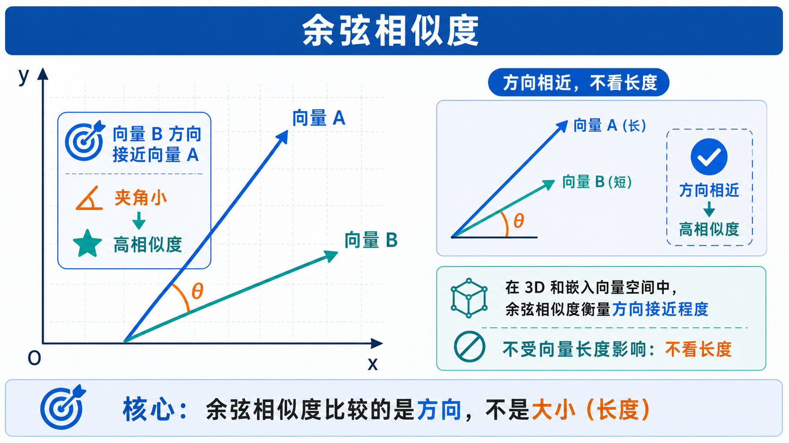

## 知识点讲解



### 1. 核心概念

余弦相似度衡量两个向量的**方向相近程度**，和向量的长度无关，只看它们夹角的余弦值。

公式：`sim(A, B) = (A · B) / (‖A‖ × ‖B‖)`

值域 [-1, 1]：

- 1：完全同向（语义相同）
- 0：正交（语义无关）
- -1：完全反向（语义相反，NLP 里罕见）

为什么 RAG 用余弦相似度而不是欧氏距离？因为 embedding 向量关注的是"方向"（语义），不是"大小"（词频、文档长度）。两篇关于 Python 的文章，一篇 100 词、一篇 10000 词，它们的语义方向应该相近，但向量长度差很远，欧氏距离会认为它们很不同。余弦相似度消除了这个干扰。

### 2. 技术细节

**手动实现（理解原理）**：

```python
import numpy as np

def cosine_sim(a: np.ndarray, b: np.ndarray) -> float:
    dot = np.dot(a, b)
    norm_a = np.linalg.norm(a)
    norm_b = np.linalg.norm(b)
    if norm_a == 0 or norm_b == 0:
        return 0.0
    return float(dot / (norm_a * norm_b))
```

**批量计算（生产用）**：

sklearn 的 `cosine_similarity` 接受矩阵，一次算出所有对（query × docs），比逐对计算快得多。

**FAISS（极大规模）**：百万级向量的近似最近邻搜索，余弦相似度等价于归一化后的点积，FAISS 的 `IndexFlatIP` 直接支持。

### 3. 对比与拓展

| 相似度方法 | 特点 | 适用场景 |
| --- | --- | --- |
| 余弦相似度 | 只看方向，不看大小 | 文本语义搜索（最常用） |
| 欧氏距离 | 看空间距离 | 图像检索、K-means |
| 点积 | 快，但受向量大小影响 | 已归一化的向量（与余弦等价） |
| BM25 | 词频关键词匹配 | 关键词精确搜索 |

混合检索（hybrid search）= 余弦相似度（语义）+ BM25（关键词），两个分数加权融合，在 RAG 里比纯向量检索准确率更高。

## 代码示例

**RAG 检索器：批量余弦相似度**

```python
import numpy as np
from dataclasses import dataclass

@dataclass
class Document:
    text: str
    embedding: np.ndarray
    metadata: dict

class VectorSearcher:
    def __init__(self):
        self._docs: list[Document] = []
        self._matrix: np.ndarray | None = None  # 所有 embedding 组成的矩阵

    def add(self, docs: list[Document]):
        self._docs.extend(docs)
        embeddings = np.array([d.embedding for d in self._docs])
        # 预归一化，查询时点积 = 余弦相似度
        norms = np.linalg.norm(embeddings, axis=1, keepdims=True)
        norms = np.where(norms == 0, 1, norms)  # 避免除以 0
        self._matrix = embeddings / norms

    def search(self, query_embedding: np.ndarray, top_k: int = 5) -> list[tuple[Document, float]]:
        if self._matrix is None or len(self._docs) == 0:
            return []

        # 归一化 query
        q_norm = np.linalg.norm(query_embedding)
        if q_norm == 0:
            return []
        q = query_embedding / q_norm

        # 矩阵点积 = 批量余弦相似度（O(N·d)）
        scores = self._matrix @ q  # shape: (N,)

        # 取 top_k
        top_indices = np.argpartition(scores, -top_k)[-top_k:]
        top_indices = top_indices[np.argsort(scores[top_indices])[::-1]]

        return [(self._docs[i], float(scores[i])) for i in top_indices]
```

**多路 Query 批量检索**

```python
def batch_search(
    searcher: VectorSearcher,
    query_embeddings: np.ndarray,  # shape: (Q, D)
    top_k: int = 5,
) -> list[list[tuple[Document, float]]]:
    """同时检索多个 query，返回每个 query 的 top_k 结果"""
    # 归一化
    q_norms = np.linalg.norm(query_embeddings, axis=1, keepdims=True)
    queries = query_embeddings / np.where(q_norms == 0, 1, q_norms)

    # 矩阵乘法：(Q, D) × (D, N) = (Q, N)
    all_scores = queries @ searcher._matrix.T

    results = []
    for q_scores in all_scores:
        top_idx = np.argpartition(q_scores, -top_k)[-top_k:]
        top_idx = top_idx[np.argsort(q_scores[top_idx])[::-1]]
        results.append([(searcher._docs[i], float(q_scores[i])) for i in top_idx])

    return results
```

## 面试怎么答

余弦相似度衡量两个向量夹角的余弦值，值域 [-1, 1]，只看方向不看大小。RAG 里用它做语义检索的原因是：两篇语义相近的文章，embedding 方向应该接近，但文章长度不同导致向量大小差很大——余弦相似度消除了这个干扰。

实现上，小规模用 numpy 手算，`np.dot(a, b) / (norm_a * norm_b)`；批量查询用矩阵乘法，把所有 doc embedding 预归一化后存成矩阵，query 也归一化，然后一次 `matrix @ query`，计算量是 O(N·d)；百万级以上用 FAISS，支持近似最近邻（ANN），毫秒内检索。

有个常见优化：预先归一化所有向量，查询时点积就等于余弦相似度，省去每次查询时的除法运算。向量数据库（ChromaDB、Pinecone）内部都是这么做的。

## 高频追问 & 加分点

- **Q1：FAISS 和精确余弦相似度有什么区别？**  
    精确搜索：遍历所有向量，结果 100% 准确，复杂度 O(N·d)；百万向量每次查询几百毫秒。FAISS 的 ANN（近似最近邻）：用 IVF、HNSW 等索引结构，牺牲少量精度（通常 95%+ recall），换来毫秒级响应。生产 RAG 几乎都用 ANN，精确搜索只在数据量小的时候用。
- **Q2：余弦相似度和 BM25 怎么融合？**  
    混合检索（Hybrid Search）：两套分数独立计算，再加权融合。常见公式：`final_score = α × cosine_score + (1-α) × bm25_score`，α 是超参数，通常 0.5-0.7。Weaviate、Milvus 原生支持混合检索；自己实现可以用 `rank_bm25` 库做 BM25。加分点：先各取 top-50，再融合排序，比全量计算两个分数再融合快很多。
- **Q3：如何评估检索效果？**  
    Recall@k：实际相关文档在 top-k 结果里出现的比例；MRR（Mean Reciprocal Rank）：第一个相关结果排在第几位。有标注数据的情况下，这两个指标可以直接计算；没有标注数据用 LLM-as-Judge 评估检索结果的相关性。
- **Q4：向量维度对检索精度有什么影响？**  
    理论上维度越高语义越丰富，但有"维度诅咒"：高维空间里距离分布趋于均匀，近邻和远邻的距离差异变小，检索变难。实践中 1536 维（text-embedding-3-small）在大多数场景下已经够用，没必要追求 3072 维——成本翻倍但效果提升有限。
