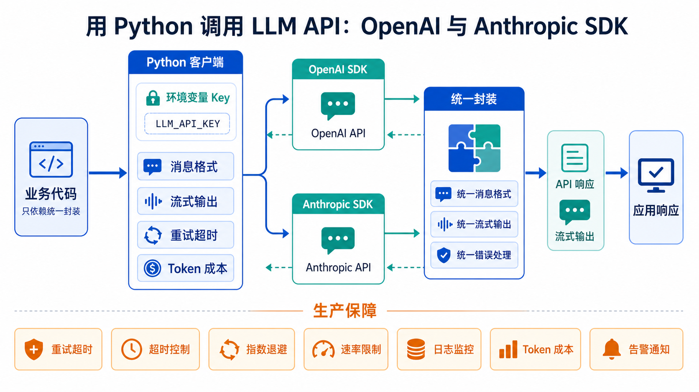

## 知识点讲解



### 1. 核心概念

两大主流 LLM API 的调用方式略有差异，但核心结构一样：**初始化客户端 → 构造消息列表 → 调用 chat/messages 接口 → 解析返回**。

| 字段 | OpenAI | Anthropic |
| --- | --- | --- |
| system 提示 | messages 列表第一条，role="system" | 独立的 `system` 参数 |
| 用户/助手消息 | `{"role": "user"/"assistant", "content": "..."}` | 格式相同 |
| 取响应文本 | `response.choices[0].message.content` | `response.content[0].text` |
| Token 统计 | `response.usage.total_tokens` | `response.usage.input_tokens + output_tokens` |

API Key 必须从环境变量读，不要硬编码在代码里——一旦提交到 Git 基本上就泄漏了。

### 2. 技术细节

**关键参数说明**：

| 参数 | 含义 | 实践建议 |
| --- | --- | --- |
| `model` | 模型版本 | 生产用 `gpt-4o-mini`、`claude-haiku-4-5-20251001`（成本低） |
| `temperature` | 随机性（0=确定，2=最随机） | 问答/分类用 0-0.3，创作用 0.7-1.0 |
| `max_tokens` | 最大输出 token 数 | 设上限控制成本，别不设 |
| `timeout` | 请求超时时间 | 生产必须设，防止请求挂死 |

**错误处理**：生产必须处理两类：

- `RateLimitError`：触发限流，用指数退避重试（1s、2s、4s...）
- `APITimeoutError`：请求超时，重试或降级

### 3. 对比与拓展

Anthropic 的一个独特优势是 **Prompt Caching**：对长 system 提示启用缓存，重复调用时 input token 成本降 90%。适合有固定长 system prompt 的 Agent（比如带工具定义的系统提示）。

## 代码示例

**OpenAI SDK 基础调用**

```python
import os
from openai import OpenAI, RateLimitError, APITimeoutError
import time

client = OpenAI(
    api_key=os.environ["OPENAI_API_KEY"],
    timeout=30.0,
    max_retries=0,  # 自己控制重试逻辑
)

def chat_openai(
    user_message: str,
    system_prompt: str = "你是一个专业的 AI 助手。",
    model: str = "gpt-4o-mini",
    temperature: float = 0.1,
    max_retries: int = 3,
) -> str:
    for attempt in range(max_retries):
        try:
            resp = client.chat.completions.create(
                model=model,
                messages=[
                    {"role": "system", "content": system_prompt},
                    {"role": "user", "content": user_message},
                ],
                temperature=temperature,
                max_tokens=2048,
            )
            return resp.choices[0].message.content

        except RateLimitError:
            wait = 2 ** attempt
            time.sleep(wait)
        except APITimeoutError:
            if attempt == max_retries - 1:
                raise
    raise RuntimeError("max retries exceeded")
```

**Anthropic SDK：带 Prompt Caching**

```python
import anthropic
import os

client = anthropic.Anthropic(api_key=os.environ["ANTHROPIC_API_KEY"])

def chat_anthropic(
    user_message: str,
    system_prompt: str,
    model: str = "claude-haiku-4-5-20251001",
    max_tokens: int = 2048,
) -> str:
    message = client.messages.create(
        model=model,
        max_tokens=max_tokens,
        # Prompt Caching：长 system prompt 加缓存标记，重复调用省 90% input token
        system=[{
            "type": "text",
            "text": system_prompt,
            "cache_control": {"type": "ephemeral"},
        }],
        messages=[{"role": "user", "content": user_message}],
    )
    return message.content[0].text
```

**统一封装：业务代码与具体 SDK 解耦**

```python
from abc import ABC, abstractmethod
from dataclasses import dataclass

@dataclass
class LLMResponse:
    content: str
    input_tokens: int
    output_tokens: int

class LLMClient(ABC):
    @abstractmethod
    def chat(self, messages: list[dict], system: str = "",
             max_tokens: int = 2048, **kwargs) -> LLMResponse:
        ...

class AnthropicClient(LLMClient):
    def __init__(self, model: str = "claude-haiku-4-5-20251001"):
        self.client = anthropic.Anthropic(api_key=os.environ["ANTHROPIC_API_KEY"])
        self.model = model

    def chat(self, messages, system="", max_tokens=2048, **kwargs) -> LLMResponse:
        resp = self.client.messages.create(
            model=self.model,
            max_tokens=max_tokens,
            system=system,
            messages=messages,
            **kwargs,
        )
        return LLMResponse(
            content=resp.content[0].text,
            input_tokens=resp.usage.input_tokens,
            output_tokens=resp.usage.output_tokens,
        )

# 使用
llm = AnthropicClient()
resp = llm.chat(
    messages=[{"role": "user", "content": "什么是 RAG？"}],
    system="你是 AI 专家，用简洁中文回答。",
)
print(f"回答: {resp.content}")
print(f"token 消耗: {resp.input_tokens + resp.output_tokens}")
```

## 面试怎么答

调用 LLM API 的核心结构：初始化客户端（从环境变量读 key，设超时）→ 构造消息列表 → 调用接口 → 解析返回。OpenAI 和 Anthropic 格式差不多，主要区别是 system prompt：OpenAI 放在 messages 列表第一条，Anthropic 作为独立的 `system` 参数。

生产环境必须做的三件事：一是设 `timeout`，不设的话请求挂死会把服务搞垮；二是处理 `RateLimitError` 并用指数退避重试；三是统一封装一个抽象层，业务代码不直接依赖 OpenAI 或 Anthropic 的 SDK，换模型时改封装层就行。

Anthropic 有个很实用的 Prompt Caching——固定的长 system prompt 加 `cache_control` 标记，重复调用时 input token 成本降 90%。Agent 通常有几千 token 的工具定义在 system prompt 里，开启这个直接省大钱。

## 高频追问 & 加分点

- **Q1：API Key 怎么安全管理？**  
    开发环境用 `.env` + `python-dotenv`，不要提交到 Git（加进 `.gitignore`）；生产环境用云厂商的密钥管理服务（AWS Secrets Manager、GCP Secret Manager、Azure Key Vault），通过 IAM 角色授权访问，Key 不出现在代码和环境变量里。加分点：定期轮换 Key，设置按 Key 的用量告警。
- **Q2：如何控制 API 调用成本？**  
    四层控制：①`max_tokens` 设上限（每次请求）；②应用层对用户做 token 配额（每天/每小时）；③对相同 prompt 做缓存（Redis 缓存，命中直接返回）；④按需选模型（能用 Haiku 解决的别用 Opus，成本差 20 倍）。加分点：Anthropic 的 Batch API 可以让离线任务成本降 50%。
- **Q3：OpenAI 和 Anthropic 的 function calling 格式一样吗？**  
    都叫 `tools` 参数，但 schema 格式有细微差异。OpenAI 用 `"type": "function"` 包一层；Anthropic 直接定义 `name`、`description`、`input_schema`。LiteLLM 这类库提供统一的抽象层，后面切换 provider 只改一行代码。
- **Q4：请求失败如何区分要重试和不要重试？**  
    HTTP 5xx（服务端错误）→ 可重试；429（限流）→ 可重试（加等待）；400（请求格式错误）→ 不重试，请求本身有问题；401（认证失败）→ 不重试，先检查 Key。SDK 里 `RateLimitError` 对应 429，`BadRequestError` 对应 400，`AuthenticationError` 对应 401。按错误类型分流，不要无脑重试所有错误。
