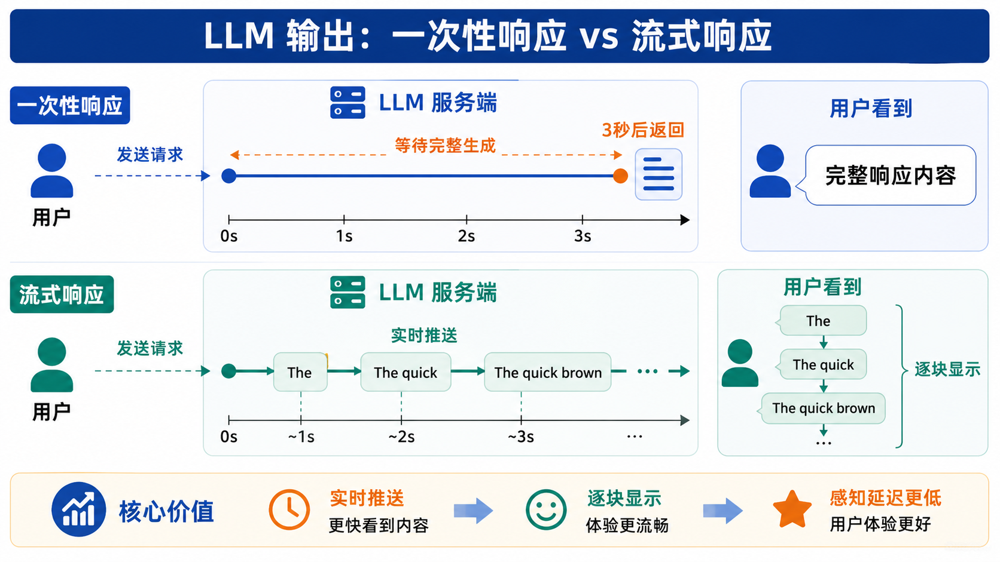

## 知识点讲解



### 1. 核心概念

流式输出（Streaming）是指 LLM 边生成边返回，而不是等整个回答生成完再一次性返回。对用户体验的影响是巨大的：

- **非流式**：等待 3-10 秒，然后突然出现完整回答——等待感很强
- **流式**：0.2 秒左右第一个字出来，然后像打字一样持续输出——感觉快很多

响应时间（TTFT，Time To First Token）比总延迟对用户感知更重要。ChatGPT 的流式输出效果就是这样。

技术上，流式输出的传输层通常是 **SSE（Server-Sent Events）**——基于 HTTP 的单向推送，浏览器端原生支持，实现简单。

### 2. 技术细节

**SDK 层的流式接口**：

OpenAI：`stream=True` 参数，`for chunk in stream: chunk.choices[0].delta.content`

Anthropic：`client.messages.stream()` 上下文管理器，`for text in stream.text_stream`

**两种关键数据需要收集**：

1. **增量文本**（delta）：每次收到的新 chunk，用于实时显示
2. **完整文本**：所有 chunk 拼起来，用于后续处理（解析工具调用、存入历史）

流式传输期间 token 统计只在最后一个 chunk 里有，需要等流结束才能记录 usage。

### 3. 对比与拓展

流式 vs 非流式的选择：

- 对话产品 → 流式（TTFT 影响体验）
- 后台批处理 → 非流式（管理简单）
- 工具调用步骤 → 可以非流式（工具结果不需要实时显示）

有个场景要注意：如果 LLM 输出里有工具调用（function call），流式和非流式的处理逻辑有差异——流式模式下 tool_use 块是分片返回的，需要积累完整后再解析参数。

## 代码示例

**Anthropic 流式输出（同步版）**

```python
import anthropic
import os

client = anthropic.Anthropic(api_key=os.environ["ANTHROPIC_API_KEY"])

def stream_chat(prompt: str) -> str:
    full_text = ""

    with client.messages.stream(
        model="claude-haiku-4-5-20251001",
        max_tokens=1024,
        messages=[{"role": "user", "content": prompt}],
    ) as stream:
        for text in stream.text_stream:
            print(text, end="", flush=True)
            full_text += text

    print()  # 换行
    return full_text
```

**OpenAI 流式输出（同步版）**

```python
from openai import OpenAI
import os

openai_client = OpenAI(api_key=os.environ["OPENAI_API_KEY"])

def stream_openai(prompt: str) -> str:
    full_text = ""

    stream = openai_client.chat.completions.create(
        model="gpt-4o-mini",
        messages=[{"role": "user", "content": prompt}],
        stream=True,
    )

    for chunk in stream:
        delta = chunk.choices[0].delta.content
        if delta:
            print(delta, end="", flush=True)
            full_text += delta

    print()
    return full_text
```

**异步流式 + 回调（FastAPI 场景）**

```python
import asyncio
from anthropic import AsyncAnthropic
from typing import AsyncGenerator

async_client = AsyncAnthropic(api_key=os.environ["ANTHROPIC_API_KEY"])

async def stream_generator(prompt: str) -> AsyncGenerator[str, None]:
    """返回 async generator，供 FastAPI StreamingResponse 使用"""
    async with async_client.messages.stream(
        model="claude-haiku-4-5-20251001",
        max_tokens=1024,
        messages=[{"role": "user", "content": prompt}],
    ) as stream:
        async for text in stream.text_stream:
            yield f"data: {text}\n\n"  # SSE 格式

# FastAPI 里这样用：
# from fastapi.responses import StreamingResponse
# return StreamingResponse(stream_generator(prompt), media_type="text/event-stream")
```

**带 token 统计的完整流式**

```python
from anthropic import Anthropic

def stream_with_stats(client: Anthropic, messages: list[dict]) -> dict:
    full_text = ""

    with client.messages.stream(
        model="claude-haiku-4-5-20251001",
        max_tokens=2048,
        messages=messages,
    ) as stream:
        for text in stream.text_stream:
            print(text, end="", flush=True)
            full_text += text

        # 流结束后才能拿到 usage
        final_msg = stream.get_final_message()
        usage = final_msg.usage

    print()
    return {
        "content": full_text,
        "input_tokens": usage.input_tokens,
        "output_tokens": usage.output_tokens,
    }
```

## 面试怎么答

流式输出让 LLM 边生成边返回 chunk，用户看到第一个字的时间（TTFT）大幅缩短，体验从"等 5 秒突然出现"变成"0.2 秒后开始像打字"。

实现上，OpenAI 加 `stream=True` 参数，逐 chunk 读 `delta.content`；Anthropic 用 `messages.stream()` 上下文管理器，遍历 `stream.text_stream`。两者都需要把 chunk 累积成完整文本，用于存历史和后续处理——不能只消费不积累。

服务端暴露给前端通常用 SSE（Server-Sent Events），格式是 `data: <chunk>\n\n`。FastAPI 用 `StreamingResponse` + async generator 几行就能实现。

有个坑：流式模式下工具调用（tool_use）的参数是分片返回的，不能拿到第一片就解析——得等 `stop_reason == "tool_use"` 且积累完整后再处理。

## 高频追问 & 加分点

- **Q1：流式输出里 token usage 什么时候可以拿到？**  
    只在最后一个 chunk 里，或者流结束后调 `get_final_message()` 获取。流式期间每个 chunk 不带 usage 信息。所以如果要记录 token 消耗，必须等整个流结束，不能在中间截断后就算。
- **Q2：如何中断正在进行的流式输出？**  
    用户点"停止"按钮时，前端断开 SSE 连接，后端检测到连接断开（FastAPI 里可以用 `request.is_disconnected()`）后取消对应的异步任务（`task.cancel()`）。对 LLM API 的调用也会被取消——异步客户端的流会因连接关闭而抛 `asyncio.CancelledError`。
- **Q3：流式输出适合 Agent 的哪些步骤？**  
    适合：最终回答生成（直接面向用户）；不适合：中间推理步骤（工具调用参数、ReAct 的 Thought 部分）——这些要等完整结果才能执行下一步，流式反而增加复杂度。折中方案：推理过程非流式，最终答案流式。
- **Q4：SSE 和 WebSocket 的区别？**  
    SSE 是 HTTP 上的单向推送（服务端 → 客户端），无需握手，断线自动重连，浏览器原生支持；WebSocket 是全双工，客户端也可以随时发消息，适合实时交互（多轮对话、协同编辑）。LLM 流式输出大多数场景用 SSE 够了，WebSocket 适合需要客户端发送中断信号的场景。
