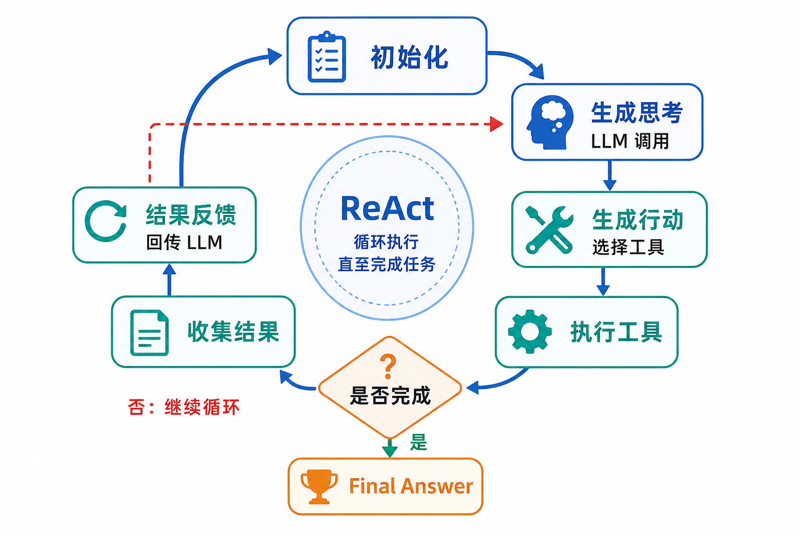

## 知识点讲解



### 1. 核心概念

ReAct（Reasoning + Acting）是目前最主流的 Agent 实现范式。每一步 LLM 输出三件事：

```
Thought:  我现在知道什么、下一步该怎么做
Action:   调用哪个工具、传什么参数
Observation: 工具返回的结果（Agent 执行后填入）
```

这三步循环，直到 LLM 输出 `Final Answer`。

ReAct 的优势是简单——不需要提前规划，每步根据 observation 重新决策，适合短任务和强环境交互（每步都依赖上一步的返回）。

**两种 ReAct 实现方式**：

1. **文本解析式（Prompt 版）**：LLM 输出文本，Agent 用正则/字符串解析出 Action；早期 LangChain 就是这样
2. **Function Calling 式**：LLM 直接返回结构化的工具调用，更可靠，现在是主流

### 2. 技术细节

ReAct 循环的核心控制流：

```
用户输入
  ↓
构建 prompt（含工具列表 + 历史轨迹）
  ↓
LLM 生成 Thought + Action
  ↓
解析 Action（工具名 + 参数）
  ↓
执行工具 → 拿到 Observation
  ↓
追加到历史轨迹
  ↓
判断是否 Final Answer？
  ├─ 是 → 返回结果
  └─ 否 → 回到"构建 prompt"
```

四个工程要点：

1. **历史轨迹管理**：把每步的 Thought/Action/Observation 追加进去，LLM 靠这些上下文做下一步决策
2. **max_steps 上限**：防止无限循环，一般设 10-20
3. **工具注册表**：名字到函数的映射，解析到工具名后直接查表调用
4. **错误处理**：工具调用失败要把错误信息作为 Observation 返回给 LLM，让它重试或换策略

### 3. 对比与拓展

ReAct vs Plan-and-Execute：ReAct 每步局部决策，灵活但可能绕弯路；Plan-and-Execute 先出完整计划，全局视角但中途环境变了要 replan。短任务用 ReAct，中长任务用混合方案。

## 代码示例

**Function Calling 版 ReAct Agent（Anthropic SDK）**

```python
import anthropic
import os
import json

client = anthropic.Anthropic(api_key=os.environ["ANTHROPIC_API_KEY"])

# --- 工具定义 ---
TOOLS = [
    {
        "name": "search_web",
        "description": "搜索互联网获取信息",
        "input_schema": {
            "type": "object",
            "properties": {
                "query": {"type": "string", "description": "搜索关键词"},
            },
            "required": ["query"],
        },
    },
    {
        "name": "calculate",
        "description": "执行数学计算",
        "input_schema": {
            "type": "object",
            "properties": {
                "expression": {"type": "string", "description": "数学表达式，如 '2 + 3 * 4'"},
            },
            "required": ["expression"],
        },
    },
]

# --- 工具实现 ---
def search_web(query: str) -> str:
    # 实际场景接入真实搜索 API
    return f"搜索 '{query}' 的结果：[模拟结果] Python 是一种高级编程语言..."

def calculate(expression: str) -> str:
    # 不要用 eval(expression, {"__builtins__": {}}) ——
    # 即使限制了 builtins，仍可被 "".__class__.__mro__[1].__subclasses__() 沙箱逃逸
    # 生产环境只允许两种安全做法：simpleeval 库白名单，或 ast 解析白名单
    from simpleeval import simple_eval
    try:
        return str(simple_eval(expression))
    except Exception as e:
        return f"计算错误: {e}"

TOOL_FUNCTIONS = {"search_web": search_web, "calculate": calculate}

# --- ReAct 主循环 ---
def react_agent(user_query: str, max_steps: int = 10) -> str:
    messages = [{"role": "user", "content": user_query}]

    for step in range(max_steps):
        response = client.messages.create(
            model="claude-haiku-4-5-20251001",
            max_tokens=1024,
            tools=TOOLS,
            messages=messages,
        )

        # 追加助手响应到历史
        messages.append({"role": "assistant", "content": response.content})

        # 判断是否结束
        if response.stop_reason == "end_turn":
            for block in response.content:
                if hasattr(block, "text"):
                    return block.text
            break

        # 处理工具调用
        if response.stop_reason == "tool_use":
            tool_results = []
            for block in response.content:
                if block.type == "tool_use":
                    fn = TOOL_FUNCTIONS.get(block.name)
                    if fn:
                        result = fn(**block.input)
                    else:
                        result = f"error: tool '{block.name}' not found"

                    tool_results.append({
                        "type": "tool_result",
                        "tool_use_id": block.id,
                        "content": str(result),
                    })

            messages.append({"role": "user", "content": tool_results})

    return "达到最大步数限制，任务未完成"
```

**轨迹记录（可观测性）**

```python
from dataclasses import dataclass, field

@dataclass
class AgentTrajectory:
    steps: list[dict] = field(default_factory=list)

    def record_tool_call(self, tool_name: str, args: dict, result: str):
        self.steps.append({
            "type": "tool_call",
            "tool": tool_name,
            "args": args,
            "result": result[:200],  # 截断避免过长
        })

    def record_final(self, answer: str):
        self.steps.append({"type": "final_answer", "content": answer})

    def summary(self) -> str:
        return f"共 {len(self.steps)} 步，工具调用 {sum(1 for s in self.steps if s['type'] == 'tool_call')} 次"
```

## 面试怎么答

ReAct 是最常用的 Agent 范式，核心是三步循环：LLM 思考（Thought）→ 决定动作（Action）→ 执行工具拿结果（Observation），然后把结果加进历史，再让 LLM 决定下一步。

现在实现 ReAct 有两种路：一是文本解析式，LLM 输出文本再用正则提取工具调用——脆，容易解析失败；二是 Function Calling 式，LLM 直接返回结构化的工具调用参数——可靠，现在是主流。我一般用 Function Calling。

工程上必须设 max_steps 上限，不然 LLM 陷入无效循环会一直烧 token。工具执行失败时，要把错误信息作为 Observation 返回给 LLM，让它自己决定是重试还是换策略——不要直接抛异常终止。

## 高频追问 & 加分点

- **Q1：ReAct 和 LangChain Agent 什么关系？**  
    LangChain 的 Agent（早期版）就是文本解析式 ReAct 的实现，`AgentExecutor` 是循环控制框架，`Tool` 是工具封装。LangGraph 是后来的版本，把 ReAct 循环显式表达成状态机图，控制流更清晰。理解 ReAct 的核心循环，LangChain/LangGraph 的代码就看得懂了。
- **Q2：ReAct 的 Thought 能提升效果吗？**  
    是的，这就是 Chain-of-Thought 在 Agent 里的应用。让 LLM 在 Action 前先输出 Thought（推理过程），强制它"想清楚再动手"，能明显降低工具调用出错率。实验结果显示，有 Thought 的 ReAct 比没有 Thought 的准确率高 10-20%。
- **Q3：工具调用结果应该直接返回原始数据还是处理后的摘要？**  
    取决于数据量。原始数据太长会超 context window，而且 LLM 不擅长处理大量数字。我习惯：结果 &lt; 500 词直接返回；超过就先做摘要（取前 N 条、聚合统计）再返回。工具层负责格式化，不要把格式化压力甩给 LLM。
- **Q4：多工具并行调用如何处理？**  
    Anthropic 支持在一次响应里返回多个 `tool_use` block——LLM 认为这些工具可以并行执行。Agent 收到后用 `asyncio.gather` 并发执行，然后把所有结果一起作为 `tool_result` 返回。这个"并行工具调用"能显著降低多步任务的总延迟，加分信号词：这是 ReWOO 思想在 Function Calling 里的体现。
