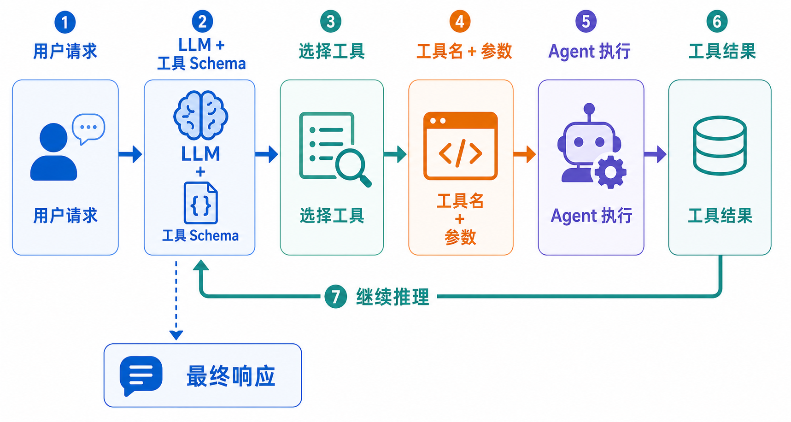

## 知识点讲解



### 1. 核心概念

Function Calling（工具调用）是让 LLM 主动选择调用预定义函数的机制。和在 prompt 里描述工具再手动解析文本相比，它返回的是**结构化的 JSON 参数**，不需要正则解析，可靠性高出一个量级。

完整流程：

```
1. 开发者定义工具 schema（JSON Schema 格式）
2. 把工具列表和用户消息一起发给 LLM
3. LLM 返回 stop_reason="tool_use" + 工具名 + 参数（JSON）
4. Agent 执行工具，拿到结果
5. 把结果作为 tool_result 发回 LLM
6. LLM 基于结果继续推理或给出最终回答
```

### 2. 技术细节

**工具 Schema 结构**（Anthropic 格式）：

```json
{
  "name": "search_web",
  "description": "搜索互联网获取信息。当需要查找最新信息、事实核对时使用。",
  "input_schema": {
    "type": "object",
    "properties": {
      "query": {
        "type": "string",
        "description": "搜索关键词，越具体越好"
      },
      "num_results": {
        "type": "integer",
        "description": "返回结果数量",
        "default": 5
      }
    },
    "required": ["query"]
  }
}
```

关键点：`description` 写得越清晰，LLM 选择工具越准确。工具描述就是 LLM 的"说明书"，含混不清会导致工具选错。

**工具调用 vs 直接回答**：当 `stop_reason == "end_turn"` 是直接回答；`stop_reason == "tool_use"` 是要调用工具。

### 3. 对比与拓展

LLM 什么时候会选错工具？工具描述重叠、参数说明不清、工具太多（超过 20 个开始降准）。工程上的应对：功能相似的工具合并、描述里加明确的使用条件（"当需要 X 时使用，当需要 Y 时不要用"）、工具数量多时用分层路由（先选类别再选具体工具）。

## 代码示例

**完整 Function Calling 循环（Anthropic）**

```python
import anthropic
import json
import os

client = anthropic.Anthropic(api_key=os.environ["ANTHROPIC_API_KEY"])

TOOLS = [
    {
        "name": "get_weather",
        "description": "获取指定城市的当前天气。需要查询实时天气时使用。",
        "input_schema": {
            "type": "object",
            "properties": {
                "city": {"type": "string", "description": "城市名，如 '北京'、'上海'"},
                "unit": {
                    "type": "string",
                    "enum": ["celsius", "fahrenheit"],
                    "description": "温度单位",
                },
            },
            "required": ["city"],
        },
    },
    {
        "name": "search_web",
        "description": "搜索互联网获取信息。查找最新新闻、事实信息时使用。",
        "input_schema": {
            "type": "object",
            "properties": {
                "query": {"type": "string", "description": "搜索关键词"},
            },
            "required": ["query"],
        },
    },
]

# 工具实现
def get_weather(city: str, unit: str = "celsius") -> str:
    # 实际场景接入天气 API
    return json.dumps({"city": city, "temperature": 22, "unit": unit, "condition": "晴"})

def search_web(query: str) -> str:
    return f"搜索结果：关于 '{query}' 的相关信息..."

TOOL_MAP = {"get_weather": get_weather, "search_web": search_web}

def tool_calling_agent(user_message: str, max_rounds: int = 5) -> str:
    messages = [{"role": "user", "content": user_message}]

    for _ in range(max_rounds):
        response = client.messages.create(
            model="claude-haiku-4-5-20251001",
            max_tokens=1024,
            tools=TOOLS,
            messages=messages,
        )

        messages.append({"role": "assistant", "content": response.content})

        if response.stop_reason == "end_turn":
            # 直接回答，提取文本
            for block in response.content:
                if hasattr(block, "text"):
                    return block.text

        if response.stop_reason == "tool_use":
            # 执行工具调用（支持并行）
            tool_results = []
            for block in response.content:
                if block.type != "tool_use":
                    continue

                fn = TOOL_MAP.get(block.name)
                if fn is None:
                    result_content = f"error: tool '{block.name}' not found"
                else:
                    try:
                        result_content = fn(**block.input)
                    except Exception as e:
                        result_content = f"tool execution error: {e}"

                tool_results.append({
                    "type": "tool_result",
                    "tool_use_id": block.id,
                    "content": str(result_content),
                })

            messages.append({"role": "user", "content": tool_results})

    return "max rounds reached"
```

**用 Python 类型提示自动生成 Schema**

```python
import inspect
from typing import get_type_hints

def func_to_tool_schema(func) -> dict:
    """把 Python 函数转成 Anthropic 工具 schema"""
    hints = get_type_hints(func)
    sig = inspect.signature(func)

    properties = {}
    required = []

    for name, param in sig.parameters.items():
        if name == "return":
            continue
        prop_type = hints.get(name, str).__name__
        type_map = {"str": "string", "int": "integer", "float": "number", "bool": "boolean"}
        properties[name] = {"type": type_map.get(prop_type, "string")}

        if param.default is inspect.Parameter.empty:
            required.append(name)

    return {
        "name": func.__name__,
        "description": (func.__doc__ or "").strip(),
        "input_schema": {
            "type": "object",
            "properties": properties,
            "required": required,
        },
    }

# 使用
def get_stock_price(ticker: str, date: str) -> str:
    """获取指定股票代码在某日期的收盘价"""
    # ...
    return "150.00"

schema = func_to_tool_schema(get_stock_price)
```

## 面试怎么答

Function Calling 让 LLM 返回结构化的工具调用——工具名 + JSON 参数，Agent 直接执行，不需要解析文本。和文本解析式相比，可靠性提升一个量级：JSON 参数不会有格式错误，工具名不会拼错。

实现流程：定义工具 Schema（含名字、描述、参数类型）→ 随消息发给 LLM → 检查 stop_reason：`end_turn` 是直接回答、`tool_use` 是要调工具 → 执行工具 → 把结果作为 `tool_result` 发回 → LLM 继续推理。这个循环可以多轮。

工具描述写好很关键。LLM 靠描述选工具，描述含混会导致工具选错。我习惯在 description 里写"什么情况下用"和"什么情况下不用"，比只写功能要准得多。

## 高频追问 & 加分点

- **Q1：工具太多 LLM 选不准怎么办？**  
    超过 15-20 个工具，准确率开始下降。解决方案：①减少工具数量，合并功能相似的；②分层路由——先用小 LLM 选工具类别，再在类别里选具体工具；③动态工具列表——根据对话上下文只传当前可能用到的工具子集。加分点：RAG 工具检索也是一种方案，把工具描述做成 embedding，用查询相似度动态选相关工具。
- **Q2：如何验证 LLM 传来的工具参数？**  
    不能信任 LLM 生成的参数，必须校验。用 pydantic `BaseModel` 定义参数模型，`Model(**tool_input)` 直接校验类型和约束。失败抛 `ValidationError` 就把错误信息作为 `tool_result` 返回，让 LLM 重新生成正确参数。这是防止工具被乱用的基础防线。
- **Q3：工具调用结果多大合适？**  
    context window 是有限资源，工具结果太长会把有用的历史挤掉。一般原则：结果 &lt; 1000 tokens 直接返回；超过就截断或摘要（取前 N 条、提取关键字段）。返回 JSON 时压缩格式（去掉多余空格、只保留必要字段）也能省不少 token。
- **Q4：OpenAI 和 Anthropic 的 Function Calling 格式有什么差异？**  
    核心概念一样，schema 格式有细微差异。OpenAI 的工具定义有多一层 `"type": "function"` 包装；响应字段是 `tool_calls[].function.arguments`（字符串需要 json.loads）；Anthropic 响应是 `content[].input`（直接是 dict，不需要 json.loads）。LiteLLM 库提供统一封装，一套代码调多个 provider。
