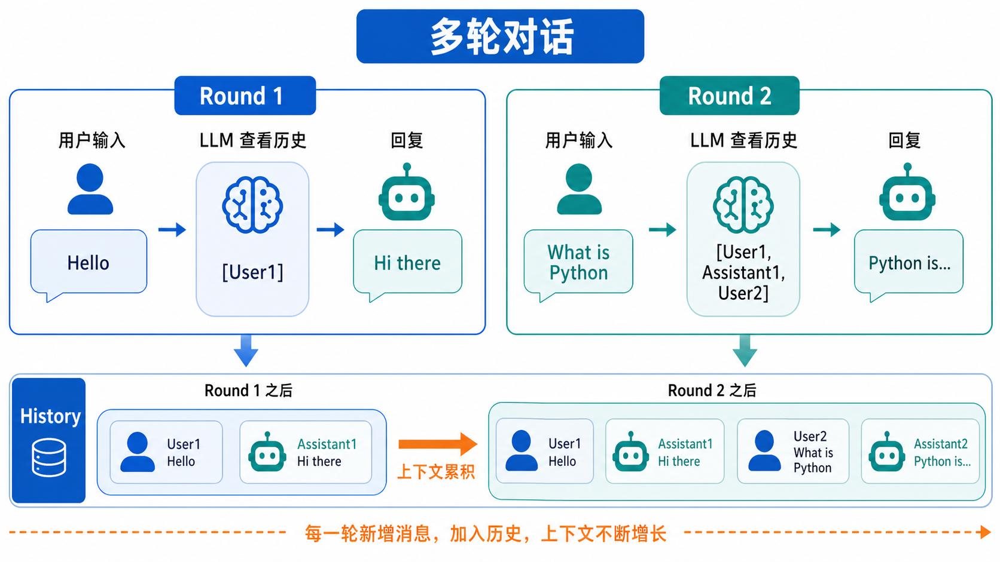

## 知识点讲解



### 1. 核心概念

LLM 本身是无状态的——每次调用它看不到之前说了什么。多轮对话的"记忆"完全靠**把历史消息列表传给 LLM**来模拟。

消息格式是一个列表，按时间顺序排：

```python
messages = [
    {"role": "user", "content": "Python 是什么语言？"},
    {"role": "assistant", "content": "Python 是..."},
    {"role": "user", "content": "它和 Java 有什么区别？"},  # 当前问题
]
```

LLM 看到完整列表，才能理解"它"指的是 Python。

### 2. 技术细节

多轮对话的三个核心问题：

**① Token 溢出**：消息列表随对话增长，最终超过 LLM 的 context window 限制。常见策略：

- 滑动窗口：只保留最近 N 轮
- 历史压缩：让 LLM 把旧对话总结成一段话，替换掉原来的长历史
- 向量记忆：把历史存向量库，检索时只取相关的几条

**② 会话隔离**：多用户并发时，每个用户的对话历史必须互相独立，不能串。用 `session_id` 做索引，每个 session 有自己的消息列表。

**③ 持久化**：服务重启后历史不丢失。开发期存 Redis（快），生产期存数据库（PostgreSQL、MongoDB）。

### 3. 对比与拓展

短对话（≤10 轮）：简单列表存历史，直接传 LLM。  
长对话（>20 轮）：必须有压缩或外部记忆机制，否则 context 溢出。  
Agent 的工具调用历史：工具调用消息格式特殊（tool_use + tool_result），要按 LLM SDK 的格式存，不能随意截断。

## 代码示例

**基础多轮对话**

```python
import anthropic
import os

client = anthropic.Anthropic(api_key=os.environ["ANTHROPIC_API_KEY"])

class Conversation:
    def __init__(self, system_prompt: str = "", max_turns: int = 20):
        self.system = system_prompt
        self.max_turns = max_turns
        self._messages: list[dict] = []

    def chat(self, user_input: str) -> str:
        self._messages.append({"role": "user", "content": user_input})

        response = client.messages.create(
            model="claude-haiku-4-5-20251001",
            max_tokens=2048,
            system=self.system,
            messages=self._messages,
        )

        reply = response.content[0].text
        self._messages.append({"role": "assistant", "content": reply})

        # 滑动窗口：超过上限就丢最旧的一轮（2 条消息）
        if len(self._messages) > self.max_turns * 2:
            self._messages = self._messages[2:]

        return reply

    def history(self) -> list[dict]:
        return list(self._messages)

    def clear(self):
        self._messages.clear()
```

**多用户会话管理器**

```python
import time
from dataclasses import dataclass, field

@dataclass
class Session:
    session_id: str
    messages: list[dict] = field(default_factory=list)
    created_at: float = field(default_factory=time.time)
    last_active: float = field(default_factory=time.time)

class SessionManager:
    def __init__(self, ttl_seconds: int = 3600):
        self._sessions: dict[str, Session] = {}
        self.ttl = ttl_seconds

    def get_or_create(self, session_id: str) -> Session:
        self._cleanup_expired()
        if session_id not in self._sessions:
            self._sessions[session_id] = Session(session_id=session_id)
        return self._sessions[session_id]

    def chat(self, session_id: str, user_input: str, system_prompt: str = "") -> str:
        session = self.get_or_create(session_id)
        session.messages.append({"role": "user", "content": user_input})
        session.last_active = time.time()

        response = client.messages.create(
            model="claude-haiku-4-5-20251001",
            max_tokens=2048,
            system=system_prompt,
            messages=session.messages,
        )

        reply = response.content[0].text
        session.messages.append({"role": "assistant", "content": reply})
        return reply

    def _cleanup_expired(self):
        now = time.time()
        expired = [sid for sid, s in self._sessions.items()
                   if now - s.last_active > self.ttl]
        for sid in expired:
            del self._sessions[sid]

    def delete(self, session_id: str):
        self._sessions.pop(session_id, None)
```

**历史压缩（长对话）**

```python
async def compress_history(
    messages: list[dict],
    keep_recent: int = 4,
) -> list[dict]:
    """把旧对话总结，只保留最近几轮原文"""
    if len(messages) <= keep_recent * 2 + 2:
        return messages  # 还没到需要压缩的程度

    old_messages = messages[:-keep_recent * 2]
    recent_messages = messages[-keep_recent * 2:]

    # 让 LLM 总结旧对话
    summary_prompt = "请把以下对话历史总结成 3-5 句话，保留关键信息：\n\n"
    for m in old_messages:
        summary_prompt += f"{m['role']}: {m['content'][:200]}\n"

    response = client.messages.create(
        model="claude-haiku-4-5-20251001",
        max_tokens=300,
        messages=[{"role": "user", "content": summary_prompt}],
    )
    summary = response.content[0].text

    # 用摘要替换旧消息
    compressed = [
        {"role": "user", "content": f"[历史摘要] {summary}"},
        {"role": "assistant", "content": "我已了解之前的对话背景。"},
    ] + recent_messages

    return compressed
```

## 面试怎么答

LLM 是无状态的，多轮对话的"记忆"靠把历史消息列表一起传给 LLM 来实现。每轮交互后把 user 和 assistant 消息追加进列表，下轮调用时把整个列表发过去，LLM 就能理解上下文了。

工程上有三个问题要解决。一是 token 溢出：历史越积越长，超过 context window 就报错——常见策略是滑动窗口（丢最旧的轮次）或历史压缩（让 LLM 把旧对话总结替换）；二是会话隔离：多用户并发时用 session_id 做 key，每个 session 独立一份历史；三是持久化：服务重启不丢历史，存 Redis 或数据库。

Agent 的工具调用消息格式比普通对话复杂——有 tool_use 和 tool_result 这两种特殊消息，截断历史时要注意配对完整，不能把 tool_use 和它对应的 tool_result 拆开，否则 LLM 会报错。

## 高频追问 & 加分点

- **Q1：历史压缩会丢失信息吗？怎么权衡？**  
    会，这是不可避免的代价。权衡点是：保留多少最近原文（recent_keep）和总结质量之间的平衡。实践中 recent_keep=4-6 轮原文 + LLM 总结旧部分，既保住上下文连贯性，又控制了 token 消耗。关键信息（比如用户说的具体需求）要放在总结里显式保留，不能让 LLM 自由发挥删掉重要内容。
- **Q2：用向量记忆替代完整历史有什么优缺点？**  
    优点：理论上无限长的"记忆"，每次只检索相关历史，token 可控。缺点：检索不一定准，可能漏掉重要上下文；对话的时间顺序关系容易丢失；实现复杂。适合长期记忆（比如 Agent 跨会话记住用户偏好），不适合短期的当前对话上下文（还是传完整历史更可靠）。
- **Q3：tool_use 和 tool_result 消息必须配对吗？**  
    是的，Anthropic API 严格要求：每个 tool_use block 必须有对应的 tool_result（用 `tool_use_id` 关联）。如果截断历史把一个 tool_use 留下来但把它的 tool_result 切掉，下次调用 API 会报 400 错误。安全的截断策略：在一轮完整的 user + assistant 对话边界截断，不要在工具调用中间截。
- **Q4：如何跨会话持久化对话历史？**  
    开发：Redis（`session_id` 为 key，消息列表序列化后存，设 TTL 自动过期）；生产：关系型数据库（PostgreSQL，一个 messages 表，session_id + turn_index + role + content），查询时 `WHERE session_id=? ORDER BY turn_index`。消息要加 `created_at` 时间戳，方便排查问题和对话复现。
