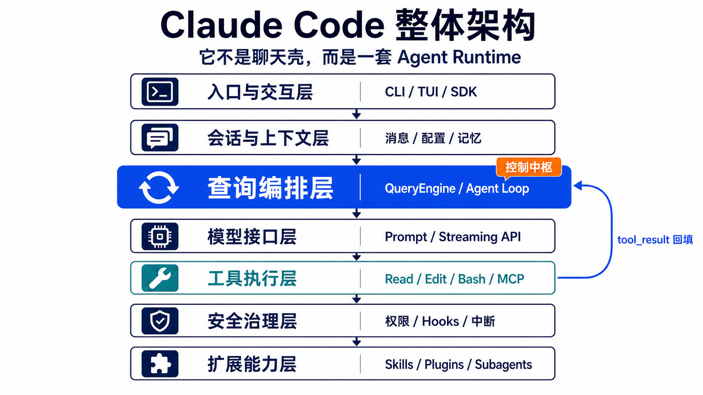
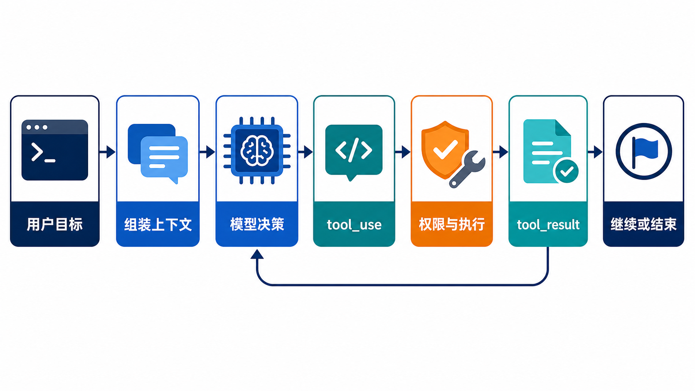
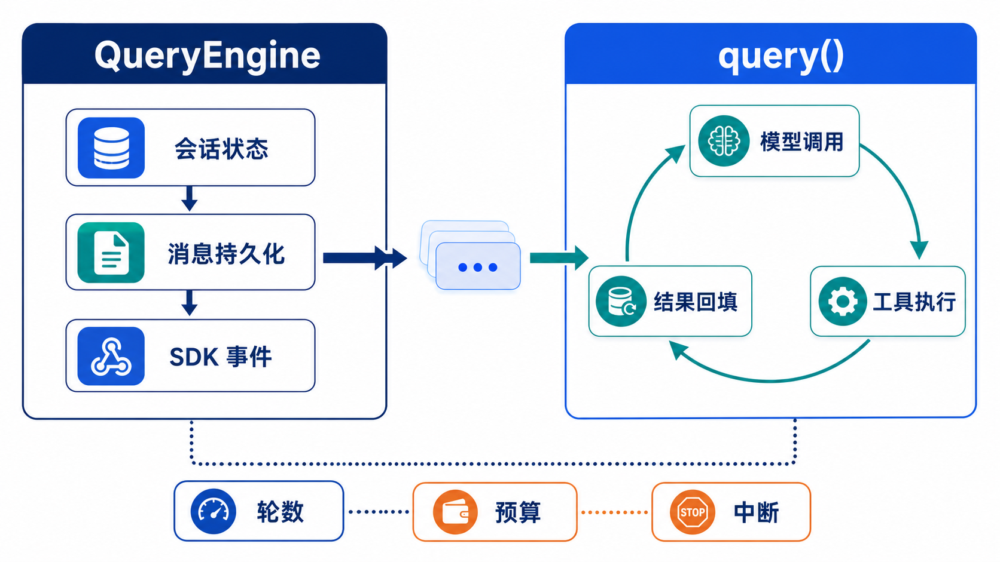
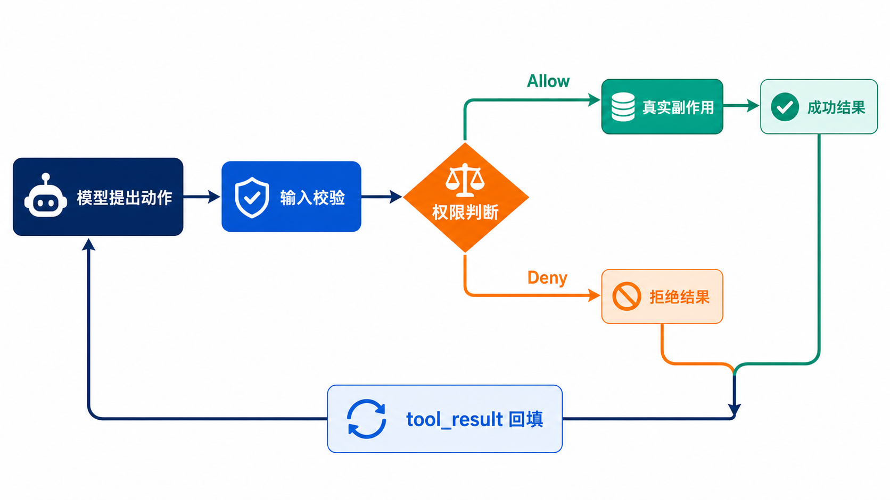

# Claude Code 为什么不是“终端套壳”？从源码看一套 Agent Runtime 的真正分层

假设你准备自己写一个 Coding Agent。

第一版通常不难：接上大模型，注册几个读文件、写文件和执行命令的工具，再写一个 Prompt 告诉模型“请自主完成任务”。

Demo 很快就能跑起来。可一旦任务变长，问题会接连出现：工具执行失败了怎么继续？用户拒绝了一条命令怎么办？多个读取能不能并发？上下文快满了怎么压缩？中途按下 Ctrl+C，怎样保证会话没有被破坏？

这时你会发现，**真正难的不是让模型调用工具，而是管理模型每一次决策前后的状态。**

Claude Code 值得看的地方也在这里。终端只是它露在外面的界面，里面真正工作的，是一套负责会话、上下文、工具、权限和循环控制的 Agent Runtime。

这篇文章不按源码目录逐个介绍文件，而是跟着一条用户请求走完整个运行链。读完以后，你应该能回答两个问题：

1. Claude Code 为什么能够持续执行任务，而不是调用一次模型就结束？
2. 如果自己开发 Agent，哪些模块必须从第一天就拆开？

## 一、先看结论：Claude Code 的核心不是终端，而是运行时

可以先把 Claude Code 惈成一套车辆控制系统。

- 终端界面是仪表盘，负责接收输入和展示状态；
- 模型像路线规划器，负责判断下一步应该做什么；
- QueryEngine 是行车电脑，保存状态并组织每次决策；
- Tool 是执行机构，真正完成读文件、改代码和运行命令；
- Permission 和 Hooks 是刹车与安全策略；
- 消息历史则像行车记录，保证下一轮知道前面发生了什么。

这个类比只用来帮助理解分工。真实代码中并不存在一辆“车”，各模块依靠 Message、`tool_use` 和 `tool_result` 这些数据结构连接。

从逻辑上看，可以把它拆成七层：

| 层次 | 解决的问题 | 对 Agent 开发的价值 |
| --- | --- | --- |
| 入口与交互层 | 用户从哪里输入，结果输出到哪里 | 让 TUI、Headless 和 SDK 复用同一运行时 |
| 会话与上下文层 | Agent 需要记住哪些状态 | 支撑多轮任务、恢复和压缩 |
| 查询编排层 | 一轮决策如何开始、继续和结束 | 驱动真正的 Agent Loop |
| 模型接口层 | 如何把上下文和工具交给模型 | 隔离模型 API 与上层业务 |
| 工具执行层 | 如何把模型意图变成真实动作 | 统一校验、执行、并发和结果格式 |
| 安全治理层 | 哪些动作可以执行 | 控制副作用、中断和 Hook |
| 扩展能力层 | 如何接入新工具和新 Agent | 支撑 MCP、Skills、Plugins 和 Subagents |

不过，这张表只是地图。

要真正理解这些层为什么存在，得先看一个 Prompt 是怎么穿过它们的。



## 二、只有“模型加工具”，为什么还不够？

先看一个常见任务：

找出登录失败的原因，修改代码，然后运行测试。

模型第一次拿到任务后，可能决定读取认证模块，于是输出一个 `tool_use`。文件内容返回以后，它发现问题可能出在环境变量，又调用搜索工具。确认位置后，它调用编辑工具，最后运行测试。

从用户视角看，这像是模型一口气完成了任务。

但运行时实际处理的是一连串离散事件：

```latex
用户目标
  ↓
模型提出 Read
  ↓
运行时执行并返回 tool_result
  ↓
模型提出 Grep
  ↓
运行时执行并返回 tool_result
  ↓
模型提出 Edit
  ↓
权限判断、执行并返回 tool_result
  ↓
模型提出 Bash(test)
  ↓
运行时执行并返回 tool_result
  ↓
模型给出最终回答
```

每个箭头之间都有状态需要管理。

例如，Edit 被用户拒绝后，运行时不能假装修改成功；测试命令被中断后，也不能留下一个只有 `tool_use`、没有对应 `tool_result` 的消息历史。否则下一次请求可能得到错误上下文，甚至违反模型 API 对工具消息的配对要求。

所以一个 Coding Agent 至少要回答下面这些问题：

- 当前会话已经发生过什么？
- 模型本轮能看见哪些工具？
- 工具输入是否合法？
- 这个动作是否需要用户批准？
- 多个工具应该并行还是串行？
- 成功、失败、拒绝和中断如何统一回传？
- 什么时候继续问模型，什么时候结束？

**Agent Runtime 的工作，就是把这些问题从 Prompt 中拿出来，变成确定的程序逻辑。**

## 三、一条 Prompt 到底经历了什么？

Claude Code 的入口可以是交互式终端，也可以是 Headless 或 SDK。但进入运行时以后，主链路大体一致。

### 1. 用户输入先变成会话消息

运行时不会把一段字符串直接扔给模型。

它要先确定当前工作目录、会话 ID、历史消息、模型配置和权限模式。如果是恢复会话，还要把之前的消息和文件状态装载回来。

这样一来，同一句“继续修复”，才能知道是在继续哪个任务。

### 2. QueryEngine 准备本轮运行环境

QueryEngine 会整理 System Prompt、User Context、System Context、工具列表、MCP Client、AbortController 和 AppState。

恢复源码中的核心调用经过裁剪后，大致如下：

```typescript
for await (const message of query({
  messages,
  systemPrompt,
  userContext,
  systemContext,
  canUseTool: wrappedCanUseTool,
  toolUseContext,
  fallbackModel,
  querySource: 'sdk',
  maxTurns,
})) {
  if (
    message.type === 'assistant' ||
    message.type === 'user'
  ) {
    messages.push(message)
  }

  // 再根据消息类型转换成上层需要的事件
}
```

这段代码最值得注意的是 `for await`。

QueryEngine 不是等待 `query()` 返回一个最终字符串，而是在持续消费它产生的消息。模型文本、工具调用、工具结果、压缩边界和错误，都可以沿同一条异步消息流向上传递。

### 3. `query()` 调用模型并观察流式输出

`query()` 会把当前消息、Prompt 和工具 Schema 交给模型。

模型可能输出普通文本，也可能在流中输出一个或多个 `tool_use`。运行时一旦捕获到工具调用，就记录对应的工具名、输入和 ID。

### 4. 工具调用经过权限与执行链

运行时先根据工具名找到 Tool，再校验输入。

接下来，调用还要经过 PreToolUse Hook 和权限决策。只有被允许的动作才会进入 `tool.call()`；被拒绝的动作也会生成一个错误类型的 `tool_result`。

### 5. 工具结果被写回消息历史

工具的内部返回值不能直接塞回模型。

每种 Tool 都要把结果映射成标准 `tool_result`，并带上原来的 `tool_use_id`。运行时把 Assistant Message 和 Tool Result 一起追加到历史中。

### 6. 有工具结果，就进入下一轮

下一轮模型看到的不只是用户最初的目标，还能看到：

- 自己刚才调用了什么工具；
- 工具是否被允许；
- 文件里真实读到了什么；
- 修改是否成功；
- 测试输出了什么。

模型再基于这些新证据决定下一步。

### 7. 没有新的工具调用，才准备结束

当模型不再输出 `tool_use` 时，运行时才进入停止判断。

此时还可能执行 Stop Hook、检查 Token 预算或处理错误。如果没有新的阻塞条件，本轮才以 `completed` 结束。

走完这条链路以后，七层架构就不再是一张静态表格，而是一条完整的数据流：

输入负责提出目标，QueryEngine 管理会话，`query()` 驱动循环，模型提出动作，Tool 产生结果，Permission 控制副作用，消息历史把结果带入下一轮。



## 四、QueryEngine 为什么不能只是一个 API Client？

如果任务只有一问一答，封装一个 `callClaude()` 也许就够了。

Coding Agent 的问题在于，它需要跨越很多轮模型调用。每轮都可能改变文件、权限、用量和上下文，因此必须有一个会话级对象保存这些状态。

恢复源码里的 QueryEngine 配置包含了下面这些核心依赖：

```typescript
type QueryEngineConfig = {
  cwd: string
  tools: Tools
  commands: Command[]
  mcpClients: MCPServerConnection[]
  agents: AgentDefinition[]

  canUseTool: CanUseToolFn
  getAppState: () => AppState
  setAppState: (f: (prev: AppState) => AppState) => void

  initialMessages?: Message[]
  maxTurns?: number
  maxBudgetUsd?: number
  abortController?: AbortController
}
```

可以把这些字段分成四组。

### 第一组：Agent 能做什么

`tools`、`commands`、`mcpClients` 和 `agents` 决定当前会话有哪些能力。

模型并不是天然知道本地有哪些工具。运行时选择哪些工具并把 Schema 发给模型，模型才可能调用它们。

### 第二组：Agent 被允许做什么

`canUseTool` 负责把“模型想做”与“系统允许做”分开。

即使模型正确生成了删除文件的调用，运行时仍然可以拒绝、询问用户，或者根据权限模式自动批准。

### 第三组：Agent 已经经历了什么

`initialMessages` 和 AppState 保存会话历史、权限上下文、MCP 状态以及其他运行信息。

这让 QueryEngine 不只是处理一次 Prompt，而是拥有一段连续的会话生命周期。

### 第四组：Agent 最多能跑多久

`maxTurns`、`maxBudgetUsd` 和 `abortController` 都是边界。

它们分别控制最大循环轮数、成本和人工中断。如果缺少这些边界，“持续自主执行”很容易变成“无法停止地继续调用”。

所以 QueryEngine 和普通 API Client 的区别，可以压缩成一句话：

API Client 负责发请求，QueryEngine 负责让一段有状态、可中断、受约束的 Agent 会话运行下去。

## 五、真正让 Agent 动起来的，是 `query()` 里的循环

QueryEngine 管的是会话，真正的 Agent Loop 则位于 `query()` 的内部。

按恢复源码的控制关系，可以把它整理成下面这段伪代码：

```typescript
// 结构化伪代码：用于展示控制关系，不是逐字源码
let state = createInitialState(params)

while (true) {
  const context = buildContext(state.messages)
  const assistantMessages = []
  const toolUseBlocks = []

  for await (const message of callModel(context)) {
    assistantMessages.push(message)

    if (containsToolUse(message)) {
      toolUseBlocks.push(...getToolUses(message))
    }
  }

  if (toolUseBlocks.length === 0) {
    return { reason: 'completed' }
  }

  const toolResults = await executeTools(toolUseBlocks)

  state = {
    ...state,
    messages: [
      ...state.messages,
      ...assistantMessages,
      ...toolResults,
    ],
    turnCount: state.turnCount + 1,
  }
}
```

这段循环解释了 Agent 的“自主性”是怎么产生的。

模型并没有一次规划完所有操作。它只需要根据当前上下文给出下一步，运行时执行以后，把真实世界的新状态反馈回来。多次“决策—执行—反馈”串在一起，才表现为持续完成任务。

这里还有一个容易被忽略的细节：循环是否继续，不能只依赖模型返回的 `stop_reason`。

恢复源码会在流式响应中真实捕获 `tool_use` Block，并设置 `needsFollowUp`。只要捕获到了工具调用，运行时就知道后面必须执行工具并再次请求模型。

这比只相信一个结束字段更稳，因为真正决定后续工作的，是消息流里有没有未处理的工具动作。



## 六、Tool 为什么不是一个普通函数？

自己写 Demo 时，工具通常长这样：

```typescript
const readFile = async path => fs.readFile(path, 'utf8')
```

这个函数能读文件，却还不是一个完整的 Agent Tool。

恢复源码中的 Tool 抽象经过裁剪后，大致包含这些能力：

```typescript
type Tool<Input, Output> = {
  inputSchema: Input

  call(
    args: Input,
    context: ToolUseContext,
    canUseTool: CanUseToolFn,
    parentMessage: AssistantMessage,
    onProgress?: ProgressFn,
  ): Promise<ToolResult<Output>>

  isConcurrencySafe(input: Input): boolean
  isReadOnly(input: Input): boolean
  isDestructive?(input: Input): boolean

  mapToolResultToToolResultBlockParam(
    output: Output,
    toolUseID: string,
  ): ToolResultBlockParam
}
```

读完这段接口，至少能看到五个普通函数没有解决的问题。

### 输入需要成为协议

`inputSchema` 不只是 TypeScript 类型。

它既用于校验模型输出，也可以转换成模型 API 认识的工具 Schema。模型、运行时和工具实现因此共享同一份输入约束。

### 执行需要拿到上下文

Tool 不只依赖输入参数，还需要知道当前会话、工作目录、中断信号、权限状态和父消息。

同一个 Bash 调用，在主 Agent、子 Agent和不同权限模式下，允许的行为可能不同。

### 调度需要知道副作用

`isConcurrencySafe()` 和 `isReadOnly()` 会影响工具编排。

多个读取操作通常可以并发；写文件、修改状态或执行破坏性命令则需要更保守地串行处理。否则两个看似独立的工具可能同时修改同一份状态。

### 结果需要重新编码

Tool 内部可能返回对象、文本、图片或结构化数据。

`mapToolResultToToolResultBlockParam()` 负责把这些结果统一转换成模型认识的 `tool_result`，并绑定正确的工具调用 ID。

### UI 还需要进度

长时间运行的 Bash、搜索或子 Agent 不能让界面一直没有反馈。

因此 `call()` 还可以通过 `onProgress` 持续产生进度。模型协议、执行状态和用户体验就能使用同一条工具生命周期。

**一个成熟的 Agent Tool，本质上是“模型协议、本地执行和安全调度”之间的适配器。**

## 七、Permission 为什么是横穿整个循环的安全层？

权限控制看起来像工具执行前的一句判断：

```typescript
if (allowed) {
  await tool.call()
}
```

真实情况要复杂得多。

一次工具调用可能先经过输入校验和 PreToolUse Hook，再结合权限规则、运行模式和用户选择得到最终决策。恢复源码中的关键关系可以裁剪成：

```typescript
// 结构化伪代码：省略消息构造、Hook 结果和遥测分支
const resolved = await resolveHookPermissionDecision(
  hookPermissionResult,
  tool,
  processedInput,
  toolUseContext,
  canUseTool,
  assistantMessage,
  toolUseID,
)

if (resolved.decision.behavior !== 'allow') {
  return createToolResult({
    tool_use_id: toolUseID,
    is_error: true,
    content: resolved.decision.message,
  })
}

const result = await tool.call(
  resolved.input,
  toolUseContext,
  canUseTool,
  assistantMessage,
)
```

这里真正关键的，不只是“拒绝危险操作”。

模型已经产生了一个带 ID 的 `tool_use`。即使用户拒绝执行，运行时也不能把它从历史里悄悄删掉，而要生成一个带相同 ID 的错误 `tool_result`。

这样下一轮模型才能知道：

这个动作没有发生，请根据拒绝原因换一种方案。

同样的原则也适用于输入错误、工具不存在、执行异常和用户中断。

成功与失败走不同的业务分支，但最终都要回到统一的消息协议。否则 Agent Loop 无法稳定继续。

所以 Permission 并不是孤立的一层。它会同时影响：

- 工具是否产生真实副作用；
- UI 是否需要询问用户；
- Transcript 记录成功还是拒绝；
- 下一轮模型看到什么；
- 当前循环继续还是停止。

这也是为什么“安全”不能只写进 System Prompt。Prompt 可以约束模型倾向，却不能替代运行时的确定性检查。



## 八、为什么不把所有逻辑写进一个大循环？

看到这里，也许会产生另一个问题：既然最终都是一个 Loop，为什么还要分 QueryEngine、Tool、Permission 和 Context？

确实，对于一个几十行的内部脚本，把模型调用和工具执行写在一起更直接。它代码少、依赖少，适合验证想法。

但任务一旦进入真实项目，集中式循环会遇到几个问题：

| 设计问题 | 全部写进循环 | 分层 Runtime |
| --- | --- | --- |
| 新增工具 | 修改主循环分支 | 实现统一 Tool 接口 |
| 切换 TUI/SDK | 重写输入输出逻辑 | 复用 QueryEngine |
| 权限策略 | 散落在不同工具中 | 统一决策链 |
| 会话恢复 | 手工拼接状态 | 由会话层管理 |
| 工具并发 | 在调用处临时判断 | 根据 Tool 属性编排 |
| 错误回填 | 每个分支各自处理 | 统一映射为 `tool_result` |
| 子 Agent | 复制主循环 | 复用上下文和工具协议 |

分层的代价也很明显。

接口数量会增加，消息类型会变多，调试时要跨越多个模块。对于一次性、无副作用、不会恢复的简单 Agent，这套结构可能过重。

因此，Claude Code 的设计并不意味着所有 Agent 都应该照搬完整架构。

更准确的决策标准是：

当任务需要多轮工具调用、产生真实副作用、支持恢复或接入多个宿主时，就应该把会话状态、循环控制、工具协议和权限从业务 Prompt 中拆出来。

## 九、如果自己开发 Agent，最应该抄走什么？

回到开头的问题。

Claude Code 为什么不是一个终端套壳？

因为终端只负责让用户看见过程。真正让任务能够持续推进的，是下面这条受控闭环：

QueryEngine 保存会话状态，`query()` 驱动模型决策，Tool 执行真实动作，Permission 控制副作用，`tool_result` 把现实反馈给下一轮。

如果你准备实现自己的 Agent，不需要一开始就复制 Claude Code 的全部能力，但至少可以先拆出六个模块：

1. **Message Store**：保存用户消息、模型消息和工具结果；
2. **Agent Loop**：决定什么时候调用模型、执行工具和结束；
3. **Tool Registry**：注册工具，并向模型暴露统一 Schema；
4. **Permission Gate**：在工具产生副作用前做确定性判断；
5. **Tool Executor**：负责校验、并发、中断和结果映射；
6. **Termination & Recovery**：控制最大轮数、错误重试和人工中断。

这六块能跑通以后，再逐步加入上下文压缩、MCP、Skills、Subagents 和会话恢复。

最后，可以把整篇文章压缩成三个值得带走的结论：

**第一，Agent 的核心不是 Prompt，而是状态循环。**

**第二，模型只提出动作，运行时才执行动作。**

**第三，所有成功、失败、拒绝和中断，最终都要变成下一轮可理解的消息。**

下一次再看一个 Agent 框架时，不妨先别看它支持多少模型、多少工具。

先去找它的消息结构、循环入口、工具协议和权限边界。找到这四样东西，才算真正找到了它的 Agent Runtime。
