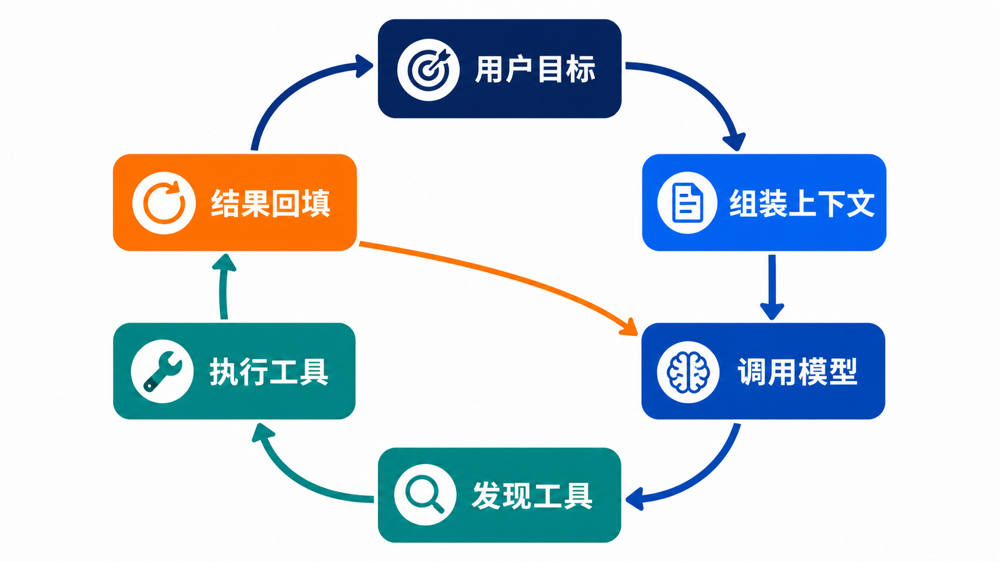
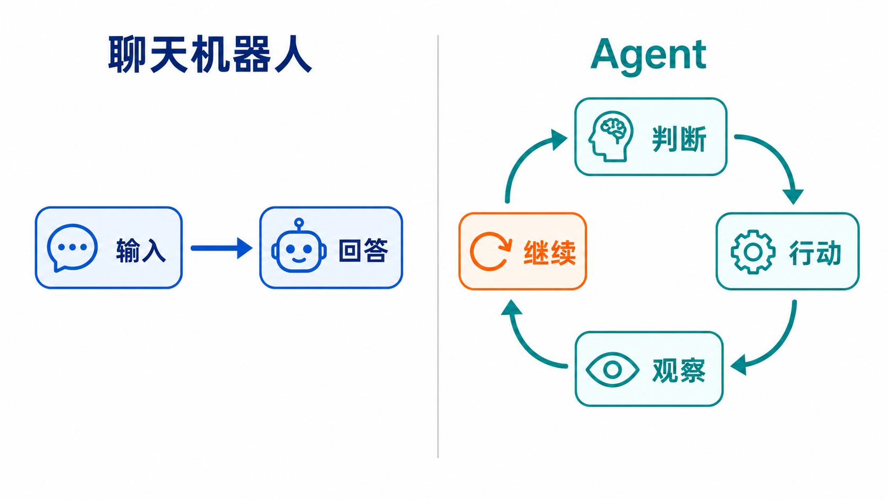
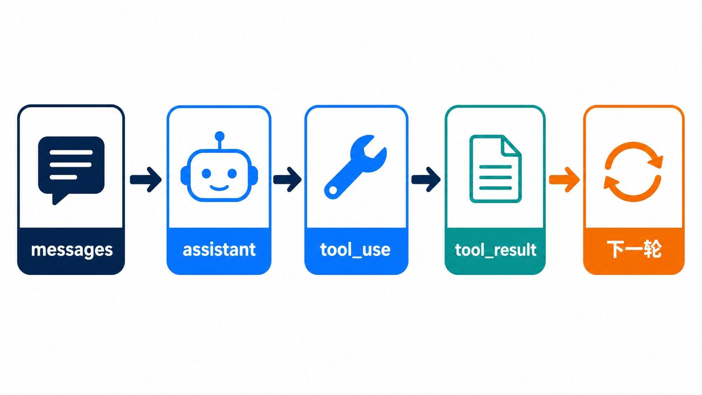
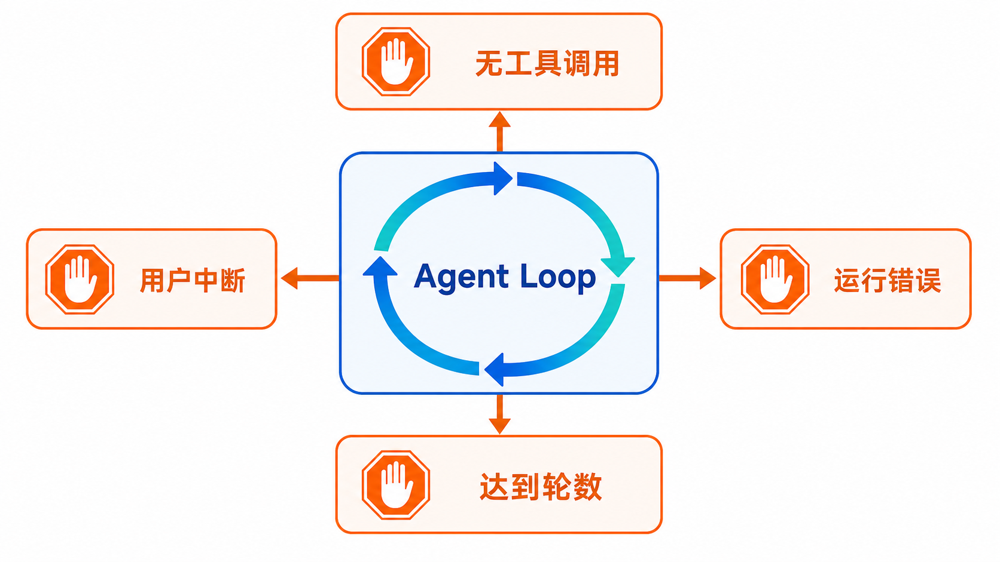

# Claude Code 的 Agent Loop 如何持续推进任务？

如果你让普通聊天机器人“修复项目里的登录问题”，它大概率会告诉你应该检查路由、鉴权中间件和数据库查询。

但 Claude Code 会先搜索文件，再阅读代码，接着修改实现、运行测试；测试失败，它还会根据报错继续调整。

两者使用的可能是同一个大模型，为什么表现却像两个完全不同的产品？

差异并不神秘。聊天机器人通常把一次模型回答当成终点，Agent 则把模型回答看成一次**状态转换**：只要回答里出现工具调用，运行时就执行工具，把结果放回上下文，再让模型决定下一步。

**Agent Loop 的本质不是反复请求模型，而是不断完成“决策—行动—观察—再决策”的闭环。**

## 一次模型调用，为什么完成不了复杂任务？

先看一个具体任务：把某个接口从同步调用改成异步调用，并保证测试通过。

模型一开始只知道用户目标，却不知道代码在哪、现有实现是什么、测试命令是什么。它需要逐步获得信息：

1. 搜索接口名称；
2. 阅读相关文件；
3. 判断修改位置；
4. 编辑代码；
5. 运行测试；
6. 根据测试结果决定是否继续。

这里的每一步都会产生下一步才需要的新信息。搜索之前不知道文件路径，修改之前不知道代码结构，运行之前也不知道测试会报什么错。

因此，复杂任务无法被可靠地压缩成一次“输入—输出”。它更像调试：每次行动都会改变你对问题的认识。

可以把普通聊天和 Agent 的差别压缩成下面这张图。

聊天机器人的控制权主要在模型回答里；Agent 的控制权由模型和运行时共同持有：

- 模型选择下一步行动；
- 运行时判断行动是否允许；
- 工具把行动作用到真实环境；
- 新观察重新进入模型上下文。

这意味着，开发 Agent 时不能只设计 Prompt。还必须设计循环状态、工具协议、终止条件和失败恢复。



## Claude Code 把循环放在哪里？

在恢复源码中，核心入口是一个异步生成器 `query()`。它没有直接返回一段最终文本，而是持续产出模型片段、工具结果、附件和系统事件。

下面是经过裁剪的核心代码，省略了命令生命周期通知和部分事件类型：

```typescript
// 裁剪后的核心代码
export async function* query(params: QueryParams) {
  const terminal = yield* queryLoop(params)
  return terminal
}

async function* queryLoop(params: QueryParams) {
  let state: State = {
    messages: params.messages,
    toolUseContext: params.toolUseContext,
    turnCount: 1,
    transition: undefined,
  }

  while (true) {
    // 组装请求、调用模型、执行工具、更新 state
  }
}
```

这里有两个值得学习的选择。

第一，使用 `AsyncGenerator`，而不是 `Promise<FinalAnswer>`。因为 Agent 运行过程中有很多对外可见的中间状态：模型正在输出、工具开始运行、命令产生进度、权限被拒绝、上下文被压缩。生成器允许调用方一边消费事件，一边等待最终状态。

第二，循环状态集中在 `state` 中。每次迭代开头读取当前状态，遇到“需要重试”“工具执行完成”“压缩后继续”等分支时，再一次性构造下一状态。

这种写法比在十几个局部变量上不断赋值更容易审计。对 Agent 来说，最危险的问题之一不是某个函数写错，而是某条异常分支漏更新了一项状态，导致下一轮拿到互相矛盾的数据。

## 一轮循环到底发生了什么？

Claude Code 的一轮循环可以拆成五个阶段：

1. 从历史消息中得到本轮输入；
2. 组装 System Prompt、用户上下文和工具定义；
3. 流式调用模型；
4. 收集并执行模型输出的 `tool_use`；
5. 把 `tool_result` 合并进消息历史。

模型调用的核心位置，经过裁剪后大致如下：

```typescript
// 裁剪后的核心代码
for await (const message of callModel({
  messages: prependUserContext(messagesForQuery, userContext),
  systemPrompt: fullSystemPrompt,
  tools: toolUseContext.options.tools,
  signal: toolUseContext.abortController.signal,
})) {
  yield message

  if (message.type === 'assistant') {
    assistantMessages.push(message)

    const blocks = message.message.content.filter(
      content => content.type === 'tool_use',
    )

    toolUseBlocks.push(...blocks)
    if (blocks.length > 0) needsFollowUp = true
  }
}
```

注意这里没有把 `stop_reason === "tool_use"` 当成唯一判断依据。循环直接检查流中是否真的出现了 `tool_use` 内容块。

这是一个很实用的工程原则：**决定状态转换时，优先相信已经观察到的业务事件，不要只相信汇总字段。**

如果模型只返回文本，没有工具调用，`needsFollowUp` 保持为 `false`，这一轮就可能结束；如果出现工具调用，运行时必须准备继续。



## 工具结果怎样变成模型的“新观察”？

模型输出 `tool_use` 并不代表任务已经向前推进。真正改变环境的是工具执行，真正让模型知道环境变化的是 `tool_result`。

Claude Code 收集完工具更新后，会把结果规范化为用户角色消息，再加入本轮历史。经过裁剪后的关键路径是：

```typescript
// 裁剪后的核心代码
for await (const update of toolUpdates) {
  if (update.message) {
    yield update.message

    toolResults.push(
      ...normalizeMessagesForAPI([update.message], tools)
        .filter(message => message.type === 'user'),
    )
  }
}

const next: State = {
  messages: [
    ...messagesForQuery,
    ...assistantMessages,
    ...toolResults,
  ],
  toolUseContext: updatedToolUseContext,
  turnCount: turnCount + 1,
  transition: { reason: 'next_turn' },
}

state = next
```

这个顺序不能随便调整。

`assistantMessages` 中保存“我要调用哪个工具、参数是什么”，`toolResults` 中保存“工具实际返回了什么”。两者共同构成一次完整行动。如果只保存工具结果，模型不知道结果属于哪次调用；如果只保存工具调用，下一轮模型会看到一个永远没有完成的动作。

所以 Agent 的消息历史并不是普通聊天记录。它还是一份事件日志：

```latex
用户：修复登录问题
助手：tool_use(Search, "login")
用户：tool_result(搜索结果)
助手：tool_use(Read, "auth.ts")
用户：tool_result(文件内容)
助手：tool_use(Edit, ...)
用户：tool_result(修改成功)
```

这里的“用户”只是协议角色，不代表真人又说了一句话。工具结果以用户侧内容进入，是为了让下一次模型采样把它当作外部世界返回的观察。

### 工具失败之后，循环应该继续还是结束？

这不能由一个全局布尔值决定。

搜索不到文件通常只是一次可恢复观察，模型可以更换关键词；读取某个可选配置失败，也可能不影响主任务。相反，写文件到一半失败、权限系统中断执行、工作区状态已经不一致，继续自动尝试就可能扩大问题。

更稳妥的做法，是让工具结果同时携带“业务结果”和“运行时结局”：

```typescript
// 教学示例
type ToolOutcome =
  | { status: 'success'; output: unknown }
  | { status: 'retryable'; error: string }
  | { status: 'denied'; reason: string }
  | { status: 'fatal'; error: string }
```

`retryable` 可以作为合法 `tool_result` 回填，让模型选择替代方案；`denied` 要让模型知道用户或策略拒绝了动作，不能把它误解成工具故障；`fatal` 则应该同时产生配对结果并终止循环。

这里有一个容易踩的坑：不要让模型独自判断错误是否致命。模型擅长根据错误内容调整方案，但工作区是否还能安全继续，应由工具和运行时提供结构化信号。两者结合，Agent 才既有适应性，又有确定边界。

## 为什么不能直接递归调用下一轮？

很多最小 Agent 示例会这样写：

```typescript
// 教学伪代码
async function run(messages) {
  const reply = await model(messages)
  if (!reply.toolCalls.length) return reply

  const results = await execute(reply.toolCalls)
  return run([...messages, reply, ...results])
}
```

这个版本非常适合解释概念，却不适合直接进入生产。

递归版本把控制流写得很漂亮，但隐藏了几个真实问题：

- 每轮都需要保留预算、压缩、重试等跨轮状态；
- 用户可能在模型流或工具执行中途打断；
- 某次模型回退后，旧流里的工具调用必须作废；
- 工具结果必须完整回填，不能留下孤儿调用；
- 长任务必须限制轮数和费用。

Claude Code 使用显式 `while (true)` 和状态对象，让每个 `continue` 都携带一个明确的下一状态。例如，上下文溢出后不是另起一套流程，而是压缩消息、设置转换原因，再回到循环顶部。

对你自己的 Agent 框架来说，这种“显式状态机”通常比“优雅递归”更笨，却更容易加入暂停、恢复、回放和故障诊断。

### 哪些状态每轮重置，哪些状态必须跨轮保留？

判断标准是：下一次模型请求还需不需要用它解释此前发生的事实。

本轮收集的 `assistantMessages`、临时工具队列和流式进度，在合并进历史后可以重置；消息历史、已使用预算、已加载规则和文件快照则必须跨轮保留。用户中断标记还要更谨慎：它用于结束当前动作，但新一次用户提交开始时应创建新的取消控制器，不能让旧信号永久污染会话。

可以为状态显式标注生命周期：

```typescript
// 教学示例
type RuntimeState = {
  turn: {
    toolQueue: ToolCall[]
    partialAssistant: Message[]
  }
  session: {
    messages: Message[]
    usage: Usage
    loadedInstructionPaths: Set<string>
  }
}
```

很多 Agent 的“跑到第三轮突然行为异常”，根因不是模型变笨，而是某个本轮变量被错误保留，或某个会话变量被错误清空。把生命周期写进类型和模块边界，比靠变量名提醒更可靠。



## Agent 怎么知道自己应该停下来？

一个可靠的 Agent 不能只依赖模型说“我完成了”。终止权必须由运行时和模型共同决定。

Claude Code 的正常结束信号，是本轮没有发现需要继续处理的工具调用。除此之外，还有多种硬边界：

- 用户中断模型流；
- 用户在工具执行期间中断；
- 达到最大轮数；
- 上下文超出可处理范围；
- 模型或运行时发生不可恢复错误；
- Hook 明确阻止继续执行。

例如，轮数检查经过裁剪后是：

```typescript
// 裁剪后的核心代码
const nextTurnCount = turnCount + 1

if (maxTurns && nextTurnCount > maxTurns) {
  yield createAttachmentMessage({
    type: 'max_turns_reached',
    maxTurns,
    turnCount: nextTurnCount,
  })
  return { reason: 'max_turns', turnCount: nextTurnCount }
}
```

这段代码体现了终止条件应该返回“原因”，而不是只返回 `false`。因为调用方需要区分：自然完成、达到预算、用户取消和系统错误不是同一种结果。

开发自己的 Agent 时，至少应该定义下面这组终止状态：

```typescript
// 教学示例
type Terminal =
  | { reason: 'completed' }
  | { reason: 'max_turns'; turnCount: number }
  | { reason: 'budget_exceeded'; cost: number }
  | { reason: 'aborted' }
  | { reason: 'model_error'; error: unknown }
  | { reason: 'tool_error'; toolUseId: string }
```

它会迫使上层产品认真处理每一种结束，而不是把所有情况都渲染成一句“任务结束”。

## 从 Claude Code 迁移到自己的 Agent，应该先实现什么？

如果你正在实现第一个 Coding Agent，不要一开始就复制 Claude Code 的所有分支。先做一个最小但闭合的循环：

```typescript
// 教学伪代码：最小可用 Agent Loop
async function runAgent(initialMessages: Message[]) {
  let messages = initialMessages

  for (let turn = 1; turn <= MAX_TURNS; turn++) {
    const assistant = await callModel({ messages, tools })
    messages.push(assistant)

    const calls = getToolCalls(assistant)
    if (calls.length === 0) {
      return { reason: 'completed', messages }
    }

    for (const call of calls) {
      const result = await executeWithPermission(call)
      messages.push(toToolResultMessage(call.id, result))
    }
  }

  return { reason: 'max_turns', messages }
}
```

然后按风险顺序增加能力：

1. 给每个工具调用分配稳定 ID，并保证结果配对；
2. 增加输入校验和权限判断；
3. 增加 `AbortSignal`，让模型和工具都能被取消；
4. 增加结构化终止原因；
5. 再考虑并发、流式执行和上下文压缩。

不要先追求“自主运行一百轮”。如果工具结果可能丢失、写操作没有权限层、错误不能终止，那么轮数越多只是把错误放大得越快。

### 怎样证明这个循环真的可靠？

只跑通一条成功路径不够。Agent Loop 最容易出错的地方，恰好发生在模型和工具没有按预期完成时。

可以准备一个最小故障矩阵：

| 场景 | 需要验证的结果 |
| --- | --- |
| 模型只返回文本 | 正常结束，不再请求模型 |
| 工具名称不存在 | 生成配对错误结果，模型可纠正 |
| 工具输入不合法 | 不执行副作用，错误进入下一轮 |
| 用户中断模型流 | 已出现的工具调用都有结局 |
| 用户中断工具 | 子进程停止，会话返回取消原因 |
| 达到最大轮数 | 不再调用模型，保留完整历史 |
| 第二轮模型失败 | 已完成工具结果不丢失 |

测试时不要只断言最终文本。还要检查每轮发出的消息序列、工具调用 ID、终止原因和实际副作用次数。

尤其要加入一个“工具已经成功，但结果回填前进程退出”的用例。恢复时系统不能假设工具没运行，也不能无条件再执行一次。对于可幂等工具可以查询状态后补结果；对于不可幂等工具则应把结果标为未知并请求确认。

当这些异常路径都能留下可解释的事件历史，循环才具备进入生产的基础。否则所谓自主性只是成功演示中的表象。



## 最后，怎样用一句话讲清 Agent Loop？

回到开头的问题：为什么同一个模型，接上 Claude Code 之后就能持续修改项目？

因为 Claude Code 没有把模型回答当成最终结果。它检查回答中的工具调用，执行真实动作，把工具结果作为新观察写回消息历史，再用更新后的状态进入下一轮；直到没有工具调用，或运行时的终止条件被触发。

可以记住三点：

1. **循环的燃料是新观察。** 没有 `tool_result`，重复调用模型并不会让任务真正前进。
2. **消息历史同时是上下文和事件日志。** 调用与结果必须成对，顺序也必须稳定。
3. **终止条件属于运行时。** 模型可以表达完成，轮数、预算、中断和错误必须由代码兜底。

如果要练习，可以先实现一个只有 `Read`、`Search` 和 `Answer` 三个工具的 Agent。让它完成“搜索文件—阅读内容—回答问题”的闭环，再故意制造工具失败和用户中断。只要这两条异常路径仍能留下完整消息历史，你的 Agent Loop 才算真正站稳。

调试时可以连续追问三个问题：这一轮为什么继续？下一轮新增了哪条观察？如果此刻停止，历史是否仍然合法？只要其中一个问题无法从事件记录中回答，就说明控制流还藏着隐式状态。把答案落实为 `transition reason`、消息 ID 和终止类型，下一次故障就不必靠猜。

这份可解释性，也是后续加入并发、子 Agent 与恢复机制时最重要的地基。
