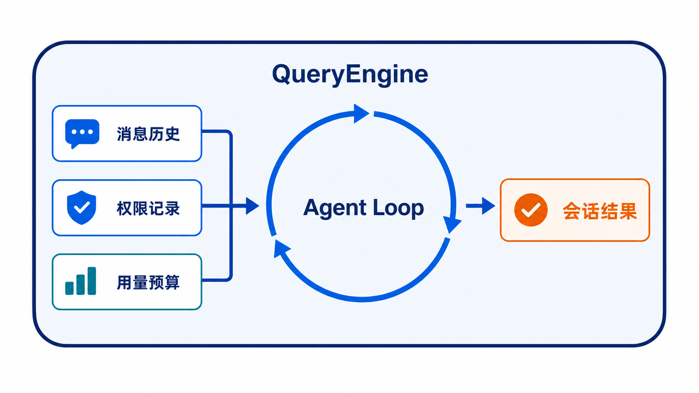
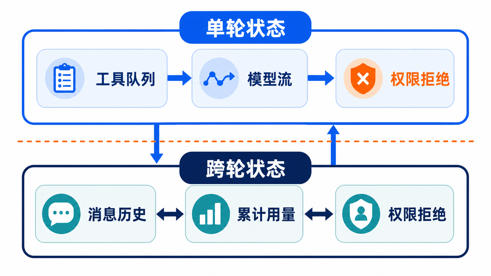
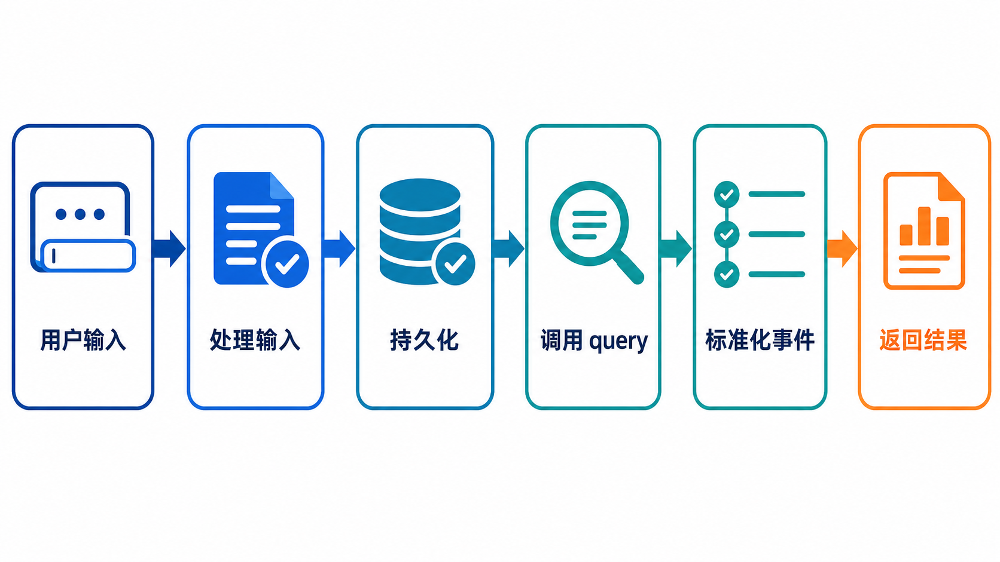
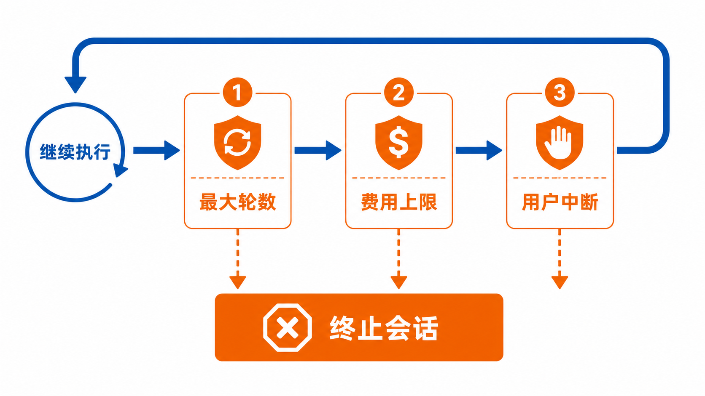

# QueryEngine 如何管理一段完整的 Agent 会话？

上一轮模型调用结束，下一轮还能记得什么？

工具被拒绝过一次，最终结果里应该怎样告诉 SDK 调用方？用户在模型输出到一半时退出，重新恢复会话时，刚刚提交的问题还在不在？任务已经花掉多少费用，又该由谁统计？

这些问题都不属于“模型推理”，却决定了一套 Agent 能不能被产品真正使用。

Claude Code 没有把所有职责都塞进 Agent Loop。循环负责让任务向前推进，外层的 `QueryEngine` 则负责维护一段完整会话：接收输入、准备上下文、持有消息、记录权限拒绝、累计用量、持久化记录，并把内部事件转换成稳定的 SDK 输出。

**如果 Agent Loop 是发动机，QueryEngine 更像整辆车的行车电脑：它不决定每次往哪转，却保证状态可记录、可限制、可恢复、可交付。**

## 为什么 Agent Loop 外面还需要一层引擎？

先区分两个经常混在一起的概念。

“一轮”指模型根据当前上下文作出一次响应，并可能产生工具调用；“一段会话”则可能包含用户多次提交、许多轮模型请求、多个工具结果，甚至上下文压缩和进程恢复。

Agent Loop 关心的是：

- 这一轮给模型哪些消息；
- 是否出现工具调用；
- 工具执行后要不要继续；
- 下一轮状态是什么。

会话引擎关心的是：

- 历史消息放在哪里；
- 新用户输入如何进入历史；
- 哪些事件需要持久化；
- 费用、用量和轮数如何累计；
- 对外应该暴露什么格式；
- 会话以什么原因结束。

如果没有这层边界，调用方就不得不理解循环内部每一种事件。UI、命令行和 SDK 都会各自实现一遍消息累计、预算判断和错误翻译，最终很难保持一致。

因此，`QueryEngine` 的第一项价值不是“多做了一层封装”，而是建立了一个稳定边界：里面可以有复杂的 Agent Runtime，外面只消费会话事件。



## QueryEngine 持有哪些长期状态？

恢复源码中的类定义很直接。下面是裁剪后的字段：

```typescript
// 裁剪后的核心代码
export class QueryEngine {
  private config: QueryEngineConfig
  private mutableMessages: Message[]
  private abortController: AbortController
  private permissionDenials: SDKPermissionDenial[]
  private totalUsage: NonNullableUsage
  private readFileState: FileStateCache
  private discoveredSkillNames = new Set<string>()
  private loadedNestedMemoryPaths = new Set<string>()

  constructor(config: QueryEngineConfig) {
    this.config = config
    this.mutableMessages = config.initialMessages ?? []
    this.abortController =
      config.abortController ?? createAbortController()
    this.permissionDenials = []
    this.readFileState = config.readFileCache
    this.totalUsage = EMPTY_USAGE
  }
}
```

这些字段不是随意堆放的，可以分成四类。

第一类是**会话事实**，比如 `mutableMessages`。它记录已经发生的用户输入、助手响应、工具结果和系统边界。

第二类是**控制状态**，比如 `abortController`。它让外部可以取消当前模型流和工具执行。

第三类是**产品统计**，比如 `permissionDenials` 与 `totalUsage`。它们不一定影响模型下一步，却影响最终结果、计费展示和审计。

第四类是**去重缓存**，比如已经发现的 Skill、已经加载的嵌套指令文件。它们防止同一内容在长会话中被重复注入。

这给 Agent 开发一个很重要的分类方法：

不要只问“这个变量在哪里用”，还要问“它的生命周期是一轮、一次用户提交，还是整段会话”。

生命周期不同的状态放在同一个临时对象里，很容易在下一次提交时被意外清空；本应按轮重置的状态如果长期保存，又会产生串轮污染。

## 一次 submitMessage 怎样穿过整套运行时？

`submitMessage()` 是 QueryEngine 的核心接口。它接收一段文本或内容块，但不会直接返回最终答案，而是继续使用异步生成器，把会话事件逐个交给调用方。

它的主要流程可以概括为：

1. 读取会话配置；
2. 准备 System Prompt、用户上下文和系统上下文；
3. 处理用户输入与命令；
4. 先写入会话记录；
5. 调用内部 `query()`；
6. 规范化每种内部消息；
7. 统计用量并生成最终结果。

调用内部循环的核心代码并不长：

```typescript
// 裁剪后的核心代码
for await (const message of query({
  messages,
  systemPrompt,
  userContext,
  systemContext,
  canUseTool: wrappedCanUseTool,
  toolUseContext: processUserInputContext,
  fallbackModel,
  querySource: 'sdk',
  maxTurns,
  taskBudget,
})) {
  // 记录、累计、规范化，再向 SDK 调用方 yield
}
```

真正复杂的不是“调用 `query()`”，而是调用前后保持哪些不变量。

调用前，用户输入必须已经变成标准消息，权限规则与模型选择也可能被命令更新；调用后，内部的 `assistant`、`user`、`progress`、`attachment`、`system` 和流事件需要分别处理。

这类外层引擎最容易被忽视，但它决定了内核能不能复用。同一个 `query()` 可以服务交互界面、无头模式或 SDK，是因为外层负责适配输入和输出，而不是让循环知道所有产品形态。



## 为什么用户输入要在模型响应前持久化？

一个看似不起眼的顺序，反映了会话系统最重要的可靠性原则。

Claude Code 会在进入 Agent Loop 之前，把刚刚接受的用户消息写入 transcript。裁剪后的逻辑如下：

```typescript
// 裁剪后的核心代码
this.mutableMessages.push(...messagesFromUserInput)
const messages = [...this.mutableMessages]

if (persistSession && messagesFromUserInput.length > 0) {
  const transcriptPromise = recordTranscript(messages)

  if (isBareMode()) {
    void transcriptPromise
  } else {
    await transcriptPromise
  }
}
```

为什么不能等模型回答后一起写？

假设用户提交任务后立刻点击停止，或者进程在 API 返回前崩溃。如果用户输入尚未落盘，那么恢复会话时，系统看到的最后状态仍然是上一次对话。用户明明已经发出的任务像从未发生过一样。

因此，这里遵循的是一种类似日志系统的策略：**先确认意图已经进入持久状态，再开始执行可能耗时、可能失败的工作。**

对自己的 Agent 服务，可以把一次提交设计成下面三个阶段：

```latex
ACCEPTED：输入已校验并持久化
RUNNING：模型和工具正在处理
TERMINAL：成功、失败、取消或达到限制
```

这样即使进程在 `RUNNING` 阶段消失，恢复逻辑也能看见一个尚未完成的提交，而不是丢失它。

不过，持久化不等于每个 token 都同步刷盘。源码中对简单模式和普通模式采用了不同等待策略，说明可靠性与启动延迟之间仍然要做取舍。关键不是“一律同步”，而是明确哪些状态丢失后不可接受。

### 恢复会话为什么不能只是重新读取消息数组？

消息内容只是恢复所需的一部分。

如果进程在工具执行中间退出，磁盘上可能已经发生副作用，而 transcript 里还没有最终 `tool_result`；如果压缩刚刚完成，持久化记录还需要知道哪段旧历史已经由摘要替代；如果上次会话使用了不同工作目录，直接在新目录重放工具上下文也可能危险。

因此，恢复入口至少要校验：

- 会话最后一个提交是否已经进入终止状态；
- 是否存在只有 `tool_use`、没有结局的调用；
- 压缩边界和保留消息能否组成连续链条；
- 当前工作区是否仍与会话记录匹配；
- 不可重复的外部动作是否已经真实发生。

对孤儿工具调用，安全做法通常不是自动重跑，而是补一条“上次运行中断、结果未知”的合成结果，让模型重新检查环境。读取文件可以重试，发布、删除和远程写入却可能已经成功，盲目重放会造成重复副作用。

所以会话恢复更接近故障恢复，而不是播放聊天记录。它需要根据持久化事件重建一个可信状态，再把控制权交回 Agent Loop。

## 内部消息为什么不能原样暴露给 SDK？

Agent Runtime 内部有很多只服务控制流的事件。例如：

- `stream_request_start` 表示新一次模型请求开始；
- `tombstone` 表示某些失败流中的临时消息应被删除；
- `compact_boundary` 表示上下文已经压缩；
- `progress` 表示工具仍在运行；
- `attachment` 可能承载轮数上限、文件变化或队列通知。

SDK 调用方并不应该依赖这些内部对象的全部字段。QueryEngine 会按消息类型进行规范化，只暴露稳定语义。

例如，模型流事件会单独累计用量：

```typescript
// 裁剪后的核心代码
if (message.event.type === 'message_start') {
  currentMessageUsage = updateUsage(
    EMPTY_USAGE,
    message.event.message.usage,
  )
}

if (message.event.type === 'message_delta') {
  currentMessageUsage = updateUsage(
    currentMessageUsage,
    message.event.usage,
  )
}

if (message.event.type === 'message_stop') {
  this.totalUsage = accumulateUsage(
    this.totalUsage,
    currentMessageUsage,
  )
}
```

这里也能看到为什么不能只读最终一条消息的 usage：一段 Agent 会话里可能发生多次模型请求，每次请求又通过流式事件逐步报告用量。外层必须按“消息开始—增量—消息结束”的生命周期累计。

对外协议应该表达“发生了什么”，而不是泄漏“内部恰好用了哪个类”。否则运行时一重构，所有 SDK 客户端都会被迫跟着改变。

### 为什么每条事件都需要稳定标识？

流式 Agent 中，同一轮可能同时产生文本、工具进度、工具结果和持久化写入。仅靠数组下标定位事件很脆弱：插入附件、压缩历史或恢复会话后，下标都会变化。

稳定的消息 ID、工具调用 ID 和父子关系，可以支持三个关键能力。

第一是幂等。SDK 重连后再次收到同一事件，可以按 ID 去重，而不是重复渲染或重复写库。

第二是配对。`tool_result` 无论何时到达，都能通过 `tool_use_id` 找回原行动。

第三是谱系。压缩和会话分叉发生后，系统仍能说明一条消息来自哪次提交、哪个子 Agent 或哪条父消息。

自己的事件协议可以从最小信封开始：

```typescript
// 教学示例
type EventEnvelope<T> = {
  eventId: string
  sessionId: string
  turnId: string
  parentEventId?: string
  createdAt: string
  payload: T
}
```

稳定 ID 不会让业务逻辑自动正确，但没有它，重试、恢复和审计只能依赖不稳定的顺序猜测。



## 权限、轮数和费用为什么由会话层汇总？

工具是否允许执行，实际判断发生在工具链里；但调用方最终还需要知道整段任务中有哪些权限被拒绝。

QueryEngine 会包装 `canUseTool`，在不改变原判断的情况下记录拒绝：

```typescript
// 裁剪后的核心代码
const wrappedCanUseTool: CanUseToolFn = async (
  tool,
  input,
  context,
  assistantMessage,
  toolUseID,
  forceDecision,
) => {
  const result = await canUseTool(
    tool,
    input,
    context,
    assistantMessage,
    toolUseID,
    forceDecision,
  )

  if (result.behavior !== 'allow') {
    this.permissionDenials.push({
      tool_name: tool.name,
      tool_use_id: toolUseID,
      tool_input: input,
    })
  }

  return result
}
```

这是一个很实用的“装饰器”思路：底层函数仍负责做决定，外层只收集跨会话信息。

预算也一样。Agent Loop 可以产生“达到最大轮数”的内部事件，QueryEngine 再把它转换成 SDK 结果；费用上限则在消费每条消息后检查累计成本。

这些保护放在会话层有两个好处。

第一，它们可以覆盖循环内部所有分支。无论本轮是在调用模型、执行工具还是处理压缩，最终都要穿过会话出口。

第二，产品可以得到结构化结束原因，而不是从最后一段文本猜测发生了什么。

在自己的实现中，可以让会话结果包含：

```typescript
// 教学示例
type SessionResult = {
  status: 'success' | 'cancelled' | 'limited' | 'failed'
  reason: string
  messages: Message[]
  turns: number
  usage: Usage
  cost: number
  permissionDenials: PermissionDenial[]
}
```

模型的自然语言回答只是其中一个字段，不应该取代运行时结果。

## QueryEngine 和 Agent Loop 的边界应该怎样划？

最容易出现的两种极端，是“循环什么都管”和“引擎什么都管”。

如果循环直接写数据库、拼 SDK 结果、处理 UI 格式，它会被具体产品绑死；如果引擎介入每一个工具的执行细节，它又会和 Runtime 内核重复。

一个更稳妥的边界是：

| 能力 | Agent Loop | 会话引擎 |
| --- | --- | --- |
| 选择是否继续下一轮 | 负责 | 观察结果 |
| 组装当前模型请求 | 负责 | 提供会话级上下文 |
| 执行并回填工具 | 负责 | 汇总权限结果 |
| 保存跨轮消息 | 更新 | 持有并持久化 |
| 累计全程用量 | 产生事件 | 负责 |
| 对外输出协议 | 不关心 | 负责 |
| 恢复与取消入口 | 接收信号 | 负责提供 |

这不是唯一划分方式，但有一个判断标准：**内层关注任务怎样推进，外层关注这段运行怎样被产品管理。**

如果某项逻辑换成 Web UI、后台任务或 SDK 后仍然完全相同，它更可能属于内层；如果它与持久化、调用者协议、租户预算或展示相关，它更可能属于会话层。

### 同一段会话能不能同时接受两个提交？

如果两个 `submitMessage()` 同时修改同一个 `mutableMessages`，顺序会变得不可预测。请求 A 可能先调用模型，请求 B 却先写入历史；两边工具结果再交错回填，最终上下文不再对应任何一条真实执行链。

因此，会话引擎需要明确并发语义。

最简单的策略是单写者：同一会话一次只运行一个提交，后续输入进入队列。用户若希望新消息立即打断当前任务，系统先通过 `AbortController` 结束当前模型或可取消工具，等旧提交进入明确终止状态，再开始新提交。

另一种策略是分叉：新输入从某个消息节点创建独立分支，拥有自己的 Agent Loop 和工具上下文。分叉适合探索不同方案，但必须给每条事件记录 branch ID，文件写入也要通过 worktree 或事务隔离，否则两个分支仍会争用同一工作区。

可以把规则写进引擎接口：

```typescript
// 教学示例
type SubmitPolicy =
  | { mode: 'queue' }
  | { mode: 'interrupt-current' }
  | { mode: 'fork'; fromMessageId: string }
```

不要让“同时调用了两次异步函数”意外定义产品语义。并发选择应由会话层显式决定，并保证每个提交都有唯一的开始、事件链和终止结果。



## 自己实现会话引擎时，先保证哪三个不变量？

第一，**接受过的输入不能悄悄消失。** 用户消息在开始长任务前应进入可恢复的持久状态。

第二，**每个终止出口都要产生结构化原因。** 成功、取消、达到轮数、费用超限和运行错误不能混成同一种“结束”。

第三，**跨轮状态与单轮状态要分开。** 工具队列可以每轮重建，累计用量和消息历史不能每轮清零；某轮发现的临时块也不应该永久污染会话。

回到开头：上一轮结束后，Agent 为什么还能可靠地继续？

不是因为模型天然拥有会话，而是 QueryEngine 持有了模型之外的长期状态，并把每次提交放进同一条可记录、可限制、可恢复的事件链。Agent Loop 负责前进，QueryEngine 负责让“前进”成为一段可以被系统管理的运行。

可以做一个小练习：在最小 Agent Loop 外面包一层 `SessionEngine`，先只实现消息持久化、取消和最大轮数。然后在模型调用前杀掉进程，再恢复会话。如果最后一条用户输入仍然存在，而且恢复程序能明确标出“上次运行未正常结束”，这层引擎才真正起作用。
