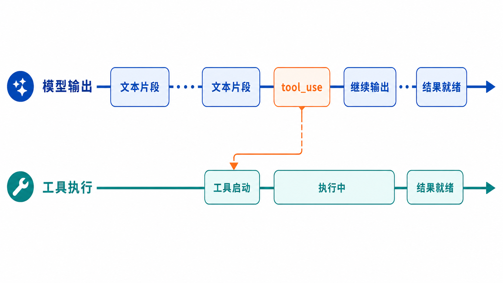
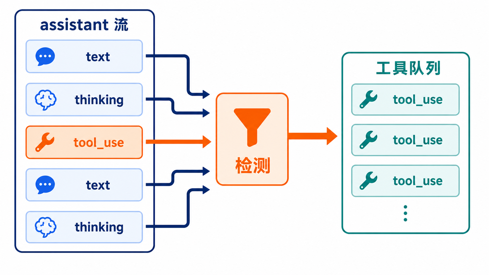
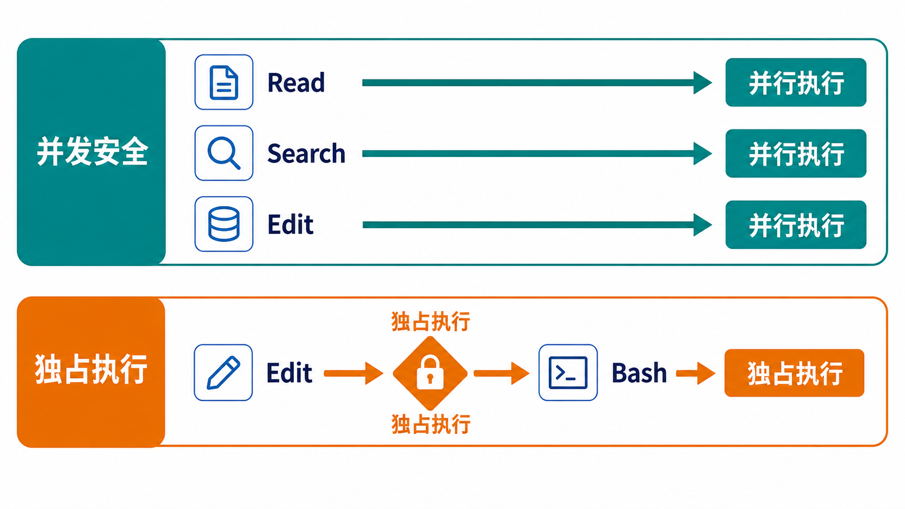
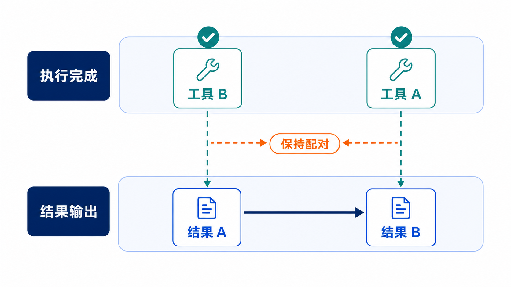

# 流式输出还没结束，Claude Code 为什么已经能开始执行工具？

假设模型准备同时读取三个文件。

最直观的实现是：等模型完整输出结束，解析出三个工具调用，再开始读文件。这样当然能工作，但模型输出的几秒钟和工具执行的几秒钟会首尾相接，用户只能多等一段时间。

Claude Code 采用了更激进的路径：当流里出现一个完整的 `tool_use` 内容块时，就把它交给工具执行器。模型可能还在生成后续内容，第一个工具已经开始运行了。

这不是简单地加一句 `Promise.all()`。一旦模型输出与真实动作重叠，运行时就必须同时处理输入完整性、并发安全、结果顺序、模型回退和用户中断。

**流式工具执行的真正难点，不是“早点启动”，而是让提前发生的动作仍然服从完整的 Agent 协议。**

## 模型到底在“流”出什么？

很多人把流式输出理解成一个不断增长的字符串。工具型 Agent 的流并不是只有文本，它由不同类型的内容块组成：

- `text`：给用户看的自然语言；
- `thinking`：模型的思考块或签名内容；
- `tool_use`：工具名称、调用 ID 和结构化输入；
- 消息级事件：开始、增量、结束和用量。

运行时不能看到字符 `"tool_use"` 就执行。它必须等到协议层交付一个可以识别的内容块，并确认输入已经形成对象。

Claude Code 在消费模型流时，会检查每条 `assistant` 消息中的内容块。下面是裁剪后的核心逻辑：

```typescript
// 裁剪后的核心代码
for await (const message of callModel(request)) {
  yield message

  if (message.type !== 'assistant') continue

  assistantMessages.push(message)

  const blocks = message.message.content.filter(
    content => content.type === 'tool_use',
  )

  if (blocks.length > 0) {
    toolUseBlocks.push(...blocks)
    needsFollowUp = true
  }
}
```

这里的流式不是“边收到半个 JSON 边执行”，而是“内容块一旦被上游组装成可消费消息，就立即进入调度”。

这条边界必须明确。过早执行会拿到残缺参数；过晚执行又失去重叠带来的延迟收益。



## 一个 tool_use 出现后，怎样立即启动？

循环为本轮创建 `StreamingToolExecutor`，随后每发现一个工具块，就调用 `addTool()`：

```typescript
// 裁剪后的核心代码
const executor = new StreamingToolExecutor(
  toolUseContext.options.tools,
  canUseTool,
  toolUseContext,
)

for (const toolBlock of blocks) {
  executor.addTool(toolBlock, message)
}

for (const result of executor.getCompletedResults()) {
  yield result.message
  toolResults.push(result.message)
}
```

`addTool()` 并不盲目调用工具。它先找到工具定义，再用工具自己的输入 Schema 解析参数，并计算这次调用是否可以并发。

```typescript
// 裁剪后的核心代码
addTool(block, assistantMessage) {
  const definition = findToolByName(this.toolDefinitions, block.name)
  const parsed = definition?.inputSchema.safeParse(block.input)

  const safe = parsed?.success
    ? Boolean(definition.isConcurrencySafe(parsed.data))
    : false

  this.tools.push({
    id: block.id,
    block,
    assistantMessage,
    status: 'queued',
    isConcurrencySafe: safe,
    pendingProgress: [],
  })

  void this.processQueue()
}
```

如果工具不存在，它也不能简单忽略。运行时会为这次调用生成带相同 `tool_use_id` 的错误结果，让模型下一轮知道自己请求了一个不可用工具。

这体现了一个协议设计原则：**即使执行失败，也要把失败变成合法观察，而不是让行动从历史中消失。**

## 为什么“是否并发”必须由工具自己判断？

“Read 可以并发、Edit 不能并发”是个有用的入门规则，但还不够精确。

同一个工具是否安全，可能取决于输入。例如某个查询工具只读远程状态时可以并发，而启用写入选项后就必须独占；某条 Bash 命令只是 `pwd`，另一条却会修改仓库。

因此，Claude Code 的工具定义暴露的是 `isConcurrencySafe(parsedInput)`，执行器在参数通过 Schema 校验后再询问。

调度条件经过裁剪后是：

```typescript
// 裁剪后的核心代码
private canExecuteTool(nextIsSafe: boolean): boolean {
  const running = this.tools.filter(
    tool => tool.status === 'executing',
  )

  return (
    running.length === 0 ||
    (nextIsSafe && running.every(tool => tool.isConcurrencySafe))
  )
}
```

意思很清楚：

- 当前没有工具执行，下一项可以启动；
- 当前已有工具时，只有“新工具安全，并且所有在运行工具都安全”，才能并行；
- 非并发安全工具必须独占执行。

为什么不让调度器维护一个固定的只读工具名单？

因为安全属性离工具实现越远，越容易失真。工具增加参数后，中心名单可能忘记更新；插件和 MCP 工具也无法被内核提前枚举。让工具根据已经校验的输入声明并发语义，内核只执行统一调度规则，扩展性更好。

边界也很明确：工具作者若错误声明“并发安全”，调度器无法替它发现真实副作用。因此生产级框架还应把工作目录锁、资源锁或沙箱作为第二道保护。



## 工具完成顺序乱了，结果为什么不能跟着乱？

假设模型依次发出：

```latex
A：读取一个很大的日志
B：读取一个很小的配置
```

B 很可能先完成。如果执行器立即按完成顺序回填，就会先输出 B 的结果，再输出 A 的结果。

从语义上看，`tool_use_id` 足以配对；但稳定顺序仍然很有价值：

- UI 展示不会来回跳动；
- transcript 更容易复现；
- 某些上下文修改需要保持调用顺序；
- 并发与串行路径产生一致消息结构。

`StreamingToolExecutor` 为每个工具维护状态：

```typescript
// 裁剪后的核心代码
type ToolStatus =
  | 'queued'
  | 'executing'
  | 'completed'
  | 'yielded'

type TrackedTool = {
  id: string
  status: ToolStatus
  isConcurrencySafe: boolean
  promise?: Promise<void>
  results?: Message[]
  pendingProgress: Message[]
}
```

工具完成时先把结果放入自己的缓冲区。`getCompletedResults()` 再按照 `this.tools` 的接收顺序遍历和发出。

```typescript
// 裁剪后的核心代码
for (const tool of this.tools) {
  if (tool.status === 'completed' && tool.results) {
    tool.status = 'yielded'

    for (const message of tool.results) {
      yield { message, newContext: this.toolUseContext }
    }
  } else if (
    tool.status === 'executing' &&
    !tool.isConcurrencySafe
  ) {
    break
  }
}
```

进度消息是例外。它们可以立即发出，让界面知道工具还活着；最终结果则服从稳定顺序。

这其实是流式系统常见的“双通道”设计：进度追求及时，最终状态追求确定。

## 模型还在输出，工具结果能立即喂回模型吗？

不能把结果插进正在进行的同一次模型响应。

当前请求的上下文在发出时已经确定。工具执行可以与模型剩余输出重叠，但结果要等这一轮响应结束后，作为 `tool_result` 加入下一轮请求。

因此，“流式执行”缩短的是等待时间：

```latex
传统路径：
模型完整输出 ──────> 工具执行 ──────> 下一轮

流式路径：
模型输出 ───────────────> 下一轮
        工具执行 ────────>
```

它并没有改变模型协议。仍然是先有 `tool_use`，再有对应的 `tool_result`，然后下一次采样。

这是一个容易讲错的地方。提前执行工具不等于“模型边想边读取工具返回”；除非模型 API 本身支持同一响应内的服务器工具闭环，否则客户端工具结果只能进入后续请求。

对 Agent 开发者来说，这意味着优化前必须先画清依赖图。只有不依赖当前响应后续内容的工作，才适合提前启动。

### 流式执行究竟能省下哪一段时间？

假设模型从开始响应到结束需要 6 秒，第一个 Read 调用在第 2 秒形成，读取文件需要 3 秒。

等待整轮结束再执行，最早要在第 9 秒得到工具结果；流式启动后，读取可以在第 5 秒完成，并与模型后四秒输出重叠。最终进入下一轮的时间接近第 6 秒，理论上省下约 3 秒。

但如果 `tool_use` 直到响应最后才出现，或工具只运行几十毫秒，收益就很小。流式执行还增加调度、取消和结果缓冲复杂度，所以不应凭感觉全面开启。

可以记录四个时间点：

```latex
T1：tool_use 内容块完整到达
T2：工具真正开始执行
T3：模型本轮结束
T4：工具结果完成
```

可重叠时间大致是 `min(T3, T4) - T2`。只有它在真实工作负载中稳定可观，才值得承担复杂性。

还有一种隐性收益：长工具可以更早报告进度，让界面不再呈现“模型结束后突然静默”。但进度体验和总延迟要分开衡量，不能用用户感觉更热闹代替性能数据。



## 如果模型流失败或切换模型，已经启动的工具怎么办？

这是流式执行最危险的边界。

假设主模型已经输出一个工具调用，工具也开始执行；随后流失败，系统决定切到备用模型重试。备用模型会生成一套新的消息和新的工具调用 ID。

如果旧工具结果继续进入历史，就会出现“新回答里没有这个调用，历史中却多了旧结果”的孤儿状态。更糟的是，旧工具可能已经产生副作用。

Claude Code 在流式回退时会丢弃当前执行器，并创建新的执行器：

```typescript
// 裁剪后的核心代码
if (streamingFallbackOccurred) {
  assistantMessages.length = 0
  toolResults.length = 0
  toolUseBlocks.length = 0

  executor.discard()
  executor = new StreamingToolExecutor(
    tools,
    canUseTool,
    toolUseContext,
  )
}
```

执行器看到 `discarded` 状态后，不再把旧结果交给主循环；尚未执行的工具不会继续启动，相关调用可以得到合成错误结果。

但这里存在一个无法用消息协议完全抹掉的事实：如果写操作已经真实完成，丢弃结果不会撤销副作用。

所以流式执行最适合读取、搜索、网络查询等可并发且低副作用工具。对写文件、发布、删除、转账这类动作，保守策略通常是等模型响应稳定结束后再执行，或者要求工具具备幂等键、事务和补偿操作。

### 权限询问会怎样改变并发调度？

一个工具从队列进入执行，并不代表它立刻产生副作用。输入校验、PreToolUse Hook 和权限判断仍然位于真实 `tool.call()` 之前。

如果并发启动三个写操作，它们又分别弹出权限对话，用户很难理解自己批准的顺序；某个工具等待用户时，其他工具是否能越过它继续执行，也会改变最终环境状态。

因此，调度器最好把“等待权限”和“正在执行”都视为占用状态。对独占工具，权限尚未确定时也不让后续写操作穿越；对已被规则自动允许的只读工具，才可以继续并发。

权限结果还可能修改输入。例如用户只批准命令的一部分，或 Hook 把路径改到安全工作区。并发安全判断若基于修改前参数，结论可能已经失效。严谨实现要么在权限修改后重新判断，要么规定允许修改的字段不能改变副作用类别。

这说明并发不是执行器的局部优化。它与 Schema、Hook、权限和工具语义共同构成一条事务边界。

## 中断时为什么还要生成“合成结果”？

用户按下停止时，可能已经有三个 `tool_use`，其中一个完成、一个正在运行、一个还在队列。

如果运行时直接退出，后两个调用将没有结果。将这段历史再次发给模型时，协议可能拒绝，模型也无法理解哪些动作发生过。

因此，执行器会为未完成调用生成错误形式的 `tool_result`，并沿用原来的 ID。它表达的不是“工具成功”，而是“这个行动已经有了明确结局：被用户取消、被兄弟错误中止，或因流回退而作废”。

可以把它抽象成一个不变量：

```typescript
// 教学伪代码
for (const call of emittedToolCalls) {
  assert(
    hasRealResult(call.id) ||
    hasSyntheticTerminalResult(call.id),
  )
}
```

合成结果听起来像伪造，其实恰恰是在诚实记录运行时事实。真实工具没有返回业务结果，但运行时知道它为何没有返回，这个原因也应该进入事件日志。

### 哪些情况下反而不该启用流式工具执行？

第一种是高副作用工具。发送消息、部署生产、删除数据和触发付款，一旦执行就很难随模型回退一起撤销。除非工具有幂等键、确认阶段和补偿动作，否则等整轮响应稳定结束更安全。

第二种是模型经常回退或重试的环境。网络不稳定、Provider 自动切换或输出解析容易失败时，提前启动会制造大量被丢弃的执行器，收益可能小于取消成本。

第三种是工具输入依赖同一回答的后续内容。模型先输出一个初步调用，随后文本又说明要根据另一个判断修改参数，此时提前执行会破坏语义。只有协议明确一个内容块闭合后不可再修改，才能安全启动。

第四种是外部系统限流严格。四个读请求在本地并发很快，却可能让远程 API 触发限流，导致整体更慢。`isConcurrencySafe` 只表示副作用兼容，不代表资源容量无限，调度器还要有每类工具的并发上限。

可以把开关设计为能力，而不是全局常量：

```typescript
// 教学示例
type StreamingPolicy = {
  startBeforeMessageEnd: boolean
  maxConcurrency: number
  requiresIdempotencyKey: boolean
}
```

默认关闭，再对可观测、可取消、低副作用工具逐步开启。性能优化的成熟标志不是覆盖率，而是能说清每个提前执行动作在失败时如何收场。



## 自己实现流式工具执行，应该分哪三步？

第一步只做**检测与排队**。从完整 `tool_use` 内容块中提取 ID、名称和输入，验证 Schema 后放入队列，先不要并发。

第二步增加**安全调度**。由工具基于参数声明并发语义；只读批次可以并发，具有副作用的工具保持独占。无论完成顺序如何，最终结果按稳定规则发出。

第三步补齐**异常闭环**。模型回退时隔离旧执行器，用户中断时取消子任务，为每个已出现的调用生成真实或合成结果。

回到开头：Claude Code 为什么能在流式输出结束前执行工具？

因为它把模型流看成结构化事件流。一旦收到完整 `tool_use` 块，就通过独立执行器校验、排队和调度；与此同时，它用结果缓冲、调用 ID、丢弃状态和合成错误维持协议完整性。

真正值得迁移的不是“越早执行越快”，而是下面三个判断：

1. **结构完整之后才能提前执行。**
2. **并发能力属于工具语义，不属于工具名称。**
3. **任何提前启动的动作，都必须设计回退和中断后的结局。**

如果你的 Agent 还不能保证第三点，先等待整轮响应结束再执行工具并不可耻。正确性是流式优化的前提，重叠只是正确路径上的延迟收益。

上线前再问两句：这个工具提前执行后能否取消？取消不了时，重复调用是否安全？若答案都是否定的，它就不应进入流式路径。先把流式执行限制在读取和搜索，再用时间线数据决定扩展范围，比全局开启后补救可靠。
