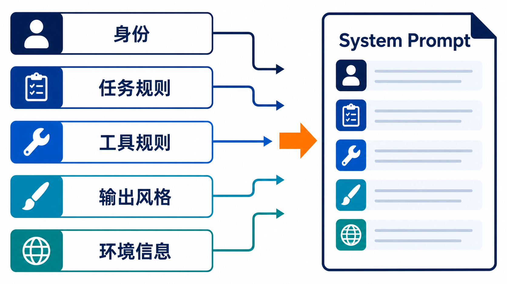
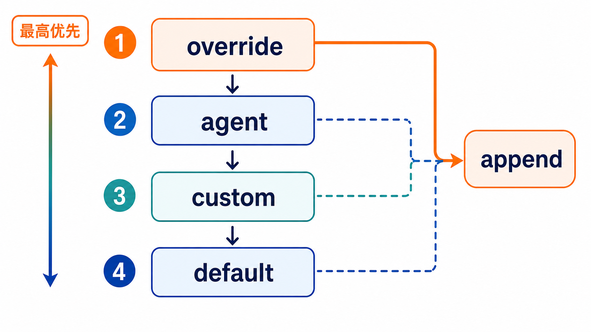
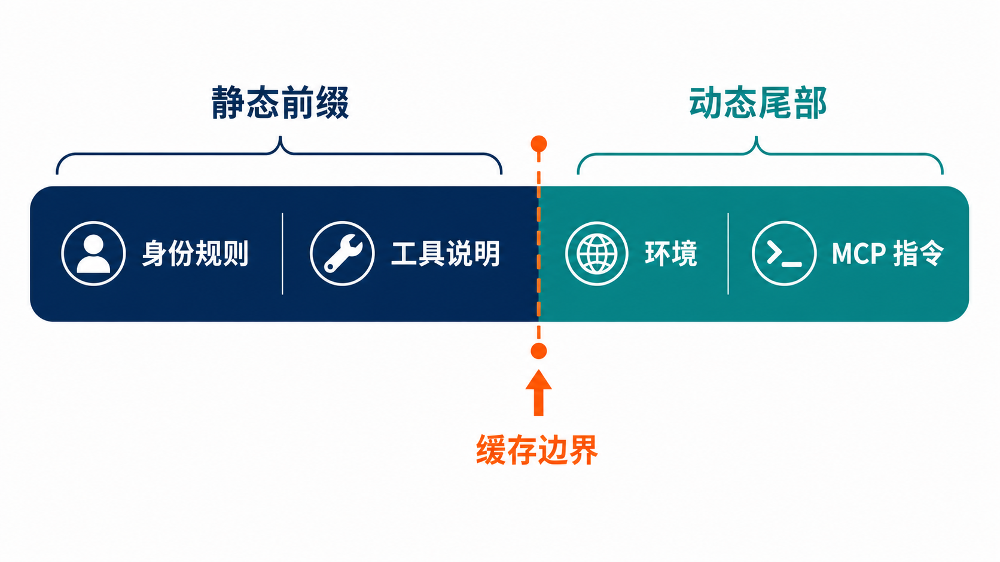
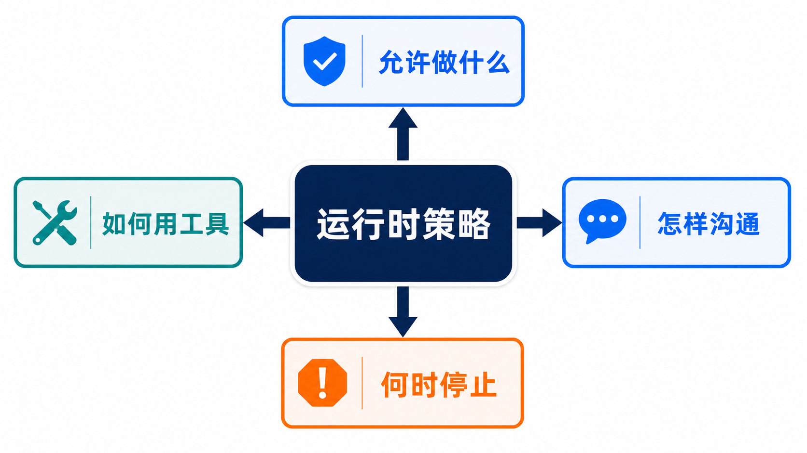

# Claude Code 如何组装 System Prompt？

做一个 Agent 原型时，我们很容易写出这样的 System Prompt：

```latex
你是一个编程助手，请使用工具完成用户任务。
```

它能跑，但任务一复杂，问题就来了：模型不知道哪些操作要谨慎确认，不知道每种工具应该怎样配合，也不知道当前目录、操作系统、输出风格和扩展能力。

于是开发者继续往字符串后面追加规则。几个月后，System Prompt 变成一篇无法维护的长文：身份、权限、工具说明、环境信息和业务要求混在一起，修改一句话就可能让整段缓存失效。

Claude Code 的思路不是寻找一句“神奇 Prompt”，而是把 System Prompt 当成运行时配置来组装。不同模块负责产生不同片段，优先级函数决定谁替换谁，缓存层再把稳定前缀和动态尾部分开。

**生产级 Agent 的 System Prompt，更像一份按运行环境编译出来的策略包，而不是写死的角色设定。**

## System Prompt 到底承担哪些职责？

对 Coding Agent 来说，System Prompt 至少同时承担五类职责：

1. 定义身份和任务边界；
2. 解释如何完成软件开发任务；
3. 约束工具使用和高风险动作；
4. 规定与用户沟通的方式；
5. 注入当前运行环境和可用扩展。

这些内容的变化频率完全不同。

“你是一个 Coding Agent”很稳定；工具列表可能按会话变化；工作目录按启动位置变化；MCP 服务器还可能在会话中途连接。把它们拼成一个不可分割的大字符串，不仅难维护，也不利于 Prompt 缓存。

恢复源码中的 `getSystemPrompt()` 返回的是 `Promise<string[]>`，不是单个字符串。每一项都可以看成一个语义片段：

```typescript
// 裁剪后的核心代码
export async function getSystemPrompt(
  tools: Tools,
  model: string,
  additionalWorkingDirectories?: string[],
  mcpClients?: MCPServerConnection[],
): Promise<string[]> {
  const [skills, outputStyle, envInfo] = await Promise.all([
    getSkillToolCommands(cwd),
    getOutputStyleConfig(),
    computeSimpleEnvInfo(model, additionalWorkingDirectories),
  ])

  // 后续返回静态片段与动态片段
}
```

返回数组有两个好处。

一是片段可以独立计算和测试。环境信息发生变化，不需要重写身份规则函数；工具说明变化，也不影响输出风格模块。

二是后续可以按片段划分缓存范围，而不是把整个 Prompt 当作一块不可分割的文本。



## 默认 Prompt 是怎样分段组装的？

默认路径会先准备动态部分，再返回静态部分和动态部分的组合。下面是高度裁剪后的结构：

```typescript
// 裁剪后的核心代码
const dynamicSections = [
  section('session_guidance', () => getSessionGuidance()),
  section('memory', () => loadMemoryPrompt()),
  section('env_info', () => computeSimpleEnvInfo(model)),
  section('language', () => getLanguageSection()),
  section('output_style', () => getOutputStyleSection()),
  section('mcp_instructions', () => getMcpInstructionsSection()),
]

const resolved = await resolveSystemPromptSections(dynamicSections)

return [
  getIntroSection(),
  getSystemSection(),
  getDoingTasksSection(),
  getActionsSection(),
  getUsingYourToolsSection(enabledTools),
  getToneAndStyleSection(),
  SYSTEM_PROMPT_DYNAMIC_BOUNDARY,
  ...resolved,
].filter(section => section !== null)
```

这里真正值得迁移的，不是具体规则，而是**按变化原因分段**。

- 身份和基本行为属于静态前缀；
- 工具可用性、环境和扩展说明属于动态片段；
- 某个功能关闭时，片段可以返回 `null`，由组装器过滤；
- 异步片段并行计算，避免启动时串行等待。

如果你自己的 Agent 有搜索、数据库、邮件和内部知识库四类能力，可以让每个能力自己提供 Prompt 片段：

```typescript
// 教学示例
type PromptSection = {
  id: string
  build(context: RuntimeContext): Promise<string | null>
  volatility: 'static' | 'session' | 'turn'
}
```

`volatility` 不一定出现在源码接口里，但它是很有用的设计维度：这一段是构建时稳定、会话级稳定，还是每轮都会变化？

## custom、agent、default，谁覆盖谁？

模块化解决了“有哪些片段”，还没解决“多个来源冲突时听谁的”。

Claude Code 单独使用 `buildEffectiveSystemPrompt()` 处理优先级。下面是裁剪后的核心决策：

```typescript
// 裁剪后的核心代码
if (overrideSystemPrompt) {
  return asSystemPrompt([overrideSystemPrompt])
}

const agentPrompt = mainThreadAgentDefinition
  ? mainThreadAgentDefinition.getSystemPrompt()
  : undefined

return asSystemPrompt([
  ...(agentPrompt
    ? [agentPrompt]
    : customSystemPrompt
      ? [customSystemPrompt]
      : defaultSystemPrompt),
  ...(appendSystemPrompt ? [appendSystemPrompt] : []),
])
```

可以把这条优先链理解为：

```latex
override > agent > custom > default
                         + append
```

`override` 是完全替换；主线程 Agent 的专用 Prompt 通常替换默认 Prompt；用户的 custom Prompt 在没有专用 Agent 时替换默认 Prompt；`append` 则在选中的基础 Prompt 之后追加。

为什么要把“替换”和“追加”分开？

因为它们表达的是不同授权。

替换表示“调用方愿意接管完整行为定义”，适合 SDK、测试或特殊 Agent；追加表示“保留产品的安全与工具规则，只叠加领域要求”，适合团队规范和临时任务约束。

自己的 Agent 平台也应该在 API 层明确区分：

```typescript
// 教学示例
type PromptOptions = {
  replaceSystemPrompt?: string
  appendSystemPrompt?: string
}
```

不要只提供一个叫 `systemPrompt` 的模糊参数，否则调用者很难知道它是在替换基础安全规则，还是在其后叠加。



## 为什么 append 也可能带来冲突？

很多人认为，只要不是替换，追加就一定安全。实际上，Prompt 的最后一段往往更靠近模型当前注意力，追加内容仍可能与前文冲突。

例如基础规则说“删除远程资源前必须询问”，追加规则却说“全程不要询问，自动完成所有操作”。即使两段都保留了，模型仍要自行解释冲突。

所以 Prompt 组装器不能替代权限系统。

System Prompt 可以告诉模型“哪些动作通常需要确认”，但真正的写文件、执行命令和调用外部 API，仍应经过代码层权限判断。Prompt 是引导层，不是不可绕过的安全边界。

在平台设计中，可以把约束分成三类：

| 约束类型 | 适合放在哪里 |
| --- | --- |
| 表达风格、工作方法 | System Prompt |
| 工具参数类型与格式 | Schema |
| 是否允许产生副作用 | 权限与策略代码 |

越靠近真实副作用，越不能只依赖自然语言。

### 工具说明为什么不应该永久写死在基础 Prompt 里？

工具集合会变化。MCP 服务器可能在会话中连接，某个工具可能因权限模式关闭，延迟发现机制也可能只在模型需要时发送 Schema。

如果基础 Prompt 永远声称“你可以调用 X”，而当前请求没有提供 X 的工具定义，模型就可能输出一个无法执行的调用；反过来，Schema 已经提供了新工具，Prompt 却没有相应使用原则，模型又可能误用。

更合理的做法，是由当前工具集合派生说明：

```typescript
// 教学示例
function buildToolGuidance(tools: Tool[]) {
  const capabilities = new Set(
    tools.map(tool => tool.capability),
  )

  return toolGuidanceSections
    .filter(section =>
      capabilities.has(section.capability),
    )
    .map(section => section.text)
}
```

这里不需要把每个 Schema 再用自然语言复述一遍。Prompt 解释的是跨工具策略，例如“搜索后再读取”“修改前确认已有内容”；Schema 解释具体参数。

能力减少时，相关说明也应消失。否则 Prompt 会积累“幽灵能力”，让模型为不存在的工具制定计划。

## Prompt 为什么要区分静态前缀和动态尾部？

大模型 API 的 Prompt 缓存通常依赖稳定前缀。前面一处字符变化，后面大量相同内容也可能无法复用。

Claude Code 在静态片段和动态片段之间放置边界标记，随后把 System Prompt 拆成不同缓存范围：

```typescript
// 裁剪后的核心代码
return [
  getIntroSection(),
  getDoingTasksSection(),
  getUsingYourToolsSection(enabledTools),
  getToneAndStyleSection(),
  SYSTEM_PROMPT_DYNAMIC_BOUNDARY,
  ...resolvedDynamicSections,
]
```

API 层再把片段转换成文本块：

```typescript
// 裁剪后的核心代码
export function buildSystemPromptBlocks(
  systemPrompt: SystemPrompt,
  enablePromptCaching: boolean,
) {
  return splitSysPromptPrefix(systemPrompt).map(block => ({
    type: 'text',
    text: block.text,
    ...(enablePromptCaching &&
      block.cacheScope !== null && {
        cache_control: getCacheControl({
          scope: block.cacheScope,
        }),
      }),
  }))
}
```

这说明 Prompt 工程不仅是内容工程，也是布局工程。

如果每轮变化的日期、工作区状态放在最前面，那么后面的稳定规则会跟着失去缓存价值。更合理的顺序是：

```latex
稳定身份与规则
稳定工具说明
──── 缓存边界 ────
会话环境
临时扩展说明
本轮动态信息
```

不过，缓存不能凌驾于语义。某段动态规则如果必须在身份之前才能被正确理解，就不能只为了缓存强行后移。正确性仍然优先。



## 环境信息为什么属于 Prompt，而不是普通用户消息？

工作目录、操作系统、Shell 和附加目录会直接影响模型怎样调用工具。

例如，模型生成文件路径时需要知道当前目录；生成命令时需要知道 Shell；在 worktree 中工作时需要知道不能随意切回主仓库。

恢复源码会把这些信息组装成环境片段：

```typescript
// 裁剪后的核心代码
const envItems = [
  `Primary working directory: ${cwd}`,
  `Is a git repository: ${isGit}`,
  `Platform: ${platform}`,
  `Shell: ${shellName}`,
  `OS Version: ${osVersion}`,
]

return [
  '# Environment',
  'You have been invoked in the following environment:',
  ...prependBullets(envItems),
].join('\n')
```

它放在 System Prompt 一侧，是因为这些内容由运行时提供，不是用户本轮提出的新要求；同时它们应该在模型制定行动方案前就可见。

但不是所有状态都应该塞进 System Prompt。频繁变化的文件 diff、工具结果和用户追加信息，更适合进入消息或附件。否则 System Prompt 每轮都变化，缓存和可解释性都会变差。

一个实用判断是：

这条信息是在定义 Agent 的运行条件，还是在汇报世界刚刚发生了什么？

前者偏向 System Prompt，后者偏向消息与工具结果。

## 为什么说 Prompt 是运行时策略，而不是人格文案？

如果只把 System Prompt 当作“你是谁”，开发者会在工具行为异常时继续润色语气：

```latex
你一定要认真使用工具。
你必须先思考再行动。
你绝对不能犯错。
```

这些句子很难替代真实机制。

Claude Code 的组装方式更接近策略编译：

- 根据启用工具生成使用说明；
- 根据 Agent 定义选择专用指令；
- 根据环境注入工作条件；
- 根据扩展连接状态加入 MCP 指令；
- 根据输出配置改变沟通风格；
- 根据缓存边界组织稳定和动态内容。

这也解释了为什么 Prompt 应该可观测。生产系统最好能够记录：

- 最终启用了哪些片段；
- 每个片段由哪个模块提供；
- 片段的版本或哈希；
- 哪些来源执行了替换，哪些来源执行了追加；
- 哪些部分进入缓存范围。

发生行为回归时，你才能回答“模型当时究竟看到了什么”，而不是只看代码仓库里当前的 Prompt 模板。

### Prompt 组装器应该怎样测试？

只给最终长字符串做快照测试，修改任意空格都会产生巨大 diff，开发者最后往往习惯性更新快照，反而失去保护价值。

更有效的是分三层测试。

第一层测试片段函数：给定工具集合和环境，验证片段是否出现、是否为空、是否泄漏不应公开的信息。

第二层测试优先级矩阵：

| override | agent | custom | 期望基础 Prompt |
| --- | --- | --- | --- |
| 有 | 任意 | 任意 | override |
| 无 | 有 | 任意 | agent |
| 无 | 无 | 有 | custom |
| 无 | 无 | 无 | default |

第三层测试结构不变量，例如静态片段必须位于缓存边界之前，动态环境必须位于边界之后，append 必须只出现一次。

还可以记录每个片段的 ID 列表，而不是只比较全文：

```typescript
// 教学示例
expect(result.sectionIds).toEqual([
  'identity',
  'tool_policy',
  'cache_boundary',
  'environment',
])
```

这样文案可以正常迭代，优先级和布局的回归仍然会被准确发现。

### Prompt 变化怎样灰度，而不是一次影响所有会话？

Prompt 是运行时代码的一部分。一个看似更清晰的句子，可能改变工具调用率、询问频率、回答长度和缓存命中，不能只通过人工阅读判断风险。

可以给组装结果附上版本：

```typescript
// 教学示例
type CompiledPrompt = {
  version: string
  sections: Array<{
    id: string
    revision: string
    text: string
  }>
}
```

新会话按稳定分流选择版本，整段会话中保持不变。不要让同一会话前几轮使用 A、后几轮突然切到 B，否则行为变化会与上下文增长混在一起，很难定位。

评估时至少观察四类指标：任务成功率、工具错误率、需要用户纠正的次数和总 token 成本。若只看回答偏好，可能得到更好看的文本，却让 Agent 更少验证代码。

灰度还要保留回放能力。对同一份固定消息、工具 Schema 和环境清单，分别用新旧 Prompt 运行离线评估，比较下一步行动，而不是只比较最终措辞。

当问题出现时，能够按 `version + section revision` 精确回滚，比把整个 Prompt 复制成 `final_v7_really_final` 可靠得多。



## 自己设计 Prompt 组装器，最少需要什么？

可以先实现一个很小的版本：

```typescript
// 教学伪代码
async function buildPrompt(ctx: RuntimeContext) {
  const base = selectBasePrompt({
    override: ctx.overridePrompt,
    agent: ctx.agentPrompt,
    custom: ctx.customPrompt,
    default: DEFAULT_PROMPT,
  })

  const dynamic = await Promise.all(
    sections.map(section => section.build(ctx)),
  )

  return [
    ...base,
    CACHE_BOUNDARY,
    ...dynamic.filter(Boolean),
    ...(ctx.appendPrompt ? [ctx.appendPrompt] : []),
  ]
}
```

然后补上三个约束：

1. 每个片段有稳定 ID，便于调试和灰度；
2. 替换与追加是两个明确参数；
3. 高风险权限不由 Prompt 决定。

回到开头：Claude Code 如何得到那段庞大的 System Prompt？

不是由某个文件返回一篇完整长文，而是先按职责计算身份、任务、工具、风格、环境和扩展片段，再根据优先级选择基础 Prompt，最后按缓存边界转换为 API 文本块。

可以记住三句话：

1. **按变化原因拆 Prompt，而不只按文字标题拆。**
2. **替换、选择和追加必须有明确优先级。**
3. **Prompt 负责引导，Schema 和权限代码负责兜底。**

下一次维护 Agent Prompt 时，不妨先不要改字句。先给现有内容标出“稳定前缀、会话配置、本轮状态和安全约束”四种颜色。通常你会发现，真正需要重构的是组装结构，而不是措辞。

还可以做一次反向检查：删掉这段文字后，哪个运行时行为会改变？如果答案只是“语气可能不同”，它属于风格片段；如果答案涉及工具权限、参数合法性或数据边界，就应确认是否已有代码兜底。这个问题能防止安全职责在漫长迭代中悄悄滑回 Prompt。

当每个片段都有职责和边界，Prompt 才能像代码一样被维护，而不是靠经验堆叠。
