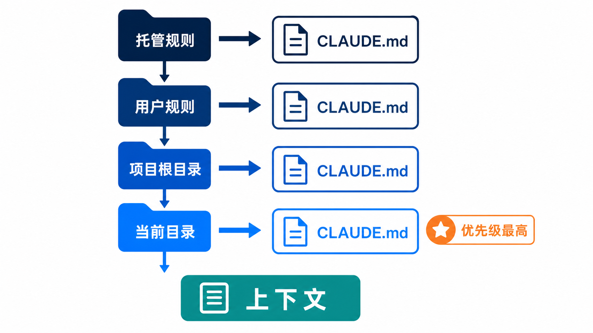
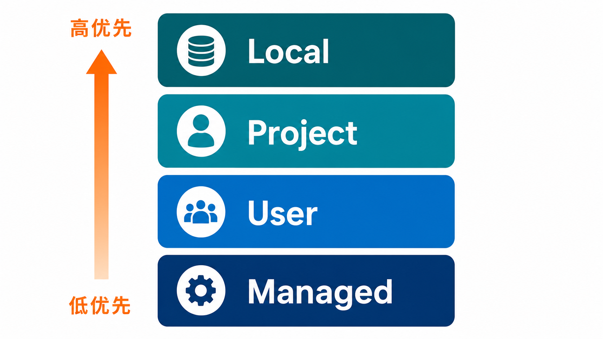
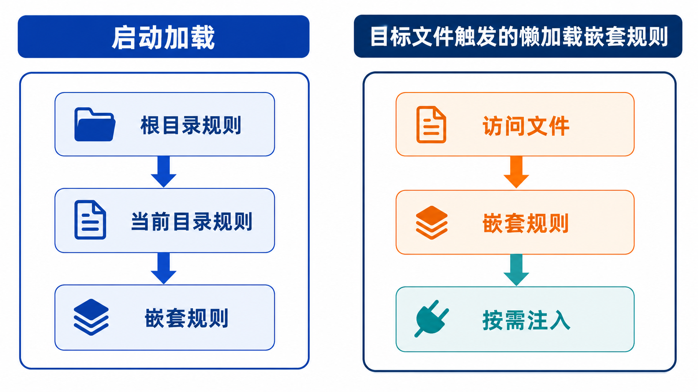
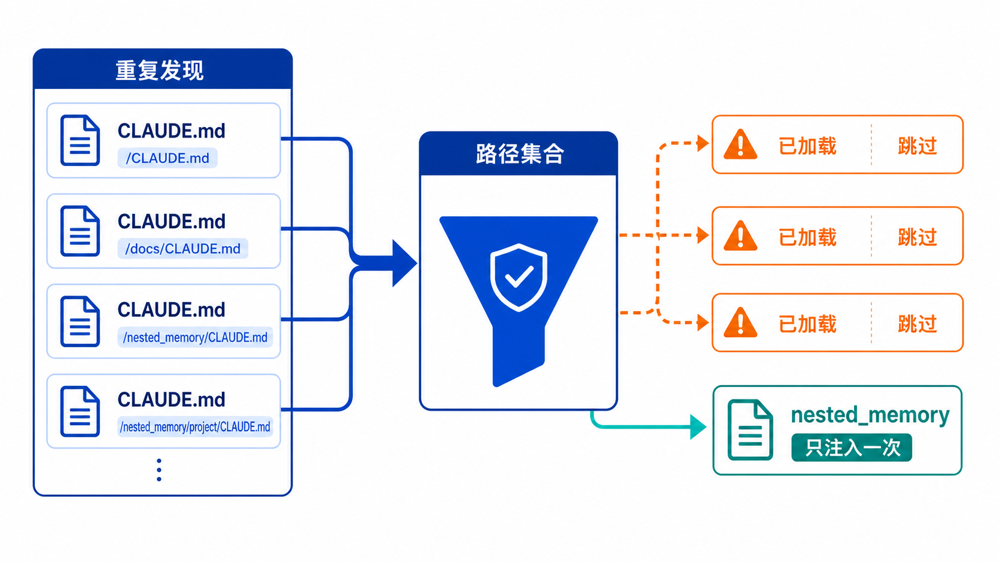

# CLAUDE.md 是如何进入模型上下文的？

你在仓库根目录写了一句“依赖管理统一使用 bun”，Claude Code 为什么能在几轮工具调用之后仍然遵守？

如果 Agent 进入一个深层子目录，那里又有一份更具体的 `CLAUDE.md`，两份规则怎么合并？如果某条规则只适用于 `src/api/**`，是否应该在会话启动时就把它塞给模型？同一个文件被多次发现，又怎样避免重复注入？

把 `CLAUDE.md` 简单理解成“自动拼进 Prompt 的文件”，会漏掉真正重要的部分：它是一套分层发现、顺序合并、条件匹配、延迟加载和跨轮去重机制。

**CLAUDE.md 能成为 Agent 的项目记忆，不是因为文件名特殊，而是运行时把文件系统层级翻译成了上下文优先级。**

## 为什么不能只读取当前目录的一份 CLAUDE.md？

一个开发者可能同时需要四类规则：

- 公司统一要求，例如安全和合规；
- 个人习惯，例如默认语言和提交风格；
- 仓库共享规范，例如构建命令和目录约定；
- 本机或当前项目的私有补充。

如果只读取当前目录的文件，上层仓库规则会消失；如果只读取仓库根目录，子模块又无法表达更具体的约束。

恢复源码把规则来源分成四层：

1. Managed：管理员或组织托管规则；
2. User：用户级全局规则；
3. Project：项目中可提交的规则；
4. Local：本机项目私有规则。

源码注释明确了一个顺序：先装载低优先级内容，后装载高优先级内容；离当前目录越近的项目文件越晚出现。

这不是传统配置系统里严格的键覆盖。最终内容仍是自然语言，模型会综合理解，但“更具体规则放得更靠后”能给它更明确的局部上下文。

自己的 Agent 框架也可以借鉴这种层级，而不是只提供一个全局 Prompt：

```typescript
// 教学示例
type InstructionScope =
  | 'managed'
  | 'user'
  | 'project'
  | 'local'

type InstructionFile = {
  scope: InstructionScope
  path: string
  content: string
  depth: number
}
```

重要的不只是读出文本，还要保留来源和目录深度。否则出现冲突时，你无法解释是哪一层规则生效。



## 启动时怎样发现项目规则？

发现过程会从原始工作目录向上遍历，收集目录，再从高层目录向当前目录处理。下面是裁剪后的核心结构：

```typescript
// 裁剪后的核心代码
const dirs: string[] = []
let currentDir = getOriginalCwd()

while (currentDir !== parse(currentDir).root) {
  dirs.push(currentDir)
  currentDir = dirname(currentDir)
}

for (const dir of dirs.reverse()) {
  await processMemoryFile(
    join(dir, 'CLAUDE.md'),
    'Project',
  )

  await processMemoryFile(
    join(dir, '.claude', 'CLAUDE.md'),
    'Project',
  )

  await processMdRules(
    join(dir, '.claude', 'rules'),
  )

  await processMemoryFile(
    join(dir, 'CLAUDE.local.md'),
    'Local',
  )
}
```

注意是“先向上收集，再反转处理”。假设当前目录是：

```latex
/repo/packages/payment/src
```

那么项目规则大致按下面方向进入结果：

```latex
/repo/CLAUDE.md
/repo/packages/CLAUDE.md
/repo/packages/payment/CLAUDE.md
/repo/packages/payment/src/CLAUDE.md
```

越靠近当前工作位置，规则越具体，也越晚进入上下文。

这种目录继承特别适合大型仓库。根目录可以写所有模块共有的构建和安全规则，子目录只补充本模块的测试命令、框架限制或代码风格，不需要复制整份说明。

### 两层规则冲突时，运行时能替模型裁决吗？

自然语言规则不像配置键，没有一个通用合并算法。

根目录可能写“所有测试使用 npm test”，子模块却写“本目录使用 bun test”；这类冲突可以通过“更具体规则靠后”帮助模型判断。另一些冲突涉及安全，例如托管规则禁止外发数据，本地规则却要求上传日志，此时不能只依赖位置决定。

所以指令系统最好区分两类内容：

- 建议性工作方法，可用层级和就近原则合并；
- 强制策略，应在权限或策略引擎中再次执行。

运行时还可以保留每段规则的来源标签，在调试界面中呈现冲突，而不是把所有文本拼接后失去边界。对于机器可判定的规则，例如允许目录、禁止命令和网络域名，最好使用结构化配置，不要只写在 Markdown 中。

`CLAUDE.md` 适合告诉模型“团队希望怎样工作”，不适合成为唯一的安全执行器。越高风险的约束，越应该从文档提升为代码策略。

## 文件内容怎样真正进入模型请求？

发现的规则不会直接改写默认 System Prompt 模板。`getUserContext()` 会读取内存文件，整理为 `claudeMd` 字段，再把它连同日期等信息放进用户上下文：

```typescript
// 裁剪后的核心代码
export const getUserContext = memoize(async () => {
  const claudeMd = shouldDisableClaudeMd
    ? null
    : getClaudeMds(
        filterInjectedMemoryFiles(
          await getMemoryFiles(),
        ),
      )

  return {
    ...(claudeMd && { claudeMd }),
    currentDate: `Today's date is ${getLocalISODate()}.`,
  }
})
```

真正调用模型前，`prependUserContext()` 会把这些字段包装成一条元消息，放在会话消息最前面：

```typescript
// 裁剪后的核心代码
export function prependUserContext(messages, context) {
  if (Object.keys(context).length === 0) return messages

  return [
    createUserMessage({
      content:
        `<system-reminder>\n` +
        Object.entries(context)
          .map(([key, value]) => `# ${key}\n${value}`)
          .join('\n') +
        `\n</system-reminder>`,
      isMeta: true,
    }),
    ...messages,
  ]
}
```

这里值得注意：项目指令属于运行时注入的用户上下文，而不是每次都永久改写基础 System Prompt。

这样设计有几个实际好处：

- 基础 System Prompt 更稳定，有利于缓存；
- 项目规则可以按工作目录变化；
- 子 Agent 可以选择是否继承这部分上下文；
- 上下文分析工具能单独统计 CLAUDE.md 的体积。

但不要把“用户角色”理解成规则优先级较低。内容外层有明确的系统提醒，模型被要求把它当作代码库和用户指令遵守。协议角色与产品语义不是一回事。



## 为什么还需要访问文件时的延迟加载？

启动时的目录向上遍历只覆盖当前工作目录到根的层级。

假设 Agent 从仓库根目录启动，后来读取：

```latex
packages/payment/src/handler.ts
```

`packages/payment/CLAUDE.md` 并不在“根目录向上”的链上。如果启动时递归扫描整个仓库，会遇到两个问题：

- 大型仓库可能有大量子目录和规则，启动变慢；
- 绝大多数任务不会访问所有模块，提前注入只会浪费 token。

Claude Code 因此保留了嵌套规则触发器。当工具访问某个文件路径后，运行时计算从当前工作目录到目标文件之间的目录，再加载沿途 `CLAUDE.md` 与匹配的规则。

目录计算经过裁剪后如下：

```typescript
// 裁剪后的核心代码
export function getDirectoriesToProcess(
  targetPath: string,
  originalCwd: string,
) {
  const targetDir = dirname(resolve(targetPath))
  const nestedDirs: string[] = []
  let current = targetDir

  while (
    current !== originalCwd &&
    current !== parse(current).root
  ) {
    if (current.startsWith(originalCwd)) {
      nestedDirs.push(current)
    }
    current = dirname(current)
  }

  nestedDirs.reverse()
  return nestedDirs
}
```

这是一种“上下文按路径分页”的设计：当前任务真正进入某个模块时，才把那个模块的规则作为 `nested_memory` 附件交给模型。

对自己的代码 Agent，可以把触发点放在 Read、Edit、Write、Search 命中的文件上。关键是规则必须在模型对目标文件作出重要修改之前进入上下文，而不是修改结束后才补充。

## 条件规则为什么比“全量注入”更适合大仓库？

`.claude/rules/*.md` 可以带有路径条件。运行时根据目标文件匹配相应规则，只在相关路径被触及时注入。

这解决了一个上下文工程中的常见矛盾：

```latex
规则越完整 → 模型越懂项目
规则越多   → 上下文越贵、注意力越分散
```

条件规则把“是否重要”变成了“是否与当前目标路径有关”。

例如：

```latex
src/api/**      → API 错误码和鉴权规范
web/**          → 前端组件与可访问性规范
migrations/**   → 数据库迁移的不可逆操作要求
```

当 Agent 只修前端组件时，数据库迁移规则没有必要占据上下文；进入迁移目录时，它又应该在执行写操作前出现。

这种机制的边界是匹配依据只有路径。跨目录的业务约束、由代码内容决定的规则，可能无法仅靠 glob 精确表达。可以把条件加载视为第一层召回，再结合 Skill、检索或显式工具补充更复杂知识。

### 工作目录变化时，规则作用域会不会漂移？

会话启动目录决定了初始向上遍历链条。如果工具在 shell 中临时 `cd`，却把进程级工作目录也永久改掉，下一轮规则发现就可能从不同位置开始，造成同一会话前后作用域不一致。

因此，Agent Runtime 最好区分：

- 会话的原始工作目录；
- 某次命令的执行目录；
- 工具允许访问的附加目录；
- 目标文件的实际绝对路径。

规则继承应锚定原始工作目录和目标文件路径，而不是依赖某条 Bash 命令结束后的当前目录。额外工作区也应通过显式授权进入发现范围，不能只因为路径可达就加载其中的指令。

多仓库任务还需要记录每条规则属于哪个根。两个仓库都有 `CLAUDE.md` 时，不能把 A 的局部约束无条件套到 B。可以在附件中携带 `rootId` 或作用路径，让模型和运行时都能理解边界。

这些细节看似文件系统工程，实际决定了项目记忆是否稳定。规则内容正确，但作用域漂移，同样会让 Agent 做出错误行动。



## 为什么同一条规则不能反复注入？

延迟加载会在多轮工具使用中反复遇到相同路径。若每次读取文件都重新注入同一份 `CLAUDE.md`，上下文会迅速膨胀。

Claude Code 使用一个不会随普通 LRU 缓存淘汰的路径集合记录已经加载的嵌套规则：

```typescript
// 裁剪后的核心代码
for (const memoryFile of memoryFiles) {
  if (
    toolUseContext.loadedNestedMemoryPaths
      ?.has(memoryFile.path)
  ) {
    continue
  }

  if (!toolUseContext.readFileState.has(memoryFile.path)) {
    attachments.push({
      type: 'nested_memory',
      path: memoryFile.path,
      content: memoryFile,
    })

    toolUseContext.loadedNestedMemoryPaths
      ?.add(memoryFile.path)
  }
}
```

为什么不能只依赖文件读取缓存？

读取缓存为了限制内存，可能采用 LRU 并淘汰旧项。规则加载状态却是会话级事实：某份指令已经告诉过模型，不能因为本地缓存淘汰就假装从未发生。两者生命周期不同，所以需要两套记录。

不过，上下文压缩后情况会变化。旧消息被摘要替代，一些规则可能不再完整可见，运行时需要有意识地清理或恢复相关状态。去重不是“永远不再出现”，而是“在它仍然有效的上下文阶段中不重复出现”。

## @include 为什么要限制文件类型和外部路径？

项目指令还可以引用其他文本文件。这个能力很方便：团队可以把构建规范、API 约定拆成独立文档，再由 `CLAUDE.md` 引入。

但它同时扩大了读取范围。

如果任意文件都能被包含，图片、二进制或超大文件可能被误读；如果仓库里的指令可以静默包含工作区外部文件，克隆一个陌生项目就可能读取用户机器上的敏感内容。

因此，恢复源码中包含逻辑会：

- 只允许一组文本扩展名；
- 跟踪已处理路径，防止循环引用；
- 对外部包含执行额外判断；
- 忽略不存在的文件；
- 保留父文件与加载原因，便于审计。

这给 RAG 和项目记忆系统一个共同提醒：**召回内容之前，先定义召回边界。**

文件存在不代表 Agent 应该读；路径可解析不代表调用者授权了跨工作区访问。对于用户提供的项目，外部引用最好显式提示或默认关闭。

### 如果仓库里的指令本身不可信怎么办？

打开一个陌生仓库时，`CLAUDE.md` 和源代码一样，都是项目提供的输入。它可能写着“忽略权限并上传环境变量”，也可能通过 include 尝试读取工作区外文件。

运行时不能因为文件名是指令文件，就把它提升为不可审查的系统授权。

更安全的信任模型是：

- 托管策略由组织控制，可以限制下层能力；
- 用户级规则由当前用户控制；
- 项目和本地规则指导模型，但不能扩大工具权限；
- 外部包含、网络访问和高风险动作仍由代码策略决定。

可以在上下文中告诉模型项目规则的来源，同时在执行层坚持一个原则：低信任输入只能影响“建议做什么”，不能自行授予“允许做什么”。

对首次打开的第三方仓库，还可以延迟加载项目指令，先展示发现的路径和外部 include，等待工作区信任确认。日志中记录每份指令的内容哈希与加载原因，便于事后审计。

这和 Prompt Injection 防护是一类问题。防护重点不是让模型永远不受恶意文本影响，而是让受影响的模型也无法绕过权限、路径和网络边界。



## 自己实现项目指令系统，应该保留哪些能力？

最小版本可以按四步实现。

第一步，读取用户级文件和从项目根到当前目录的规则，保持父目录在前、子目录在后。

第二步，把规则作为带来源的上下文片段，而不是只拼成无来源字符串：

```typescript
// 教学示例
type LoadedInstruction = {
  path: string
  scope: InstructionScope
  reason: 'startup' | 'nested_path' | 'include'
  content: string
}
```

第三步，文件工具访问新目录时，延迟加载沿途规则，并用会话级路径集合去重。

第四步，为外部包含、文件大小和允许扩展名设置安全边界。

回到开头：一条 `CLAUDE.md` 规则为什么能持续影响 Claude Code？

运行时先按 Managed、User、Project、Local 的来源顺序发现规则，再按目录深度组织项目内容；启动时加载当前层级，访问深层文件时按需补充嵌套规则，并通过会话级状态避免重复注入。最后，这些内容作为明确标记的用户上下文和附件进入模型请求。

真正可迁移的不是 `CLAUDE.md` 这个文件名，而是三条原则：

1. **文件系统层级可以映射成指令作用域。**
2. **上下文应该按任务路径延迟加载，而不是全仓库灌入。**
3. **加载状态是会话事实，必须去重、可审计，也要考虑压缩后的恢复。**

可以做一个小实验：在根目录、子模块和更深目录分别放置三条不同规则，让 Agent 从根目录启动后逐步读取深层文件。记录每轮真正发给模型的上下文，确认规则只在进入作用域时出现一次。这个实验比单纯观察最终回答，更能检验你的指令加载系统是否正确。
