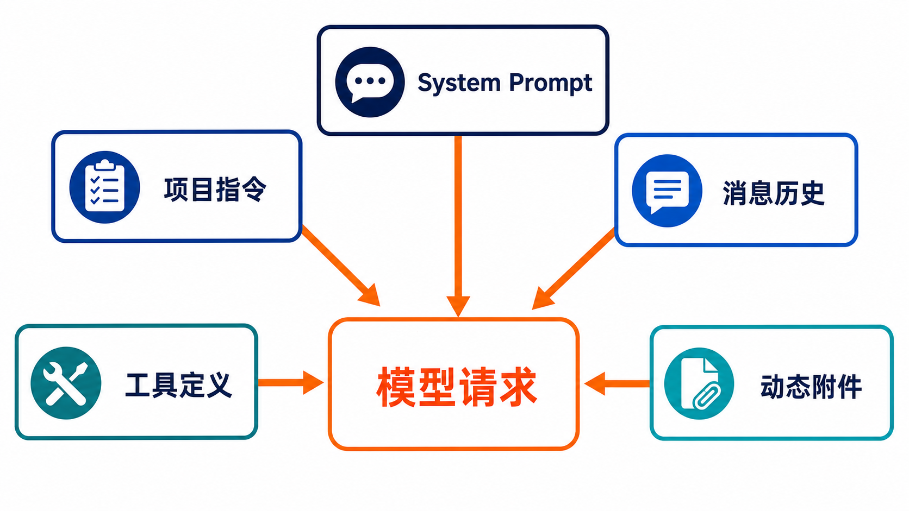
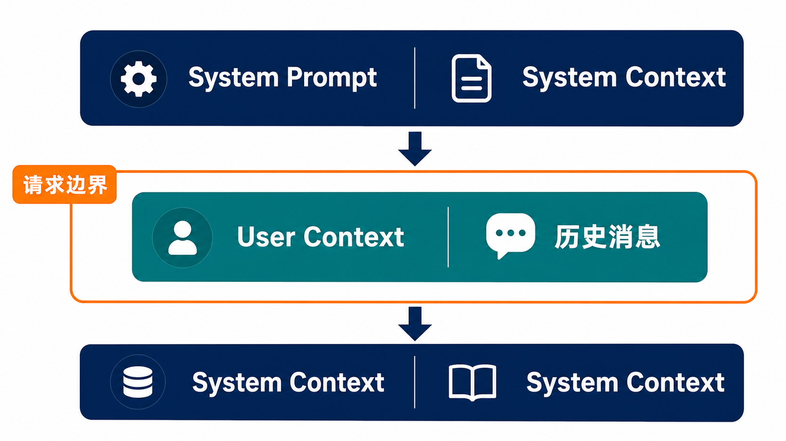
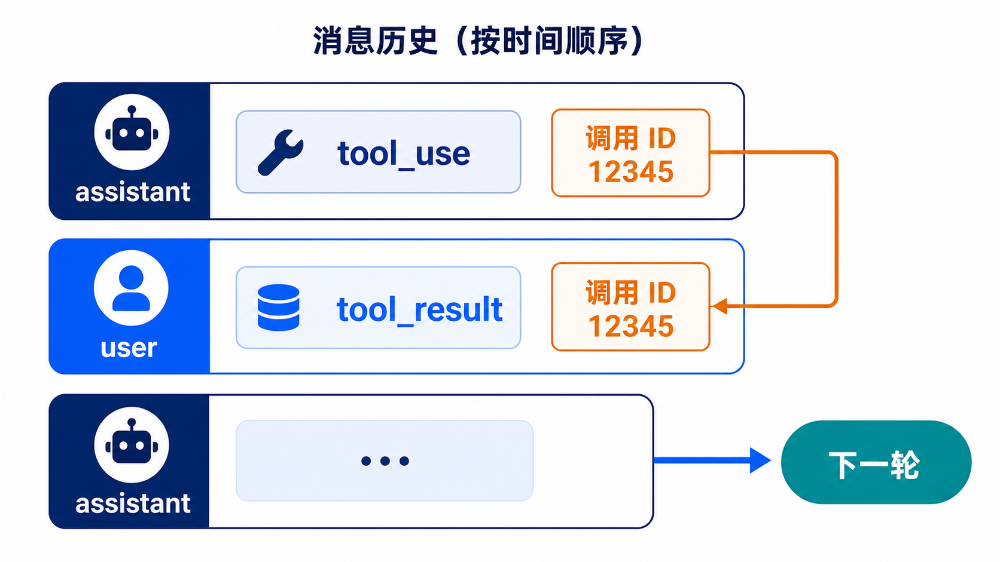
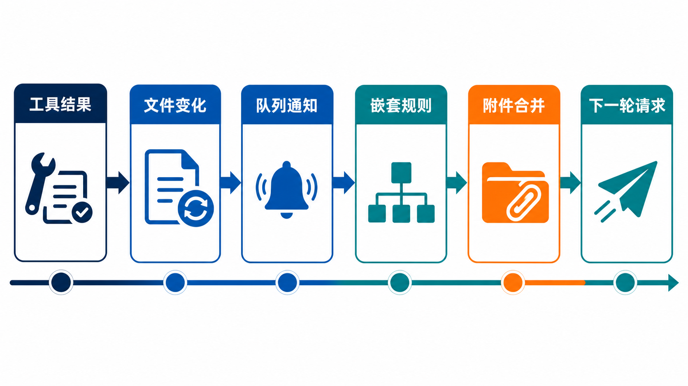

# 用户消息、附件、文件状态和工具结果如何组成上下文？

很多 Agent 教程把模型请求写成两行：

```typescript
messages.push(userMessage)
await model.generate(messages)
```

真正的 Coding Agent 却不能只把聊天记录发给模型。

它还需要知道项目规则、当前环境、可用工具、刚刚读取的文件、修改后的状态、后台任务通知，以及工具到底成功还是失败。少一项，模型可能重复读取；顺序错了，工具调用和结果会失配；全部永久保存，上下文又会迅速膨胀。

Claude Code 的做法，是把不同信息放进不同通道，在模型请求前再合并：System Prompt 定义运行策略，用户上下文提供项目规则，消息历史记录对话与行动，工具定义描述能力，动态附件补充本轮新发生的环境变化。

**上下文工程的重点不是“把更多信息塞给模型”，而是决定每类事实以什么身份、在什么时机、保持多久进入请求。**

## 一个模型请求里究竟有哪些东西？

从 Agent Runtime 的角度看，一次请求至少有五类输入。

第一类是 `systemPrompt`，用于描述身份、行为边界、工具方法和环境。

第二类是 `userContext`，其中包括项目指令、日期等由运行时提供但与用户作用域相关的信息。

第三类是 `messages`，它是按时间排列的用户输入、助手内容、工具调用与工具结果。

第四类是 `tools`，每个工具包含名称、描述和输入 Schema，让模型知道自己能做什么。

第五类是动态附件，例如新加载的嵌套规则、文件变化、后台任务完成通知和 Skill 发现结果。

核心调用经过裁剪后如下：

```typescript
// 裁剪后的核心代码
for await (const message of callModel({
  messages: prependUserContext(
    messagesForQuery,
    userContext,
  ),
  systemPrompt: fullSystemPrompt,
  tools: toolUseContext.options.tools,
  signal: toolUseContext.abortController.signal,
  options: {
    model: currentModel,
    mcpTools: appState.mcp.tools,
    agents: activeAgents,
  },
})) {
  // 消费模型流
}
```

这里没有一个叫 `context` 的万能字符串。不同来源保持结构化，直到 API 边界才被组合。

这让运行时可以分别压缩消息、缓存 System Prompt、刷新工具列表或去重附件，而不用每次重新处理一大段混合文本。



## System Context 和 User Context 有什么区别？

恢复源码中，`systemContext` 与 `userContext` 走两条不同路径。

`systemContext` 会追加到 System Prompt：

```typescript
// 裁剪后的核心代码
export function appendSystemContext(
  systemPrompt,
  context,
) {
  return [
    ...systemPrompt,
    Object.entries(context)
      .map(([key, value]) => `${key}: ${value}`)
      .join('\n'),
  ].filter(Boolean)
}
```

`userContext` 会被包装为元消息，放在历史消息之前：

```typescript
// 裁剪后的核心代码
export function prependUserContext(messages, context) {
  if (Object.keys(context).length === 0) return messages

  return [
    createUserMessage({
      content: renderSystemReminder(context),
      isMeta: true,
    }),
    ...messages,
  ]
}
```

为什么要分开？

`systemContext` 更接近运行时环境和系统侧控制信息，例如会话开始时的 Git 状态快照；`userContext` 包含用户与项目作用域的指令，例如 `CLAUDE.md`。把来源分开，有利于缓存、统计和子 Agent 的继承控制。

不过，这不是通用标准里的固定定义，而是该运行时的建模方式。自己的系统可以用不同名称，但最好保留“谁提供、作用域是什么、是否可被调用方覆盖”这些元信息。

当上下文只有一个 `Record<string, string>` 时，后续很难回答某字段是否安全传给子 Agent，也很难决定压缩时应保留还是重算。

## 消息历史为什么同时是对话和行动日志？

Coding Agent 的 `messages` 不只包含“用户说了什么、助手回答什么”。

一次工具行动通常占据两侧：

```latex
assistant: tool_use(id=tool_1, name=Read, input=...)
user:      tool_result(tool_use_id=tool_1, content=...)
```

`tool_use` 表示模型决定采取行动，`tool_result` 表示外部世界返回观察。两者通过 ID 严格配对。

为什么工具结果使用 `user` 角色？

它不是在假装真人说话，而是在协议中表达“来自助手之外的外部输入”。下一轮模型看到的因果关系是：我请求了一个工具，环境随后返回了这个结果。

Claude Code 在一轮末尾按固定顺序构造下一状态：

```typescript
// 裁剪后的核心代码
const next: State = {
  messages: [
    ...messagesForQuery,
    ...assistantMessages,
    ...toolResults,
  ],
  toolUseContext: updatedToolUseContext,
  turnCount: turnCount + 1,
  transition: { reason: 'next_turn' },
}
```

这个顺序是协议不变量：

1. 先有进入本轮的历史；
2. 再有模型产生的助手消息；
3. 最后是这些行动对应的工具结果。

如果在工具结果之间插入一条普通用户消息，某些 API 会拒绝这种结构。用户在工具执行期间追加的新要求，通常应进入队列，在安全边界处转换为附件或留到下一次提交，而不是随意穿插。



## 附件和普通消息到底差在哪里？

“附件”在这里不只表示图片或文件上传。它是一类运行时消息，用来承载模型下一步需要知道、但并非用户自然语言对话的事件。

例如：

- 某个文件刚刚被编辑；
- 新的嵌套 `CLAUDE.md` 已经加载；
- 后台任务已经完成；
- 达到了最大轮数；
- 工具 Hook 阻止继续；
- Skill 或 MCP 能力列表发生变化。

为什么不把所有东西都变成字符串工具结果？

因为来源和生命周期不同。工具结果必须与某个 `tool_use_id` 配对；文件变化通知可能来自多次工具共同作用；后台任务完成可能发生在另一轮；嵌套规则是上下文补充，而不是工具业务输出。

保留附件类型，运行时可以决定：

- 是否向用户展示；
- 是否写入 transcript；
- 是否发送给模型；
- 压缩后是否重新生成；
- SDK 是否需要收到它。

对自己的 Agent，可以定义一个明确联合类型：

```typescript
// 教学示例
type RuntimeAttachment =
  | { type: 'file_changed'; path: string }
  | { type: 'instruction_loaded'; path: string; content: string }
  | { type: 'task_notification'; taskId: string; result: string }
  | { type: 'limit_reached'; limit: string }
```

不要只用 `{ type: string; data: any }`。类型越松散，越容易把仅供 UI 的内部字段意外发给模型。

## 文件状态为什么不能只存在于模型上下文？

模型读过一个文件，不代表磁盘文件永远保持原样。

外部编辑器可能修改它，Agent 自己的工具也可能重写它；上下文里保留的旧内容会逐渐变成陈旧快照。

Claude Code 使用 `readFileState` 缓存已经读取的文件状态。它不只是为了少读一次磁盘，还服务于几个运行时判断：

- 编辑前是否真的读过完整文件；
- 文件自上次读取后是否变化；
- 哪些文件状态需要在压缩后恢复；
- 已注入的规则文件是否需要去重；
- 工具是否只能看到一个截断或局部视图。

这说明“模型记得文件”和“运行时知道文件状态”是两回事。

模型上下文擅长语义推理，却不是可靠的一致性存储。文件修改前仍应由工具层核对路径、版本、时间戳或内容哈希。

一个更稳健的文件工具接口可以包含：

```typescript
// 教学示例
type ReadSnapshot = {
  path: string
  contentHash: string
  readAt: number
  isPartialView: boolean
}

type EditRequest = {
  path: string
  expectedHash?: string
  patch: string
}
```

当 `expectedHash` 与当前磁盘不一致时，工具返回冲突，让 Agent 重新读取，而不是拿旧上下文覆盖新修改。



## 动态附件为什么要在工具执行后、下一轮之前合并？

一轮工具执行完成后，环境可能发生多个变化：文件被修改、后台命令结束、某个深层目录规则被触发、用户在运行期间排队了新提示。

Claude Code 在准备下一轮状态之前调用附件收集器：

```typescript
// 裁剪后的核心代码
for await (const attachment of getAttachmentMessages(
  null,
  updatedToolUseContext,
  null,
  queuedCommandsSnapshot,
  [
    ...messagesForQuery,
    ...assistantMessages,
    ...toolResults,
  ],
  querySource,
)) {
  yield attachment
  toolResults.push(attachment)
}
```

为什么这个位置合适？

工具执行前，这些变化还没有发生；下一次模型请求发出后再收集，又会晚一轮。放在两轮之间，附件可以与工具结果一起成为下一轮的新观察。

这也是事件驱动 Agent 的一个通用扩展点。所有“本轮结束后才知道、下一轮开始前必须知道”的信息，都可以在这个阶段汇总。

不过，汇总器不能无限等待。某些预取任务如果还没完成，源码选择零等待跳过，下一轮再尝试消费。否则一个用于优化相关性的后台任务，反而会卡住主 Agent。

## 上下文里为什么不能保留一切？

把所有 System Prompt、项目规则、完整文件内容、每次工具输出和全部通知永久放进历史，看上去信息最完整，实际很快遇到三个问题。

第一是 token 成本。工具输出和文件内容通常远大于用户问题。

第二是注意力竞争。旧日志、重复规则和过期文件会稀释当前任务真正需要的信息。

第三是状态矛盾。模型可能同时看到同一文件修改前后的完整内容，却不清楚哪份是当前事实。

所以不同上下文需要不同保留策略：

| 上下文类型 | 典型策略 |
| --- | --- |
| 基础 System Prompt | 稳定前缀、缓存 |
| 项目规则 | 启动加载与按需注入、去重 |
| 消息历史 | 保序，必要时压缩 |
| 工具定义 | 按当前可用能力刷新 |
| 文件内容 | 快照与变化检测 |
| 动态附件 | 事件化、选择性重建 |

上下文管理不是做一个越来越大的数组，而是管理多种生命周期。

### 当上下文预算有限时，应该优先保留谁？

不能只按“越新越重要”排序。

用户当前目标、不可违反的约束和未完成工具调用属于高优先级；最近工具结果通常决定下一步，也应保留。很早以前的一大段搜索结果可能已经被后续文件读取替代，可以裁剪；重复的项目规则如果仍在有效上下文中，只需保留一次。

可以给不同内容设置保留等级：

```typescript
// 教学示例
type Retention =
  | 'pinned'      // 目标、安全约束、协议边界
  | 'working'     // 近期消息、当前工具结果
  | 'recoverable' // 可重新读取的文件和搜索结果
  | 'ephemeral'   // 进度、重复通知
```

压缩时先处理 `ephemeral`，再把 `recoverable` 替换为引用或摘要；`working` 尽量保留近期窗口；`pinned` 则应进入摘要和结构化检查点。

这套等级不能只由消息类型决定。同样是工具结果，删除命令的确认比一次目录列表更重要；同样是用户消息，最初目标可能比中途寒暄更重要。工具和业务层最好共同提供保留提示。

### 怎样知道模型在某一轮究竟看到了什么？

只保存 transcript 不够。Transcript 记录会话发生过什么，却不一定等于某次 API 请求的真实输入：运行时可能裁剪工具结果、注入临时附件、刷新工具 Schema，也可能把 System Prompt 分成缓存块。

生产环境可以为每次采样记录一份“上下文清单”：

```typescript
// 教学示例
type ContextManifest = {
  requestId: string
  systemSectionIds: string[]
  messageIds: string[]
  attachmentIds: string[]
  toolSchemaHashes: Record<string, string>
  estimatedTokens: number
}
```

清单不必复制敏感全文。片段 ID、内容哈希、来源和 token 估算通常足以回答：某条规则是否已注入、某个工具是否对模型可见、某份文件内容是否已经被压缩。

调试 Agent 行为时，这比只查看最终回答更有效。模型“忘记规则”可能是推理问题，也可能是规则根本没进入这一轮；模型“乱调用工具”可能是 Schema 错误，也可能是旧 Prompt 仍声称工具可用。

上下文清单把这些可能性从猜测变成可核对事实。

### 敏感内容进入上下文前，还要经过什么边界？

模型请求可能离开本机，因此“工具有权读取”不自动等于“内容可以发送给模型”。

环境变量、密钥文件、私有证书、客户数据和未公开日志都可能被搜索工具命中。如果运行时把所有结果原样回填，权限控制只保护了文件读取动作，却没有保护数据外发。

上下文管线可以增加单独的数据策略：

```typescript
// 教学示例
type ContextPolicyDecision =
  | { action: 'allow' }
  | { action: 'redact'; fields: string[] }
  | { action: 'summarize-locally' }
  | { action: 'deny'; reason: string }
```

其中，脱敏结果要明确告诉模型哪些字段被隐藏，避免它把占位符当成真实值；本地摘要适合只需结构、不需原文的日志；完全拒绝时也要形成工具结果，让 Agent 改用其他方案。

观测日志本身同样要谨慎。上下文清单可以保存 ID、哈希和大小，而不保存敏感全文；调试模式若允许抓取完整 Prompt，应有单独授权、短期保留和访问审计。

上下文工程的安全边界不是最后一次字符串拼接，而是从信息被工具发现，到它进入模型、日志和持久化的完整数据流。



## 自己开发 Agent，怎样设计一条清晰的上下文管线？

可以把请求组装拆成四个阶段。

第一阶段，选择稳定策略：

```latex
System Prompt + 当前 Agent 定义 + 工具 Schema
```

第二阶段，获取会话级上下文：

```latex
项目指令 + 工作区环境 + 会话配置
```

第三阶段，整理有序历史：

```latex
用户消息 + assistant/tool_use + tool_result
```

第四阶段，消费本轮动态事件：

```latex
文件变化 + 任务通知 + 延迟加载规则
```

然后为每类信息回答四个问题：

1. 谁生产它？
2. 什么时候进入请求？
3. 保留到什么时候？
4. 压缩或恢复后怎样重建？

回到开头：用户消息、附件、文件状态和工具结果是怎样组成上下文的？

它们不是被平铺到一个字符串里。Claude Code 让策略、项目规则、对话行动、能力描述和动态事件保持各自的结构，再在每次模型请求前按协议顺序组合；模型上下文负责理解，运行时缓存和文件状态负责一致性。

可以记住三条：

1. **消息历史记录因果，工具调用和结果必须配对。**
2. **附件记录运行时事件，不必伪装成普通对话。**
3. **文件当前状态由工具层确认，不能只相信模型记忆。**

如果想检验自己的上下文管线，可以记录一次“读取文件—外部修改—再次编辑”的完整请求。确认模型收到变化通知，编辑工具又能检测旧快照冲突。只有语义上下文与运行时事实同时一致，Agent 才不会自信地修改一个已经不存在的世界。
