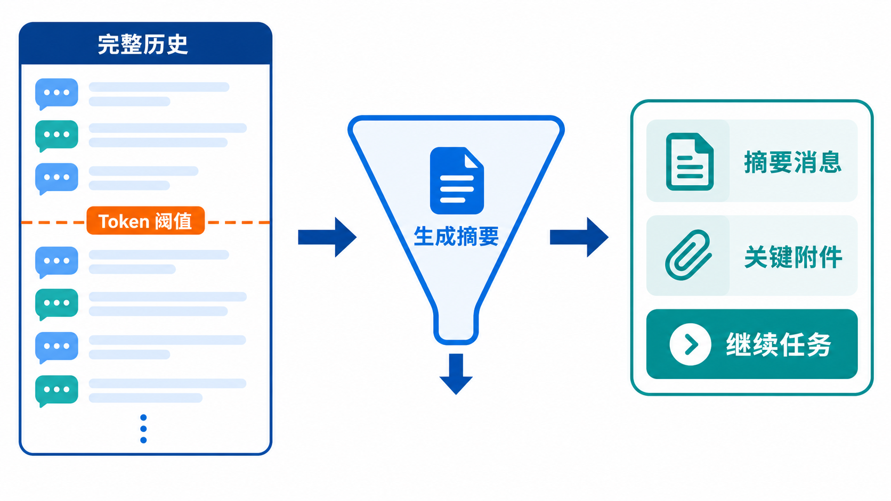
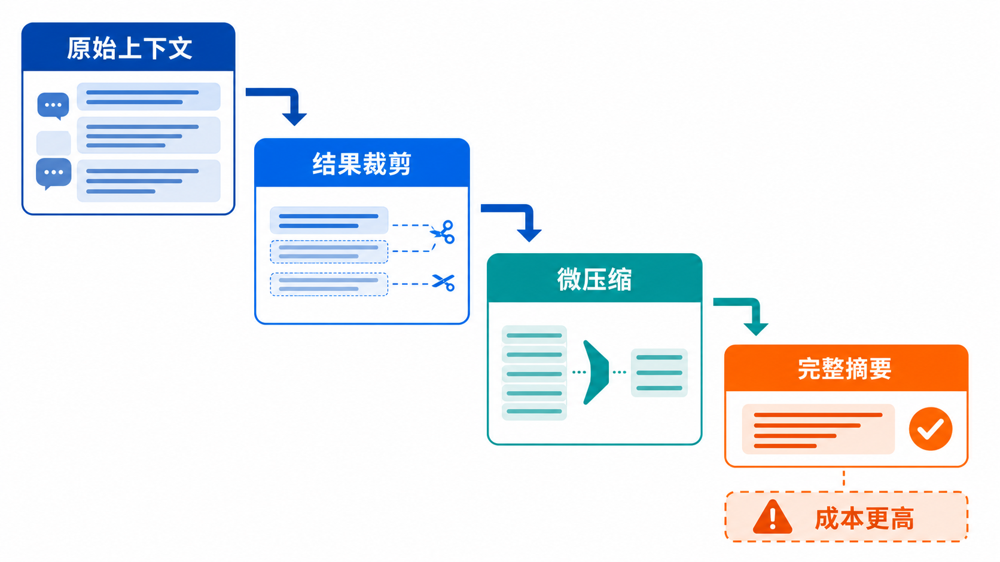
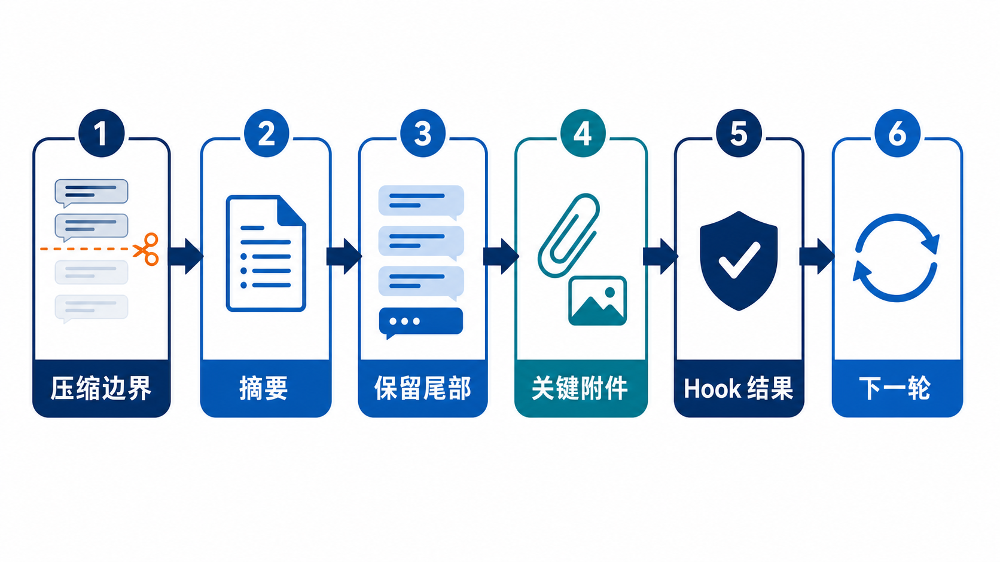
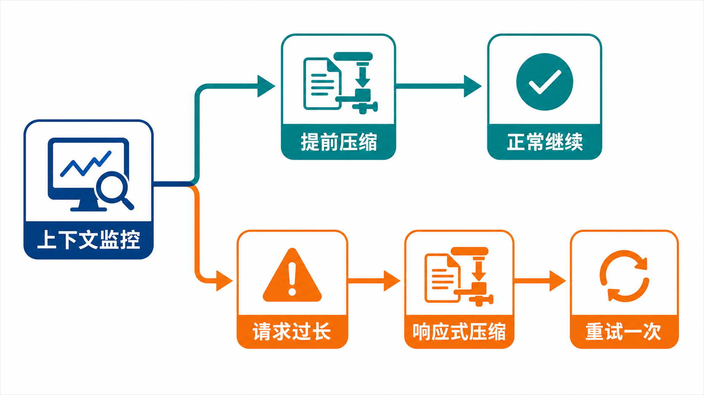

# 上下文快满时，Claude Code 如何压缩历史并继续工作？

Agent 跑得越久，消息历史越长。

搜索结果、完整文件、命令输出、工具错误和多轮解释会不断进入上下文。等窗口快满时，最简单的处理是删掉最旧消息；但那里面可能有用户最初目标、已经做过的修改和不能违反的约束。

另一种做法是把整段历史总结成几句话。上下文确实变短了，可模型也可能忘记当前文件状态、正在执行的计划、已经加载的工具和后台任务。

Claude Code 没有把压缩当作一次字符串摘要。它先尝试更便宜的局部裁剪，达到阈值时再生成完整摘要，同时重新注入下一轮仍然需要的附件、计划和工具状态；如果请求已经被 API 判定过长，还准备了响应式恢复路径。

**上下文压缩不是把历史变短，而是把“完整事件日志”转换成“足够继续任务的工作状态”。**

## 为什么直接删除旧消息会破坏 Agent Loop？

普通聊天里，删掉几轮寒暄可能影响不大。工具型 Agent 的历史却有严格结构。

例如：

```latex
assistant: tool_use(id=1, Edit, ...)
user:      tool_result(tool_use_id=1, 修改成功)
assistant: tool_use(id=2, Bash, ...)
user:      tool_result(tool_use_id=2, 测试失败)
```

如果从中间切一刀，可能只留下 `tool_result`，却删掉它对应的 `tool_use`；也可能留下助手消息作为第一条，而模型 API 要求消息序列从用户侧开始。

更重要的是，旧历史包含三种不同价值：

- 可以丢弃的细节，例如很早以前的冗长搜索输出；
- 必须语义保留的任务状态，例如已经完成什么、下一步是什么；
- 必须结构保留的近期消息，例如正在进行的工具调用和结果。

所以压缩器不能只按 token 从头删。它必须理解消息分组、工具配对和“近期尾部”。

对自己的 Agent，至少应该先建立一个消息不变量检查器：

```typescript
// 教学伪代码
function validateHistory(messages: Message[]) {
  assert(firstApiMessage(messages).role === 'user')
  assertEveryToolUseHasResult(messages)
  assertNoResultAppearsBeforeItsCall(messages)
}
```

每种压缩策略输出后都运行它。否则上下文是变短了，下一次请求却可能无法发送。



## 为什么先做局部压缩，再做完整摘要？

生成完整摘要本身要再调用一次模型，既消耗时间，也会丢失细粒度历史。若只是某几个巨大工具结果占满窗口，直接总结整段会话并不划算。

Claude Code 的查询循环在自动压缩前，先经过多种轻量处理。抽象后可以看成：

```latex
工具结果预算
    ↓
历史片段裁剪
    ↓
微压缩
    ↓
上下文折叠
    ↓
完整自动摘要
```

恢复源码中可以看到顺序：

```typescript
// 裁剪后的核心代码
messagesForQuery = await applyToolResultBudget(
  messagesForQuery,
  contentReplacementState,
)

const microcompactResult = await microcompact(
  messagesForQuery,
  toolUseContext,
  querySource,
)
messagesForQuery = microcompactResult.messages

const { compactionResult } = await autocompact(
  messagesForQuery,
  toolUseContext,
  cacheSafeParams,
  querySource,
)
```

分级压缩背后的原则是：**先移除低价值的大块内容，尽量保留可回放的细粒度历史；只有仍然超阈值时，才用摘要替换长链条。**

这个思想和数据库存储分层很像。不是所有旧数据都立刻归档，先清理缓存和临时结果，再处理主记录。

局部裁剪也有边界。如果工具结果中的某一行错误恰好决定下一步，机械截断可能损失关键信息。工具最好提供结构化摘要或可重新获取的引用，而不是让通用压缩器猜哪一段重要。

## 自动压缩在什么时机触发？

Claude Code 会先计算模型的有效上下文窗口，并为压缩摘要的输出预留空间。自动压缩阈值还会再留出缓冲。

裁剪后的逻辑大致如下：

```typescript
// 裁剪后的核心代码
export function getEffectiveContextWindowSize(model: string) {
  const reserved = Math.min(
    getMaxOutputTokensForModel(model),
    MAX_OUTPUT_TOKENS_FOR_SUMMARY,
  )

  return getContextWindowForModel(model) - reserved
}

export function getAutoCompactThreshold(model: string) {
  return (
    getEffectiveContextWindowSize(model) -
    AUTOCOMPACT_BUFFER_TOKENS
  )
}
```

为什么不能等可用窗口耗尽再摘要？

因为摘要请求也需要输入原历史，并且要留出模型生成摘要的空间。若当前请求已经无处容纳输出，压缩器自己也可能启动不了。

所以生产级上下文管理应该保留“逃生空间”。这和磁盘不能写到完全零剩余、数据库日志不能等满盘才清理是同一个道理。

阈值也不应该只看消息数组粗略长度。System Prompt、工具 Schema 和用户上下文同样占 token；工具结果经过局部裁剪后，旧的 usage 统计还可能暂时反映裁剪前大小。源码为这些差异保留了估算和修正路径。

自己的实现可以先简单，但要把误差方向设为保守：宁可略早压缩，也不要晚到压缩请求本身无法发送。



## 完整压缩怎样生成摘要？

完整压缩不是在原 Agent Loop 内让主模型随口总结。运行时构造专用摘要请求，用当前消息和压缩指令启动一次独立采样。

核心流程经过裁剪后如下：

```typescript
// 裁剪后的核心代码
const summaryRequest = createUserMessage({
  content: getCompactPrompt(customInstructions),
})

const summaryResponse = await streamCompactSummary({
  messages: messagesToSummarize,
  summaryRequest,
  context,
  cacheSafeParams,
})

const summary = getAssistantMessageText(summaryResponse)
if (!summary) {
  throw new Error('Failed to generate conversation summary')
}
```

摘要 Prompt 需要模型保留可继续工作的状态，而不是写一篇“此前对话概述”。好的压缩摘要通常应包含：

- 用户目标和明确约束；
- 已经完成的修改；
- 关键文件、函数和路径；
- 测试或命令结果；
- 尚未解决的问题；
- 当前计划和下一步；
- 不能重复的失败尝试。

如果只写“用户希望修复登录问题，助手正在处理”，token 很省，却无法继续。

这也是为什么通用文本摘要模型并不等于 Agent 状态压缩器。后者要了解任务执行所需字段，并尽量用可验证事实表达。

## 压缩后为什么还要恢复附件和运行状态？

摘要只能保留语义，无法自然恢复所有结构化运行状态。

例如，压缩前模型可能已经：

- 读取过若干文件；
- 进入 Plan Mode；
- 启动后台 Agent；
- 调用过某个 Skill；
- 动态加载了工具 Schema；
- 收到 MCP 服务器的指令。

如果只留下摘要，下一轮可能重复读取大量文件，忘记当前模式，或者不再知道已发现的工具。

因此，完整压缩成功后会并行生成需要恢复的附件：

```typescript
// 裁剪后的核心代码
const [fileAttachments, asyncAgentAttachments] =
  await Promise.all([
    createPostCompactFileAttachments(
      preCompactReadFileState,
      context,
      maxFilesToRestore,
    ),
    createAsyncAgentAttachmentsIfNeeded(context),
  ])

const postCompactAttachments = [
  ...fileAttachments,
  ...asyncAgentAttachments,
  createPlanAttachmentIfNeeded(context.agentId),
  createSkillAttachmentIfNeeded(context.agentId),
].filter(Boolean)
```

这说明压缩结果不是一个字符串，而是一个结构：

```typescript
// 裁剪后的核心类型
interface CompactionResult {
  boundaryMarker: SystemMessage
  summaryMessages: UserMessage[]
  messagesToKeep?: Message[]
  attachments: AttachmentMessage[]
  hookResults: HookResultMessage[]
}
```

**摘要负责“记住发生过什么”，附件负责“恢复现在还能做什么和环境处于什么状态”。**



## 压缩后的消息为什么有固定顺序？

恢复源码用一个专门函数构造压缩后的基础消息：

```typescript
// 裁剪后的核心代码
export function buildPostCompactMessages(result) {
  return [
    result.boundaryMarker,
    ...result.summaryMessages,
    ...(result.messagesToKeep ?? []),
    ...result.attachments,
    ...result.hookResults,
  ]
}
```

各部分职责不同：

1. `boundaryMarker` 标识逻辑历史在这里发生了压缩；
2. `summaryMessages` 提供旧历史的语义状态；
3. `messagesToKeep` 保留不应被摘要吞掉的近期片段；
4. `attachments` 恢复文件、计划和扩展状态；
5. `hookResults` 恢复压缩生命周期产生的附加信息。

边界标记尤其重要。它不只是给 UI 显示“对话已压缩”，还让查询循环知道下一次只应使用边界之后的消息，也让会话恢复逻辑能够剪掉旧历史。

如果没有边界，内存中的历史可能已经缩短，磁盘 transcript 却仍加载全部旧消息；下一次恢复后，压缩像从未发生，窗口立即再次爆满。

因此，压缩是一个跨内存与持久化的状态转换，而不只是当前请求前的临时过滤。

## 提前压缩失败后，为什么还需要响应式压缩？

任何 token 估算都可能不准确。

System Prompt、工具定义、图片和服务端计数都会影响真实请求大小。即使客户端认为还没到阈值，API 仍可能返回“请求过长”。

Claude Code 准备了两条路径：

- 主动路径：请求前检测阈值，提前压缩；
- 响应式路径：真实请求被判定过长后，压缩并重试。

响应式路径经过裁剪后可以表示为：

```typescript
// 裁剪后的核心代码
if (isPromptTooLong(lastMessage)) {
  const compacted = await tryReactiveCompact({
    hasAttempted: hasAttemptedReactiveCompact,
    messages: messagesForQuery,
    cacheSafeParams,
  })

  if (compacted) {
    state = {
      messages: buildPostCompactMessages(compacted),
      hasAttemptedReactiveCompact: true,
      transition: {
        reason: 'reactive_compact_retry',
      },
    }
    continue
  }
}
```

关键是 `hasAttemptedReactiveCompact`。没有单次保护，可能出现：

```latex
请求过长 → 压缩 → 仍然过长 → 再压缩 → 再重试……
```

系统不断消耗 API 调用，却永远无法前进。

因此，恢复策略必须带熔断：一次响应式压缩后仍失败，就把真实错误返回，而不是无限自救。



## 压缩会丢信息，怎么判断是否值得？

压缩从来不是无损操作。即使摘要质量很好，也可能丢掉：

- 某次失败命令的精确参数；
- 一个文件中的具体行号；
- 用户早期措辞中的隐含偏好；
- 模型此前为什么排除某种方案；
- 工具输出中的边缘异常。

所以完整摘要应该尽量晚于局部清理，但又要早于硬窗口。

可以用三个问题判断压缩策略：

第一，丢掉的信息能否通过工具重新获得？完整文件可以重读，用户原始需求却不一定能重建。

第二，保留的信息是否足以作出下一步决策？摘要不需要复述一切，但必须支持继续。

第三，压缩后是否恢复了协议和运行状态？工具配对、计划模式、文件快照和后台任务不能只靠自然语言猜测。

对高风险任务，还可以在压缩前生成结构化检查点：

```typescript
// 教学示例
type AgentCheckpoint = {
  objective: string
  constraints: string[]
  completedSteps: string[]
  openQuestions: string[]
  touchedFiles: Array<{
    path: string
    contentHash: string
  }>
  nextAction: string
}
```

自然语言摘要帮助模型理解，结构化检查点帮助运行时验证，两者并不冲突。

### 怎样评估一次压缩摘要是否合格？

不能只看摘要变短了多少。压缩率很高但任务无法继续，没有实际价值。

可以准备一组“压缩后可回答问题”：

- 用户最终要完成什么？
- 有哪些不能违反的约束？
- 哪些文件已经修改，修改目的是什么？
- 最近一次测试为什么失败？
- 哪些方案已经尝试并排除？
- 下一步应该执行什么？

在压缩前，从原历史中生成标准答案；压缩后只给评估器摘要、保留尾部和恢复附件，看它能否回答。再增加一组行动测试：让 Agent 从压缩状态继续一轮，观察是否重复大范围搜索、是否误改已完成内容、是否忘记运行必要测试。

指标可以分成四类：

```latex
压缩率：减少了多少 token
任务保真：目标和约束是否保留
状态保真：文件、计划、工具状态是否接续
继续成本：压缩后为恢复信息又调用了多少工具
```

只优化压缩率，往往会把成本转移到后续重复读取。好的压缩是在整体任务成本下做平衡。

摘要还要防止把不确定事实写成确定结论。工具执行中断时，应保留“结果未知”，而不是擅自总结为成功或失败。

## 自己实现上下文压缩，应该按什么顺序？

不要从“让模型总结全部历史”开始。更稳妥的顺序是：

1. 给工具结果设置单条大小预算；
2. 用引用替代可重新获取的大块内容；
3. 保证裁剪后工具调用与结果仍成对；
4. 达到安全阈值时生成任务状态摘要；
5. 保留近期未完成的消息尾部；
6. 重建文件、计划、工具和后台任务状态；
7. 记录压缩边界并更新持久化；
8. 为真实溢出准备一次性响应式恢复。

### 压缩后的第一轮为什么值得单独观察？

压缩后第一轮是最容易暴露问题的地方。

模型刚失去完整历史，只能依赖摘要、保留尾部和恢复附件。如果摘要遗漏下一步，它会重新规划；如果文件快照没恢复，它会重复读取；如果工具发现状态丢失，它可能调用一个没有 Schema 的工具。

因此，运行时可以为“压缩后第一轮”记录专门指标：

- 立即再次触发压缩，说明重建后的上下文仍然太大；
- 大量重复 Read/Search，说明状态恢复不足；
- 用户纠正“你刚才已经做过”，说明任务摘要遗漏；
- 工具调用配对错误，说明消息重建顺序有问题；
- Prompt 缓存骤降，说明动态内容被放进稳定前缀。

这不意味着要给模型一套完全不同的行为规则。Agent Loop 应继续走同一条路径，只在观测层标记这是压缩后的第几轮。

保持同一运行路径很重要。若压缩后进入一套特殊循环，普通路径中的权限、中断和工具配对修复很容易漏掉，最终产生两个行为逐渐分叉的 Runtime。

### 压缩服务自己出错时，主会话应该怎么办？

压缩需要额外模型调用，因此也会遇到超时、限流、空摘要和请求过长。不能假设“救火工具”永远成功。

首先，压缩失败不应破坏原消息数组。只有摘要、恢复附件和边界标记都准备完成后，才能原子地把会话切换到新状态。中途失败时继续保留旧历史，并返回明确错误。

其次，自动压缩可以有限重试，但必须有失败计数和熔断。连续多轮在同一阈值失败，继续每轮调用压缩模型只会增加费用；达到上限后，应停止自动尝试并提示用户缩小任务或手动处理。

最后，压缩请求本身过长时，可以按合法消息组从头裁掉最旧部分，再尝试生成摘要，但仍要保证第一条 API 消息角色正确、工具调用结果配对。这个降级会损失更多历史，应该在结果中留下诊断信息。

可以把提交过程理解为两阶段：

```latex
准备：生成摘要 + 恢复附件 + 校验新历史
提交：写入压缩边界 + 切换内存状态
```

压缩不是一个纯函数调用，而是会话状态迁移。用事务思维处理它，才能避免出现“旧历史已删、摘要却没有成功”的不可恢复状态。

回到开头：Claude Code 在上下文快满时，为什么还能继续工作？

因为它没有把压缩理解成删除旧聊天。运行时先做局部瘦身，再在安全阈值前生成任务摘要；压缩后按固定顺序重建边界、摘要、近期消息和关键附件，最后带着新的状态回到原来的 Agent Loop。若估算失误，还能在真实溢出后压缩并有限重试。

最值得迁移的三点是：

1. **先压缩低价值载荷，再压缩任务历史。**
2. **摘要和运行状态必须分别恢复。**
3. **所有恢复路径都要有单次保护与失败出口。**

可以用一个破坏性测试验证实现：让 Agent 读取多个大文件、修改其中一个、运行失败测试，然后触发压缩。压缩后询问它当前目标、修改过的文件、测试错误和下一步。如果回答正确，再让编辑工具校验磁盘哈希。语义和真实文件状态都能接上，压缩才算成功。
