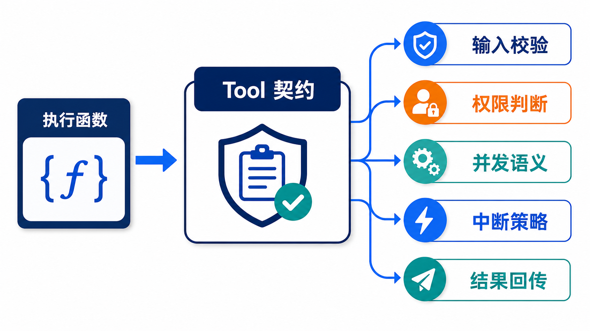
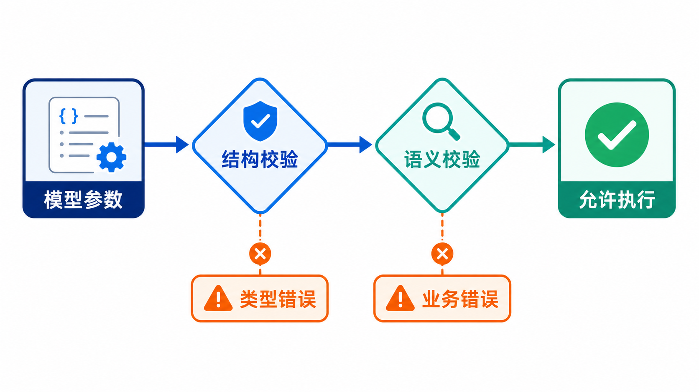
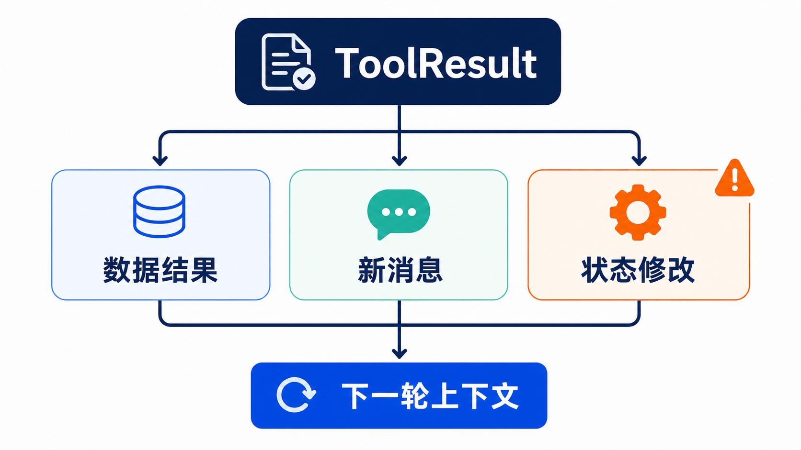
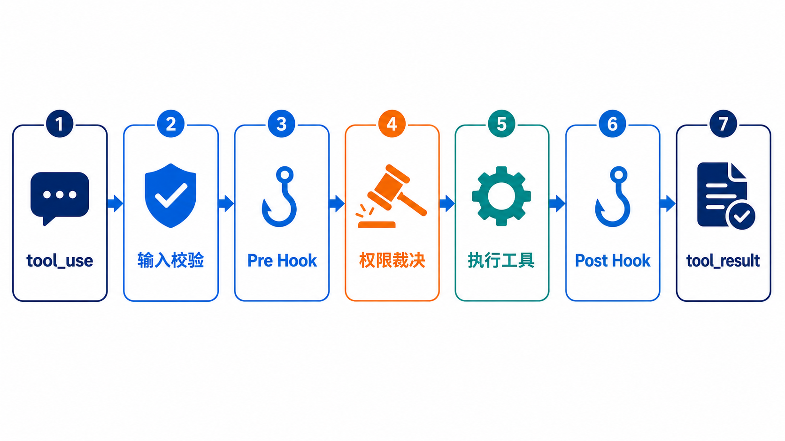

# Claude Code 的 Tool 接口为什么不只是一个函数？

假设你正在写一个最小 Agent，工具大概会被定义成这样：

```typescript
const tools = {
  readFile: async ({ path }) => fs.readFile(path, 'utf8'),
  runShell: async ({ command }) => exec(command),
}
```

这当然能跑。模型给出工具名和参数，程序查表、调用函数、把结果塞回消息列表，一个演示版 Agent 就完成了。

可一旦它真的开始帮用户改代码，问题会连续冒出来：参数不合法怎么办？哪些调用可以并发？执行前是否需要确认？怎样中断正在运行的命令？如何把结果转换成模型协议？终端里又该展示什么？

如果这些能力全堆到 Agent Loop 里，循环很快就会变成一个巨大的条件分支。

Claude Code 的做法，是把 Tool 设计成一份完整的**运行时契约**。真正值得我们学习的，不是它有多少工具，而是它如何让每个工具自己描述能力、风险和生命周期。

## 一个函数为什么扛不住真实 Agent？

先说结论：**函数只描述“怎么执行”，Tool 契约还必须描述“能否执行、何时执行、怎样观察、如何回传”。**

想象模型生成了一次文件写入。执行函数可能只有十几行，但运行时至少需要回答下面这些问题：

- 输入是不是一个合法的绝对路径？
- 这个路径是否在工作区里？
- 本次调用属于只读、写入，还是不可逆操作？
- 它能否和另外三个读取工具并发？
- 用户此时提交新消息，应该取消还是等待？
- 输出过大时，是截断、落盘，还是完整回传？
- 工具失败后，怎样生成带原调用 ID 的错误结果？

这些都不是函数体内部的“业务逻辑”，而是 Agent Runtime 调度它时所需的元数据。缺少这些信息，调度器只能靠工具名猜行为。

一个很实用的判断是：如果调度器里出现大量 `if (toolName === "...")`，通常意味着本该属于工具契约的信息泄漏到了中心循环。



## Claude Code 把哪些能力放进 Tool？

恢复源码里的 `Tool` 类型很长，但它不是为了炫耀抽象。把界面渲染部分先放到一边，和 Agent 开发最相关的字段可以压缩成下面这份代码。

```typescript
// 根据恢复源码裁剪，省略 UI、遥测和泛型细节
type Tool = {
  name: string
  inputSchema: ZodType
  inputJSONSchema?: JSONSchema

  call(input, context, canUseTool, parentMessage, onProgress?): Promise<ToolResult>
  validateInput?(input, context): Promise<ValidationResult>
  checkPermissions(input, context): Promise<PermissionResult>

  isEnabled(): boolean
  isConcurrencySafe(input): boolean
  isReadOnly(input): boolean
  isDestructive?(input): boolean
  interruptBehavior?(): 'cancel' | 'block'

  prompt(options): Promise<string>
  mapToolResultToToolResultBlockParam(output, toolUseID): ToolResultBlock
  maxResultSizeChars: number
}
```

这里可以看出，Claude Code 把一件工具拆成了五类信息：

| 类别 | 典型成员 | 回答的问题 |
| --- | --- | --- |
| 身份与说明 | `name`、`prompt` | 模型怎样认识它 |
| 输入契约 | `inputSchema`、`validateInput` | 参数是否可解析、是否合理 |
| 安全语义 | `checkPermissions`、`isDestructive` | 本次调用能不能执行 |
| 调度语义 | `isConcurrencySafe`、`interruptBehavior` | 什么时候执行、如何中断 |
| 协议适配 | `mapToolResult...` | 结果怎样回到模型 |

关键点是，`isConcurrencySafe` 等方法接收的是**本次输入**，而不是一个写死的布尔值。同一个 Bash 工具，`pwd` 和修改系统配置的命令风险完全不同；同一个 MCP 工具，也可能根据服务端注解表现为只读或破坏性操作。

因此，工具能力最好由“工具定义 + 本次参数”共同决定，而不是只由工具名称决定。

## 输入 Schema 为什么只是第一道门？

很多框架把 JSON Schema 当成工具安全的全部：模型只要产出符合 Schema 的参数，就立即执行。

但“类型正确”并不等于“操作合理”。`file_path` 是字符串，只能证明它不是数组；它不能证明文件存在，也不能证明路径在允许目录中，更不能证明这不是一个会阻塞进程的设备文件。

Claude Code 的执行链先做结构校验，再调用工具自己的值校验：

```typescript
// 根据恢复源码裁剪
const parsedInput = tool.inputSchema.safeParse(input)
if (!parsedInput.success) {
  return inputValidationError(toolUseID, parsedInput.error)
}

const validation = await tool.validateInput?.(
  parsedInput.data,
  toolUseContext,
)
if (validation?.result === false) {
  return toolError(toolUseID, validation.message)
}
```

这两层分别承担不同责任：

1. `inputSchema` 处理结构：字段、类型、必填项和枚举值。
2. `validateInput` 处理语义：路径、状态、额度、前置条件和领域规则。

这个分层很适合迁移到自己的 Agent。比如数据库工具的 Schema 可以要求 `sql` 是字符串，而 `validateInput` 再检查是否允许多条语句、是否触碰受保护表、事务状态是否有效。

还有一个容易忽视的点：校验失败也必须生成正常的 `tool_result`，而不是直接抛异常退出循环。对模型来说，参数错误也是一次可以观察并纠正的环境反馈。



## ToolUseContext 为什么像一个“能力背包”？

工具执行时不能只拿到参数。它还需要知道当前会话、权限模式、取消信号、工具池、MCP 连接、文件状态和应用状态。

Claude Code 用 `ToolUseContext` 把这些运行时能力集中传入。下面仍然是裁剪后的核心结构：

```typescript
// 根据恢复源码裁剪
type ToolUseContext = {
  options: {
    tools: Tools
    mcpClients: MCPServerConnection[]
    mainLoopModel: string
    isNonInteractiveSession: boolean
    maxBudgetUsd?: number
  }
  abortController: AbortController
  readFileState: FileStateCache
  messages: Message[]

  getAppState(): AppState
  setAppState(update): void
  setInProgressToolUseIDs(update): void
  setResponseLength(update): void
}
```

你可以把它理解成工具运行时的“能力背包”。工具不必从全局变量里到处找依赖，也不必认识 UI 或 Agent Loop，只需要通过上下文使用明确提供的能力。

不过这里有一条边界：上下文不是越大越好。上下文一旦成为什么都能塞的万能容器，工具之间会通过隐含状态耦合，测试也会越来越难。

自己实现时，可以进一步按能力拆成小接口：

```typescript
// 示例设计，不是 Claude Code 原样源码
type ToolRuntime = {
  cancellation: { signal: AbortSignal }
  permission: { mode: PermissionMode }
  state: { get(): SessionState; update(fn): void }
  progress: { report(event): void }
}
```

重点不是复制字段，而是让依赖显式、可替换，并控制工具能触达的权限范围。

## 为什么 ToolResult 也不是一个字符串？

最小实现常把工具输出统一转成字符串，但真实工具会产生更多状态变化。

Claude Code 的结果类型除了 `data`，还允许返回新消息、上下文修改器和 MCP 元数据：

```typescript
// 根据恢复源码裁剪
type ToolResult<T> = {
  data: T
  newMessages?: Message[]
  contextModifier?: (
    context: ToolUseContext,
  ) => ToolUseContext
  mcpMeta?: {
    _meta?: Record<string, unknown>
    structuredContent?: Record<string, unknown>
  }
}
```

`data` 是模型需要看到的执行结果；`newMessages` 允许工具附带新的上下文事件；`contextModifier` 则表达“这次操作不仅返回数据，还改变了后续工具的运行环境”。

例如进入一个新工作树后，后续命令的工作目录可能需要改变。把这种变化作为结果的一部分返回，比让工具偷偷修改全局变量更容易追踪。

但并发会让问题复杂起来。两个工具同时返回上下文修改器，应用顺序可能改变最终状态。因此源码明确限制了并发工具对上下文修改的使用，并在批次完成后按原始调用顺序应用修改。

这暴露出一个通用原则：**数据结果适合并发汇聚，状态修改必须定义顺序。**



## `buildTool` 为什么选择保守默认值？

几十个工具都要实现完整接口，会产生大量样板代码。Claude Code 用 `buildTool` 为一部分方法填默认值：

```typescript
// 根据恢复源码裁剪
const TOOL_DEFAULTS = {
  isEnabled: () => true,
  isConcurrencySafe: () => false,
  isReadOnly: () => false,
  isDestructive: () => false,
  checkPermissions: input =>
    Promise.resolve({ behavior: 'allow', updatedInput: input }),
  toAutoClassifierInput: () => '',
}

function buildTool(def) {
  return {
    ...TOOL_DEFAULTS,
    userFacingName: () => def.name,
    ...def,
  }
}
```

最值得注意的是 `isConcurrencySafe` 和 `isReadOnly` 默认都是 `false`。没有声明安全，就按可能写入、不可并发处理。

这叫“失败时保守”，也就是 fail closed。对于会真实修改环境的 Agent，未知工具被串行执行，代价只是慢一些；未知工具被误判为可并发，代价可能是状态竞争和数据损坏。

不过默认 `checkPermissions` 返回允许，并不代表跳过整个权限系统。注释说明它只是把决定交给通用权限流程，具体调用仍然会经过规则、模式和交互确认。

自己设计 Builder 时，建议把默认值分成两类：

- 便利型默认：名称展示、空进度回调、默认启用。
- 安全型默认：不可并发、非只读、需要权限、可取消性未知。

只要默认值会影响副作用，就应该选择更保守的方向。

## 从模型调用到真实执行，Tool 经历了什么？

现在把整个过程串起来。一段工具调用不会直接进入 `call()`，而会经过一条逐层收窄的管道：

```latex
模型产生 tool_use
    ↓
按名称查找 Tool
    ↓
Schema 结构校验
    ↓
工具语义校验
    ↓
PreToolUse Hooks
    ↓
权限规则与用户决策
    ↓
Tool.call()
    ↓
结果协议映射
    ↓
PostToolUse Hooks
    ↓
生成配对的 tool_result
```

这条链路的价值，是把“模型想做什么”和“系统真的做了什么”隔开。

模型的输出只是一个提议。只有经过验证、策略和权限裁决之后，它才变成真实副作用。执行完成后，结果又必须通过协议适配，才能成为模型下一轮推理的观察值。

如果把工具直接看成函数，开发者很容易把这些关卡散落在循环各处；把它看成契约，运行时就能用统一方式接住内置工具、插件工具和 MCP 工具。

### 为什么这些关卡不能全部塞进 `call()`？

把校验、审批和结果序列化全部藏进 `call()`，表面上减少了接口字段，实际上失去了中心运行时最需要的可见性。

调度器在执行前就要知道这个动作能否并发。如果只有进入函数体后才能判断，它已经无法安全安排批次。权限系统也需要在副作用发生前展示动作摘要；若权限判断埋在函数内部，运行时只能让工具一边准备执行、一边等待审批，很容易造成资源占用和竞态。

结果映射同样不适合随意返回。模型协议要求结果携带原始调用 ID，失败和取消也必须使用相同结构。若每个工具自行向消息列表写内容，某个实现忘记 `tool_use_id`，损坏的就不只是该工具，而是整段会话历史。

因此，工具内部应负责领域行为，运行时负责跨工具一致性。可以用下面这条边界检查设计：

```latex
依赖具体业务知识？      放进 Tool
影响所有工具的生命周期？放进 Runtime
需要双方协作？          写进 Tool 契约
```

例如“这个 SQL 是否触碰只读副本”属于数据库工具；“拒绝结果也必须回填”属于 Runtime；“本次 SQL 是否可并发”则需要工具根据输入声明，调度器据此行动。

### Tool 契约怎样改善测试？

完整契约还带来一个容易低估的收益：大部分安全行为可以在不运行真实副作用的情况下测试。

你可以向 `inputSchema` 投喂错误字段，验证模型参数会被拒绝；向 `isConcurrencySafe()` 投喂不同命令，验证调度分类；构造各种权限上下文，验证 `checkPermissions()` 的 allow、ask 和 deny；再用固定输出检查结果是否映射为正确的 `tool_result`。

真正调用文件系统或远程 API 的集成测试只需要覆盖少量快乐路径与故障路径。测试金字塔就从“所有行为都必须跑端到端”，变成“契约单测覆盖决策，集成测试覆盖副作用”。

对第三方工具尤其如此。接入前可以先做契约一致性检查：Schema 能否解析样例、并发语义是否保守、最大结果是否有限、取消策略是否声明。工具还没拿到真实权限，就能发现很多设计问题。



## 自己开发 Agent，Tool 最少应该设计到哪一步？

不必一开始复制 Claude Code 的完整接口。一个面向生产的最小版本，可以先保留八项：

```typescript
// 可迁移的最小设计示例，不是 Claude Code 原样源码
interface AgentTool<I, O> {
  name: string
  description: string
  inputSchema: Schema<I>

  validate?(input: I, ctx: RuntimeContext): Promise<void>
  authorize(input: I, ctx: RuntimeContext): Promise<'allow' | 'ask' | 'deny'>
  concurrency(input: I): 'shared' | 'exclusive'
  interrupt: 'cancel' | 'block'

  execute(
    input: I,
    ctx: RuntimeContext,
    progress: (event: ProgressEvent) => void,
  ): Promise<O>
  serialize(output: O, callId: string): ToolResultBlock
}
```

先确保输入、权限、并发、中断和回传五条主线能闭环，再按需要增加 UI、遥测、动态加载和结果落盘。

评审一个新工具时，也可以直接问：

1. 它的输入能否被机器验证？
2. 它对环境的副作用是否可描述？
3. 它与其他工具能否安全并行？
4. 用户中断时会发生什么？
5. 成功、失败和取消是否都能生成配对结果？

回答不了其中任何一项，这个工具就还只是一个函数，没有真正进入 Agent Runtime。

还可以增加一项“结果大小”审查。工具输出越长，下一轮模型请求越贵，也越容易淹没真正重要的信息。Claude Code 在契约中提供 `maxResultSizeChars`，让运行时在统一位置决定是否保存完整结果、只回传预览或提示模型分段读取。

这说明工具资源预算也应该显式化。除了字符上限，生产 Agent 还可以声明预计耗时、网络域、费用等级和可重试性。调度器据此做预算控制，而不是执行后才发现一次工具调用耗尽了整轮时间。

## 最后：Tool 的本质是可调度的能力

回到开头，为什么 `async function` 不够？

因为 Agent 工具面对的不是普通函数调用，而是一个不完全可信的模型提议。运行时必须把它变成**可验证、可授权、可调度、可观察、可中断、可回传**的动作。

Claude Code 的 Tool 接口之所以显得庞大，是因为这些工程责任被明确写进了契约。对我们自己的 Agent 来说，真正该照搬的不是每一个字段，而是这条边界：

模型负责提出动作，Tool 描述动作的完整语义，Runtime 决定动作是否以及如何发生。

下一步如果要动手，可以先把现有工具表里的函数包装成统一契约，然后把 Agent Loop 中按工具名分支的校验、权限和并发逻辑逐步迁回工具定义。做到这一步，工具系统才开始具备扩展性。
