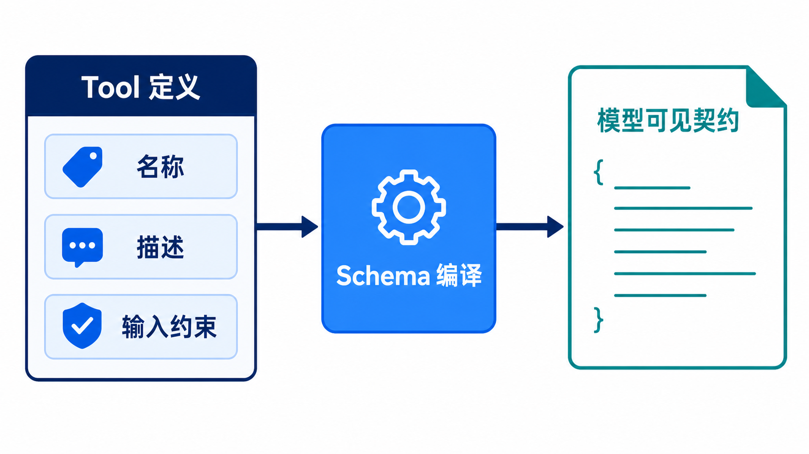
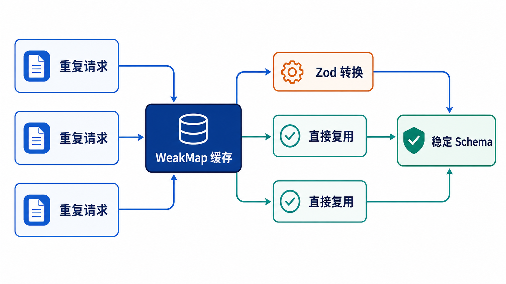
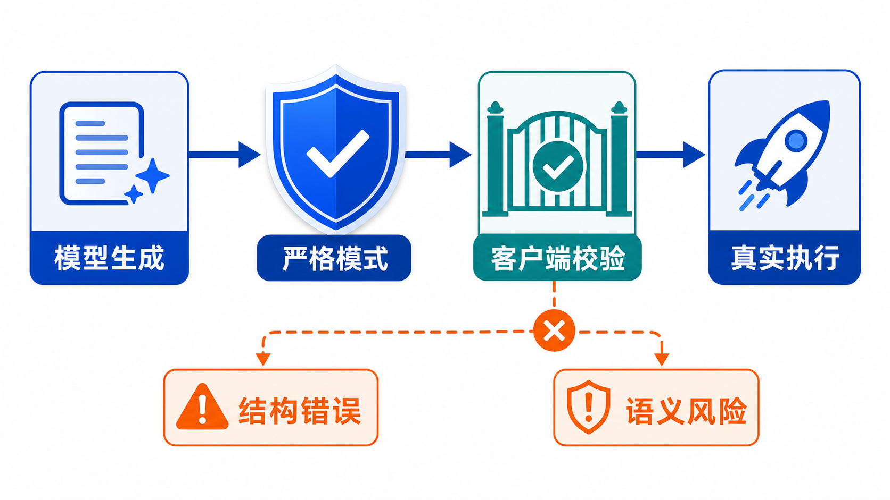
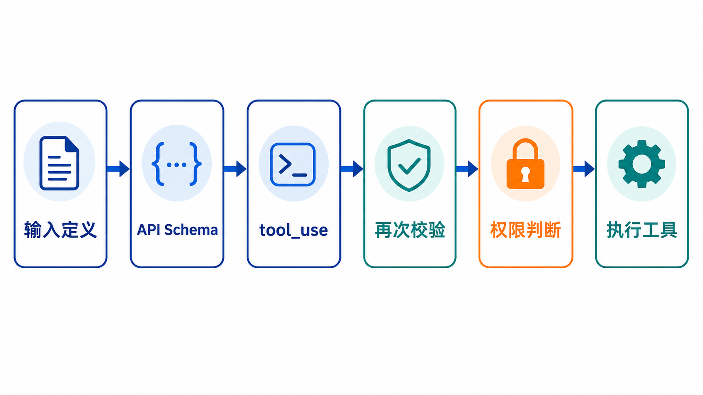

# 工具定义如何转换成模型能够调用的 Schema？

写 Agent 工具时，我们通常从 TypeScript 类型或 Zod Schema 出发：

```typescript
const inputSchema = z.object({
  file_path: z.string(),
  offset: z.number().int().optional(),
  limit: z.number().int().positive().optional(),
})
```

但模型并不能直接读取这段代码。API 真正接收的是一份工具描述：名称、自然语言说明，以及 JSON Schema 形式的参数定义。

于是一个看似简单的问题出现了：把 Zod 转成 JSON Schema 不就行了吗？

转换本身确实不难，难的是保证**模型看到的契约、客户端校验的契约和真正执行的契约始终一致**。一旦三者漂移，Agent 会进入最难排查的一类故障：模型确信自己调用正确，客户端却不断拒绝。

这篇我们沿着 Claude Code 的工具定义链路，看看一份内部 Tool 如何编译成模型能够可靠调用的 Schema。

## 模型调用工具时，究竟看到了什么？

先说结论：**模型不会“调用函数”，它只会根据名称、描述和输入 Schema 生成一个结构化提议。**

典型的 API 工具定义可以抽象成：

```json
{
  "name": "Read",
  "description": "Read a file from the local filesystem",
  "input_schema": {
    "type": "object",
    "properties": {
      "file_path": { "type": "string" },
      "offset": { "type": "integer" },
      "limit": { "type": "integer" }
    },
    "required": ["file_path"],
    "additionalProperties": false
  }
}
```

模型读到它之后，可能生成：

```json
{
  "type": "tool_use",
  "id": "toolu_01",
  "name": "Read",
  "input": {
    "file_path": "/workspace/src/main.ts",
    "limit": 200
  }
}
```

注意这只是协议数据。到底有没有名为 `Read` 的实现、路径能不能读、结果怎样返回，都是客户端运行时的责任。

因此，Schema 的第一项任务是缩小模型的输出空间。字段越明确，模型越不需要猜；枚举、格式说明和字段描述越准确，修复性重试就越少。



## Claude Code 如何维护一份输入真相？

Claude Code 的 Tool 同时允许两种输入定义：

```typescript
// 根据恢复源码裁剪
type Tool = {
  readonly inputSchema: ZodType
  readonly inputJSONSchema?: {
    type: 'object'
    properties?: Record<string, unknown>
  }
}
```

内置工具通常以 Zod 为主。这样客户端可以直接用同一份 Schema 做运行时解析和类型推导。

MCP 工具不同。它们的输入 Schema 来自外部服务端，本来就是 JSON Schema；如果强行把它转换成 Zod，再转回 JSON Schema，不仅浪费，还可能丢失协议关键字。因此接口保留了 `inputJSONSchema` 这条直通路径。

这不是“两份真相”，而是两种来源进入同一个编译出口：

```typescript
// 根据恢复源码裁剪
let input_schema =
  tool.inputJSONSchema
    ? tool.inputJSONSchema
    : zodToJsonSchema(tool.inputSchema)
```

设计自己的 Agent 时，也可以遵循这条规则：

- 自己维护的工具，选一种强类型 Schema 作为源头。
- 外部协议工具，尽量保留原生 Schema。
- 不要手写一份给模型、再手写一份给客户端校验。

最后一点尤其重要。两份 Schema 起初看起来一样，几次迭代后一定会漂移。

## Zod 转 JSON Schema，为什么还需要缓存？

源码里的转换函数非常短：

```typescript
// 根据恢复源码裁剪
const cache = new WeakMap<ZodTypeAny, JsonSchema>()

function zodToJsonSchema(schema: ZodTypeAny) {
  const hit = cache.get(schema)
  if (hit) return hit

  const result = toJSONSchema(schema)
  cache.set(schema, result)
  return result
}
```

如果只看算法，好像没什么可讲。但注释给出了关键背景：一次请求可能要处理几十到几百个工具，而 Schema 转换会在每次 API 请求前发生。

Agent Loop 不只请求模型一次。每次工具执行结果回填后，模型还会继续推理。如果每一轮都重新遍历复杂 Zod 结构，工具越多，固定开销越明显。

这里使用 `WeakMap`，缓存键不是工具名，而是 Zod 对象的身份。只要同一会话复用同一个 Schema 实例，就能命中缓存；当 Schema 不再被其他对象引用时，缓存也不会阻止垃圾回收。

这给我们两个可迁移结论：

第一，Schema 构造最好是会话稳定的。不要在每次请求前临时 `z.object(...)`，否则对象身份一直变化，缓存形同虚设。

第二，缓存对象必须和实际变化维度一致。仅用工具名做键不一定安全，因为同名结构化输出工具可能在不同工作流中携带不同 Schema。



## 一份 API Tool Schema 是怎样组装出来的？

Claude Code 用 `toolToAPISchema()` 把内部 Tool 编译成 API 对象。核心路径可以裁剪成下面这样：

```typescript
// 根据恢复源码裁剪
async function toolToAPISchema(tool, options) {
  const cacheKey = tool.inputJSONSchema
    ? `${tool.name}:${JSON.stringify(tool.inputJSONSchema)}`
    : tool.name

  let base = toolSchemaCache.get(cacheKey)
  if (!base) {
    const input_schema = tool.inputJSONSchema
      ?? zodToJsonSchema(tool.inputSchema)

    base = {
      name: tool.name,
      description: await tool.prompt({
        tools: options.tools,
        agents: options.agents,
      }),
      input_schema,
    }

    toolSchemaCache.set(cacheKey, base)
  }

  return applyRequestOptions(base, options)
}
```

这里有三件事容易被忽略。

第一，`description` 不是一个固定字符串，而可以由 `prompt()` 动态生成。工具能够结合当前工具池、Agent 定义或权限环境，形成更贴近会话的说明。

第二，基础 Schema 被做成会话稳定缓存。这样即使远程配置在会话中途变化，也不会让整个工具数组的序列化字节频繁改变，影响提示词缓存。

第三，请求级选项应该在稳定基础层之后叠加。比如某个请求需要把工具标记为延迟加载，或者增加缓存控制，这些不必污染工具的核心定义。

这是一种“编译器”思路：内部契约是源代码，稳定 API Schema 是中间产物，请求级标记是最终链接参数。

## `strict` 能解决参数错误吗？

Claude Code 的 Tool 可以声明 `strict: true`，但发送给 API 之前还要同时满足特性开关和模型能力条件。

```typescript
// 根据恢复源码裁剪
if (
  strictToolsEnabled &&
  tool.strict === true &&
  options.model &&
  modelSupportsStructuredOutputs(options.model)
) {
  base.strict = true
}
```

严格模式的价值是让模型更紧地遵守 Schema，减少少字段、错类型和多余字段。

但它不是安全边界。即使模型生成的 JSON 与结构约束完全一致，也仍然可能：

- 读取不该读取的路径；
- 运行合法但危险的命令；
- 使用存在但已经失效的资源 ID；
- 传入业务上互相冲突的字段组合。

所以客户端仍然会执行：

```typescript
// 根据恢复源码裁剪
const parsed = tool.inputSchema.safeParse(toolUse.input)
if (!parsed.success) return validationError(...)

const semantic = await tool.validateInput?.(parsed.data, context)
if (semantic?.result === false) return toolError(...)
```

可以把 `strict` 理解成“提高模型生成正确率”，把客户端校验理解成“守住真实执行边界”。二者目标不同，不能互相替代。

还有一个现实边界：并非所有模型、代理网关和 Provider 都支持相同的严格工具协议。源码因此不是看见 `strict: true` 就无条件发送，而是同时检查当前模型能力。

自己的工具编译器也应把“内部想要的能力”和“当前链路支持的能力”分开。可以先构造目标 Schema，再经过 Provider 能力协商：

```typescript
// 示例设计，不是 Claude Code 原样源码
const compiled = compileTool(tool)
const wireTool = provider.supportsStrictTools
  ? { ...compiled, strict: tool.strict }
  : compiled
```

降级时仍然保留客户端校验，并记录本次请求没有启用严格生成。不要为了兼容代理就放宽真实执行边界，也不要向不支持的链路发送未知字段，让整个模型请求失败。

工具 Schema 中还可能有 Provider 不支持的关键字。编译阶段应该验证最终 wire Schema，而不是假设标准 JSON Schema 的所有特性都能透传。对于无法表达的约束，把它保留在本地语义校验，并在字段描述里给模型足够提示。



## 描述文字为什么也是 Schema 的一部分？

JSON Schema 擅长表达类型，却不擅长完整表达意图。

例如 `limit` 是正整数，这可以写进 Schema；但“只有文件很大时才提供 limit”“先用搜索定位再读取局部”等策略，更适合写进字段描述和工具说明。

Claude Code 的文件读取工具会为字段附加具体说明：

```typescript
// 根据恢复源码裁剪
z.object({
  file_path: z.string()
    .describe('The absolute path to the file to read'),
  offset: z.number().int().nonnegative().optional()
    .describe('The line number to start reading from...'),
  limit: z.number().int().positive().optional()
    .describe('The number of lines to read...'),
})
```

对 Agent 来说，描述文字会直接影响工具选择和参数质量。写得太少，模型会猜；写得太长，所有工具定义会挤占上下文。

一个实用写法是分层：

- 工具描述回答“什么时候选我，不要在什么情况下选我”。
- 字段描述回答“这个值的单位、边界和使用条件是什么”。
- System Prompt 只保留跨工具的通用策略。

不要在三个位置重复同一段说明。重复不仅浪费 token，也会让修改后出现冲突版本。

## 工具太多时，为什么不能把所有 Schema 全塞进去？

当 MCP 服务接入后，工具数量可能迅速增加。每个工具的名称、描述和 JSON Schema 都会占用输入 token，而且每一轮请求都要携带。

Claude Code 因此支持延迟工具：初始请求只让模型知道存在可搜索的能力，需要时再通过 ToolSearch 把具体 Schema 引入对话。

这意味着 Schema 编译还要处理一个维度：当前工具是立即加载，还是标记为 `defer_loading`。

```typescript
// 机制示意，非原样源码
const apiTool = await toolToAPISchema(tool, options)

return tool.shouldDefer && toolSearchEnabled
  ? { ...apiTool, defer_loading: true }
  : apiTool
```

这并不是单纯的性能优化。工具定义本身也是上下文，工具越多，模型用于理解用户任务的注意力和 token 预算就越少。

不过延迟加载也有成本：模型可能要额外调用一次搜索工具，并且历史消息必须保留“哪些工具已经被发现”的状态。工具池较小时，直接加载反而更简单。

选择依据不是“动态一定高级”，而是比较：

| 场景 | 更合适的策略 |
| --- | --- |
| 5～20 个稳定核心工具 | 直接加载 |
| 大量 MCP 工具 | 延迟加载 |
| 工具说明很短且高频使用 | 直接加载 |
| 工具长尾明显、Schema 很大 | 搜索后加载 |



## 自己实现时，怎样避免 Schema 漂移？

可以把整个过程固定成一条单向流水线：

```latex
领域输入定义
   ↓
内部 Tool 契约
   ↓
API Schema 编译器
   ↓
模型产生 tool_use
   ↓
同源 Schema 再校验
   ↓
语义校验与权限判断
```

落实到代码评审，可以检查五件事：

1. 内置工具是否只有一个 Schema 真相源？
2. 外部 JSON Schema 是否被无损保留？
3. Schema 是否会在每轮重新创建？
4. 模型输出是否在客户端再次解析？
5. 语义校验是否和类型校验分开？

还可以给编译器加一组快照测试：固定 Tool 定义，断言最终发送的名称、描述、必填字段、枚举和 `additionalProperties`。这类测试不需要调用模型，却能及时发现工具协议的破坏性变化。

### Schema 版本升级时，历史调用怎么办？

工具协议并不是只服务当前请求。长会话、恢复会话和后台任务里可能保存着旧版 `tool_use`。如果今天把 `file_path` 改名为 `path`，新模型只会看到新 Schema，但历史重放和延迟执行仍可能带着旧字段。

因此工具 Schema 的升级最好按 API 兼容性来处理，而不是普通内部重构。

一种办法是在工具契约里保留别名或输入迁移器：

```typescript
// 示例设计，不是 Claude Code 原样源码
function migrateInput(raw: unknown) {
  if (
    isObject(raw) &&
    'file_path' in raw &&
    !('path' in raw)
  ) {
    return {
      ...raw,
      path: raw.file_path,
    }
  }
  return raw
}
```

迁移应发生在结构校验之前，并且必须幂等；同一输入处理两次不能继续变化。迁移后的参数还要重新通过新 Schema 和权限检查，不能因为“来自旧历史”就自动信任。

另一种办法是发布新工具名，例如从 `ReadV1` 迁移到 `Read`，让旧会话继续绑定旧实现。它更清楚，却会暂时增加工具数量。选择哪一种取决于持久化历史是否需要长期恢复，以及旧语义能否安全模拟。

版本变更还应进入可观测数据。记录每个工具的 Schema 指纹、校验失败字段和迁移命中次数，才能判断旧调用是否仍大量存在。若新版本上线后某个必填字段错误突然增加，问题通常不在模型“变笨了”，而在描述、Schema 或 Provider 转换发生了不一致。**工具协议的兼容性要靠数据验证，不能只靠类型检查通过。**

### 描述改变为什么会影响提示词缓存？

Agent 每轮都会重新发送工具数组。即使字段语义没有变化，只要描述文本的空格、顺序或动态内容变化，序列化后的请求前缀也可能变化。

这会产生两个后果。第一，提示词缓存命中下降；第二，同一会话里模型看到的工具说明悄悄漂移，行为难以复现。

Claude Code 将基础工具 Schema 做成会话稳定缓存，正是为了减少这种漂移。自己的实现也可以把工具编译分成两层：

```latex
会话稳定层：名称、基础描述、输入 Schema
请求变化层：本轮启用状态、延迟加载、权限摘要
```

不要把时间戳、临时连接状态或每轮都会变化的统计数字写入基础 description。确实需要告诉模型的动态信息，可以通过独立上下文附件表达。

这也解释了为什么 Schema 快照测试不只是在测类型。它还在守住提示词的稳定前缀和会话的可重放性。

## 最后：Schema 是模型与运行时之间的 ABI

Schema 不只是参数文档，更像模型和 Agent Runtime 之间的 ABI，也就是双方共同遵守的调用边界。

模型根据它生成工具提议；客户端根据它解析参数；执行器再用语义规则决定是否真的行动。只要其中一层和另外两层不一致，失败就会表现为反复重试、错误调用或隐藏的安全漏洞。

Claude Code 给我们的核心启发可以压缩成三句话：

- 用一份内部定义生成模型可见 Schema，避免手写双份契约。
- 把 Schema 编译结果做成会话稳定对象，控制性能和缓存漂移。
- 永远把严格生成当作正确率优化，而不是执行安全边界。

下一次为 Agent 新增工具时，不妨先别写 `execute()`，先把“模型怎样正确描述这次调用”设计清楚。工具能不能被可靠使用，往往在函数真正执行之前就已经决定了。

落地时可以做一个很小的练习：选现有 Agent 中调用失败最多的工具，保存十条原始 `tool_use`，逐条标记失败是工具选择错误、字段缺失、类型错误还是语义错误。类型问题应回到 Schema，使用条件应回到描述，环境约束应进入语义校验。这样修改会比笼统地“优化提示词”更可验证。
