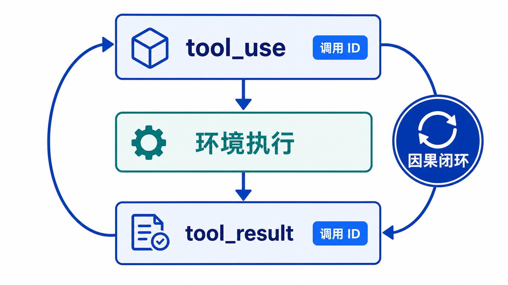
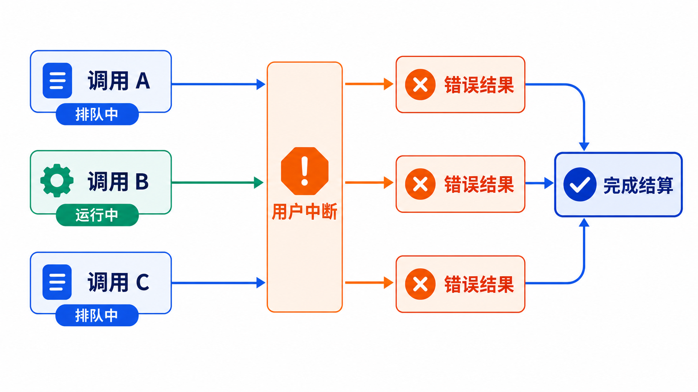
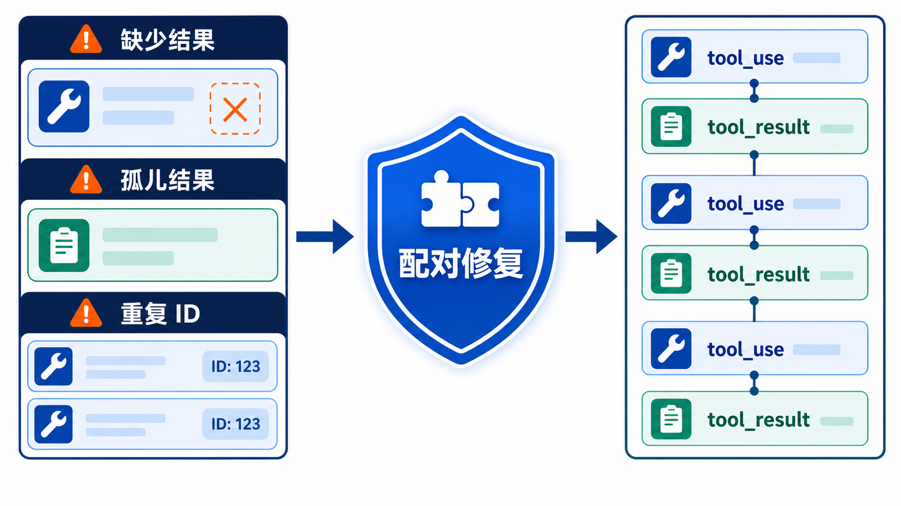
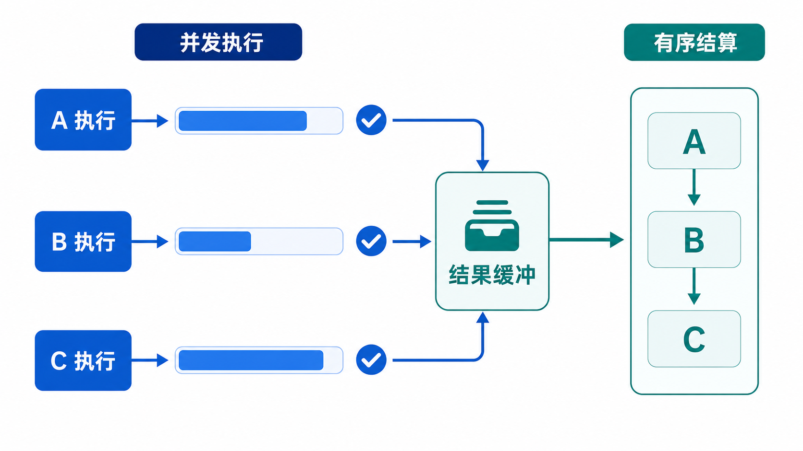

# `tool_use` 和 `tool_result` 为什么必须严格配对？

Agent Loop 里有一个看起来很机械的规则：模型发出的每个 `tool_use`，后面都必须有一个 ID 对应的 `tool_result`。

很多人第一次实现时，会把它当成 API 格式要求。工具成功了就回传结果；工具失败、用户取消或者进程崩溃，就直接结束本轮。

这种实现通常能通过演示，却会在恢复会话、并行工具和中途取消时突然报错。更麻烦的是，损坏的历史可能被持久化，下一次恢复仍然报错，让整个会话“卡死”。

Claude Code 为配对规则写了执行、补偿和发送前修复三层保障。它告诉我们一件很重要的事：**工具调用 ID 不是展示用编号，而是一段 Agent 状态转换的事务键。**

## 一对消息究竟表达了什么？

先看最小结构。模型先产生工具调用：

```json
{
  "type": "tool_use",
  "id": "toolu_42",
  "name": "Read",
  "input": { "file_path": "/workspace/app.ts" }
}
```

客户端执行以后，用相同 ID 回传：

```json
{
  "type": "tool_result",
  "tool_use_id": "toolu_42",
  "content": "1  import ...\n2  export ..."
}
```

这对消息告诉模型：“你刚才提出的 `toolu_42` 已经完成，这是它在环境中产生的观察值。”

如果只把它当成聊天内容，似乎少一条也没关系；如果把 Agent 看成状态机，就会发现 `tool_use` 表示一个尚未结算的动作，`tool_result` 表示这个动作被结算。

没有结果的调用会留下悬空状态。模型不知道动作没执行、执行到一半，还是结果丢了。之后它的任何推理都缺少确定前提。



## 为什么失败和拒绝也必须返回结果？

工具结果并不等于成功结果。只要一个 `tool_use` 已经进入对话历史，它就需要一个可观察的结局。

Claude Code 在找不到工具时，也会构造 `tool_result`：

```typescript
// 根据恢复源码裁剪
if (!tool) {
  yield createUserMessage({
    content: [{
      type: 'tool_result',
      tool_use_id: toolUse.id,
      content: `<tool_use_error>
        Error: No such tool available: ${toolName}
      </tool_use_error>`,
      is_error: true,
    }],
  })
  return
}
```

输入校验失败、权限拒绝、执行异常和取消也遵循同样模式，只是 `content` 和 `is_error` 不同。

这不是为了迎合协议，而是给模型提供纠错信息：

- 未知工具：重新选择当前可用工具。
- 参数错误：修正字段类型或补齐字段。
- 权限拒绝：停止该路径，或者向用户解释限制。
- 执行失败：分析错误并决定是否重试。
- 用户取消：不要假设原动作已经生效。

如果异常直接穿透 Agent Loop，模型失去了修复机会；如果错误结果仍然带上调用 ID，失败就成为下一轮推理可以使用的观察值。

## 中断发生在一半时，怎样补齐配对？

最棘手的场景是流式响应。

模型可能已经流出了两个完整 `tool_use`，第三个还没结束，用户就按下取消。此时客户端已经把前两个调用展示或写入历史，但工具未必都执行完成。

Claude Code 提供了一个生成器，为已出现的工具调用补合成错误结果：

```typescript
// 根据恢复源码裁剪
function* yieldMissingToolResultBlocks(
  assistantMessages,
  errorMessage,
) {
  for (const assistantMessage of assistantMessages) {
    const toolUses = assistantMessage.message.content
      .filter(block => block.type === 'tool_use')

    for (const toolUse of toolUses) {
      yield createUserMessage({
        content: [{
          type: 'tool_result',
          tool_use_id: toolUse.id,
          content: errorMessage,
          is_error: true,
        }],
      })
    }
  }
}
```

这是裁剪后的代码，真实调用点还会区分普通执行器和流式执行器。

普通路径不知道哪些工具已经开始，因此对当前响应里的调用统一补结果。流式执行器跟踪了每个工具的 `queued / executing / completed / yielded` 状态，能够给排队中和执行中的工具生成更准确的合成错误。

这里的设计原则是：**取消不是删除历史，而是为已经公开的动作写入取消结局。**



## 为什么结果必须紧跟对应的调用批次？

配对不只要求 ID 相等，还涉及消息顺序。

当一个 assistant 消息里包含多个 `tool_use` 时，下一条 user 消息通常承载这一批工具结果。不能随意在它们中间插入普通用户文本，否则 API 可能无法判断哪些结果属于哪次工具轨迹。

Claude Code 的查询循环有一段注释直接指出：如果在 `tool_result` 消息和普通用户消息之间错误交错，API 会拒绝。

可以把一批调用理解成：

```latex
assistant:
  tool_use A
  tool_use B
  tool_use C

user:
  tool_result A
  tool_result B
  tool_result C

assistant:
  根据三份观察继续推理
```

结果可以按运行时策略并发产生，但提交给对话历史时要保留清晰的逻辑分组。

这和数据库事务日志很像：真实执行完成顺序可能不同，提交日志仍要让消费者得到一致、可重放的状态序列。

## 会话恢复时，历史为什么会损坏？

理想路径里执行器总会产生结果，但真实系统还有远程会话、进程退出、版本迁移、消息压缩和持久化失败。

常见损坏包括：

1. `tool_use` 已写入，`tool_result` 还没写入进程就退出。
2. 压缩或恢复时丢了调用消息，只剩结果。
3. 同一段孤儿处理逻辑重复运行，产生重复 ID。
4. 流式重试产生了新调用，却混入上一次尝试的旧结果。
5. 恢复从会话中段开始，第一条就是找不到来源的结果。

所以 Claude Code 在把消息发给 API 前，还会统一调用：

```typescript
// 根据恢复源码裁剪
messagesForAPI = normalizeMessagesForAPI(messages, tools)

// 修复恢复会话中的 tool_use / tool_result 不匹配
messagesForAPI = ensureToolResultPairing(messagesForAPI)
```

这个位置很关键。它不是依赖每条上游路径永远正确，而是在协议出口设置一道完整性检查。

对于自己的 Agent，这类似在写数据库前做约束检查：局部组件负责尽量正确，边界层负责不让结构损坏的数据离开系统。



## `ensureToolResultPairing` 修复了哪些情况？

源码里的函数比较长，但核心算法可以浓缩成四步。

```typescript
// 机制伪代码，不是原样源码
for (const assistantMessage of messages) {
  const toolUseIds = dedupeToolUses(assistantMessage)
  const nextUserMessage = getNextUserMessage()
  const resultIds = dedupeToolResults(nextUserMessage)

  const missing = toolUseIds - resultIds
  const orphaned = resultIds - toolUseIds

  insertSyntheticErrorResults(missing)
  removeOrphanedResults(orphaned)
}
```

真实代码还处理了跨 assistant 消息重复的调用 ID、服务端工具块，以及删除后内容为空时的占位消息。

正向修复是：有调用、无结果，就插入一条 `is_error: true` 的合成结果。

反向修复是：有结果、无调用，就删除孤儿结果。因为系统无法可靠猜出它原本属于哪个动作，保留反而会污染轨迹。

重复修复是：同一 ID 多次出现时，只保留一份调用和一份结果，避免 API 报“ID 必须唯一”。

这套修复让普通会话尽可能恢复可用。不过源码还提供严格模式：某些对训练数据完整性要求更高的场景，不进行合成修复，而是发现不匹配就失败。因为模型如果基于人工占位结果继续回答，这条轨迹已经不再代表真实执行。

所以“自动修复”并非永远正确，要看业务更看重可用性还是轨迹真实性。

### 为什么不能只在 API 报错后再修？

一种看似省事的方案，是先把历史发给模型，收到“配对不合法”的错误后，再启动修复并重试。

问题是，API 错误只告诉你最终载荷不合法，未必指出损坏发生在哪条本地路径。为了重试，系统还要重新构造完整请求；如果修复逻辑依赖已经丢失的上下文，第二次仍可能失败。

更麻烦的是，工具调用可能已经在本地执行成功。API 请求失败不代表环境副作用失败。Agent 如果把整轮当作未发生并重新执行，就可能重复写文件、重复发送消息或重复创建远程资源。

所以配对检查应该位于三个更早的边界：

```latex
执行器边界：每个退出分支都产生结果
轮次边界：中断前结算所有已公开调用
协议边界：发送前验证完整历史
```

第一层减少损坏产生，第二层处理控制流中断，第三层承接恢复和迁移留下的历史问题。三层不是重复代码，而是分别覆盖不同故障域。

### 配对不变量怎样写成自动测试？

工具系统很适合做基于性质的测试。随机生成若干调用、成功、失败和取消事件，不关心具体工具内容，只断言最终历史满足：

```latex
每个 tool_use.id 全局唯一
每个 tool_use.id 恰好出现一个 tool_result
每个 tool_result.tool_use_id 都能找到来源
结果位于对应调用批次之后
```

再加入故障注入：在模型流出第一、第二或最后一个调用时中断；让一个并行工具失败；让进程在持久化两条消息之间“崩溃”；重复运行恢复逻辑。修复函数应保持幂等，也就是修过一次的历史再修一次不发生变化。

这比只测成功调用更能暴露 Agent Runtime 的问题。成功路径通常很短，真正损坏会话的代码往往隐藏在 catch、abort 和 resume 分支里。

### 合成结果会不会骗模型？

会有这个风险，所以合成结果必须明确表示失败，不能伪装成真实工具输出。

一个好的合成结果至少包括：

- 原始 `tool_use_id`；
- `is_error: true`；
- 清楚的原因，例如用户中断、流式回退或会话恢复；
- 不暗示副作用已经成功。

例如流式执行器会区分：

```typescript
// 根据恢复源码裁剪
type AbortReason =
  | 'sibling_error'
  | 'user_interrupted'
  | 'streaming_fallback'
```

不同原因会生成不同错误文本。模型由此能够判断，是用户主动拒绝、并行兄弟工具失败导致取消，还是当前流式尝试已经被丢弃。

不过，合成结果无法撤销已经发生的外部副作用。Bash 进程可能在收到取消信号前已经写了一半文件，远程 API 也可能已经提交请求。

因此配对完整性只解决“对话状态可解释”，不自动解决“环境状态可回滚”。不可逆工具仍然需要幂等键、事务、补偿动作或执行前确认。

这里可以用三个问题检查设计是否混淆了边界：工具没有返回，是否等于它没有执行？历史已经补齐，是否等于环境已经恢复？模型看见失败，是否知道下一步应该验证什么？三个答案都不是天然的“是”。

例如写文件工具在落盘后、发送结果前被中断，合成错误只能说明运行时没拿到可信结果。下一轮不应直接重试同一个写操作，而应先读取目标文件或检查事务标记。换句话说，**协议结算告诉模型哪里不确定，环境验证才负责消除这种不确定。**

## 多工具并发时，怎样保持结果可重放？

假设模型一次请求了三个只读工具：

```latex
A: 读取 package.json      120ms
B: 搜索所有 TODO          900ms
C: 读取 tsconfig.json     80ms
```

如果按完成顺序写历史，结果是 C、A、B；下一次运行可能变成 A、C、B。语义未必错，但持久化轨迹、缓存和调试结果会变得不稳定。

Claude Code 的流式执行器可以立即上报进度，却把最终结果缓冲下来，按工具接收顺序产出。这样用户仍能看到进行中的反馈，模型历史则保持稳定。

```typescript
// 根据恢复源码裁剪
for (const tool of this.tools) {
  while (tool.pendingProgress.length > 0) {
    yield tool.pendingProgress.shift()
  }

  if (tool.status === 'completed') {
    tool.status = 'yielded'
    for (const message of tool.results) yield message
  } else if (
    tool.status === 'executing' &&
    !tool.isConcurrencySafe
  ) {
    break
  }
}
```

这揭示了两个不同的顺序：

- 观察顺序：进度可以按真实发生时间流出。
- 结算顺序：最终结果按逻辑调用顺序稳定提交。

还有一种取舍是“是否等待整批完成后才让模型继续”。等待整批可以让模型一次看到完整观察，推理更一致；边完成边继续则能降低首个结果延迟，却可能让模型基于局部信息提前行动。

如果工具彼此独立而且协议支持增量轮次，边完成边继续可能有价值；如果工具属于同一调查步骤，例如同时读取配置、依赖和测试日志，完整批次通常更合适。

实现增量消费还必须防止重复结果。模型已经基于 A 继续后，B、C 的迟到结果要进入哪一轮、是否仍与原 assistant 调用相邻，都需要新的消息协议。没有这些设计时，稳定批次结算是更安全的默认值。

调试时可以把每轮打印成简短账本：

```latex
opened:  A B C
settled: A(error) B(ok) C(cancelled)
pending: -
```

只看终端渲染往往会漏掉隐藏附件或合并消息；账本能直接暴露哪个 ID 没有结算。



## 自己实现 Agent，怎样守住这条不变量？

可以把“每个调用必须且只能有一个结果”写成运行时不变量，而不是团队约定。

一个实用实现是为每轮维护账本：

```typescript
// 示例设计，不是 Claude Code 原样源码
class ToolLedger {
  pending = new Map<string, ToolCall>()
  settled = new Set<string>()

  open(call: ToolCall) {
    if (this.pending.has(call.id) || this.settled.has(call.id)) {
      throw new Error(`duplicate tool call: ${call.id}`)
    }
    this.pending.set(call.id, call)
  }

  settle(result: ToolResult) {
    if (!this.pending.has(result.toolUseId)) {
      throw new Error(`orphan tool result: ${result.toolUseId}`)
    }
    this.pending.delete(result.toolUseId)
    this.settled.add(result.toolUseId)
  }

  cancelAll(reason: string) {
    return [...this.pending].map(([id]) =>
      errorResult(id, reason),
    )
  }
}
```

在三个边界检查它：

1. 模型流出 `tool_use` 时登记。
2. 成功、失败、拒绝、取消时统一结算。
3. 请求再次发送给模型前，断言账本没有悬空项。

持久化会话时，也最好把调用状态显式记录为 `pending / settled / cancelled`，而不是只靠扫描文本猜测。

如果工具会产生不可逆远程动作，还可以把外部幂等键和 `tool_use_id` 关联。重试时先查询该键是否已经提交，再决定返回既有结果还是重新执行。这样“对话结算”和“环境结算”就有一条可以核对的桥梁。

对于文件编辑，可以在执行前记录内容哈希或快照，结果中返回新哈希。恢复时若调用没有结果，却发现文件已经变为预期哈希，系统可以标记为“环境可能已成功，结果记录丢失”，而不是盲目重跑。它比直接合成成功更谨慎，也比一律当失败更接近真实状态。

## 最后：配对规则是 Agent 的因果链

`tool_use` 和 `tool_result` 严格配对，真正维护的是一条因果关系：

模型提出动作 → 环境给出结局 → 模型基于结局继续。

少一个结果，模型就不知道世界发生了什么；多一个结果，模型就会看到一个从未提出过的观察；重复 ID，则让同一动作出现多个相互冲突的结局。

Claude Code 用正常执行路径生成结果，用中断补偿结算悬空调用，再用发送前修复守住协议边界。这三层机制很适合迁移到任何会长期运行、支持恢复和并发工具的 Agent。

如果只记住一个开发检查项，可以记住这句：

**凡是已经进入历史的工具调用，都必须以成功、失败、拒绝或取消中的一种方式结算。**

做到这一点，你的 Agent 才不仅“能调用工具”，还拥有一条可解释、可恢复、可重放的行动链。
