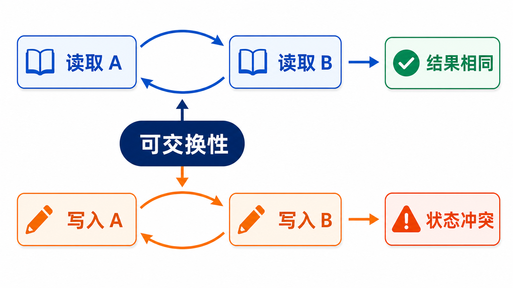
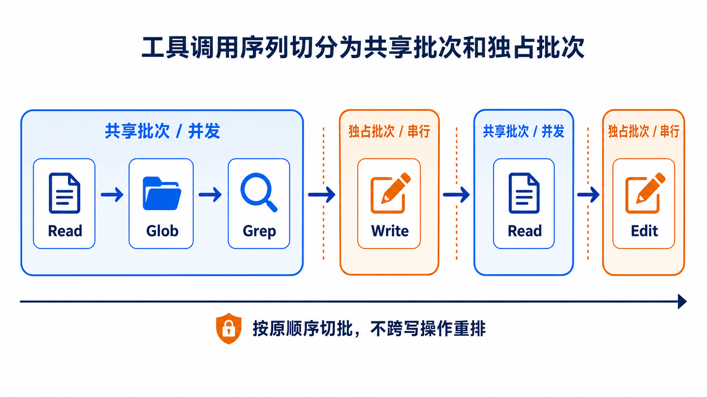
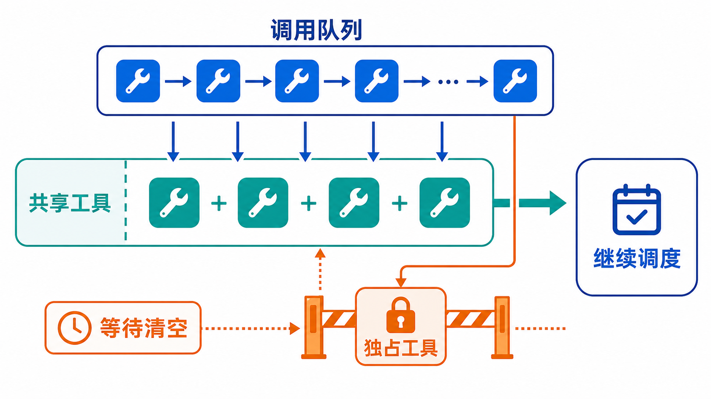
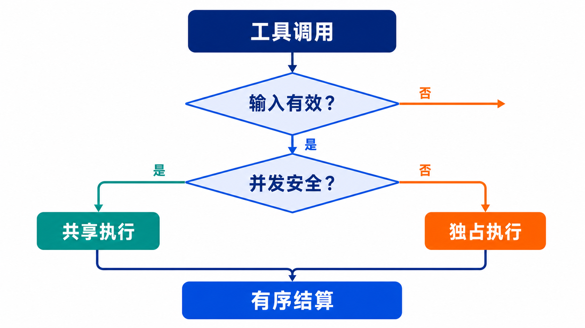

# Claude Code 为什么让只读工具并发、写操作串行？

模型一次返回多个工具调用时，最诱人的优化是全部 `Promise.all()`。

读取文件、搜索代码、执行命令同时启动，等待时间确实会明显下降。可当调用里混入文件编辑、目录切换或会改变会话状态的工具，问题就来了：谁先写？后一个工具看到的是修改前还是修改后的文件？并发返回的状态修改按什么顺序生效？

另一个极端是所有工具都串行。这样比较安全，却会让一批互不相关的读取白白排队。

Claude Code 没有简单地用“读并发、写串行”按工具名硬编码，而是让工具根据本次输入声明 `isConcurrencySafe`，调度器再把连续调用切成共享批次和独占批次。

这篇要回答的不是 Promise 怎么写，而是 Agent 如何在速度与确定性之间建立一套可解释的调度规则。

## 为什么工具并发不是普通的接口并发？

普通后端并发经常建立在接口相互独立的前提上。Agent 工具却共享很多隐含状态：

- 当前工作目录；
- 同一份工作区文件；
- 会话消息与文件读取缓存；
- 权限模式和已授权规则；
- 环境变量、子进程和远程连接；
- 工具返回的上下文修改器。

模型还可能一次产生带依赖的调用。例如先创建目录，再在目录内写文件。它们虽然出现在同一个 assistant 响应里，却不是可交换操作。

因此问题不能只问“能不能同时执行”，还要问：

如果交换这两个调用的开始顺序或完成顺序，结果是否仍然等价？

若答案不确定，就不应该并发。

这也是为什么“只读”只是很好的近似，而不是数学上绝对的安全证明。某些读取会消费流、改变游标或依赖短暂状态，也可能不能并发。



## 工具如何声明自己的并发语义？

Claude Code 把并发判断放进 Tool 契约：

```typescript
// 根据恢复源码裁剪
type Tool = {
  isConcurrencySafe(input): boolean
  isReadOnly(input): boolean
  isDestructive?(input): boolean
}
```

这里用方法而不是字段，是因为同一种工具的不同输入可能有不同语义。

例如 Bash 工具不能仅凭名字判断。`git status` 近似只读，`npm install` 会改变依赖目录，`rm` 更是不可逆。MCP 工具则可以从服务端的 `readOnlyHint` 和 `destructiveHint` 获取线索。

MCP 工具适配时会把注解映射进内部 Tool：

```typescript
// 根据恢复源码裁剪
return {
  ...MCPTool,
  isConcurrencySafe() {
    return tool.annotations?.readOnlyHint ?? false
  },
  isReadOnly() {
    return tool.annotations?.readOnlyHint ?? false
  },
  isDestructive() {
    return tool.annotations?.destructiveHint ?? false
  },
}
```

缺少 `readOnlyHint` 时默认 `false`，也就是未知即独占。这种保守默认非常重要：误串行只会损失一点性能，误并发可能损坏环境。

自己的 Agent 也不必局限于布尔值。复杂系统可以声明资源集合：

```typescript
// 示例设计，不是 Claude Code 原样源码
concurrency(input) {
  return {
    reads: [`file:${input.path}`],
    writes: [],
  }
}
```

有了资源级读写集，两个写不同文件的工具也可能并行。不过规则越精细，验证成本越高，第一版通常用“共享 / 独占”已经足够可靠。

## 调度器怎样把调用切成批次？

Claude Code 的普通工具调度器先扫描调用序列，把它们分成两类批次：

1. 多个连续的并发安全工具合并成一批；
2. 每个不安全工具单独成为一批。

```typescript
// 根据恢复源码裁剪
function partitionToolCalls(toolUses, context) {
  return toolUses.reduce((batches, toolUse) => {
    const tool = findToolByName(context.options.tools, toolUse.name)
    const parsed = tool?.inputSchema.safeParse(toolUse.input)

    const safe = parsed?.success
      ? safelyCall(() => tool.isConcurrencySafe(parsed.data), false)
      : false

    if (safe && batches.at(-1)?.isConcurrencySafe) {
      batches.at(-1).blocks.push(toolUse)
    } else {
      batches.push({
        isConcurrencySafe: safe,
        blocks: [toolUse],
      })
    }
    return batches
  }, [])
}
```

注意两个保守分支：

- 输入 Schema 解析失败，按不可并发处理。
- `isConcurrencySafe()` 自己抛异常，按不可并发处理。

因为调度器不能在尚未可靠理解参数时做乐观判断。

假设模型给出：

```latex
Read A → Grep B → Edit C → Read D → Read E
```

它会被切成：

```latex
[Read A, Grep B] 并发
[Edit C]          串行
[Read D, Read E]  并发
```

`Edit C` 像一道栅栏。后面的读取必须等它完成，才能看到编辑后的世界。



## 为什么不把所有只读调用捞出来一起跑？

如果只按类型分组，可以把所有 Read 放到一起，把所有 Write 放到最后，看起来并发度更高。

问题是这会改变模型给出的逻辑顺序。

例如：

```latex
Read config
Edit config
Read config
```

前后两个 Read 虽然都是只读，却理应观察不同版本。把它们提到同一批，第二次读取就可能提前发生。

Claude Code 只合并**连续**的安全调用，不跨独占操作重排。这保留了原序列中的因果边界。

这条原则很适合通用 Agent：

可以在一个无副作用区间内并发，但不要为了并发跨越可能改变世界的动作。

如果模型本身生成的同一批调用存在显式依赖，更完善的协议可以让模型提供 DAG；但在没有依赖声明时，保留原始顺序是可靠的默认选择。

## 并发执行时，怎样限制资源占用？

即使一批工具都安全，也不能无限制同时启动。几十个文件读取可能还好，几十个网络请求或子进程会迅速耗尽连接和文件描述符。

Claude Code 给并发批次设置最大并发数：

```typescript
// 根据恢复源码裁剪
function getMaxToolUseConcurrency() {
  return parseInt(
    process.env.CLAUDE_CODE_MAX_TOOL_USE_CONCURRENCY || '',
    10,
  ) || 10
}

yield* all(
  toolUseMessages.map(toolUse => runOne(toolUse)),
  getMaxToolUseConcurrency(),
)
```

并发上限不只是性能参数，也是可靠性边界。

自己实现时还可以按资源类型分别限流：

| 资源 | 示例上限策略 |
| --- | --- |
| 本地文件读取 | 较高并发 |
| 子进程 | 较低并发 |
| 同一 MCP 服务 | 单独信号量 |
| 外部写 API | 串行或幂等并发 |
| 高成本模型子调用 | 预算感知限流 |

如果所有工具共享一个上限，一个慢网络服务可能占满槽位，阻塞本地快速读取。生产系统可以进一步做分池调度。

分池并不意味着每个工具都拥有一套独立线程池。更实用的做法是同时设置两道门：先占用全局并发额度，再占用资源组额度。一个 MCP 服务最多执行两个请求、Bash 最多启动三个子进程，但所有工具加起来仍不能超过全局上限。这样既防止单个服务吃光资源，也避免各个小池同时满载后击穿机器。

限流还必须和取消配合。排队中的调用如果已经收到取消，就不应先获取信号量、启动工具，再立刻退出；它应该在入队、获得额度和真正执行之前都检查一次 signal。否则用户看到界面停止了，后台却还在慢慢启动旧任务。

```typescript
// 示例设计，不是 Claude Code 原样源码
async function acquireFor(call, signal) {
  signal.throwIfAborted()
  const releaseGlobal = await globalPool.acquire(signal)
  const releaseGroup = await poolFor(call.resourceGroup).acquire(signal)
  signal.throwIfAborted()

  return () => {
    releaseGroup()
    releaseGlobal()
  }
}
```

这里还有一个容易忽略的公平性问题。若共享读取不断到来，独占写操作可能一直等不到所有读取清空。因此调度器一旦发现队列前方存在独占调用，就应停止接纳它后面的新共享调用，让已有读取完成后把执行窗口交给独占者。**并发上限解决资源爆炸，队列公平性解决写操作饥饿；两者不是同一个问题。**



## 流式工具还没收完，调度怎么提前开始？

普通路径等完整模型响应结束后统一调用 `runTools()`。Claude Code 还有 `StreamingToolExecutor`：一个工具块流式完成后，就可以立刻加入执行队列。

它为每个调用维护状态：

```typescript
// 根据恢复源码裁剪
type ToolStatus =
  | 'queued'
  | 'executing'
  | 'completed'
  | 'yielded'

type TrackedTool = {
  block: ToolUseBlock
  status: ToolStatus
  isConcurrencySafe: boolean
  results?: Message[]
  pendingProgress: Message[]
}
```

能否启动新工具，由当前正在执行的集合决定：

```typescript
// 根据恢复源码裁剪
private canExecuteTool(safe: boolean): boolean {
  const running = this.tools
    .filter(t => t.status === 'executing')

  return running.length === 0 ||
    (safe && running.every(t => t.isConcurrencySafe))
}
```

也就是说：

- 当前没有工具运行，任何工具都能开始。
- 当前全是共享工具，新来的共享工具可以加入。
- 只要新工具是独占，必须等待正在运行的工具清空。
- 只要已有独占工具，后续工具都不能插入。

这可以类比读写锁，但实现更接近一个保持调用顺序的队列。

## 结果按完成顺序返回，不是更快吗？

进度应该尽快展示，最终结果却不一定要按完成顺序写入会话。

假设三个读取分别耗时 900、100 和 200 毫秒。若最终消息按完成顺序返回，每次运行的历史排列可能不同，导致：

- 快照测试不稳定；
- 提示词缓存字节变化；
- 恢复会话难以复现；
- 与 `tool_use` 的视觉对应更混乱。

Claude Code 把进度消息单独缓存，可以立即产出；最终结果则按工具在队列中的顺序结算。

```typescript
// 根据恢复源码裁剪
for (const tool of this.tools) {
  while (tool.pendingProgress.length > 0) {
    yield tool.pendingProgress.shift()
  }

  if (tool.status === 'completed') {
    tool.status = 'yielded'
    for (const message of tool.results) {
      yield message
    }
  }
}
```

这叫“执行并发，提交有序”。它牺牲了一点最快结果进入模型的时间，换来稳定轨迹。

如果业务更看重低延迟，也可以让模型先消费已完成的独立结果，但那需要协议能表达部分批次、依赖关系和后续补充，复杂度会明显上升。

### 上下文修改为什么比文件写入更容易被漏掉？

开发者通常会注意两个工具不能同时写同一个文件，却容易忽略工具还可能修改运行时上下文。

Claude Code 的 `ToolResult` 可以携带 `contextModifier`。这类修改可能改变工作目录、后续可见工具或会话状态。如果并发工具都返回修改器，即使它们没有触碰同一文件，应用顺序也可能影响后续行为。

普通调度器在并发批次里先收集修改器，再按原始工具调用顺序应用：

```typescript
// 根据恢复源码裁剪
for await (const update of runToolsConcurrently(...)) {
  if (update.contextModifier) {
    queued[update.toolUseID].push(
      update.contextModifier,
    )
  }
  yield update.message
}

for (const block of blocks) {
  for (const modify of queued[block.id] ?? []) {
    currentContext = modify(currentContext)
  }
}
```

也就是说，耗时不同不会改变状态提交顺序。

不过源码注释也承认，流式并发工具对上下文修改的支持更受限制。这是一条合理边界：如果当前没有并发工具需要修改上下文，不必为了假设需求引入复杂的冲突合并。

自己的实现最好规定：共享工具只能返回纯数据；会改变 Runtime 上下文的工具必须独占。确实需要并发状态更新时，再引入版本号、交换律或合并函数。

### 为什么 Bash 失败会取消并行兄弟，而 Read 失败不会？

流式执行器还有一个很有意思的策略：只有 Bash 错误会触发兄弟调用取消。

源码注释给出的理由是，多个 Bash 调用经常形成隐式依赖链。例如创建目录失败后，后续在该目录里执行的命令通常已经没有意义。

```typescript
// 根据恢复源码裁剪
if (isErrorResult) {
  thisToolErrored = true

  if (tool.block.name === BASH_TOOL_NAME) {
    this.hasErrored = true
    this.siblingAbortController.abort('sibling_error')
  }
}
```

而 Read、WebFetch 等读取通常彼此独立，一个失败不应抹掉其他结果。

这不是永恒真理，而是一种基于工具语义的故障域划分。自己的 Agent 可以显式声明：

```typescript
// 示例设计
failurePolicy(input) {
  return 'isolate' // 或 'cancel-siblings'
}
```

比按工具名硬编码更通用，也便于 MCP 或插件工具接入。



## 自己开发 Agent，应该从哪种调度模型开始？

第一版可以只设计三档：

```typescript
type ConcurrencyMode =
  | 'shared'     // 可与其他 shared 并发
  | 'exclusive'  // 单独执行
  | 'barrier'    // 单独执行，并让前后形成明确阶段
```

然后遵循下面的决策：

1. 未声明、校验失败或判断异常，一律 `exclusive`。
2. 只在连续 `shared` 区间内合批，不跨独占调用重排。
3. 设置全局和资源级并发上限。
4. 进度可以即时流出，最终结算保持稳定顺序。
5. 状态修改按调用顺序应用，避免并发写上下文。
6. 为工具声明失败传播策略和取消行为。

如果以后性能确实成为瓶颈，再升级为资源读写集或依赖 DAG。不要在没有测量之前就构造复杂调度器。

升级为资源读写集时，可以让每个工具返回规范化资源键，例如 `file:/workspace/a.ts`、`mcp:github:repo-x`。调度器允许读读并发，读写与写写冲突。资源键必须在权限检查之后、执行之前确定，避免路径别名或符号链接让两个实际相同的资源看起来不同。

资源键也不能只取模型传入的字符串。`./a.ts`、绝对路径和经过符号链接访问的路径可能指向同一文件；两个远程接口也可能修改同一仓库。规范化失败时应退回独占，而不是假设互不相关。对动态范围工具，例如“格式化整个项目”，可以声明 `workspace:*` 这样的宽资源键，用较少并发换取明确边界。

更进一步的 DAG 只有在模型或规划器能可靠表达依赖时才值得使用。否则一份错误依赖图会让有前后关系的动作提前发生，风险比保守串行更大。

评估是否值得升级，可以记录每轮工具数、并发批次宽度、独占等待时间和总工具耗时。如果主要瓶颈来自模型推理，调度器再复杂也不会显著缩短端到端时间；如果长尾集中在多个独立网络读取，资源级并发才可能产生真实收益。

日志还应记录“为什么这次被判为独占”。是工具声明如此、输入校验失败、资源键冲突，还是系统无法判断？没有原因码时，性能下降只表现为“Agent 变慢了”，开发者很难知道应调整工具契约还是调度器。

第三方工具首次接入时，最安全的默认值仍是独占。运行一段时间后，只有在它明确声明读写集、取消策略和失败传播方式，并通过并发测试，才升级为共享。把未知工具默认并发，看起来更快，却等于让尚未建立的语义参与调度。

并发测试不能只比较最终返回值，还要反复改变完成顺序，并检查文件状态、上下文修改、结果排列和取消后的残留任务。只有各种交错执行仍保持同一可观察结果，`shared` 声明才真正成立。

## 最后：并发优化的前提是世界仍然可解释

Claude Code 让并发安全工具一起跑，让可能改变状态的工具独占，并且不跨独占边界重排。

这套设计的目标不只是“快”，而是同时守住三件事：

- 模型调用顺序表达的因果关系；
- 工具共享环境的一致性；
- 会话历史的稳定与可重放。

所以，真正准确的总结并不是“只读工具并发、写操作串行”，而是：

可交换、无冲突的动作共享执行窗口；可能改变后续观察的动作建立独占边界。

当你为自己的 Agent 增加并发时，先不要问最多能开多少个 Promise。先问每个动作读了什么、写了什么、失败会影响谁，以及交换顺序是否仍然等价。

只有这些问题有答案，并发才是性能优化；否则它只是把不确定性跑得更快。
