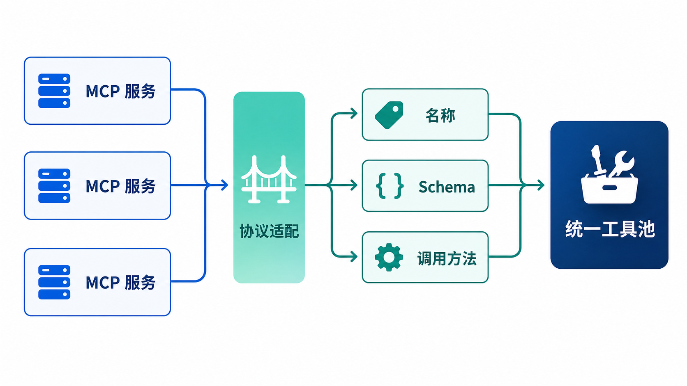
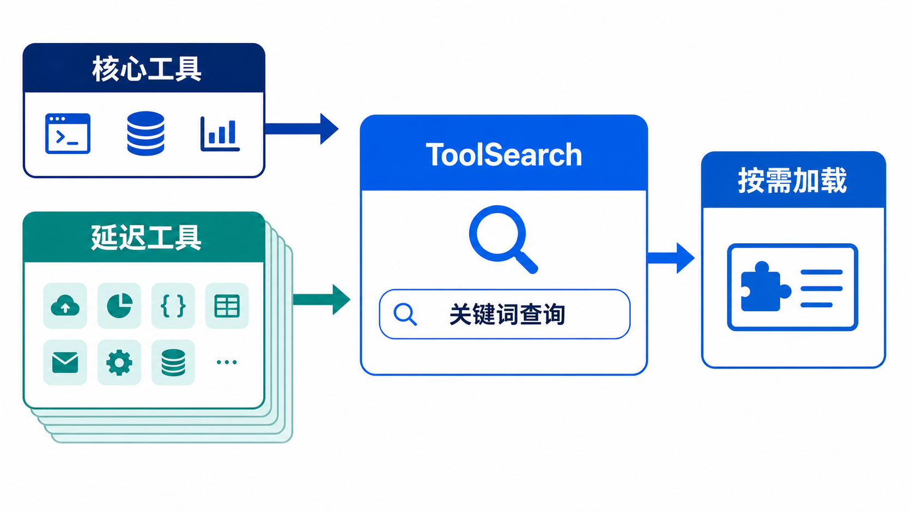
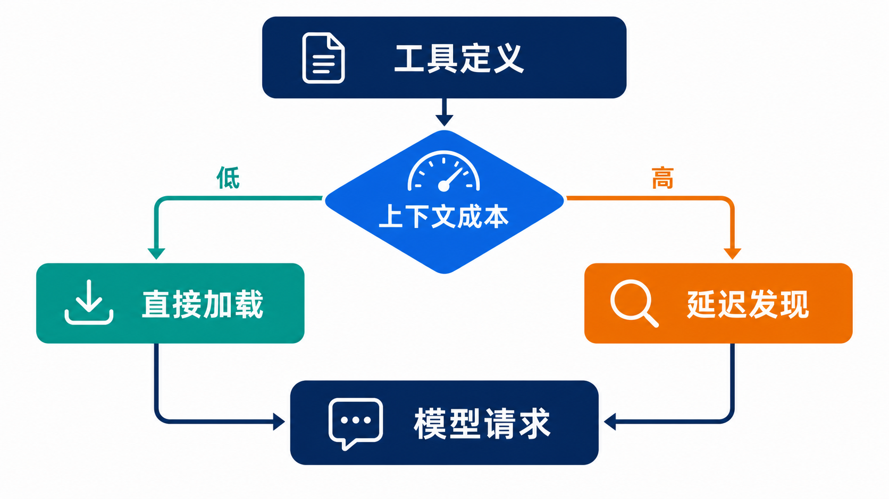
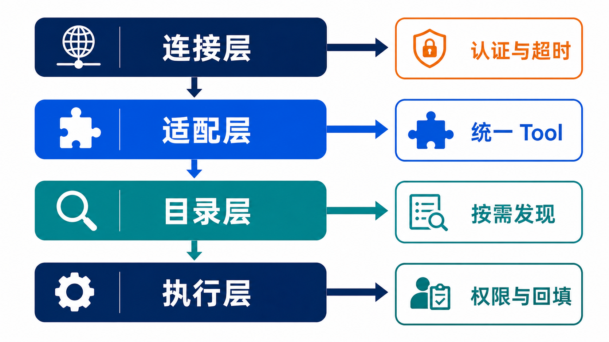

# MCP 和 ToolSearch 如何动态扩展 Agent 能力？

给 Agent 接入工具，最直接的做法是启动时把所有工具定义都塞进请求。

当工具只有十几个，这很省心。接入多个 MCP 服务后，情况会迅速改变：每个服务可能暴露几十个工具，每个工具又带着名称、描述和完整 JSON Schema。用户只想改一行代码，模型却要先阅读一整本“工具电话簿”。

于是动态扩展出现了两个不同问题：

1. MCP 如何把外部服务的能力适配成内部 Tool？
2. 工具数量过多时，ToolSearch 如何让模型按需加载 Schema？

这两个机制经常被混在一起。其实 MCP 解决的是**能力从哪里来**，ToolSearch 解决的是**什么时候让模型看到能力的完整定义**。

## MCP 给 Agent 带来的不是函数，而是远程能力目录

MCP 服务端会通过协议提供工具列表。每个工具可能包括：

- 工具名称与描述；
- 输入 JSON Schema；
- `readOnlyHint`、`destructiveHint` 等注解；
- 服务端自定义元数据；
- 真正执行时使用的远程调用通道。

Claude Code 连接服务端后，先请求 `tools/list`：

```typescript
// 根据恢复源码裁剪
const result = await client.client.request(
  { method: 'tools/list' },
  ListToolsResultSchema,
)

const toolsToProcess =
  recursivelySanitizeUnicode(result.tools)
```

返回值不能直接交给 Agent Loop，因为内部调度器只认识统一的 `Tool` 契约。因此下一步是适配。

这和插件系统很像：外部提供能力描述，宿主负责把它转换成自己的运行时对象，并在权限、并发、取消和结果协议之间做桥接。



## 外部 MCP 工具如何变成内部 Tool？

Claude Code 以通用 `MCPTool` 为底座，再为每个远程工具覆盖名称、Schema、注解和调用逻辑。

```typescript
// 根据恢复源码裁剪
return {
  ...MCPTool,
  name: buildMcpToolName(client.name, tool.name),
  mcpInfo: {
    serverName: client.name,
    toolName: tool.name,
  },
  isMcp: true,

  async prompt() {
    return truncate(tool.description ?? '')
  },
  inputJSONSchema: tool.inputSchema,

  isConcurrencySafe() {
    return tool.annotations?.readOnlyHint ?? false
  },
  isDestructive() {
    return tool.annotations?.destructiveHint ?? false
  },

  async call(args, context, _canUseTool, parent, onProgress) {
    return callRemoteMcpTool(client, tool.name, args, context, onProgress)
  },
}
```

代码经过裁剪，但保留了适配的关键点：

第一，名称被命名空间化。类似 `mcp__server__tool` 的全限定名称可以避免不同服务端工具相撞，也能让权限规则按服务或具体工具匹配。

第二，输入 Schema 走 `inputJSONSchema` 直通，不做多余的 Zod 往返转换。

第三，服务端注解被映射成内部调度语义。没有只读提示时按不可并发处理。

第四，远程调用仍通过内部 Tool 的 `call()` 暴露。这样 Agent Loop 不需要知道调用来自本地函数、子进程还是网络。

这就是适配层的价值：把来源差异封在边界上，中心循环只处理统一契约。

## 动态工具池为什么会挤占上下文？

模型每次请求都要看到可调用工具的定义。工具多时，成本不是只发生一次，而会在每轮 Agent Loop 中反复出现。

一份工具定义的体积大致来自：

```latex
工具名 + 描述 + 输入 Schema
```

MCP 服务尤其容易出现长描述，因为某些服务从 OpenAPI 自动生成工具，把大量接口文档放进 description。Claude Code 会对 MCP 描述做长度上限控制：

```typescript
// 根据恢复源码裁剪
const MAX_MCP_DESCRIPTION_LENGTH = 2048

async prompt() {
  const desc = tool.description ?? ''
  return desc.length > MAX_MCP_DESCRIPTION_LENGTH
    ? desc.slice(0, MAX_MCP_DESCRIPTION_LENGTH) + '… [truncated]'
    : desc
}
```

截断只能控制单个工具的尾部，不能解决几百个工具的总量问题。

更关键的是，工具定义占用的不只是费用，还占用模型注意力。模型需要在大量相似名称中选择，选错工具、混淆字段和生成错误参数的概率也会上升。

因此，动态扩展不能只考虑“怎么把工具加进来”，还要考虑“怎样不让扩展能力淹没任务上下文”。



## ToolSearch 的核心思路是什么？

Claude Code 把一部分工具标记成延迟工具。模型初始知道系统存在这些能力，但完整 Schema 不必全部立即加载。需要时，模型先调用 `ToolSearch` 搜索。

可以把流程理解成：

```latex
初始工具池
  ├─ 核心工具：完整 Schema
  └─ 延迟工具：名称索引 / 延迟标记
                    ↓
              ToolSearch(query)
                    ↓
          返回匹配工具的引用
                    ↓
       后续请求携带具体工具 Schema
```

延迟对象不仅包括 MCP 工具，内部 Tool 也可以通过 `shouldDefer` 加入这套机制；`alwaysLoad` 则允许少数关键 MCP 工具始终首轮可见。

因此它本质上是一个“工具虚拟内存”：常用核心能力驻留，长尾能力按需换入。

## 模型怎样搜索到正确工具？

ToolSearch 接收查询字符串和最大结果数：

```typescript
// 根据恢复源码裁剪
const inputSchema = z.object({
  query: z.string().describe(
    'Use "select:<tool_name>" for direct selection, or keywords to search.',
  ),
  max_results: z.number().optional().default(5),
})
```

源码支持几条路径：

- `select:<tool_name>` 精确选择；
- 查询完整工具名；
- 按 MCP 服务前缀搜索；
- 对工具名、`searchHint` 和描述做关键词打分；
- `+term` 表示必须满足的关键词。

搜索评分大致体现了信息可靠度：

```typescript
// 机制伪代码，不是原样源码
score =
  工具名精确词命中 * 高权重
  + searchHint 命中 * 中高权重
  + 描述词命中 * 较低权重
```

工具名比长描述更稳定，人工提供的短 `searchHint` 比描述全文更有信号，所以权重更高。

搜索结果还会缓存工具描述，并在延迟工具集合变化时清理缓存。因为 MCP 服务可能中途连接或断开，旧缓存不能永远有效。

对自己的 Agent 来说，如果动态工具超过几十个，仅靠向量搜索并不是唯一方案。明确的命名空间、短能力提示和精确选择语法，往往比“全都语义搜索”更可控。



## ToolSearch 什么时候应该启用？

源码里支持三种模式：

```typescript
type ToolSearchMode =
  | 'tst'       // 始终延迟
  | 'tst-auto'  // 超过阈值时延迟
  | 'standard'  // 全部直接加载
```

自动模式会估算延迟工具定义占用的 token，并与模型上下文窗口的一定比例比较。若 token 计数不可用，再退化为字符估算。

```typescript
// 根据恢复源码裁剪
const deferredToolTokens =
  await countToolDefinitionTokens(deferredTools)

if (deferredToolTokens !== null) {
  return deferredToolTokens >= tokenThreshold
}

const chars = await calculateDeferredToolDescriptionChars(...)
return chars >= charThreshold
```

这里的思想比具体阈值更值得迁移：工具搜索不是固定功能开关，而应和当前模型窗口、工具池规模、Schema 体积一起决策。

还要检查模型是否支持工具引用、搜索工具本身是否可用，以及代理网关能否接受相关协议形状。任何一个条件不满足，就回到标准模式。

### 动态发现后，工具怎样进入后续请求？

模型搜索得到工具名还不够，后续请求必须真正携带它的 Schema。

Claude Code 会从消息历史中提取已经发现的工具名，并据此决定哪些延迟 Schema 应该发送。若工具池发生变化，还会记录新增和移除的延迟工具。

这意味着“已发现工具集合”是会话状态的一部分，而不是一次函数调用的局部变量。

如果会话压缩时丢掉发现记录，模型可能记得自己用过某工具，API 请求却没有再带它的 Schema，最终生成无法解析的参数。源码甚至在输入校验失败时检查这种情况，并提示模型先用 ToolSearch 重新加载。

```typescript
// 根据恢复源码裁剪
if (
  tool.shouldDefer &&
  !discoveredToolNames.has(tool.name)
) {
  return `This tool's schema was not sent.
    Call ToolSearch with "select:${tool.name}", then retry.`
}
```

所以动态加载需要完整闭环：

1. 声明哪些工具可延迟；
2. 提供模型可调用的发现工具；
3. 把发现结果写入可恢复历史；
4. 请求编译时加载已发现 Schema；
5. 调用失败时给出可修复提示。

缺少任何一步，动态工具都会变成“偶尔可用”的隐性状态。

### 为什么工具目录变化会破坏会话稳定性？

MCP 连接不是永远静止的。服务可能启动较慢、认证后才出现、运行中断开，或者重新连接后返回一组不同工具。

如果每一轮直接以“当前连接结果”为准重建工具池，模型会遇到几个问题：

- 上一轮存在的工具下一轮突然消失；
- 同名工具的 Schema 中途改变；
- 已发现集合仍引用一个不再可用的工具；
- 新工具已经连接，模型却没有收到目录变化。

Claude Code 会扫描历史中的延迟工具变更记录，计算新增与移除集合。已经从“延迟”变成“直接加载”的工具不应被误报为不可用；真正离开工具池的名称才需要移除。

自己的实现可以给工具目录加单调版本号：

```typescript
// 示例设计，不是 Claude Code 原样源码
type ToolCatalogSnapshot = {
  version: number
  tools: Map<string, ToolDescriptor>
  added: string[]
  removed: string[]
}
```

模型请求、ToolSearch 结果和持久化事件都记录目录版本。执行某个搜索结果前，如果目录版本已经变化，就重新确认该工具仍存在、Schema 指纹仍一致。

这避免“模型按旧目录选择，执行器按新目录解释”的竞态。

### 动态工具怎样做权限最小化？

工具按需加载不等于按需授权。ToolSearch 返回某个 MCP 工具，只是让模型获得调用契约；真正执行仍必须经过本地权限。

一个常见错误是把“用户安装了 MCP 服务”解释成“用户永久允许该服务的所有动作”。安装只表示连接意愿，读数据、写数据、发送消息和删除资源仍应有不同规则。

可以把权限分成三层：

```latex
连接权限：是否允许启动或连接该 MCP 服务
发现权限：哪些工具名称可以出现在目录
执行权限：本次参数是否允许产生副作用
```

隐藏一个工具可以减少误调用，却不能代替执行校验；展示一个工具也不能暗示自动允许。尤其在 SDK 无前缀模式下，外部工具名称可能与内置工具相撞，权限匹配必须使用保留的 `mcpInfo` 和全限定身份，而不是只看展示名。

## MCP 远程调用失败时，边界在哪里？

MCP 是远程能力，额外带来连接、认证、超时和会话失效问题。

Claude Code 的适配器会在调用时重新确保连接有效；遇到特定的会话失效错误，会清理缓存并有限重试。认证错误则向上转换为明确错误，让应用把服务状态标记为需要重新授权。

```typescript
// 根据恢复源码裁剪
for (let attempt = 0; ; attempt++) {
  try {
    const connected = await ensureConnectedClient(client)
    return await callMCPTool(connected, toolName, args, signal)
  } catch (error) {
    if (isSessionExpired(error) && attempt < 1) {
      continue
    }
    throw error
  }
}
```

有限重试很重要。网络失败不应让 Agent 无限自旋；远程工具也不能因为“来自协议”就绕开本地权限和取消信号。

MCP 提供的是互操作标准，不自动提供可信度。服务端的 `readOnlyHint` 是调度提示，真正高风险调用仍需由宿主权限策略裁决。

远程结果也不能不加边界地进入上下文。一个搜索工具可能返回几兆字节，一个服务可能把二进制内容错误塞进文本字段，另一个服务可能在错误对象里带出认证细节。适配层应统一限制结果大小、区分文本与资源引用、清理敏感错误，并把截断事实明确告诉模型。否则工具发现节省下来的上下文，会在第一次调用时被巨型结果全部占满。

```typescript
// 示例设计，不是 Claude Code 原样源码
function normalizeRemoteResult(raw) {
  const safe = removeSecrets(raw)
  const { text, truncated } = limitText(safe, 80_000)

  return {
    content: text,
    metadata: { truncated },
  }
}
```

连接状态则不应只有“成功”和“失败”。桌面 Agent 启动时，多个 MCP 服务可能处于连接中、等待认证、暂时离线或已禁用。工具目录要能表达这些中间态：尚未连接的服务不进入可调用集合；等待认证的服务可以显示恢复入口；暂时失败的服务按退避策略重连，但不能让每轮模型请求都同步等待它。

如果一个服务在会话中途断开，已经展示给模型的工具怎么办？宿主不能默默把调用转给同名的另一服务。更稳妥的处理是保留工具的稳定身份，本次调用返回“能力暂不可用”，并让目录在下一轮更新状态。这样历史中的工具身份、权限记录和审计日志仍指向同一提供方。

**动态能力系统真正要隔离的，不只是协议差异，还有远程服务的不稳定、结果体积和信任边界。**MCP 适配完成，只代表“会说同一种调用语言”，不代表已经满足生产执行条件。



## 自己做动态工具系统，应该怎样分层？

可以拆成四层：

```latex
连接层：发现服务、维护连接、认证与超时
适配层：远程描述 → 内部 Tool 契约
目录层：索引名称、能力提示和延迟工具状态
执行层：权限、调度、调用、结果回填
```

实现顺序建议是：

1. 先统一内部 Tool 契约，让内置与 MCP 工具走同一执行链。
2. 给外部工具加命名空间，避免冲突并支持权限匹配。
3. 统计完整工具定义的 token，而不是只统计工具数量。
4. 达到成本阈值后，再引入延迟加载和 ToolSearch。
5. 把“已发现工具集合”纳入持久化和压缩策略。
6. 为连接失败、认证失败和会话失效设计有限恢复。

如果工具总数只有十几个，先全部加载通常更稳。动态系统有额外轮次和状态复杂度，不应为了架构漂亮过早引入。

还应该为 ToolSearch 本身设置观测指标。至少记录查询词、候选数量、是否精确命中、搜索后是否真的调用、是否因 Schema 未加载而重试。若模型频繁搜索却不用，说明目录提示噪声大；若经常直接调用延迟工具失败，说明发现状态在压缩或恢复中丢失。

搜索质量不要只用“返回了相关名称”衡量。真正有价值的指标是：模型是否用更少工具定义完成任务，以及额外搜索轮次是否低于节省的上下文与错误重试成本。

## 最后：扩展能力，不等于扩大初始提示词

MCP 让 Agent 可以从外部服务获得新的能力，ToolSearch 则让这些能力不必一次性占满模型上下文。

两者组合后的完整含义是：

外部工具先被适配成统一运行时契约，再根据上下文成本按需暴露给模型。

对 Agent 开发者来说，真正值得记住的是三条边界：

- 能力来源和运行时契约分开，Agent Loop 不关心工具来自哪里。
- 工具目录和工具完整 Schema 分开，发现不等于立即加载全部定义。
- 服务端提示和本地安全决策分开，远程注解不能替代宿主权限。

当你的工具池开始增长时，先统计它们真正占用了多少上下文，再决定是否引入动态发现。扩展性的目标不是让模型“知道一切”，而是让它在需要时，能够可靠地找到并加载下一步所需能力。
