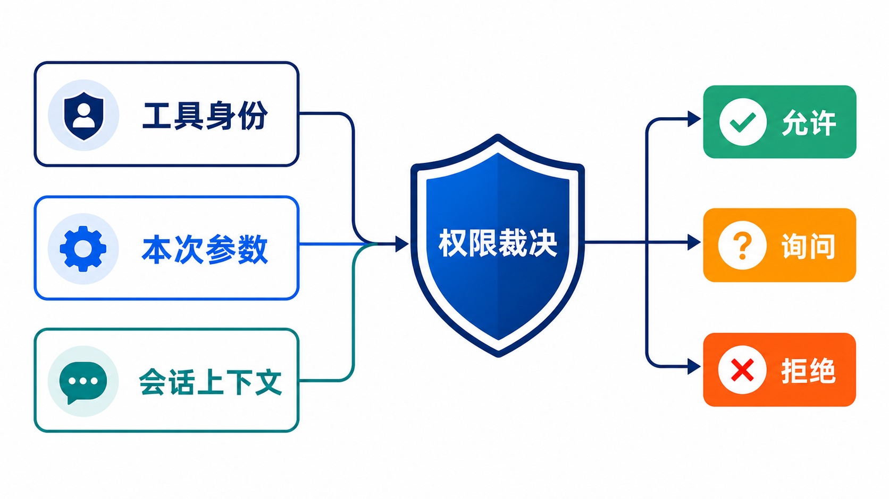
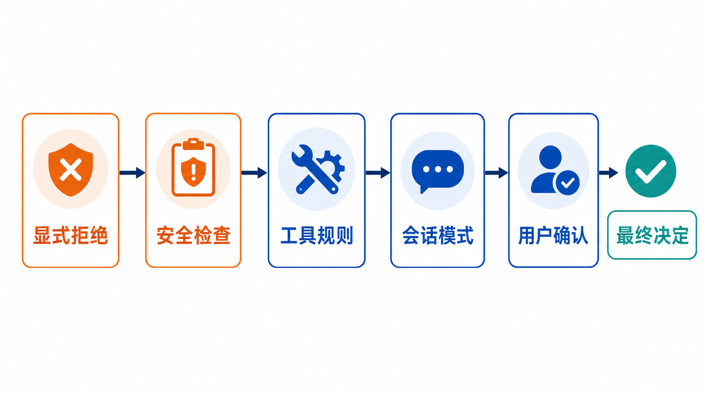
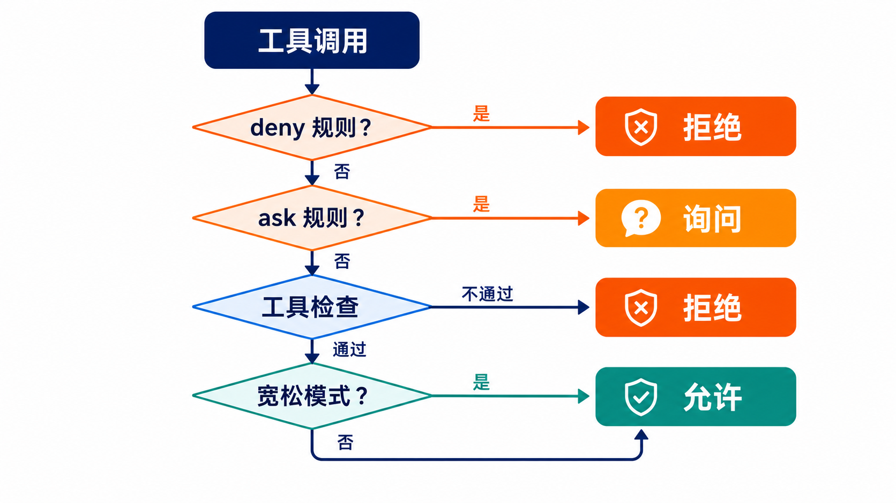
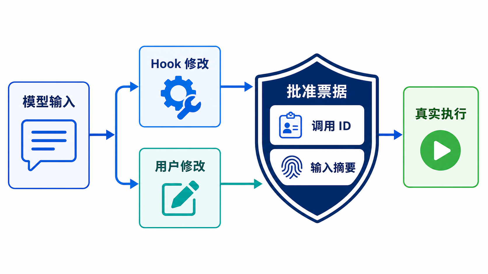

# 一次工具调用要经过哪些权限判断？

很多 Agent 的权限系统只有一个开关：

```typescript
if (autoApprove) {
  await tool.execute(input)
} else {
  await askUser()
}
```

这在演示里很直观，在真实开发工具里却不够用。用户可能允许读取项目文件，但拒绝写入；允许 `git status`，但要求 `git push` 每次确认；允许当前会话执行某个命令，却不希望它永久写入配置。

更麻烦的是，同一个动作还可能同时受到模式、规则、工具自身安全检查、Hooks、沙箱和交互环境影响。它们发生冲突时，谁优先？

Claude Code 的权限实现不是一个弹窗组件，而是一条有明确优先级的裁决管道。理解这条管道，能帮助我们把 Agent 的“自主性”从一个危险开关，变成可组合、可解释的策略。

## 权限判断的输入，不只是工具名

先说结论：**权限判断的最小单位是“工具 + 本次参数 + 会话上下文”，而不是工具名。**

同一个 Bash 工具：

```latex
pwd
git status
npm test
npm publish
rm -rf build
```

风险完全不同。只写一条“允许 Bash”会过宽，只写“拒绝 Bash”又会让 Agent 失去大量正常能力。

Claude Code 的权限规则值包含工具名和可选内容：

```typescript
// 根据恢复源码裁剪
type PermissionRuleValue = {
  toolName: string
  ruleContent?: string
}

type PermissionRule = {
  source: PermissionRuleSource
  ruleBehavior: 'allow' | 'deny' | 'ask'
  ruleValue: PermissionRuleValue
}
```

因此规则既能匹配整个工具，也能表达类似 `Bash(git status:*)` 的内容级限制。MCP 工具还可以按服务器命名空间匹配。

如果你的 Agent 面向代码、数据库或外部消息系统，内容级权限几乎是必需品。因为真正危险的通常不是“使用某工具”，而是“使用它做了什么”。



## 权限结果为什么不是一个布尔值？

Claude Code 把裁决结果分为四种语义：

```typescript
// 根据恢复源码裁剪
type PermissionResult =
  | { behavior: 'allow'; updatedInput?: Input }
  | { behavior: 'deny'; message: string; decisionReason: Reason }
  | { behavior: 'ask'; message: string; suggestions?: Update[] }
  | { behavior: 'passthrough'; message: string }
```

`allow` 和 `deny` 很直观。

`ask` 表示运行时需要获得用户或宿主系统的明确决策。它还可以携带建议规则，例如“只允许这一次”或“把该工具写入项目设置”。

`passthrough` 表示工具自己没有做最终决定，把裁决交给通用权限系统。它不是“默认允许”，也不是“默认拒绝”。

`updatedInput` 也很重要。用户或 Hook 可能批准的是修改后的安全参数，而不是模型最初提交的参数。执行器最终必须使用裁决返回的新输入。

这比布尔值多出来的信息，让系统可以回答：

- 谁做了决定？
- 为什么做出决定？
- 是否需要显示交互？
- 参数是否被用户修正？
- 规则应该保存到哪里？

对需要审计的 Agent，理由和来源与最终结果同样重要。

## 第一层：哪些规则必须先于“自动模式”？

Claude Code 的核心权限函数按顺序检查。最前面的规则属于硬边界，不能轻易被宽松模式绕过。

```typescript
// 根据恢复源码裁剪
async function hasPermissionsToUseToolInner(
  tool,
  input,
  context,
) {
  if (context.abortController.signal.aborted) {
    throw new AbortError()
  }

  const denyRule = getDenyRuleForTool(context, tool)
  if (denyRule) return deny(denyRule)

  const askRule = getAskRuleForTool(context, tool)
  if (askRule && !sandboxCanAutoAllow(input)) {
    return ask(askRule)
  }

  const toolResult =
    await tool.checkPermissions(parsedInput, context)

  if (toolResult.behavior === 'deny') return toolResult
  // 后续再处理模式与通用规则
}
```

顺序体现了安全策略：

1. 整个工具的显式拒绝先检查。
2. 显式 `ask` 规则不能被普通自动批准轻易跳过。
3. 工具自身最了解参数语义，因此要执行工具级检查。
4. 某些安全路径检查即使在绕过模式下也要保留。

如果先检查“自动允许”，后检查 deny 规则，就可能出现宽松模式吞掉用户明确禁令的漏洞。



## 工具自身为什么还需要 `checkPermissions()`？

通用规则引擎只能知道工具名和通用匹配语法，具体工具最清楚输入的真实含义。

文件工具可以检查：

- 路径是否在工作目录；
- 是否触碰 `.git`、编辑器配置或 shell 启动文件；
- 当前模式是否只允许编辑工作区；
- 是否存在专门的路径规则。

Bash 工具可以拆解复合命令，分别判断子命令与重定向。

MCP 工具可以根据服务和具体工具生成权限建议。

所以权限职责可以这样划分：

```latex
通用权限引擎：来源、优先级、模式、持久化
工具权限方法：输入语义、资源范围、危险模式
```

工具方法返回 `passthrough` 时，通用引擎会把它转成 `ask`；返回明确 `deny` 时，中心系统立即尊重。

这避免通用层不断新增工具专属条件，也让插件工具有机会声明自己的风险。

## 模式在权限管道里扮演什么角色？

源码中出现多种权限模式，例如默认、接受编辑、计划、不要询问和绕过权限。

模式不是规则替代品，而是当硬规则没有给出结论后的一种会话级策略。

```typescript
// 根据恢复源码裁剪
const shouldBypass =
  mode === 'bypassPermissions' ||
  (
    mode === 'plan' &&
    isBypassPermissionsModeAvailable
  )

if (shouldBypass) {
  return allow(updatedInput, {
    type: 'mode',
    mode,
  })
}
```

即便是绕过模式，源码前面仍然先处理工具拒绝、内容级 ask 和不可绕过的安全检查。

`dontAsk` 则在管道后段把本来需要询问的动作转成拒绝。这适合不能弹窗或不希望被打断的环境，但不能把 ask 偷偷变成 allow。

非交互 Agent 也类似：如果无法显示权限提示，系统可以先让 PermissionRequest Hook 决策；没人决策时应自动拒绝，而不是假定允许。

这条原则非常通用：

缺少交互能力，应该收紧权限，而不是扩大自主权。

计划模式尤其容易被误解。它不是在提示词里写一句“只做计划”就结束了，因为模型仍可能生成 Edit、Bash 或远程写操作。可靠实现必须把模式变成运行时约束：允许搜索、读取和写计划载体，其他改变环境的动作在权限管道中被拒绝或要求先退出计划模式。

模式切换本身也应视为受控状态变更。谁发起切换、切换前有哪些待执行工具、已获得的临时授权是否继续有效，都要有明确答案。一个安全的默认策略是：模式改变后，尚未执行的权限票据全部失效；下一次工具调用重新用新模式和新输入裁决。

```typescript
// 示例设计，不是 Claude Code 原样源码
function changeMode(session, nextMode) {
  session.permissionMode = nextMode
  session.pendingApprovals.clear()
  session.audit.push({
    event: 'permission_mode_changed',
    mode: nextMode,
  })
}
```

这样可以避免一种竞态：用户在默认模式下批准了命令，随后切到计划模式，而排队中的旧命令仍凭旧批准执行。**模式不是给模型参考的偏好，而是权限计算的一项实时输入。**



## allow、deny、ask 冲突时谁优先？

源码没有把所有规则简单合并成“最后一条生效”，而是通过管道位置表达优先级。

可以压缩成下面的决策顺序：

```latex
请求已取消？         → 终止
显式整工具 deny？    → deny
显式整工具 ask？     → ask
工具级 deny？        → deny
内容级 ask？         → ask
不可绕过安全检查？   → ask
绕过模式？           → allow
整工具 allow？       → allow
工具 passthrough？   → ask
普通工具级结果？     → 使用该结果
```

其中沙箱可以改变部分 Bash `ask` 的处理：当命令确定会在启用的沙箱中执行，并且配置允许沙箱命令自动通过时，系统可以把隔离本身作为风险缓解条件。

但沙箱不是万能允许。显式危险输入、请求绕过沙箱的参数，以及工具自身安全检查仍要单独处理。

自己的 Agent 应该把优先级写成代码和测试，而不是写在文档里让调用方自行理解。权限冲突是安全系统最容易出现解释分歧的地方。

### 权限规则为什么需要记录来源？

Claude Code 的规则来源包括用户设置、项目设置、本地设置、策略设置、CLI 参数和当前会话等。

来源决定两件事：

1. 规则能否修改或删除；
2. 决策在审计里应被解释成配置、临时用户批准还是永久用户批准。

例如策略设置可能由组织管理，应用不应该让用户在 UI 中删除；会话规则只存在内存，不必落盘。

```typescript
// 根据恢复源码裁剪
type PermissionRuleSource =
  | 'userSettings'
  | 'projectSettings'
  | 'localSettings'
  | 'policySettings'
  | 'cliArg'
  | 'session'
```

如果所有规则只放在一个数组里，系统很难回答“为什么允许”和“允许会持续多久”。

对自己的 Agent，至少可以区分：

- 产品策略：不可由会话覆盖；
- 用户永久规则：跨会话；
- 项目规则：只对某工作区；
- 会话授权：退出即失效；
- 单次授权：只对一个 `tool_use_id`。

权限范围越明确，用户越敢给 Agent 更多自主权。

### PreToolUse Hook 允许了，就一定能执行吗？

不能。Claude Code 明确保留了一个不变量：Hook 的 `allow` 可以跳过普通交互，但不能绕过 `settings.json` 中的 deny / ask 规则。

```typescript
// 根据恢复源码裁剪
if (hookResult?.behavior === 'allow') {
  const hookInput = hookResult.updatedInput ?? input
  const ruleCheck =
    await checkRuleBasedPermissions(tool, hookInput, context)

  if (ruleCheck === null) {
    return hookResult
  }
  if (ruleCheck.behavior === 'deny') {
    return ruleCheck
  }

  // ask 规则仍然进入用户确认
  return canUseTool(tool, hookInput, context)
}
```

这避免一个自动化 Hook 意外获得比用户显式规则更高的权限。

反过来，Hook 的 deny 可以直接阻止工具。因为在安全组合中，多个守卫通常采用“任一拒绝即可阻止”，而不是“任一允许即可放行”。

这种非对称性很常见：允许需要满足所有必要条件，拒绝只需命中一个硬边界。

### 沙箱在权限系统里究竟是什么角色？

沙箱经常被误解为另一种权限模式。实际上它更像执行条件：同一条命令在隔离环境中运行，风险可能降低，但用户和组织的显式禁令仍然存在。

源码对整工具 ask 规则有一个窄例外：仅当 Bash 确定会使用已启用沙箱，并且配置明确允许“沙箱内自动通过”时，才暂时跳过整工具 ask，让 Bash 自己继续判断命令级规则。

这条路径包含三个同时成立的条件：

```latex
工具确实是 Bash
沙箱功能已启用
本次输入不会绕过沙箱
```

任何一个条件不满足，就回到 ask。

这说明风险缓解措施不该变成全局通行证。网络隔离可以降低数据外传风险，却不能阻止删除工作区；只读文件系统可以限制写入，却不能阻止读取敏感信息。权限系统应根据具体威胁，判断沙箱缓解了哪一部分风险。

自己的 Agent 可以让工具权限结果携带所需执行约束：

```typescript
// 示例设计，不是 Claude Code 原样源码
return {
  behavior: 'allow',
  constraints: {
    sandbox: 'required',
    network: 'deny',
    writableRoots: ['/workspace/tmp'],
  },
}
```

执行器必须验证约束已经兑现，再调用工具。否则权限层批准的是“沙箱内动作”，执行层却可能在宿主环境运行。

### 权限缓存怎样避免“批准 A，执行 B”？

为了减少反复询问，Agent 往往会缓存用户批准。缓存键如果只有工具名，就会把一次安全调用扩展成整个工具永久授权。

更稳妥的缓存至少包含：

- 工具的规范身份；
- 规范化后的输入或规则前缀；
- 权限模式；
- 工作目录与资源范围；
- 授权来源和有效期。

对单次批准，直接绑定 `tool_use_id` 最清楚。对会话规则，可保存经过解析的规则值；对永久规则，再明确写入用户或项目设置。

输入在 Hook 或用户界面里修改后，旧批准不应继续命中。可以对最终规范化输入计算摘要，在执行前核对批准票据中的摘要。这样即使异步流程发生竞态，工具也不会拿着 A 的票据执行 B。

权限缓存还要考虑撤销。用户删除一条规则后，内存中的派生缓存必须失效；组织策略更新时，低优先级会话批准也不能继续存活。

## 用户批准之后，为什么还可能修改输入？

权限弹窗不一定只有“允许 / 拒绝”。用户可能修改命令、移除危险参数、把目标路径改到工作区内，或附加反馈。

执行链拿到最终决定后，会更新 `processedInput`：

```typescript
// 根据恢复源码裁剪
if (permissionDecision.updatedInput !== undefined) {
  processedInput = permissionDecision.updatedInput
}

const result = await tool.call(
  processedInput,
  runtimeContext,
  canUseTool,
  assistantMessage,
  onProgress,
)
```

这里要防止一个常见漏洞：权限系统检查的是 A，最终工具执行的却还是模型原始输入 B。

因此授权结果应该像一个“已批准的执行票据”，同时绑定：

- 工具身份；
- 规范化后的输入；
- 调用 ID；
- 决策来源；
- 有效范围与时间。

如果审批和执行之间允许参数再次变化，就必须重新校验。



## 自己实现 Agent，权限系统最少需要什么？

一个可用的最小模型可以有四层：

```typescript
// 示例设计，不是 Claude Code 原样源码
async function authorize(call, ctx): Promise<Decision> {
  assertNotAborted(ctx.signal)

  const hard = matchHardRules(call, ctx)
  if (hard) return hard

  const semantic = await call.tool.checkPermission(
    call.input,
    ctx,
  )
  if (semantic === 'deny') return deny('tool-policy')

  const mode = applySessionMode(semantic, ctx.mode)
  if (mode !== 'ask') return mode

  if (!ctx.canPrompt) return deny('no-interactive-channel')
  return promptUser(call)
}
```

同时保留以下不变量：

1. 输入先解析，再进行权限判断。
2. deny 和不可绕过安全规则早于宽松模式。
3. 无交互环境中的 ask 默认转 deny。
4. 执行使用批准后的输入。
5. 每个决定都记录来源和理由。
6. 永久、项目、会话和单次授权分开存储。

测试时，不要只测单条规则，要测冲突矩阵：deny + allow、ask + bypass、Hook allow + 配置 deny、无交互 + ask、参数被修改后再执行。

再补两类故障测试。第一类让工具的 `checkPermissions()` 抛异常，确认系统不会因为检查器失效而自动允许。第二类让用户批准、取消信号和自动 Hook 几乎同时完成，确认只有一个决定能够进入执行器。

审计日志也要避免泄露。命令、路径和 MCP 参数可能包含密钥或业务数据，记录决定来源与规则摘要通常足够；若确实需要完整输入，应由明确开关控制，并进入受保护的日志通道。

还可以增加性质测试：无论普通规则以什么顺序出现，显式 deny 都不能被 allow 覆盖；输入只要发生变化，旧批准就不能继续使用；缺少交互通道时，ask 永远不会意外变成 allow。与其试图记住所有分支，不如把权限不变量交给自动生成的组合用例反复验证。

## 最后：权限不是弹窗，而是动作编译器

一次工具调用从模型输出到真实执行，中间需要把不完全可信的意图编译成一个已批准动作。

Claude Code 的权限管道先处理显式拒绝和工具安全检查，再处理模式、允许规则、自动分类与用户交互；最后把决定和最终输入交给执行器。

这套设计的核心不是“问得多”，而是让每次副作用都能回答：

谁允许了什么动作，在什么范围内，基于什么理由，最终执行的参数是什么？

当你的 Agent 只需要读取公开数据，一个简单开关或许足够；当它能改文件、执行命令、调用外部系统，权限就必须成为运行时的一等模块。

真正成熟的自主 Agent，不是永远不询问，而是能够在明确边界内自动行动，在边界之外可靠停下。
