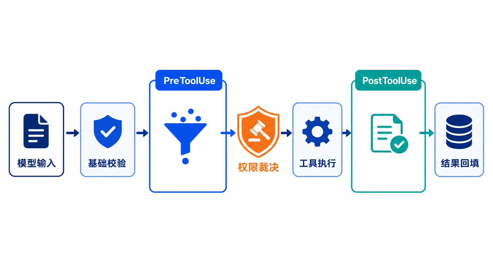
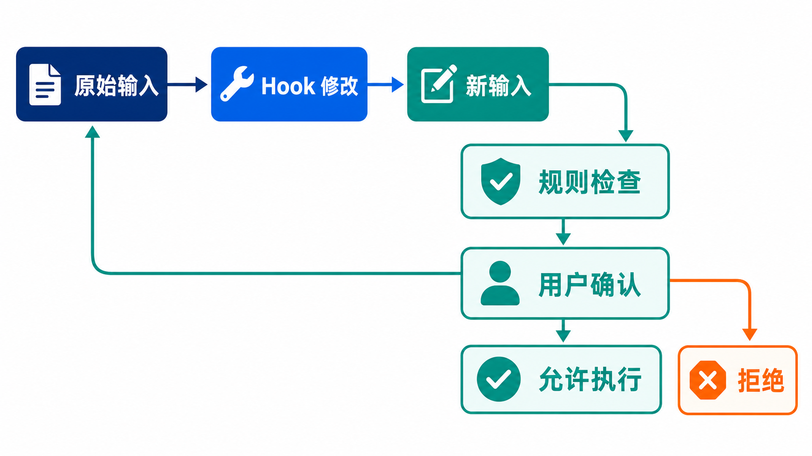
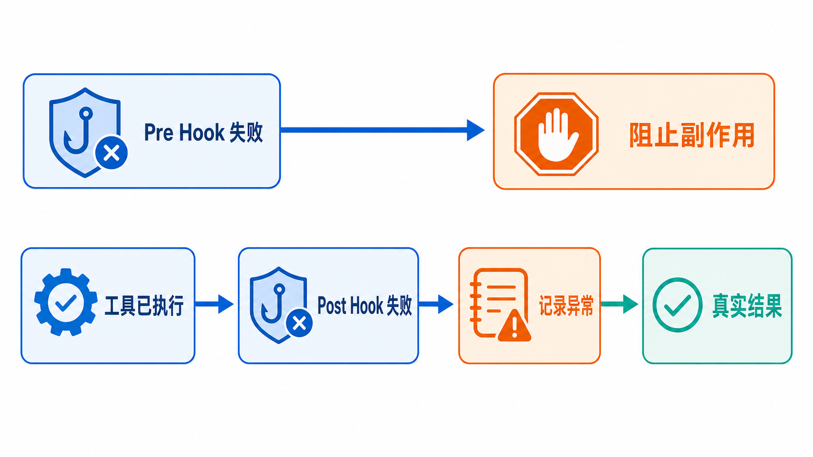
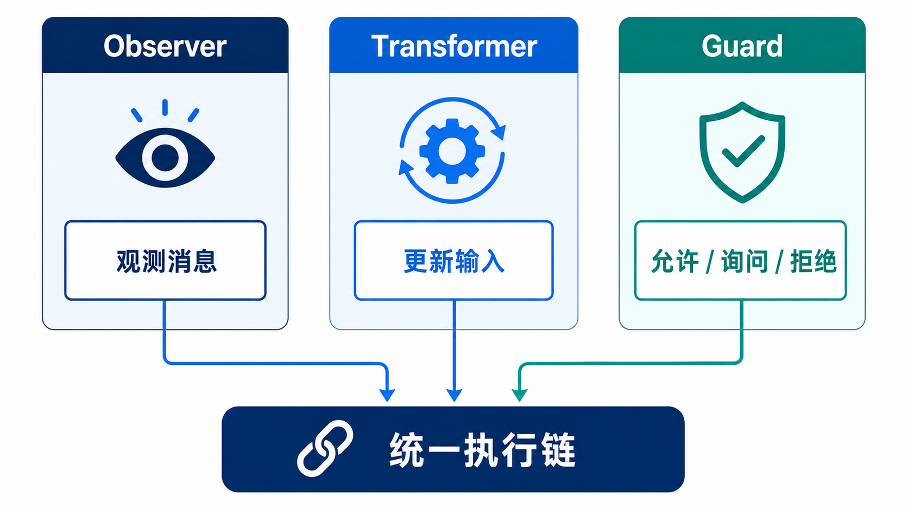

# PreToolUse 和 PostToolUse Hooks 如何介入执行链？

当 Agent 工具越来越多，团队很快会提出一些横切需求：

- 每次写文件前运行安全检查；
- 执行命令前补充环境变量；
- 工具完成后记录审计日志；
- MCP 返回后脱敏或补充上下文；
- 某条组织策略命中时阻止后续执行。

最直接的实现，是修改每个工具的 `call()`。但这样规则会散落在几十个实现里，升级工具时容易漏掉，第三方 MCP 工具更无法逐个修改。

Hooks 提供了另一条路径：在统一工具执行链的关键节点插入外部逻辑。

不过，Hooks 一旦能修改输入、改变权限、阻止执行甚至重写输出，就不再只是“回调”。它已经成为 Agent Runtime 的可编程策略层。设计不好时，它也会成为最隐蔽的控制流来源。

## Hook 应该插在哪里，才不破坏工具契约？

先看一次工具调用的主链：

```latex
解析模型输入
   ↓
Schema 校验
   ↓
工具语义校验
   ↓
PreToolUse Hooks
   ↓
权限裁决
   ↓
工具执行
   ↓
结果协议映射
   ↓
PostToolUse Hooks
   ↓
回填 tool_result
```

Claude Code 把 PreToolUse 放在基础输入校验之后、最终权限裁决之前。

这样做有两个好处：

第一，Hook 看到的至少是结构可解析、通过工具基础语义校验的调用，不必处理完全任意的脏数据。

第二，Hook 可以修改输入或提出权限决定，而最终权限层仍有机会应用用户规则和硬安全边界。

PostToolUse 则发生在工具执行完成后。它能观察结果、附加消息，并对 MCP 输出做有限修改。

节点顺序就是安全语义，不能只把 Hook 当成随便放在哪都行的事件监听器。



## PreToolUse 能返回哪些东西？

恢复源码中的 `runPreToolUseHooks()` 会把底层 Hook 结果转换成一组明确事件。

经过裁剪后，可以概括为：

```typescript
// 根据恢复源码裁剪
type PreHookEvent =
  | { type: 'message'; message: Message }
  | { type: 'hookPermissionResult'; result: PermissionResult }
  | { type: 'hookUpdatedInput'; input: Record<string, unknown> }
  | { type: 'additionalContext'; message: Message }
  | { type: 'preventContinuation'; value: true }
  | { type: 'stopReason'; reason: string }
  | { type: 'stop' }
```

这说明 PreToolUse 不只有“允许或拒绝”：

- 可以发送进度或附件消息；
- 可以把输入改成更安全的版本；
- 可以给权限系统一个 allow / ask / deny 建议；
- 可以向下一轮模型补充上下文；
- 可以立即停止当前工具；
- 还可以让工具执行完成，但阻止 Agent 继续推进。

最后两种语义尤其容易混淆。

“停止当前工具”意味着副作用不应发生；“阻止后续推进”可以表示当前工具已经成功执行，但系统不希望 Agent 继续自动行动。实现时最好使用不同状态，而不是都叫 `blocked`。

## Hook 修改输入后，为什么还要重新走权限？

假设模型请求：

```json
{ "command": "npm test" }
```

PreToolUse Hook 把它改成：

```json
{ "command": "npm test -- --runInBand" }
```

修改后的命令才是真正要执行的动作，所以权限检查必须针对新输入。

Claude Code 在 Hook 只返回 `updatedInput`、没有做权限决定时，会把新输入交给正常权限流：

```typescript
// 根据恢复源码裁剪
if (
  result.updatedInput &&
  result.permissionBehavior === undefined
) {
  yield {
    type: 'hookUpdatedInput',
    updatedInput: result.updatedInput,
  }
}
```

执行器随后更新 `processedInput`，再调用统一裁决。

如果 Hook 同时返回 allow，系统也不会无条件执行。源码专门通过 `resolveHookPermissionDecision()` 保证显式 deny / ask 规则仍然生效。

```typescript
// 根据恢复源码裁剪
if (hookResult?.behavior === 'allow') {
  const hookInput = hookResult.updatedInput ?? input
  const ruleCheck =
    await checkRuleBasedPermissions(tool, hookInput, context)

  if (ruleCheck === null) {
    return { decision: hookResult, input: hookInput }
  }
  if (ruleCheck.behavior === 'deny') {
    return { decision: ruleCheck, input: hookInput }
  }
  return askUserAbout(hookInput)
}
```

这条不变量很关键：**Hook 可以缩短普通审批路径，但不能拥有比硬规则更高的权限。**



## 多个 PreToolUse Hook 冲突时怎么办？

源码会迭代执行 Hook 结果，并把消息、输入修改、权限结果和停止状态逐步收集。

多 Hook 系统必须预先定义合并规则，否则结果会依赖偶然执行顺序。

一个可解释的合并策略通常是：

```latex
deny / stop        优先级最高
ask                高于 allow
updatedInput       按明确顺序串联
additionalContext  可以累积
观测消息           可以累积
```

如果两个 Hook 都修改同一个字段，应该明确是：

- 后一个基于前一个输出继续修改；
- 检测冲突并失败；
- 或者只允许一个“输入变换”Hook。

不要默默地做对象浅合并。路径、命令和权限字段被局部覆盖后，可能产生两边都没审批过的新动作。

Claude Code 的执行链还会记录 Hook 的来源和决定理由，便于之后解释为什么一个工具被允许或拒绝。自己的系统也应把 Hook 名称、输入摘要、耗时和结果写入审计事件。

## Hook 出错时，是放行还是阻止？

这是一个需要按 Hook 类型决定的问题。

审计日志 Hook 失败，可能不应该阻断用户任务；安全策略 Hook 失败，如果继续执行，就等于安全层失效。

Claude Code 的 PreToolUse 包装器捕获处理异常后，会产出 Hook 错误消息并停止工具路径：

```typescript
// 根据恢复源码裁剪
try {
  for await (const result of executePreToolHooks(...)) {
    // 转换并产出 Hook 结果
  }
} catch (error) {
  logError(error)
  yield {
    type: 'message',
    message: hookExecutionError(error),
  }
  yield { type: 'stop' }
}
```

这属于 fail closed：执行前的策略层失效，不继续产生副作用。

PostToolUse 不同。工具副作用已经发生，Hook 再报错也无法假装工具没执行。源码会记录错误附件，但不会简单回滚工具结果。

所以 Hook 注册时最好声明失败策略：

```typescript
// 示例设计，不是 Claude Code 原样源码
type HookPolicy = {
  phase: 'pre' | 'post'
  onError: 'block' | 'continue' | 'mark-uncertain'
  timeoutMs: number
}
```

安全 Hook 默认 `block`，观测 Hook 可以 `continue`，外部事务确认 Hook 可能需要 `mark-uncertain`。



## PostToolUse 能修改工具结果吗？

PostToolUse 最常见的用途是观测：记录耗时、保存审计、添加额外上下文。

Claude Code 还允许 MCP 工具的 PostToolUse Hook 返回 `updatedMCPToolOutput`：

```typescript
// 根据恢复源码裁剪
for await (const result of executePostToolHooks(...)) {
  if (
    result.updatedMCPToolOutput &&
    isMcpTool(tool)
  ) {
    toolOutput = result.updatedMCPToolOutput
    yield { updatedMCPToolOutput: toolOutput }
  }

  if (result.additionalContexts?.length) {
    yield additionalContextMessage(result.additionalContexts)
  }
}
```

随后执行器再把更新后的 MCP 输出映射成 `tool_result`。

这种能力适合：

- 统一脱敏远程返回内容；
- 把结构化对象裁剪成模型需要的字段；
- 补充组织内部标记；
- 修正外部服务不规范的返回形状。

但它也改变了模型看到的事实。系统必须区分“原始工具输出”和“模型可见输出”，审计日志至少保留变换来源和摘要。

对内置本地工具，源码先加入预映射结果，再运行普通 PostToolUse Hook；MCP 路径则为了支持输出更新，在 Hook 后再加入最终结果。这说明能够重写结果的 Hook 会影响流水线位置，不能用一个无差别回调概括。

### 为什么还需要 PostToolUseFailure？

工具失败时，普通 PostToolUse 往往拿不到正常输出，但失败同样需要横切处理：

- 清理临时资源；
- 记录错误分类；
- 发送告警；
- 根据错误提示后续恢复；
- 区分真实失败与用户中断。

Claude Code 因此有单独的失败 Hook 路径：

```typescript
// 根据恢复源码裁剪
for await (const hookResult of runPostToolUseFailureHooks(
  context,
  tool,
  toolUseID,
  processedInput,
  errorContent,
  isInterrupt,
)) {
  hookMessages.push(hookResult)
}

return [
  errorToolResult(toolUseID, errorContent),
  ...hookMessages,
]
```

失败 Hook 的消息不会替代原始错误结果，而是附加在后面。这样 `tool_use` 仍然有明确的错误结算，Hook 只是补充处理。

将成功和失败拆开，比让一个 Post Hook 接收大量可空字段更清晰，也方便为失败路径设置不同超时与权限。

### Hook 并发执行还是串行执行？

不同 Hook 之间是否并发，是一个不能只看性能的问题。

纯观测 Hook 通常可以并行，例如一个写审计日志、一个上报指标。它们不修改输入，也不决定权限，互相没有依赖。

输入变换 Hook 和策略 Hook 则更适合有序执行。后一个 Hook 是否应该看到前一个修改后的参数，必须明确。如果两者并行后再合并对象，很可能产生任何一方都没有单独审批过的组合输入。

可以按能力把 Hook 分成三类：

```latex
Observer：只读观察，可并行
Transformer：修改输入或输出，按顺序
Guard：允许、询问或拒绝，采用保守合并
```

Claude Code 在用户可见的耗时摘要中使用墙钟时间，而不是简单相加各 Hook 耗时，因为底层 Hook 可能并行运行。这提醒我们，监控指标也要反映真实调度方式。

实现时可以为每个阶段先并行跑 Observer，再串行跑 Transformer，最后汇总 Guard。更简单的第一版则全部串行，换取确定性；只有测量到 Hook 明显拖慢工具启动后，再放开纯观测任务。

### Hook 超时后，外部进程真的停了吗？

Hook 常由 shell 命令、HTTP 服务或另一个 Agent 实现。上层 Promise 超时，并不代表底层工作已经停止。

因此 Hook 执行器需要把同一个 `AbortSignal` 继续传给子进程和网络请求，并在超时后等待有限清理。否则 Pre Hook 已经被判失败，后台检查进程却继续占用资源；更危险的是，它晚到的批准结果可能错误地命中下一次请求。

每次 Hook 执行应携带独立 ID，返回结果必须核对该 ID 和工具调用 ID。超时、取消或阶段结束后，迟到结果只能记录，不能再修改当前决策。

对执行前安全 Hook，超时应视为未通过；对执行后日志 Hook，可以标记投递失败并异步重试。但异步重试不得再次把上下文注入已经结束的 Agent 轮次。

## Hook 的额外上下文怎样进入 Agent？

Hook 可以产生 `additionalContext`，执行器把它包装成附件消息加入会话。

这相当于策略层向模型说：“除了工具结果，还要注意这条环境信息。”

例如文件写入后，Hook 可以告诉模型格式化器改动了哪些文件；安全检查可以说明为什么某个动作被阻止；外部系统可以补充审批票据状态。

但是额外上下文也会持续占用 token。不要把完整审计日志、长命令输出或重复政策文本每次都注入模型。

可以采用三档：

| 信息 | 处理方式 |
| --- | --- |
| 影响下一步决策 | 注入模型上下文 |
| 只供用户观察 | UI / 日志消息 |
| 只供审计 | 外部存储，不进提示词 |

Hooks 的强大之处是能访问三条通道，但也必须避免把它们混为一谈。

额外上下文还需要来源标记和长度预算。模型应知道这段信息来自组织策略、格式化器还是远程系统，避免把它误解成用户原话。长度超限时，优先保留影响决策的摘要，把完整内容存到外部审计记录。

如果 Hook 能返回图片或结构化块，也要在协议层验证允许的媒体数量和内容类型。扩展点不应成为绕过普通消息规范化的入口。



## 自己实现 Hook 系统，最少要有哪些约束？

可以先建立一个明确的 Hook 协议：

```typescript
// 示例设计，不是 Claude Code 原样源码
type PreToolHookResult =
  | { action: 'continue'; input?: unknown; context?: string[] }
  | { action: 'ask'; reason: string; input?: unknown }
  | { action: 'deny'; reason: string }
  | { action: 'stop'; reason: string }

type PostToolHookResult = {
  visibleOutput?: unknown
  context?: string[]
  stopContinuation?: boolean
}
```

同时守住六条规则：

1. Pre Hook 在结构校验之后运行。
2. 输入被修改后，重新做语义和权限检查。
3. Hook allow 不能覆盖硬 deny / ask。
4. Pre Hook 安全失败默认阻止执行。
5. Post Hook 失败不能抹掉已经发生的工具结果。
6. 每个 Hook 有超时、取消信号、来源和审计记录。

还要写组合测试，而不只是单 Hook 测试：A 修改输入、B 拒绝；A 允许、配置 deny；工具成功、Post Hook 报错；用户取消时 Hook 是否收到同一信号。

测试还应覆盖“迟到结果”：Hook 超时后才返回 allow，系统不能恢复执行；Post Hook 在会话已经进入下一轮后才返回附加上下文，也不能把消息插入错误位置。

为方便排查，可以给一次工具生命周期生成关联 ID，把 Pre Hook、权限决定、工具执行、Post Hook 和最终 `tool_result` 串在同一条时间线上。这样慢在哪里、谁修改了输入、哪个 Guard 最终拒绝，都能从一条记录看清楚。

还应限制 Hook 的能力范围。只需要观察的 Hook 不应获得修改输入权限，只负责改写参数的 Hook 不应直接决定 allow。可以把 Hook 注册成 `observer`、`transformer`、`guard` 三种角色，运行时只接受该角色允许的返回字段。**最小能力原则同样适用于扩展点。**

当 Hook 来自项目配置时，信任级别还要低于用户级和组织级 Hook。项目文件可能来自刚克隆的仓库，不能因为进入工作区就自动获得执行外部程序、读取环境机密或覆盖硬安全规则的能力。

## 最后：Hook 是策略切面，不是隐藏插件

PreToolUse 和 PostToolUse 的价值，是让安全、合规、观测和环境适配不必侵入每个工具实现。

但它们必须被放在清晰的执行链上：

PreToolUse 可以变换提议、补充上下文或提出裁决；最终权限系统仍守住硬边界。PostToolUse 观察已经发生的事实，必要时变换模型可见输出，但不能篡改历史事实。

如果 Hook 能任意修改输入、绕过权限、吞掉错误，却没有来源、顺序和失败策略，它就会变成不可调试的第二套 Agent Runtime。

所以真正成熟的 Hook 系统，不以“能插多少回调”为目标，而以“每个扩展点的能力和边界都能被解释”为目标。

当你准备给 Agent 增加第一个 Hook 时，先写清楚三个问题：它运行在哪个阶段？它失败时是否允许副作用继续？它修改的内容之后由谁重新验证？答案清楚了，扩展性才不会以可控性为代价。
